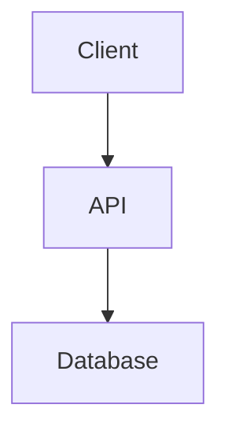

# Personal Blog

A bilingual personal blog built with Hugo and the Congo theme. It publishes English and Portuguese articles about software engineering, distributed systems, cloud, Linux, and web technologies.

## Technology

- Hugo Extended 0.158.0
- Congo 2.14.0, resolved through Go modules
- Markdown content with Hugo taxonomies
- GitHub Pages deployment through GitHub Actions
- Open Sans and Source Code Pro self-hosted in `static/fonts/`

The build does not use Node.js, npm, or a JavaScript build toolchain.

## Local development

Install Hugo Extended 0.158.0 and Go 1.24 or newer, then run:

```sh
hugo mod get
hugo server
```

Open the local address printed by Hugo. The development server reloads when content or configuration changes.

To create a new article, add an `index.md` page bundle under `content/articles/<slug>/` for English or `content/pt/articles/<slug>/` for Portuguese. Include front matter for the title, description, date, and tags. Put article-specific images alongside the Markdown file; Congo detects a file named `cover.*` as the article cover.

## Mermaid diagrams

Write Mermaid source directly in a fenced Markdown code block:

````markdown

````

The site converts fenced Mermaid blocks to diagrams and loads the version bundled with the pinned Congo theme only on pages containing Mermaid diagrams.

## Theme configuration

Site-wide settings are in `hugo.toml` and `config/_default/`. English and Portuguese language settings and navigation are kept in their respective language configuration files. Small CSS adjustments, including fonts, code blocks, focus indicators, and Mermaid overflow, live in `assets/css/custom.css`; theme files are not modified.

To update Congo, change its pinned version in `go.mod`, resolve the module, and validate the production build:

```sh
go get github.com/jpanther/congo/v2@<version>
hugo mod get
hugo --gc --minify --environment production
```

## Production build

```sh
hugo --gc --minify --environment production
```

The generated site is written to `public/`.

## GitHub Pages deployment

Pushing to `main` runs `.github/workflows/deploy.yml`. The workflow installs the pinned Hugo Extended release, resolves the pinned Congo module, builds the site, uploads the Pages artifact, and deploys it using GitHub's Pages Actions. The repository's Pages source should be set to **GitHub Actions**.
