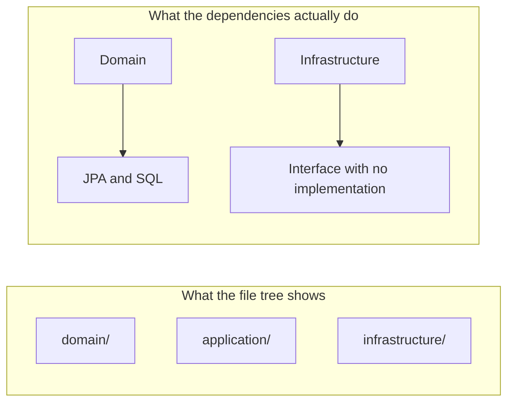
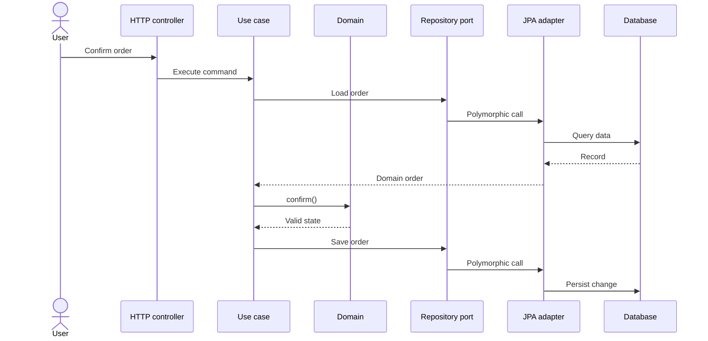
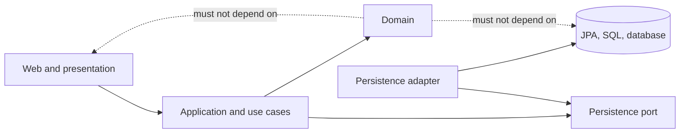
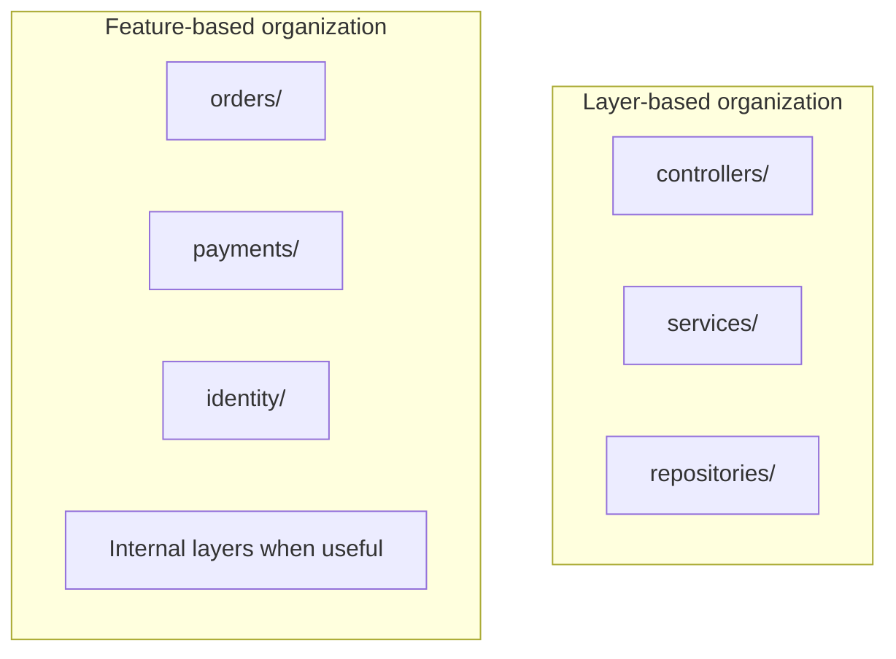

In software design and architecture, I keep seeing a recurring mistake: assuming that creating and naming folders, packages, or modules is the same as implementing an architecture correctly.

Create `domain`, `application`, `infrastructure`, `services`, and `repositories`… and now we have Clean Architecture. Right?

Not necessarily.

> **A layer or pattern is not defined by its name. It is defined by the responsibility the code implements, and the dependencies it respects.**

Names help people navigate and communicate. But they are a promise, not a guarantee. Real architecture lies in what components do, what they know about, and which changes they can absorb without dragging the rest of the system along.

## A folder tree is not a dependency map

A directory structure shows where files were placed. By itself, it does not show:

- Who calls whom at runtime.
- Which modules import or depend on others.
- Which way source-code dependencies point.
- Where business rules are enforced.
- Which boundaries are enforced by the compiler or build process.

You can have a package called `domain` that imports JPA classes, knows about tables, and executes SQL. And you can have a package called `infrastructure` that contains only an interface and no technical implementation. The names do not fix those responsibilities.



The tree is a clue. The dependency direction and the behavior of the code are what matter.

## What does layered architecture mean in practice?

A layered architecture separates responsibilities that change for different reasons. A common division might include:

- **Presentation**: receives external interactions, HTTP, a graphical interface, CLI, or messages, and translates inputs and outputs.
- **Application**: coordinates use cases, controls the sequence of operations, and defines the transaction boundary.
- **Domain**: represents business concepts and protects the system’s rules and invariants.
- **Infrastructure**: connects the system to external technologies such as databases, queues, third-party services, files, and frameworks.

This is not a universal taxonomy. Some architectures combine or split layers; others use names such as *ports and adapters*, Hexagonal Architecture, or Clean Architecture. Names and conventions vary. The relevant principle is that each part has an understandable responsibility and coupling between them is deliberate.

### Runtime flow is not the same as dependency direction

This distinction is subtle and important.

While a use case runs, a request may travel along the path below: it reaches the controller, passes through the application service, changes the domain, and eventually reaches a database through an adapter.



But runtime call flow does not determine compile-time dependencies. In the dependency direction of Hexagonal or Clean Architecture, the core should not need to know about outer technology. The persistence adapter knows the port; the port does not need to know about JPA.



A call can enter the adapter and return to the use case while business code still avoids importing the concrete implementation. That is the difference between a nice-looking diagram and a real dependency boundary.

## “Service” is a name; what kind of service is it?

In Java, we can name a class `UserService`, `OrderService`, or `PaymentService`. The compiler does not check whether it is actually an application service, a domain service, a facade for an external API, or just a large class where everything ended up.

The name `service` is especially ambiguous:

- An **application service** coordinates a use case: it loads what is needed, invokes the domain, and requests persistence.
- A **domain service** represents a business operation that does not naturally belong to one entity or value object.
- An **external service adapter** translates the application’s interface into a call to a vendor, API, or external system.

Mixing these functions in a class with a generic name produces the familiar service that validates rules, opens transactions, builds queries, sends email, serializes responses, and manages retries. It may still be called `OrderService`, but its name neither reduces its responsibilities nor its coupling.

## “Repository” can also be just a label

A repository should give application or domain code a way to retrieve and save domain objects without exposing persistence details.

For example, the interface can express what a use case needs:

```java
public interface OrderRepository {
    Optional<Order> findById(OrderId id);
    void save(Order order);
}
```

The concrete implementation can use Spring Data, JPA, handwritten SQL, or another technology:

```java
@Repository
final class JpaOrderRepositoryAdapter implements OrderRepository {
    private final SpringDataOrderRepository database;
    private final OrderMapper mapper;

    @Override
    public Optional<Order> findById(OrderId id) {
        return database.findById(id).map(mapper::toDomain);
    }

    @Override
    public void save(Order order) {
        database.save(mapper.toRecord(order));
    }
}
```

The important detail is not the interface’s name or the existence of a class called `Repository`. It is that business flow depends on a useful abstraction instead of being tied to `JpaRepository`, `EntityManager`, or a specific SQL query.

Where should the interface live? It depends on the design. In some systems it makes sense to define it alongside the domain; in others, alongside the use case that needs it. What matters is who owns the contract and which way the dependencies point, not copying a folder rule by imitation.

## A small use case with visible responsibilities

Consider confirming an order. The controller translates the HTTP request, the use case coordinates the operation, and the domain decides whether the transition is allowed.

```java
public final class ConfirmOrder {
    private final OrderRepository orders;

    public ConfirmOrder(OrderRepository orders) {
        this.orders = orders;
    }

    public void execute(OrderId id) {
        Order order = orders.findById(id)
            .orElseThrow(() -> new OrderNotFound(id));
        order.confirm();
        orders.save(order);
    }
}
```

The rule that only a draft order with line items can be confirmed belongs to the domain:

```java
public final class Order {
    private final OrderId id;
    private final List<OrderLine> lines;
    private OrderStatus status;

    public void confirm() {
        if (lines.isEmpty()) {
            throw new EmptyOrderCannotBeConfirmed();
        }
        if (status != OrderStatus.DRAFT) {
            throw new OrderCannotBeConfirmedInCurrentStatus(status);
        }
        status = OrderStatus.CONFIRMED;
    }
}
```

The repository knows how to load and save. The use case knows how to coordinate. The order knows its rules. An adapter converts `Order` to a JPA record and back. Names help communicate intent because each component fulfils the role it advertises.

Not every system needs exactly these four classes. The example is useful because the reasons to change are visible: changing an endpoint should not alter the confirmation rule; changing the database should not force the domain to import a new library.

## Horizontal layers or feature-based organization?

There are two common ways to organize code:

- **By technical layer**: all controllers together, all services together, all repositories together.
- **By feature or business context**: orders, payments, identity, notifications, each area groups the code it owns.

Both can work. Layer-based organization is easy to understand in small applications, but in a large system it can require searching many folders to understand one feature. Feature-based organization brings together parts that change together, but it can create duplication or poor boundaries if every module invents its own rules.

It is also possible to combine both: group by feature first, then separate presentation, application, domain, and infrastructure inside a module where that adds value.



Choose the structure that makes code easier to discover and limits unrelated changes. There is no architectural score for the number of folders.

## Names do not enforce boundaries

In Java, package and class names help organize and communicate, but they are not a security boundary or an automatic architecture rule. Putting a class in `com.example.domain` does not stop it from importing a Hibernate class. Writing `interface` in a type’s name does not turn it into a well-designed abstraction.

Some tools and language choices can make boundaries harder to cross:

- **Build modularization**: separate modules with explicit dependencies can prevent invalid imports.
- **Visibility**: classes and constructors do not need to be public if only one module should use them.
- **Architecture tests**: tools such as ArchUnit can verify dependency rules in CI.
- **Dependency-graph review**: builds and analysis tools can reveal cycles and unexpected paths.

A convention such as “the domain does not import infrastructure” is only useful if the team can detect and correct violations. If it depends solely on collective memory, sooner or later someone will cross the boundary to solve an urgent problem, and the exception will become the pattern.

## How to recognize a layer that exists only in name

Ask concrete questions about the code instead of trusting the folder tree:

1. **What responsibility does this class fulfil?** Can you describe it without repeating its name?
2. **What would make it change?** Do an API change, a business rule change, and a database migration all require changing the same class?
3. **What details does it know about?** Does the domain import HTTP, JPA, SQL, or a vendor’s types?
4. **Who depends on whom?** Does the dependency direction respect the intended boundary?
5. **Where do the rules live?** Can you test them without starting a database, web server, or container?
6. **Does the abstraction hide details or only add indirection?** An interface without a reason to change does not create modularity by magic.
7. **Can we enforce the rule?** Is there a module boundary, architecture test, or build check?

These questions help distinguish an implemented architecture from one that exists only on slides.

## Do not turn architecture into ceremony

None of this means every application needs a rich domain, interfaces for every method, and an adapter for every table.

A small CRUD tool can benefit from a simple structure, even if its JPA class is also used by the application service. If rules are minimal and changes predictable, duplicating models may add more work than protection.

The cost appears when different responsibilities start changing for different reasons. That is when deliberate separation reduces coupling and helps the system evolve. Architecture should respond to real change risks, not satisfy a pattern checklist.

## Architecture lives in the behavior of boundaries

Creating packages called `domain`, `application`, `infrastructure`, `services`, and `repositories` can be an excellent start for organizing code. But it does not prove that responsibilities are separated or dependencies are correct.

Architecture emerges from what each component does, what it knows about, and which direction the system allows changes to propagate. Names can explain intent. The implementation has to fulfil it, and modules, tests, and the build process should help keep that promise.