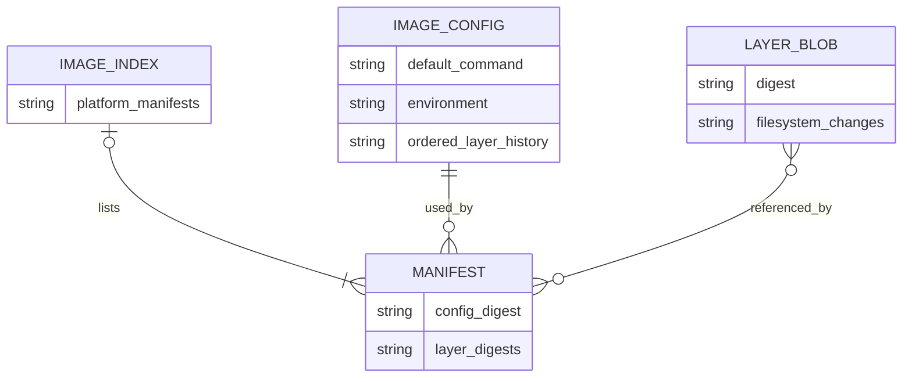
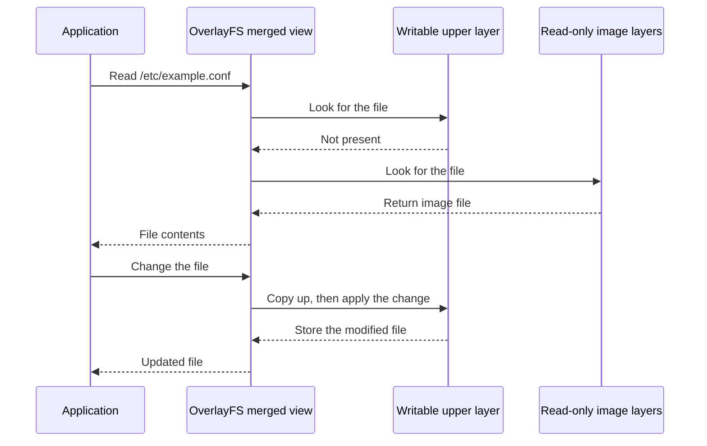

A Dockerfile looks like a list of commands. Build it, and you get an image that can be pulled, tagged, and started. But what is that image made of, and why can changing one line make a build slow, or leave an unexpected file in the final image?

Let’s follow an image from its published format to the filesystem a running container sees.

## An image is a recipe plus immutable filesystem changes

A **container image** is a packaged, versioned artifact: metadata describing how to run a workload, plus filesystem content such as executables, libraries, and configuration. It does not include a booted machine or its own Linux kernel. A container runtime uses the image to prepare a filesystem and start a process with the image’s default settings, which can be overridden at run time.

As an analogy to OOP, think of the relationship like this: a **Dockerfile is like the class definition**, an **image is like the built class or blueprint**, and a **container is like an object created from that class**. It is an analogy, not a one-to-one match: a Dockerfile is build input, while the image is the packaged result.

- A **Dockerfile** describes the steps for building the artifact, much like source code defines a class.
- An **image** is the reusable template produced by those steps, including metadata and filesystem content.
- A **container** is an instance created from that image, with runtime settings and usually a writable filesystem layer of its own.

Just as multiple objects can be created from one class, multiple containers can be created from one image. They share the image’s read-only starting point, but each has its own runtime state.

Images are usually described as a stack of layers, but they are not simply a stack of complete directory snapshots. Each filesystem layer records changes, files added or changed, and sometimes markers for files removed, relative to what came before. Layer content is immutable once built; a later change adds a new layer rather than editing an existing one.

## OCI: a common format for images

The **Open Container Initiative (OCI)** publishes specifications that let different tools build, store, and run container images in interoperable formats. OCI is a set of standards, not a container engine.

At a high level, an OCI image has:

- An **image manifest**, which points to the image configuration and its filesystem layers.
- An **image configuration**, which records metadata such as the default command, environment, and the ordered layer history.
- **Layer blobs**, which carry filesystem changes.
- Optionally, an **image index**, which points to different manifests, for example, builds for different CPU architectures.

These objects are content-addressed: their digests are derived from their bytes. A registry can reuse identical content, and a client can check that downloaded content matches the digest it requested. Tags such as `my-app:latest` are convenient names that can move; a digest identifies specific content.



The exact storage and runtime implementation can differ, but these OCI objects provide a shared vocabulary for distributing images.

## Layers at build time and at runtime

A Dockerfile instruction that changes the filesystem, commonly `RUN`, `COPY`, or `ADD`, typically contributes a filesystem layer in a classic image build. Other instructions may change image configuration without adding filesystem content. **BuildKit** is the image-building toolkit used by Docker; it executes Dockerfile build steps and manages their cache. Like other builders, it may represent intermediate steps and cached data differently, so it is better to think in terms of build steps and resulting changes than assume every line always becomes one final layer.

When a container starts, its image layers are available as read-only lower layers. A storage driver or snapshotter presents them together with a writable upper layer as one filesystem tree. On many Linux systems, **OverlayFS** provides this merged view. Suppose an application reads a file that exists only in an image layer, then changes it:



The application sees paths such as `/etc` or `/usr` in the merged view; it does not need to know which layer supplied a file. OverlayFS is common, not universal: storage drivers, snapshotters, and operating systems can use different mechanisms.

## Copy-on-write: what happens when a container writes?

The image layers stay unchanged when a running container modifies its filesystem. Instead, writes go to the container’s writable layer. This is the **copy-on-write (CoW)** idea: share unchanged lower-layer data, and keep modifications separate.

- Creating a new file writes it to the upper layer.
- Changing a file that exists in a lower layer can trigger **copy-up**: OverlayFS copies the file into the upper layer, then applies the change there.
- Removing a lower-layer file is represented by a marker (a *whiteout*) in the upper layer, so the merged view hides it without editing the image.

The copy-up behavior can make writes to large lower-layer files more expensive than expected. More importantly, container-layer changes are usually tied to that container’s lifecycle. Replacing the container does not turn those changes into a new image, and removing it can discard them. Use a volume or bind mount for data that needs to outlive a container.

## Build cache: why instruction order matters

Image distribution and building both benefit from reuse. If a build step and its inputs match a cached result, the builder may reuse it rather than repeat the work. When a step changes, later dependent steps may need to run again.

For example, copying all source files before installing dependencies means an ordinary source edit can invalidate the dependency-install step too. Copying dependency manifests first gives that step a chance to remain cached:

```dockerfile
WORKDIR /app
COPY package.json package-lock.json ./
RUN npm ci
COPY . .
RUN npm run build
```

This is a pattern, not a universal recipe: adapt it to the language and build system, and make sure the files needed by each step are copied before that step runs.

A few cache details are easy to miss:

- **A cache hit is not a freshness check.** A cached `RUN apt-get update` can be reused if the build inputs still match; it does not necessarily contact the repository again. Use an intentional refresh strategy when fresh packages are required.
- **Changes invalidate downstream work.** Reordering steps can help put stable, expensive work before frequently changing source files.
- **Build context is an input.** A broad context can slow transfers and make irrelevant files affect builds. Use `.dockerignore` to exclude files that the build does not need.
- **Cache mounts are not image layers.** BuildKit can make a temporary directory, often used for package downloads, available to a build step and preserve its contents across builds. A step may still need to run again, but it can reuse those downloads without including the cache in the final image.

## A deleted file may still be in the image

Adding a file in one layer and deleting it in a later layer usually does not erase its bytes from the earlier layer. The merged filesystem hides it, but the earlier layer is still part of the image. This can waste space, and it is especially risky for credentials or private files.

Do not copy a secret into an image and then delete it in a later instruction. Keep secrets out of the build context, and use a build tool’s secret-mount feature when a build genuinely needs a credential. For files that are only needed to compile an application, **multi-stage builds** can keep the toolchain in a builder stage and copy only the required output into the final stage.

## What to remember

A container image is a content-addressed artifact with metadata and reusable filesystem changes. At runtime, those read-only changes are combined with a separate writable layer; copy-on-write keeps a container’s edits out of the image. During a build, cache reuse depends on instructions and their inputs, so step ordering and a clean build context matter.

Once you see images as immutable layers with explicit inputs, Dockerfile design becomes less mysterious: keep stable work reusable, keep unnecessary files and secrets out, and store persistent application data somewhere other than a disposable container layer.

## Further reading

- [OCI Image Format Specification](https://github.com/opencontainers/image-spec)
- [Docker: Understanding image layers](https://docs.docker.com/get-started/docker-concepts/building-images/understanding-image-layers/)
- [Docker: Build cache optimization](https://docs.docker.com/build/cache/optimize/)
- [Linux kernel: OverlayFS documentation](https://docs.kernel.org/filesystems/overlayfs.html)
- [Docker: Build secrets](https://docs.docker.com/build/building/secrets/)
