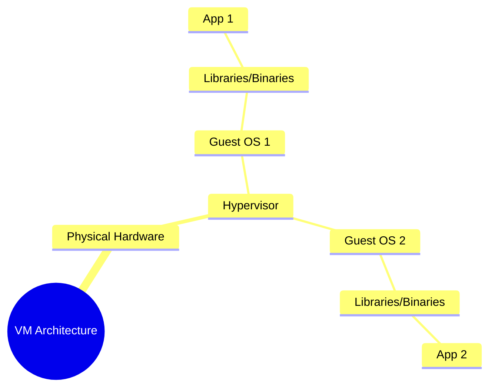
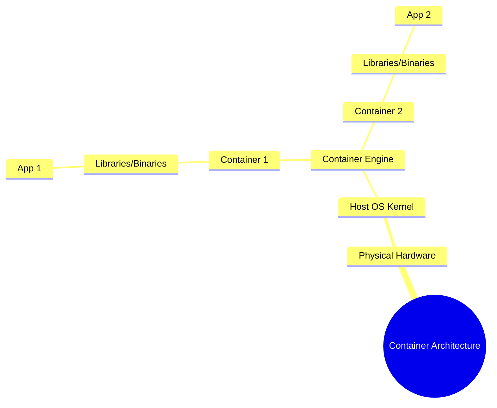

Containers and virtual machines both isolate workloads, but they do so at different layers. Understanding that boundary clarifies their security properties, resource costs, and operational trade-offs.

## Virtual machines (VMs): the traditional model

A virtual machine runs a guest operating system on virtual hardware provided by a **hypervisor**. Depending on the design, the hypervisor runs directly on the physical machine or on top of a host operating system.

### How does it work?
The hypervisor presents virtual CPUs, memory, storage, and devices to each guest, then schedules and mediates their access to physical resources. These resources are shared by the host and guests rather than reserved exclusively for one VM.

**A useful analogy:** think of a VM as an apartment in a building. Each apartment has its own rooms and utilities, much like a guest has its own operating-system kernel and virtual devices. The separation is stronger than process isolation, but it still depends on the hypervisor and its configuration.

## Containers: OS-level isolation

Containers provide operating-system-level isolation rather than virtualizing hardware. Linux containers use kernel features such as namespaces and cgroups to isolate process views and manage resources while sharing a Linux kernel.

### What changes in practice?
Linux containers share the host's Linux kernel, so an image does not need a separate kernel for each application. Docker provides container tooling, while Kubernetes orchestrates containerized workloads; neither is itself a container.

A rough analogy is separate rooms in a shared building: each process gets an isolated view of some resources, but all depend on shared infrastructure, the kernel. Unlike rooms, these boundaries are implemented by kernel features and do not give each container its own kernel.

## Which kernel runs?

The kernel details depend on the container type and host. Linux containers share a Linux kernel; Docker Desktop uses a lightweight Linux VM to run Linux containers on macOS and on Windows configurations that do not provide a Linux kernel directly. Windows containers instead use a Windows kernel.

A Linux container image can provide an Ubuntu or Arch Linux userland, including its libraries and package manager, while both containers still use the host's Linux kernel. The distribution name in the image does not determine the kernel that runs the container.

## Comparison at a glance

If you need a quick summary, here is a comparison between the two:

| Feature | Virtual Machines (VMs) | Containers |
| :--- | :--- | :--- |
| **OS** | Guest OS runs on virtual hardware | Processes share the host kernel |
| **Isolation** | Separate guest kernel and virtual hardware boundary | Kernel mechanisms such as namespaces and cgroups; configuration matters |
| **Startup** | Includes guest OS boot | Starts isolated processes; timing depends on workload and setup |
| **Image and storage** | Includes a guest OS image | Includes application userland and dependencies; size varies |
| **Resource overhead** | Includes hypervisor and guest OS costs | Avoids a separate kernel per container; costs still depend on workload and runtime |

## Security and isolation boundaries

One of the main differences between VMs and containers is the **security boundary**.

- **VMs:** Give each guest a separate kernel and virtual hardware boundary. This is a stronger isolation boundary than process isolation in many deployments, but it still depends on the hypervisor, configuration, and threat model.
- **Linux containers:** Use features such as **namespaces** to isolate views of system resources and **cgroups** to account for and limit resource use. Containers share the host kernel, so a kernel vulnerability or a privileged configuration can affect the host and other workloads.

## Portability has limits

A container image can make application files and userspace dependencies more consistent across environments. It does not remove differences in CPU architecture, host kernel, runtime configuration, available resources, or external services, so it cannot guarantee identical behavior everywhere.

VM images are also portable, but they include a guest operating system and can require more storage and transfer capacity. The operational impact depends on the image format, infrastructure, and deployment process.

## Which to choose?

Choose based on the isolation boundary and operating-system requirements the workload needs.

### Use VMs when:
- You need a separate guest kernel or virtual-hardware boundary.
- You need to test different operating systems or specific kernel versions.
- You need snapshots that include the guest operating system.

### Use containers when:
- A shared host kernel is acceptable for the workload.
- You want to package an application and its user-space dependencies consistently.
- You want to run multiple isolated processes without a separate guest kernel for each one.

## Conclusion

The choice depends on whether the workload needs a separate guest kernel, what isolation boundary is appropriate, and how the system will be operated.

## Further reading

- [What is a container?](https://docs.docker.com/get-started/docker-concepts/the-basics/what-is-a-container/)
- [Linux Container Configuration](https://github.com/opencontainers/runtime-spec/blob/main/config-linux.md)
- [The Definitive KVM API Documentation](https://docs.kernel.org/virt/kvm/api.html)
