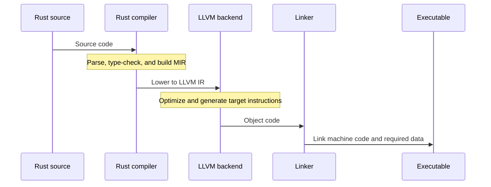
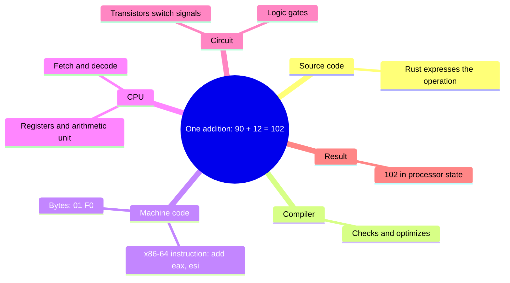

When you write `a + b`, it feels as if the computer simply understands what you mean and adds the numbers. In a way, it does—but only after your code has passed through several layers of translation. The processor does not read Rust keywords or the `+` sign. It fetches machine instructions encoded as bits, and transistor-based circuits turn those instructions into electrical changes.

Let’s follow one small addition all the way through. We’ll use it as a guided tour, and we’ll be careful to separate what the source code says from what a particular CPU might actually do:

```rust
fn main() {
    let a = 90;
    let b = 12;
    let c = a + b;
}
```

The answer is `102`. Nothing about the arithmetic is complicated; the interesting part is how many layers make that answer happen. We’ll trace it from Rust, through compiled instructions and CPU hardware, down to logic gates and transistors.

## 1. High-level code describes an intention

The code says what we want: create two integer values, add them, and bind the result to `c`. It does not say where those values must live, which CPU register to use, or how to build an adder circuit.

In this Rust example, the compiler infers the integer literals as `i32` because we do not specify a type. That is a 32-bit signed integer type. The values are positive, so their bit patterns are the same whether we view them as ordinary positive binary numbers or as two's-complement signed integers.

A name such as `a` is mainly useful to us and to the compiler. It does not promise that a permanent memory cell named `a` will exist in the finished program.

## 2. The compiler turns the program into lower-level forms

A compiler typically processes source through several representations. For our Rust example, `rustc` (usually invoked via Cargo) follows a path that can be summarized like this:



In simplified terms:

1. **Parsing** checks that the text follows Rust's grammar and builds a structured representation of the code.
2. **Semantic checks** determine types and enforce Rust rules, including ownership and borrowing where relevant. In this example there are no references or ownership complications.
3. **Intermediate representations** express the program in forms that are easier for the compiler to analyze and transform. Rust's MIR is one of these forms; Rust commonly uses LLVM as a code-generation backend.
4. **Optimization** can simplify the program, remove unnecessary work, and choose efficient ways to represent values.
5. **Code generation** emits instructions for a particular target, such as x86-64 or AArch64. The output depends on the target, compiler version, build settings, and surrounding program.

These are useful conceptual stages, not a promise that every compiler version uses exactly the same internal steps.

### Optimization can remove the addition

Our example uses constants. The compiler can calculate `90 + 12` while compiling and replace the expression with `102`. Because `c` is not used, it may even remove the whole calculation. In a real compiled program, the CPU might execute no addition for this snippet.

This is called **constant folding**: if the compiler can determine a result ahead of time, it can pre-compute it. Optimization is one reason source code and executed instructions do not correspond one-to-one.

To make an addition that depends on runtime values easier to see, we can write a function that receives its inputs:

```rust
fn add(a: i32, b: i32) -> i32 {
    a + b
}
```

This function makes the example a little more realistic: the inputs arrive when the function runs, so the compiler cannot simply calculate the answer in advance. It still has freedom to choose different instructions for different processors and build settings.

To inspect generated assembly for your own project, you can ask Rust to emit it:

```bash
cargo rustc --release -- --emit=asm
```

The exact output depends on your target, compiler version, and surrounding code. Assembly is a readable spelling of machine instructions; the CPU itself receives instruction bytes, not these words.

## 3. Machine instructions operate on bits

A CPU instruction can say, in effect, “add the value in this register to the value in that register, and keep the answer here.” Here is one x86-64 example, written in Intel assembly syntax:

```asm
add eax, esi
```

Read it as: add `esi` to `eax`, then put the result in `eax`. These names are CPU registers, not Rust variables. Imagine that earlier instructions have put `90` in `eax` and `12` in `esi`. This instruction changes `eax` to `102`. We’re skipping those setup instructions so we can focus on the addition itself. A real Rust function may use different registers or a different instruction; this is a concrete illustration, not a promise about what every compiler emits.

### What does that instruction look like in binary?

On x86-64, the instruction above has this machine-code encoding:

```text
Hex bytes:     01 F0
Binary bits:   00000001 11110000
```

Hexadecimal is a compact way to write bytes. The CPU fetches `01 F0`, not the letters `add eax, esi`. Here is the second byte split into the fields the x86 decoder reads:

```text
F0 = 11 110 000
     mod reg r/m
```

In that second byte, `mod = 11` means both operands are registers; `reg = 110` selects `esi`, and `r/m = 000` selects `eax`. The first byte, `01`, selects an `ADD` instruction form. Together, those encoding rules tell the processor to add `esi` into `eax`.

Other CPU architectures encode addition differently, and x86 can encode equivalent operations in more than one way. Assembly is the human-readable spelling; machine code is the architecture-specific bit pattern the processor decodes.

Now let’s look at the values being added. Written with just eight bits, they are:

```text
90  = 01011010
12  = 00001100
102 = 01100110
```

Our Rust values are `i32`, so they are 32-bit values; the eight-bit version is just easier to read on the page. For these positive numbers, the extra bits to the left are all zero. Binary addition works column by column, just like decimal addition, but each column is base 2:

```text
  01011010
+ 00001100
----------
  01100110
```

The CPU does not follow this drawing as a little recipe. The instruction tells its arithmetic hardware which operation to perform and which values to use; the hardware combines the bits and produces the result.

## 4. The operating system loads the program

The compiler and linker package machine code and other required data into an executable file. On a typical Linux system that file uses the ELF format. When we run it, the operating system loads its executable segments into the process's virtual address space, prepares the process, and transfers control to its entry point. Dynamically linked programs may also involve a dynamic linker loading shared libraries.

The operating system does not normally translate each source line as the program runs. Compilation has already produced machine code. The OS sets up execution and provides services; the CPU then executes the program's instructions.

## 5. The CPU fetches, decodes, and executes

At a high level, a CPU core repeatedly performs work often described as **fetch, decode, execute**:

1. **Fetch:** use the current instruction address to obtain instruction bytes, commonly from a nearby cache.
2. **Decode:** determine which instruction those bits represent and what operands it needs.
3. **Execute:** perform the operation, such as integer addition, and update the processor's state.

The fetch-decode-execute loop is a useful picture, but modern processors do more behind the scenes. They pipeline work, predict branches, rename registers, and may run independent operations in parallel. Some x86 processors also decode an instruction such as the one above into smaller internal operations, often called micro-ops. Those are implementation details: they are not the same thing as the instruction bytes `01 F0`, and they can differ between processor designs.

For our addition, the values may be in registers: tiny, very fast storage locations inside the CPU core. Arithmetic hardware combines their bits and makes the result available to later instructions. The compiler chooses which registers to use, so a Rust variable does not stay tied to one physical register.

## 6. Logic gates make the addition happen

Inside the processor, the addition is implemented by digital logic. At a simplified level, an adder is built from circuits that calculate a sum bit and a carry bit for each position. A sum bit depends on the input bits and any carry from the previous position. Real CPU arithmetic units use carefully designed circuits to do this quickly.

Logic circuits are assembled from **logic gates** such as AND, OR, and NOT. A gate implements a small rule about its inputs and output. For example, an AND gate's output is 1 only when both inputs are 1. Combining gates gives circuits capable of arithmetic, comparisons, selection, and many other operations.

The exact implementation is more complex than a chain of classroom gates. Modern chips use optimized transistor networks, and circuit design balances speed, power use, area, and heat.

## 7. Transistors turn logic into electrical behavior

A digital circuit uses transistors as controllable electrical switches. In a simplified CMOS transistor, an input voltage affects whether a conducting path is formed. By combining transistors, chip designers build gates whose output voltage moves toward one of two ranges interpreted as logical 0 or logical 1.

These are **voltage ranges**, not perfectly fixed voltages and not tiny particles labeled “zero” or “one.” The circuit is designed so that small variations still leave a signal reliably within a valid range. As signals change, capacitances in the circuit charge and discharge; that switching uses energy and contributes to heat.

The CPU's clock provides timing references for much of this coordinated work. A clock edge does not mean every transistor in the chip flips at once: different parts of the chip are active at different times, and some logic is combinational between clocked elements. But clocking helps coordinate when state such as register contents is updated.

At the very bottom of this explanation, the addition is not a magical operation performed by software. It is a pattern of electrical changes in transistor-based circuits, arranged so that the result follows the rules of binary addition.

## 8. What happens to `c`?

After the addition, the result `102` is available in the processor's state, often in a register to be used by the next instruction. If later code needs it in memory, the compiler can generate an instruction to store it. If we print it, there is much more work: formatting the number as characters, passing output to the operating system, and eventually sending it to a terminal or another destination.

In our original example, `c` is never read, and the addition has no observable side effects. The compiler can discard the binding and calculation. That means asking "where is `c` stored?” may have no concrete answer in the final machine code: it may not exist at runtime at all.

## The layers involved in one addition



Each layer offers a useful abstraction. A high-level language lets us express intent without designing a circuit. The compiler translates and optimizes that intent. Machine instructions describe operations for a processor architecture. CPU circuits carry them out using electrical signals in transistors.

When your source code says `a + b`, it is not directly commanding electricity. It describes an operation through a stack of abstractions, and those abstractions eventually guide electrical changes that produce `102`—unless the compiler can prove the answer ahead of time and skip the addition altogether.