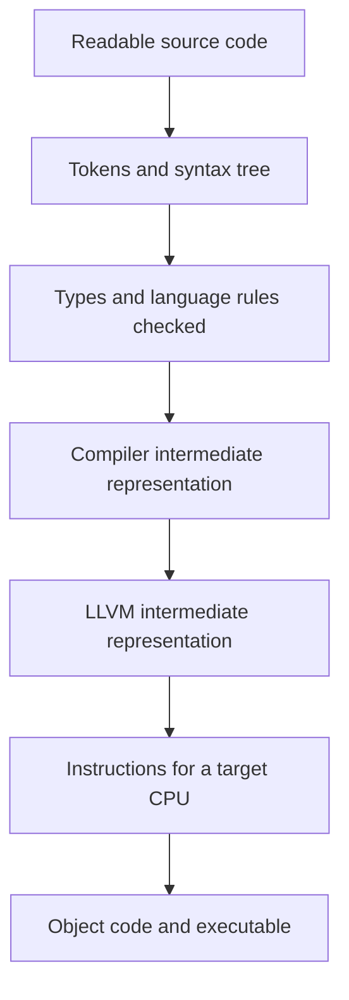

When we write a line of high-level code, the processor does not read its keywords or operators. A CPU works with a much smaller vocabulary: machine instructions encoded as bits. Between source code and those bits are several layers of translation, and below the bits are circuits whose electrical behavior makes computation possible.

To follow those layers, consider this small integer addition:

```rust
fn main() {
    let a = 90;
    let b = 12;
    let c = a + b;
}
```

The result is `102`. That simple calculation gives us a thread to follow through compilation, the operating system, CPU instructions, logic gates, and transistors.

## 1. High-level code describes an intention

The code says what we want: create two integer values, add them, and bind the result to `c`. It does not say where those values must live, which CPU register to use, or how to build an adder circuit.

In this Rust example, the compiler infers the integer literals as `i32` because we do not specify a type. That is a 32-bit signed integer type. The values are positive, so their bit patterns are the same whether we view them as ordinary positive binary numbers or as two's-complement signed integers.

A name such as `a` is mainly useful to us and to the compiler. It does not promise that a permanent memory cell named `a` will exist in the finished program.

## 2. The compiler turns the program into lower-level forms

A compiler typically processes source through several representations. For our Rust example, `rustc` (usually invoked via Cargo) follows a path that can be summarized like this:



In simplified terms:

1. **Parsing** checks that the text follows Rust's grammar and builds a structured representation of the code.
2. **Semantic checks** determine types and enforce Rust rules, including ownership and borrowing where relevant. In this example there are no references or ownership complications.
3. **Intermediate representations** express the program in forms that are easier for the compiler to analyze and transform. Rust's MIR is one of these forms; Rust commonly uses LLVM as a code-generation backend.
4. **Optimization** can simplify the program, remove unnecessary work, and choose efficient ways to represent values.
5. **Code generation** emits instructions for a particular target, such as x86-64 or AArch64. The output depends on the target, compiler version, build settings, and surrounding program.

These are useful conceptual stages, not a promise that every compiler version uses exactly the same internal steps.

### Optimization can remove the addition

Our example uses constants. The compiler can calculate `90 + 12` while compiling and replace the expression with `102`. Because `c` is not used, it may even remove the whole calculation. In a real compiled program, the CPU might execute no addition for this snippet.

This is called **constant folding**: if the compiler can determine a result ahead of time, it can pre-compute it. Optimization is one reason source code and executed instructions do not correspond one-to-one.

To make an addition that depends on runtime values easier to see, we can write a function that receives its inputs:

```rust
fn add(a: i32, b: i32) -> i32 {
    a + b
}
```

The compiler must produce a result for the values supplied when the function runs, although it can still choose different instructions or transformations for different targets and build modes. To inspect the generated assembly locally, one option is:

```bash
cargo rustc --release -- --emit=asm
```

The output is specific to your platform and compiler. Assembly is a human-readable view of machine instructions, not the CPU's native input format.

## 3. Machine instructions operate on bits

A CPU instruction might tell the processor to add the contents of two registers and put the answer in a register. On an x86-64 CPU, a compiler might use an instruction resembling `add eax, esi`; an AArch64 CPU has different instruction encodings and names. These are examples, not guaranteed output for our exact source.

The numbers themselves can be written in binary:

```text
90  = 01011010
12  = 00001100
102 = 01100110
```

For this small illustration, we show only eight bits. In our Rust example, the values are `i32`, so an actual operation generally uses 32-bit values or an equivalent representation. The extra leading bits are zero for these positive numbers.

Binary addition follows the same column-by-column idea as decimal addition, except each column uses base 2. A bit can be 0 or 1, and adding two bits can produce a carry into the next column. Here is the eight-bit view:

```text
  01011010
+ 00001100
----------
  01100110
```

The compiler's instruction does not have to mean "perform this exact drawing.” It asks the CPU to perform an integer addition with the specified operands and destination.

## 4. The operating system loads the program

The compiler and linker package machine code and other required data into an executable file. On a typical Linux system that file uses the ELF format. When we run it, the operating system loads its executable segments into the process's virtual address space, prepares the process, and transfers control to its entry point. Dynamically linked programs may also involve a dynamic linker loading shared libraries.

The operating system does not normally translate each source line as the program runs. Compilation has already produced machine code. The OS sets up execution and provides services; the CPU then executes the program's instructions.

## 5. The CPU fetches, decodes, and executes

At a high level, a CPU core repeatedly performs work often described as **fetch, decode, execute**:

1. **Fetch:** use the current instruction address to obtain instruction bytes, commonly from a nearby cache.
2. **Decode:** determine which instruction those bits represent and what operands it needs.
3. **Execute:** perform the operation, such as integer addition, and update the processor's state.

Modern processors do much more internally: they pipeline work, predict branches, rename registers, and may execute independent operations in parallel. Those techniques help performance, but the visible result still follows the program's defined behavior.

For an addition, the operands may be in registers. Registers are tiny, very fast storage locations inside the CPU core. The CPU's arithmetic hardware combines the operand bits and makes the result available to later instructions. The compiler decides how values are assigned to registers; a source-level variable does not map permanently to one physical register.

## 6. Logic gates make the addition happen

Inside the processor, the addition is implemented by digital logic. At a simplified level, an adder is built from circuits that calculate a sum bit and a carry bit for each position. A sum bit depends on the input bits and any carry from the previous position. Real CPU arithmetic units use carefully designed circuits to do this quickly.

Logic circuits are assembled from **logic gates** such as AND, OR, and NOT. A gate implements a small rule about its inputs and output. For example, an AND gate's output is 1 only when both inputs are 1. Combining gates gives circuits capable of arithmetic, comparisons, selection, and many other operations.

The exact implementation is more complex than a chain of classroom gates. Modern chips use optimized transistor networks, and circuit design balances speed, power use, area, and heat.

## 7. Transistors turn logic into electrical behavior

A digital circuit uses transistors as controllable electrical switches. In a simplified CMOS transistor, an input voltage affects whether a conducting path is formed. By combining transistors, chip designers build gates whose output voltage moves toward one of two ranges interpreted as logical 0 or logical 1.

These are **voltage ranges**, not perfectly fixed voltages and not little particles labeled "zero” or "one.” The circuit is designed so that small variations still leave the signal reliably within a valid range. As signals change, capacitances in the circuit charge and discharge; that switching consumes energy and contributes to heat.

The CPU's clock provides timing references for much of this coordinated work. A clock edge does not mean every transistor in the chip flips at once: different parts of the chip are active at different times, and some logic is combinational between clocked elements. But clocking helps coordinate when state such as register contents is updated.

At the very bottom of this explanation, the addition is not a magical operation performed by software. It is a pattern of electrical changes in transistor-based circuits, arranged so that the result follows the rules of binary addition.

## 8. What happens to `c`?

After the addition, the result `102` is available in the processor's state, often in a register to be used by the next instruction. If later code needs it in memory, the compiler can generate an instruction to store it. If we print it, there is much more work: formatting the number as characters, passing output to the operating system, and eventually sending it to a terminal or another destination.

In our original example, `c` is never read, and the addition has no observable side effects. The compiler can discard the binding and calculation. That means asking "where is `c` stored?” may have no concrete answer in the final machine code: it may not exist at runtime at all.

## The whole path, in one view


Each layer offers a useful abstraction. A high-level language lets us express intent without designing a circuit. The compiler translates and optimizes that intent. Machine instructions describe operations for a processor architecture. CPU circuits carry them out using electrical signals in transistors.

When source code expresses an operation like `a + b`, it is not directly commanding electricity. It uses a stack of abstractions that ultimately makes electrical behavior reliably produce `102`,unless the compiler can prove that answer in advance and skip the work.