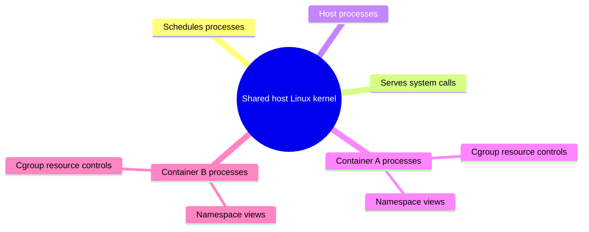
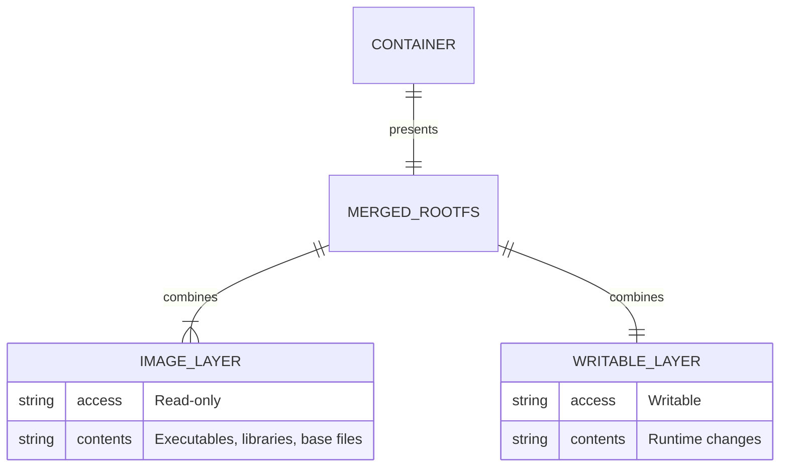
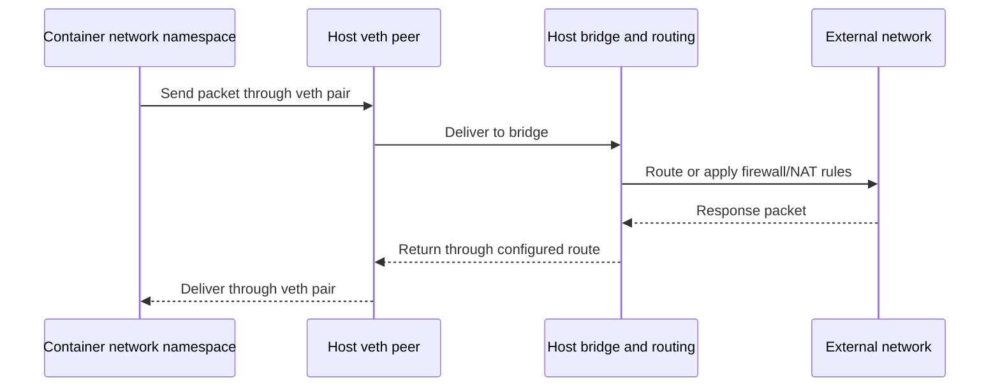
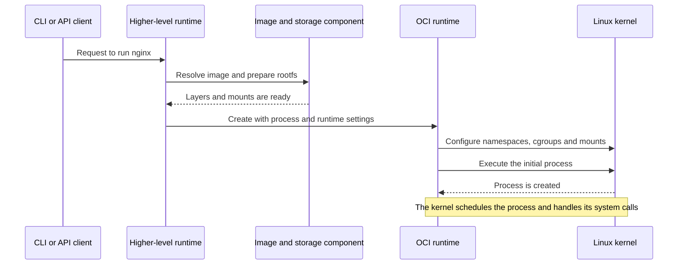

*In [Containers Are Not Virtual Machines](/articles/containers-vs-vms/), we compared containers with VMs. Now let’s follow the path from a Linux process to a running container and understand the roles of the kernel, filesystem, and tools that coordinate everything.*

## The central idea: a container is a process with context

A container is not, by itself, a virtual machine, a complete operating system, or a box implemented by Docker. On Linux, it is more useful to think of it as **one or more ordinary processes to which the kernel presents an isolated view of the system and applies resource and security policies**.

The processes are still scheduled by the same kernel and use the same hardware as other host processes. What changes is the context in which they run: which processes they can see, which filesystem tree they encounter, which network interfaces they have available, which user identities they appear to have, and which resources they can consume.



This diagram is conceptual: namespaces and cgroups are not layers that every syscall passes through. They are mechanisms the kernel consults when handling process operations.

This distinction also explains why Linux containers share the host kernel. On macOS and Windows, tools such as Docker Desktop typically run Linux containers inside a Linux virtual machine because the host operating-system kernel is not Linux.

## 1. The starting point: Linux processes

A **process** is an instance of a program that is running. When we run `sleep 300`, the kernel creates and schedules a process to execute that program. A process has an identifier (PID), user and group credentials, virtual memory, file descriptors, and other attributes maintained or controlled by the kernel.

We can inspect processes with:

```bash
ps -ef
cat /proc/<PID>/status
```

`/proc` is a virtual filesystem: the kernel exposes information about processes and the system through it; these are not ordinary files stored on disk.

A process requests services from the kernel through **system calls**, or syscalls, for example, to open a file, create another process, or send data through a socket. The program running in the container does not have its own kernel to handle these requests: it continues to use the shared Linux kernel.

## 2. Namespaces: limiting what a process can see

A **namespace** changes a process’s view of a system resource. Groups of processes can therefore share the kernel without necessarily sharing the same view of processes, networking, or mount points.

| Namespace | What it isolates or changes |
|---|---|
| PID | The view of process IDs and the process hierarchy |
| Network (NET) | Interfaces, addresses, routes, sockets, and other networking resources |
| Mount (MNT) | The view of mount points |
| UTS | Hostname and NIS domain name |
| IPC | Inter-process communication resources, such as queues and semaphores |
| User (USER) | Mapping of user and group identifiers |
| Cgroup (CGROUP) | The view of the cgroup hierarchy |
| Time (TIME) | Certain clock references through offsets |

A typical container combines several namespaces, but the exact configuration depends on the runtime and the requested settings. The existence of namespaces does not automatically mean that every resource is completely isolated or that the container is safe from every attack.

### PID: processes and PID 1

Inside a PID namespace, a process may appear as PID 1 even though it has a different PID in the host namespace. The process can be seen with different identifiers at different levels of the namespace hierarchy.

PID 1 has special responsibilities, including receiving orphaned processes and reaping terminated processes to prevent *zombies* from accumulating. Correct signal forwarding may also be necessary. If the application does not handle these responsibilities, a small init process can do so.

### Network: an independent network stack

A network namespace can have its own interfaces, IP addresses, and routing tables. This lets two containers run services listening on the same internal port, such as `8080`, without conflicting: they are in separate network contexts.

To communicate with the host or other containers, the configuration can connect namespaces using virtual interface pairs (*veth*), bridges, and routes. Publishing a host port, for example, forwarding a host port to a container service, is additional configuration performed by the runtime or networking tools; it does not happen simply because a namespace exists.

### Mount: an independent filesystem view

A mount namespace gives a process its own table of mount points. Combined with a *root filesystem* and root-changing operations, this lets `/` inside the container point to a tree different from the host’s root.

This is an isolated view of mounts, not an independent physical disk. The tree may be assembled from image layers, bind mounts, volumes, and other mounts configured for the container.

### User: identities and privileges

A user namespace can map the user and group identifiers seen inside the container to different identifiers on the host. For example, UID 0 inside the namespace can map to an unprivileged UID on the host.

Therefore, "root inside the container" does not necessarily mean "root on the host." The level of protection depends on the mappings, capabilities, runtime configuration, and possible kernel vulnerabilities. Not all environments use user namespaces in the same way.

## 3. Cgroups: accounting for and controlling resources

**Control groups (cgroups)** organize processes in a hierarchy that lets the kernel account for and, depending on the controller and configuration, limit or distribute resources. While namespaces mainly concern visibility, cgroups mainly handle **accounting and usage control**.

Controllers can manage resources such as CPU, memory, I/O, and the number of tasks. The PID controller counts kernel tasks, including threads, not only the number of programs shown by a simplified process listing.

For example, Docker can configure some limits when creating a container:

```bash
docker run -d \
  --name my-app \
  --cpus="1.5" \
  --memory="512m" \
  --pids-limit=100 \
  nginx
```

`--cpus="1.5"` configures a quota equivalent to up to 1.5 CPUs over time; it does not reserve exclusive physical CPUs. `--memory` sets a memory limit, and reaching it can cause the kernel to terminate processes due to an out-of-memory condition. `--pids-limit` limits the number of tasks counted by the PID controller.

With cgroups v2, the unified hierarchy is usually exposed at `/sys/fs/cgroup/`. Common control files include `memory.current`, `memory.max`, `cpu.stat`, `pids.current`, and `pids.max`. The exact path varies by system and hierarchy. To find which cgroup a process belongs to:

```bash
cat /proc/<PID>/cgroup
```

Cgroups are not a mechanism for isolating a process’s view of the filesystem or other processes, and limits do not replace monitoring. The kernel, cgroup version, and runtime configuration determine the exact behavior.

## 4. Filesystem: image, rootfs, and writable layer

A container image provides the userspace files needed to start an application: executables, libraries, configuration, and sometimes much of a Linux distribution’s userland. It may include directories such as `/bin`, `/etc`, `/usr`, and `/lib`.

That does not mean the image contains its own Linux kernel. The host still provides the kernel and syscalls. An image may look like a complete operating system from the perspective of its files, but it does not boot an independent kernel like a VM.

### Image layers and storage

OCI-format images are distributed as content with manifests and layers. Shared layers can be reused by multiple images. At runtime, the runtime and its storage component prepare a filesystem tree for the process. In many Linux configurations, a union filesystem such as OverlayFS combines read-only layers with a writable layer; other implementations and snapshotters are also possible.



With OverlayFS, changing a file that exists only in a lower layer can trigger a *copy-up* operation: the file is copied into the writable layer before modification. The specific mechanism depends on the driver or snapshotter in use.

The writable layer usually belongs to the container’s lifecycle. If it is removed, changes stored only in that layer can disappear too. Data that must survive container replacement or removal should use persistent storage, such as volumes or bind mounts.

**An image and a container are different things:** an image is a reusable artifact; a container is an instance with its own configuration and state, whether running or prepared to run.

## 5. Networking: from virtual interface to published port

A network namespace provides an independent network stack, but its connections must be configured to communicate with other networks. A common setup creates a *veth* pair: one end resides in the container’s namespace and the other connects to a bridge on the host. The host can route traffic, and firewall or NAT rules can allow external access.



This is a common architecture, not a universal rule. Network plugins, host networking mode, cluster policies, IPvlan/Macvlan, and other configurations change the path. "The port is open in the container" also does not mean it is reachable from the Internet: check the listening address, forwarding, firewall rules, and surrounding network.

## 6. Security: multiple layers, no standalone guarantee

Namespaces and cgroups are important building blocks, but **they do not, on their own, provide a complete security boundary**. Containers share the kernel, so an exploitable kernel vulnerability can affect the host. Security also depends on configuration, granted privileges, the application’s attack surface, and system maintenance.

- **Linux capabilities:** divide privileges traditionally associated with root into more specific capabilities. Grant only those needed; `CAP_SYS_ADMIN`, for example, covers a very broad set of operations.
- **Seccomp:** syscall filters can block calls an application does not need. This reduces the available attack surface but does not fix vulnerabilities in the application or kernel.
- **AppArmor and SELinux:** Linux Security Modules (LSM) apply additional access-control policies, such as restrictions on files and operations.
- **User namespaces and rootless execution:** can reduce the privileges required on the host, but do not remove every risk or guarantee that the entire execution path is unprivileged.
- **Additional isolation:** environments that need a stronger boundary may use VMs or sandboxes that add another layer between the workload and the host kernel.

A defensive configuration commonly avoids privileged mode unless necessary, limits capabilities, sets resource limits, keeps the kernel updated, and handles images and secrets carefully. There is no single configuration that is right for every workload.

## 7. Runtimes: who prepares and starts the container?

Creating namespaces, assigning cgroups, preparing mounts, applying policies, and executing the process directly is possible, but complex. A **runtime** coordinates these steps based on a configuration.

The [Open Container Initiative (OCI)](https://opencontainers.org/) publishes specifications for image and runtime formats. These specifications help components from different vendors interoperate; they are neither a daemon nor the kernel.

- **Low-level runtimes**, such as `runc` and `crun`, create and start containers according to an OCI runtime configuration.
- **Higher-level runtimes**, such as `containerd` and CRI-O, manage operations such as images and lifecycle, and can delegate execution to an OCI runtime.
- **Docker Engine** provides an integrated build and management experience; in a common architecture, the daemon communicates with `containerd`, which coordinates execution through an OCI runtime.
- **Podman** provides container management and can run without a persistent central daemon, including in rootless mode, depending on configuration.
- **Kubernetes** communicates with runtimes through the CRI (*Container Runtime Interface*). CRI is Kubernetes’s interface; OCI defines formats and execution. They serve different roles.

Details vary by version and configuration. Names such as Docker, `containerd`, and `runc` refer to components with different responsibilities; they are not synonyms for "container".

## 8. What happens when we start a container?

Consider `docker run nginx`. Conceptually, the path looks like this, although the exact components vary between tools:



1. The tool resolves the image reference and obtains any missing content, if needed.
2. The storage component makes the layers available and prepares the filesystem tree, along with requested volumes or bind mounts.
3. The runtime prepares the container configuration: namespaces, cgroups, mounts, and, when applicable, networking.
4. The user, capabilities, seccomp filters, and LSM policies are configured according to the settings.
5. The runtime prepares environment variables, the working directory, and the command, then starts the process.
6. The kernel schedules that process like other processes, while applying the configured context and policies.

In practical terms, a container is generally considered running while its main process is running. If that process exits, the container stops, even if its filesystem tree and other persistent data still exist.

## 9. Inspecting containers on a Linux host

On Linux, these commands help connect the concepts to actual execution. Some depend on permissions, kernel version, or the installed tools:

```bash
# Processes visible in the current namespace
ps -ef

# Namespaces associated with a process
ls -l /proc/<PID>/ns/

# Cgroup associated with the process
cat /proc/<PID>/cgroup

# Process identifiers as seen by the process
cat /proc/<PID>/status
```

`/proc/<PID>/ns/` contains references to the process’s namespaces. Comparing those references can help identify which processes share a namespace. These tools show the current state of the host; on non-Linux systems, the underlying architecture may include a Linux VM and differ from this view.

## Conclusion: kernel mechanisms coordinated by tools

A Linux container does not boot a new kernel. It is a process, or group of processes, using the host kernel with a combination of visibility isolation, resource control, filesystem, and security policies.

- **Namespaces** change the view of selected resources.
- **Cgroups** account for and control resource usage.
- **Images and mounts** provide the application’s filesystem tree.
- **Capabilities, seccomp, LSM, and user namespaces** can strengthen security.
- **Runtimes and tools** coordinate setup and lifecycle.

The image may provide a Linux distribution’s userland, but that is not equivalent to a VM with its own kernel. And calling a container "isolated" does not make it invulnerable: the mechanisms and their specific configuration matter.

Once you understand how these pieces fit together, containers stop looking like magic boxes. They are Linux processes with a deliberately constructed context, and with limitations that are just as important to understand.

### Further reading

- [Linux namespaces  man7.org](https://man7.org/linux/man-pages/man7/namespaces.7.html)
- [Control Group v2  Linux kernel documentation](https://docs.kernel.org/admin-guide/cgroup-v2.html)
- [OverlayFS  Linux kernel documentation](https://docs.kernel.org/filesystems/overlayfs.html)
- [Linux capabilities  man7.org](https://man7.org/linux/man-pages/man7/capabilities.7.html)
- [Seccomp filter  Linux kernel documentation](https://docs.kernel.org/userspace-api/seccomp_filter.html)
- [OCI Runtime Specification](https://github.com/opencontainers/runtime-spec)
- [OCI Image Specification](https://github.com/opencontainers/image-spec)
- [Kubernetes container runtimes](https://kubernetes.io/docs/setup/production-environment/container-runtimes/)

---

**Previous article:** [Containers Are Not Virtual Machines](https://dyotamo.is-a.dev/articles/containers-vs-vms/)
