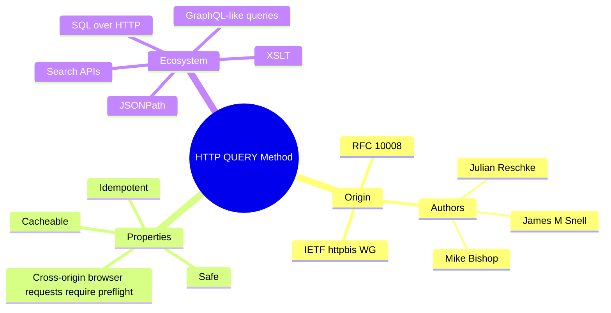
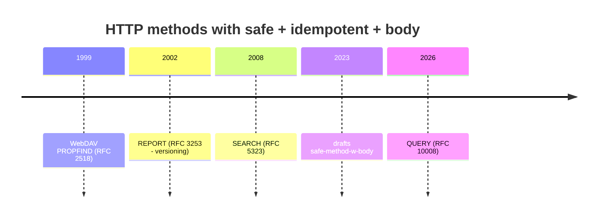
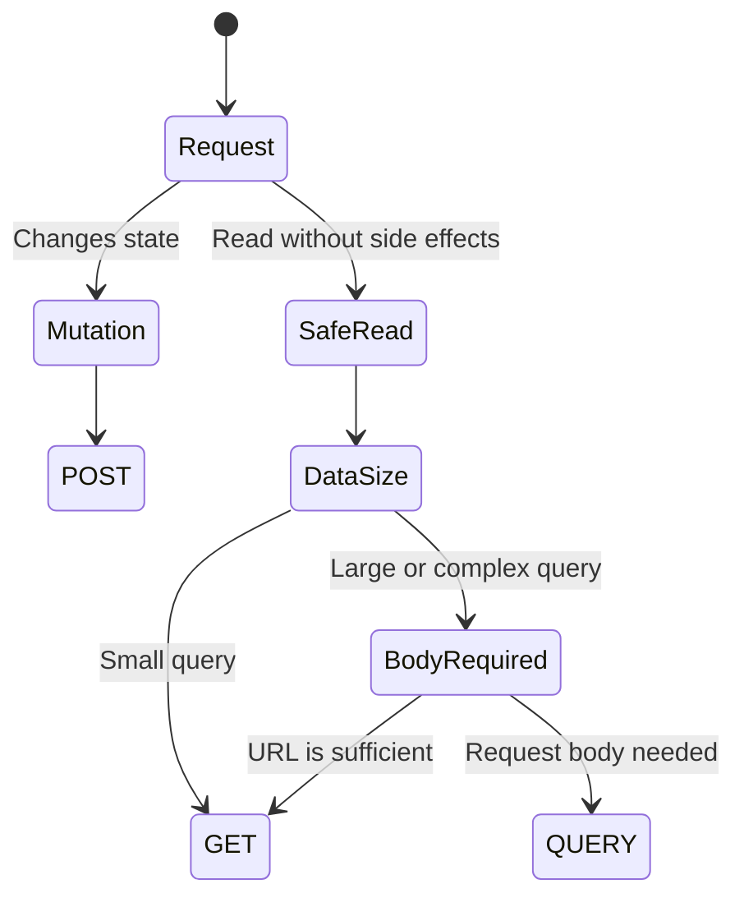
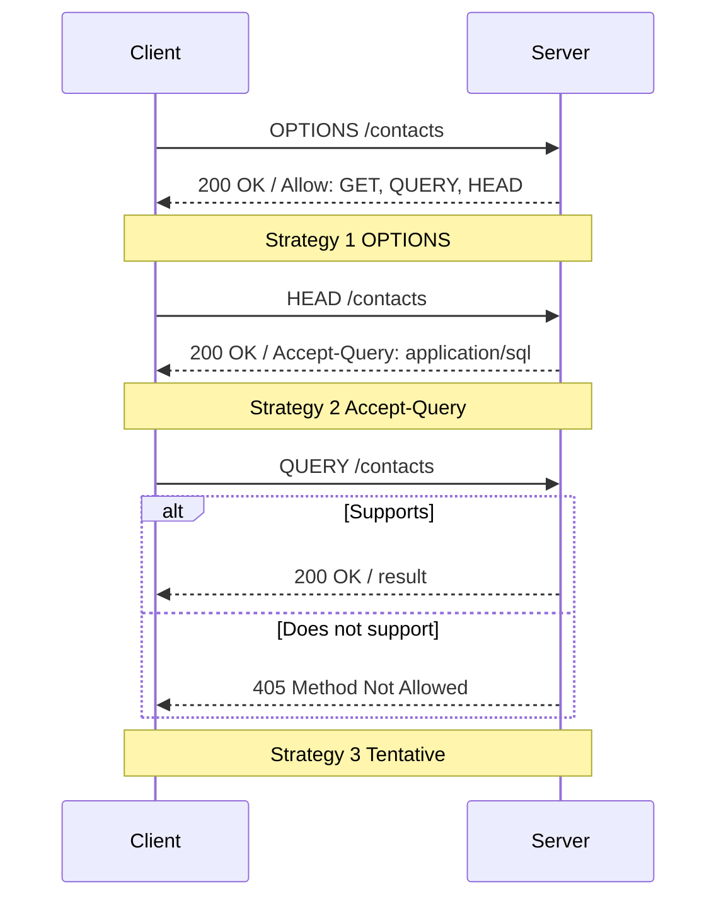
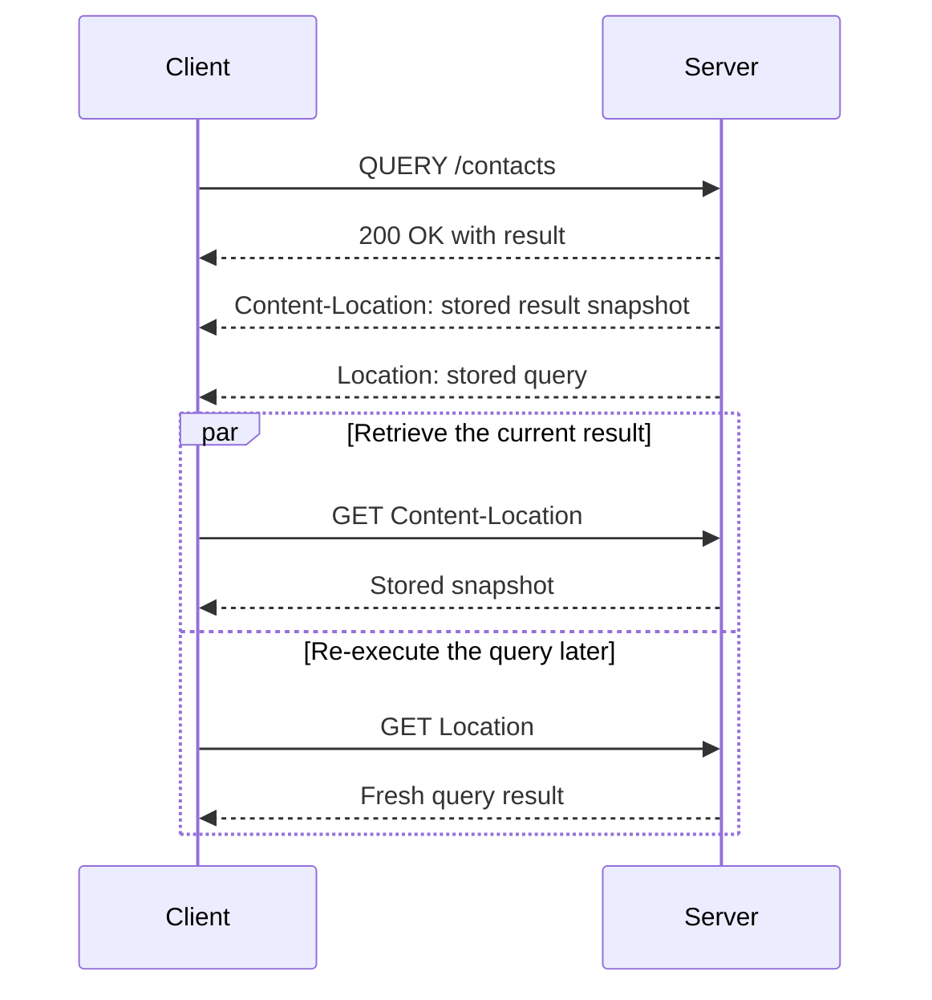
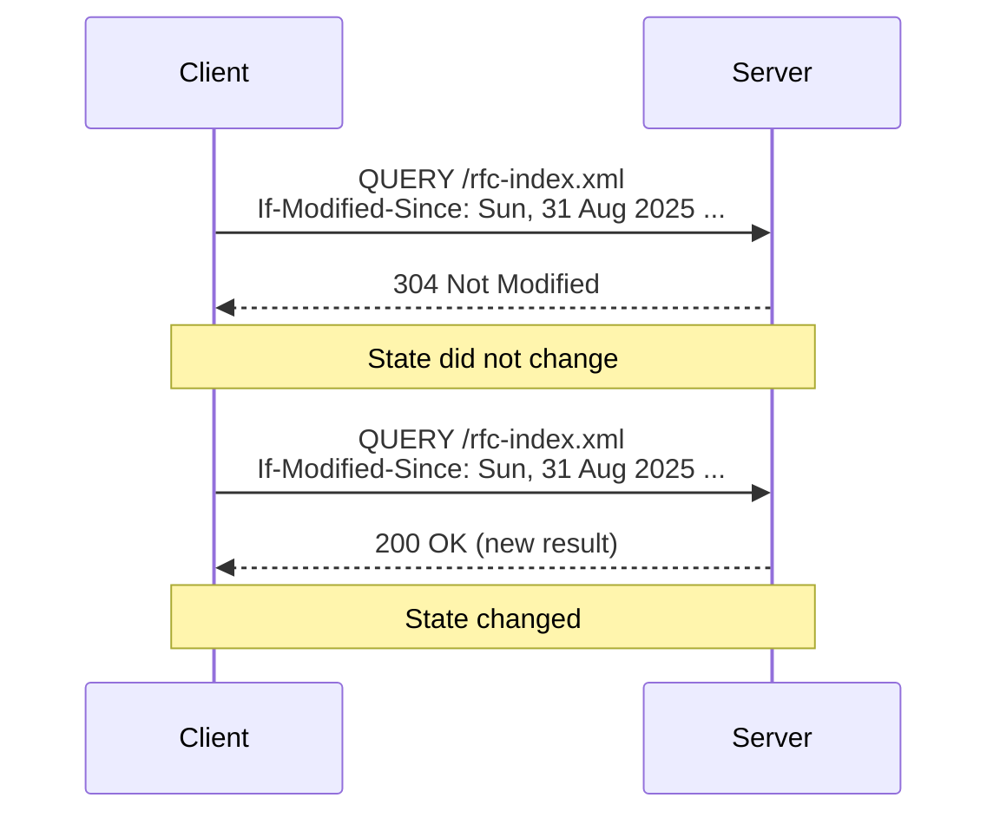
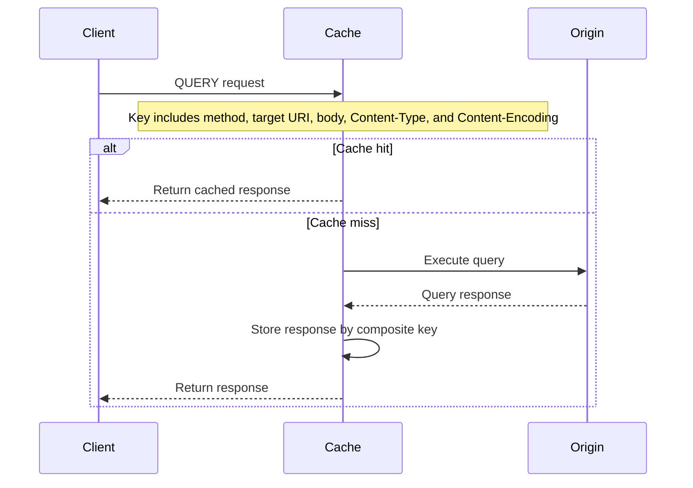
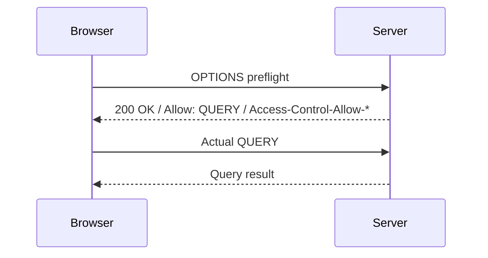

HTTP `GET` requests do not define semantics for a request body, while `POST` does not signal safe, idempotent query semantics by default. RFC 10008, published by the IETF in **June 2026**, defines **`QUERY`** for requests whose content carries query input and whose intended operation is safe and idempotent.

This article explains the method's history and semantics, compares it with `GET` and `POST`, and examines caching, security, and deployment considerations.

## Why define another HTTP method?

HTTP/1.1, defined in **RFC 9110** (and historically in RFC 7231), has well-known limitations when you want to express a complex query:

- **`GET`** cannot carry a request body with defined semantics. In theory it *can*, but neither proxies nor servers are required to do anything meaningful with it.
- **`POST`** can carry content, but is not safe or idempotent by default. A client cannot assume that repeating a POST is free of application-level effects; caching is possible only under the applicable HTTP rules and explicit response metadata.

A common workaround is to put simple filters in a `GET` URI or send complex query input in a `POST` body. The former can run into URI-length and logging concerns; the latter does not communicate safe, idempotent query semantics to HTTP intermediaries.



## History of HTTP methods with request content

The need for a "GET with body" is not new. Long before RFC 10008 was published, there was already a family of methods with the *safe and idempotent* profile born out of WebDAV:

- **`PROPFIND`** ([RFC 4918](https://www.rfc-editor.org/info/rfc4918))
- **`REPORT`** ([RFC 3253](https://www.rfc-editor.org/info/rfc3253))
- **`SEARCH`** ([RFC 5323](https://www.rfc-editor.org/info/rfc5323))

These methods are safe and idempotent and can carry request content, but they are associated with specific WebDAV use cases. RFC 10008 defines a general-purpose `QUERY` method; its authors include Julian Reschke, James M. Snell, and Mike Bishop. Early drafts used the name `SEARCH` before adopting **`QUERY`**:

> The name "QUERY" captures the relation with the URI's query component well, while detaching the new method from the WebDAV universe.



## RFC 10008 and the QUERY method

### What exactly does QUERY do?

> *"The QUERY method is used to initiate a server-side query. Unlike GET, which requests a representation of the resource identified by the target URI, the QUERY method is used to ask the target resource to perform a query operation within the scope of that target resource."*
>
> RFC 10008, Section 2

`QUERY` is not simply `GET` with a body: it has its own method semantics, and the request content describes how the target resource should perform the query.

```http
QUERY /feed HTTP/1.1
Host: example.org
Content-Type: application/x-www-form-urlencoded
Accept: application/json

q=foo&limit=10&sort=-published
```

### QUERY semantics

According to the IANA Method Registry, QUERY is registered as:

| Property | Value |
| :--- | :--- |
| **Method Name** | `QUERY` |
| **Safe** | yes |
| **Idempotent** | yes |
| **Specification** | Section 2 of RFC 10008 |
| **Cacheable** | yes |

Being **safe** means the client does not request a state change to the target resource; it does not prohibit incidental effects such as logging. Being **idempotent** means repeating the same request has the same intended effect as making it once, so clients can retry it after failures without requesting additional application-level changes.

### Mandatory content type

RFC 10008 requires servers to reject a request when its content type is missing or inconsistent with the content:

> *"Servers MUST fail the request if the Content-Type request field is missing or is inconsistent with the request content."*
>
> RFC 10008, Section 2

If the `Content-Type` is missing → **400 Bad Request**. If it is supported but inconsistent with the content → **400**. If it's not supported by the resource → **415 Unsupported Media Type**. If the content was parsed but the query is logically impossible → **422 Unprocessable Content**.

## GET vs QUERY vs POST: side by side

The table summarizes how the methods differ under HTTP semantics:

| | **GET** | **QUERY** | **POST** |
| :--- | :--- | :--- | :--- |
| **Safe** | yes | yes | no by default; an application may constrain effects |
| **Idempotent** | yes | yes | no by default; an application may define repeatable behavior |
| **URI for query itself** | yes (by definition) | optional via `Location` | no |
| **URI for the result** | optional via `Content-Location` | optional via `Content-Location` | optional |
| **Cacheable** | subject to HTTP cache rules | subject to HTTP cache rules and the QUERY cache key | subject to HTTP cache rules; limited to later GET/HEAD reuse |
| **Content (body)** | *"no defined semantics"* | **expected** (semantics per resource) | expected |



## Discovering QUERY Support

The spec offers **three** forms of discovery, from least to most invasive:

### 1. `OPTIONS`

```http
OPTIONS /contacts HTTP/1.1
Host: example.org
```

```http
HTTP/1.1 200 OK
Allow: GET, QUERY, OPTIONS, HEAD
```

### 2. `Accept-Query` response header

```http
HEAD /contacts HTTP/1.1
Host: example.org
```

```http
HTTP/1.1 200 OK
Content-Type: text/html
Accept-Query: "application/x-www-form-urlencoded", application/sql;charset="UTF-8"
```

### 3. Tentative QUERY

Just send a `QUERY` and see what happens. If the server doesn't support it, the response will be a **`405 Method Not Allowed`** with `Allow`.



## Detailed example: querying a contact list

Reproducing Example A.1 of the RFC, slightly annotated:

### Request

```http
QUERY /contacts HTTP/1.1
Host: example.org
Content-Type: application/x-www-form-urlencoded
Accept: application/json

select=surname,givenname,email&limit=10&match=%22email=*@example.*%22
```

### Response

```http
HTTP/1.1 200 OK
Content-Type: application/json

[
  { "surname": "Smith", "givenname": "John", "email": "smith@example.org" },
  { "surname": "Jones", "givenname": "Sally", "email": "sally.jones@example.com" },
  { "surname": "Dubois", "givenname": "Camille", "email": "camille.dubois@example.net" }
]
```

The server returned a result without changing the target resource. `QUERY` is defined as safe and idempotent, but a particular response is cacheable only when the HTTP caching rules and response metadata allow it.

## Content-Location and Location: two distinct roles

The server can use two response headers to let clients retrieve a query result later:

- **`Content-Location`**: A URI that returns the **current result** of the query (a snapshot).
- **`Location`**: A URI that returns a **future result** if the same query is executed again (refreshed state).



This permits a pattern where the first request uses `QUERY` and the server returns a stable `Location`; a later `GET` can retrieve that resource using ordinary HTTP cache rules.

## Conditional requests

Because QUERY inherits the **selected representation** semantics of GET, conditional headers work normally:

- `If-Modified-Since`
- `If-None-Match` (with ETag)
- `If-Match`
- `If-Unmodified-Since`

If the selected representation hasn't changed, the server can respond with **`304 Not Modified`** and omit the response body.



## Redirection: 301, 302, 307, 308 and 303

The spec explicitly removes the historical exception of converting `POST → GET` after a 301/302. For QUERY:

- **`301` / `308`**: The resource has moved permanently. Retain the method.
- **`302` / `307`**: The resource has moved temporarily. Retain the method.
- **`303` (See Other)**: The server suggests moving on to a `GET` on the URI in `Location`.

```http
HTTP/1.1 303 See Other
Content-Type: text/plain
Location: /contacts/stored-queries/42

See stored query at "/contacts/stored-queries/42".
```

A client can use `QUERY` first, then retrieve the stored query result with `GET`.

## Caching: the request-content key

RFC 10008 requires the cache key for a `QUERY` request to include its content and related metadata:

> *"The cache key for a QUERY request MUST incorporate the request content and related metadata."*
>
> RFC 10008, Section 2.7

In practice, this means the cache **must read the entire body** to compute the key. A simple `"URI → response"` table is not enough. To alleviate this, caches MAY normalize semantically insignificant differences (encoding, whitespace, etc.). With the directive **`no-transform`**, the client can refuse these normalizations.

If the server returns a stable `Location`, a client can use `GET` for later retrievals; caching those responses still depends on their cache directives and validators.



> *"Note that caching QUERY method responses is inherently more complex than caching responses to GET."* — RFC 10008, Section 2.7

## Range requests

The RFC says HTTP range requests offer little value for QUERY because query formats such as SQL, JSONPath, and GraphQL already have pagination mechanisms. Using HTTP `Range` headers with QUERY is permitted.

## Security considerations

- Request bodies may be logged by applications or infrastructure, so using a body does not by itself protect sensitive query data.
- If the server creates a temporary URI for the equivalent resource (`Location`), that URI MUST NOT contain sensitive query content, which could otherwise appear in access logs.
- **CORS**: `QUERY` is not in the CORS-safelisted methods. Every cross-origin request triggers a **preflight (`OPTIONS`)**.



## What QUERY changes for API design

`QUERY` gives HTTP a method for read-oriented operations whose input is carried in request content, with safe and idempotent semantics. This can be useful when criteria are too complex for a URI or when an API needs to distinguish a query from a state-changing `POST`.

Those semantics permit clients to retry requests and allow compatible caches to store responses, but neither behavior is automatic: the server must honor the method contract, and caches must include the request content in their keys and follow HTTP cache directives. A request body may still be logged, so sensitive input needs the same logging and data-protection controls as other request content.

## Deployment and adoption considerations

RFC 10008 standardizes the method, but implementations and intermediaries may add support at different times. Before using `QUERY`, verify that the selected server framework, clients, gateways, caches, API description tools, and security policies recognize it and preserve its semantics.

Cross-origin browser requests require CORS preflight because `QUERY` is not a safelisted method. A shared cache must understand the request-content cache key; a cache that keys only by method and target URI is insufficient. Teams should also document the accepted content types, query limits, caching policy, and fallback behavior for clients or infrastructure that do not support the method.

## Conclusion

RFC 10008 defines a standard method for safe, idempotent queries whose input is carried in request content. It does not replace `GET` or `POST` universally: use each method according to the operation's semantics, and verify that the participating clients, servers, and intermediaries support `QUERY` correctly.

## Further reading

- [RFC 10008: The HTTP QUERY Method](https://www.rfc-editor.org/info/rfc10008)
- [RFC 9110: HTTP Semantics](https://www.rfc-editor.org/rfc/rfc9110.html)
- [RFC 9111: HTTP Caching](https://www.rfc-editor.org/info/rfc9111)
- [Hypertext Transfer Protocol (HTTP) Method Registry](https://www.iana.org/assignments/http-methods/http-methods.xhtml)
