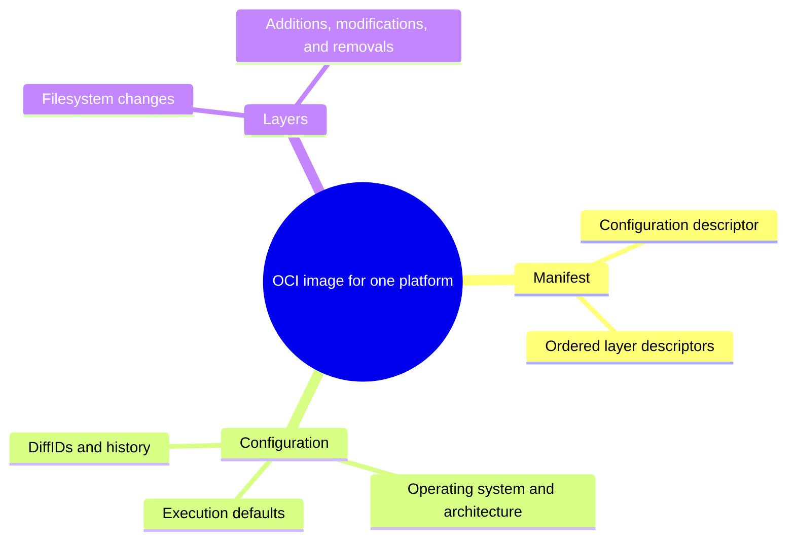

When we run `docker pull nginx:alpine` or use `nginx:alpine` in a `FROM` instruction, we work with a reference that looks like it points to a single file. In reality, a container image is a collection of digest-addressed content and metadata that describes how to combine and run it.

OCI stands for **Open Container Initiative**, an open standards project that maintains specifications for container images, runtimes, and distribution. In this article, an *OCI image* means an image arranged according to the OCI Image Format Specification, which defines how its manifest, configuration, and filesystem layers are represented and linked. OCI is not a container engine such as Docker or a filesystem implementation; it is a format that different tools can produce and consume.

Understanding that structure helps explain why images can share content, how filesystem changes are represented, and why deleting a file in a later layer does not always reduce an image's size.

## An image is not a container

An image bundles the userspace files an application needs — such as executables, libraries, and configuration — along with metadata that provides defaults for execution. It is not, by itself, a running process or a virtual machine with its own kernel.

A container is an instance created from the image. The runtime prepares its filesystem and process settings; in many Linux environments, it also associates a writable layer with that instance. The original image remains unchanged.

## Layers are filesystem changes

A *layer* represents a set of changes relative to the previous filesystem state: files added, modified, or removed. It is not necessarily a complete copy of a directory tree.

For example, an image might start with base files, add Nginx, and then include an HTML page:

```text
Base layer:
  bin/sh
  etc/os-release

Nginx layer:
  usr/sbin/nginx
  etc/nginx/nginx.conf

Application layer:
  usr/share/nginx/html/index.html
```

Applied from the base to the top, these changes produce the filesystem visible in the image. If an upper layer replaces a file, the upper version appears in the result. The lower layers remain unchanged.

Removals also need to be represented without altering an immutable layer. In the OCI format, a layer can contain a special file called a *whiteout*, which marks a path from a lower layer as removed. For example, `.wh.old-config` indicates that `old-config` should not appear in the final filesystem.

This has a practical consequence: if a build adds a file in one layer and removes it in a later one, the removal does not erase the bytes from the earlier blob. The image still includes the layer that contains them. To avoid that waste, do not leave unnecessary artifacts in earlier layers, or use a build strategy that keeps them out of the final image.

## From Dockerfile to image

A Dockerfile describes instructions for building an image. Consider this example:

```dockerfile
FROM nginx:alpine
COPY index.html /usr/share/nginx/html/index.html
```

`FROM` establishes the base image. `COPY` adds the file to the filesystem, and its result becomes part of the built image's layers. The Dockerfile is a build recipe; it does not need to be present in the final image for the container to run.

Not every instruction changes the filesystem. Instructions such as `ENV`, `CMD`, and `ENTRYPOINT` set configuration metadata. Instructions that modify the filesystem can produce layers in the result. Details also depend on the builder: for example, intermediate stages in a multi-stage build can be used to produce the image without appearing in the final image.

When we run:

```bash
docker build -t dyotamo/my-app:v1 .
```

the builder reads the Dockerfile and build context, resolves the base image, executes the instructions, and produces the resulting content and metadata. The build context — the files made available to the builder — can also affect the result and whether cache can be reused.

### Build cache is not the same as an image layer

Builders can reuse the results of earlier steps when their inputs remain valid. Instruction order affects that reuse. In a Go application, for example, copying dependency files first allows the dependency-download step to be reused when only source code changes:

```dockerfile
FROM golang:alpine
WORKDIR /app
COPY go.mod go.sum ./
RUN go mod download
COPY . .
RUN go build -o server .
```

The cache is a builder mechanism; it should not be confused with the composition of image layers. Changing an input can invalidate a step and its dependent steps, even if some of their final outputs appear similar. The order above reduces how often dependencies need to be downloaded, provided the dependency files have not changed and the cache can be used.

## The components of an OCI image

The OCI format separates the manifest, image configuration, and layer contents. The manifest connects these components through *descriptors*, which specify properties such as the content type, size, and digest.



### Manifest: references to content

An OCI manifest is a JSON document that describes an image for one platform, such as Linux/amd64. It contains a descriptor for the configuration and an ordered list of layer descriptors. The blobs are not embedded in the JSON; they are identified by their digests and sizes.

A simplified example:

```json
{
  "schemaVersion": 2,
  "mediaType": "application/vnd.oci.image.manifest.v1+json",
  "config": {
    "mediaType": "application/vnd.oci.image.config.v1+json",
    "digest": "sha256:abc123...",
    "size": 702
  },
  "layers": [
    {
      "mediaType": "application/vnd.oci.image.layer.v1.tar+gzip",
      "digest": "sha256:def456...",
      "size": 102400
    }
  ]
}
```

The values are illustrative. A digest identifies content using a cryptographic hash; the descriptor lets a client verify that received content matches what was expected. For images that support multiple platforms, an *image index* can point to separate manifests, for example for `linux/amd64` and `linux/arm64`.

### Configuration: properties and defaults

The configuration blob describes the platform and contains defaults that a runtime can use when creating a container, such as environment variables, a working directory, a user, `Entrypoint`, and `Cmd`. These defaults can be overridden by options provided when the container is created.

The configuration also records the layers' `diff_ids` and, optionally, build history. A `diff_id` is the digest of the **uncompressed** layer tar archive. It is not necessarily the same as the digest in the manifest descriptor, which identifies the distributed blob — for example, content compressed with gzip.

### Layers: blobs containing changes

Layers are blobs that carry filesystem changes in a tar-based format. OCI defines media types for uncompressed tar content and compressed variants such as gzip or zstd. A tool may choose a supported representation, so not every layer has to be a gzip-compressed tar archive.

Order matters: the manifest lists the base layer first, followed by subsequent changes. The final result is computed by applying them in that order, including the special handling required for whiteouts.

| Component | Responsibility |
|---|---|
| Manifest | References the configuration and layers in application order |
| Configuration | Describes the platform, execution defaults, and `diff_ids` |
| Layers | Carry filesystem changes |

## A tag is not an immutable identifier

A reference such as `dyotamo/my-app:v1` combines an image name with a tag. A tag is a readable reference and can be moved to point to different content. A digest, such as `sha256:…`, identifies specific content.

This distinction matters when an exact deployment must be reproducible: a tag can change over time, while a digest reference pins the identified content. Digests also let a registry and client recognize identical blobs and avoid transferring them again.

## Distribution and execution

When an image is pushed to a registry, the manifest and blobs are transferred as digest-identified content. A client can reuse blobs it already has and verify received content. Common commands for publishing and retrieving an image are:

```bash
docker push dyotamo/my-app:v1
docker pull dyotamo/my-app:v1
```

When a container runs, the image remains the read-only base. On Linux, a runtime may use OverlayFS to present the image's filesystem layers together with a writable layer specific to the container. This storage choice is separate from the OCI image format: OCI describes the image contents, while OverlayFS is one Linux filesystem implementation that can present directory trees as a single view.

Changes made only in the container's writable layer do not modify the image or automatically become visible to other containers. That layer is also generally not the right place for data that must survive container removal; use volumes or other persistent storage for that purpose.

## OverlayFS: how a merged filesystem works

OverlayFS is a Linux union filesystem. It combines a read-only lower directory tree with a writable upper directory tree and exposes them through a mounted merged directory. A runtime can map unpacked image layers to lower directories and place the container's changes in the upper directory.

| OverlayFS path | Role |
|---|---|
| `lowerdir` | One or more read-only directory trees, such as unpacked image layers |
| `upperdir` | Stores changes and newly created files |
| `workdir` | Private working area used by OverlayFS; it must be on the same filesystem as `upperdir` |
| merged mount | The unified filesystem view visible to processes |

On lookup, OverlayFS uses an upper entry when one exists; otherwise it falls back to the lower tree. Directories present in both trees are merged. Reads of an unchanged lower file can therefore use the lower file directly, without first copying it into the upper tree.

### Copy-on-write means copy-up on modification

When an operation needs to modify a lower-layer file, OverlayFS performs **copy-up**: it creates the required parent directories in the upper tree, copies the file's metadata and data there, and then applies the write to that upper copy. The lower file remains unchanged. New files are created directly in the upper tree.

This is copy-on-write at the file level, not necessarily a block-by-block copy of only the bytes changed. The first modification of a large lower file can therefore incur a one-time cost in copy time and upper-layer space; subsequent writes use the upper copy. OverlayFS has optional metadata-only copy-up behavior, but its availability and configuration are kernel-specific; it is not needed for the basic example below.

Removing a lower-layer file also cannot alter the lower tree. OverlayFS records a whiteout in the upper tree so the name is hidden in the merged view. Linux OverlayFS can represent it as a character device with device number 0/0 or as a zero-length regular file with an OverlayFS whiteout extended attribute; the exact form depends on configuration. This is not the same thing as an OCI layer archive entry such as `.wh.old-config`: OCI specifies how removals are encoded in a distributable layer, while OverlayFS uses its own filesystem-level markers. In both cases, the lower content remains untouched.

### Observe copy-up on a Linux host

You can see the same behavior without Docker by mounting OverlayFS directly. This requires a Linux kernel with OverlayFS support and permission to mount filesystems, usually through `sudo`. The upper filesystem must support extended attributes and valid directory-entry types; local ext4 and XFS filesystems are common choices. `upperdir` and `workdir` must be empty directories on the same filesystem. These commands create them as siblings under one temporary directory. Run the commands in the same terminal because they reuse `$demo`.

```bash
demo=$(mktemp -d)
mkdir -p "$demo"/{lower,upper,work,merged}
printf 'from lower layer\n' > "$demo/lower/message.txt"
printf 'remove me\n' > "$demo/lower/obsolete.txt"

sudo mount -t overlay overlay -o "lowerdir=$demo/lower,upperdir=$demo/upper,workdir=$demo/work" "$demo/merged"
findmnt -T "$demo/merged"
cat "$demo/merged/message.txt"

printf 'changed through merged mount\n' | sudo tee "$demo/merged/message.txt" >/dev/null
printf 'created in upper layer\n' | sudo tee "$demo/merged/new.txt" >/dev/null
sudo rm "$demo/merged/obsolete.txt"

cat "$demo/lower/message.txt"
cat "$demo/upper/message.txt"
ls "$demo/merged"
ls -la "$demo/upper"

sudo umount "$demo/merged"
sudo rm -r -- "$demo"
```

`findmnt` identifies the mount. The first `cat` reads `message.txt` from `lower`; after the write, the lower copy remains unchanged and `upper/message.txt` contains the replacement. The new file appears in `upper`, while `ls "$demo/merged"` no longer lists `obsolete.txt`. The final listing of `upper` shows the whiteout that hides it. The last two commands unmount OverlayFS and remove the temporary directory. If the mount fails, check that OverlayFS is enabled and that the upper filesystem supports its requirements. Docker and other runtimes may use different storage drivers or snapshotters, so their internal paths and behavior are not necessarily identical to this direct mount.

## What to remember

An OCI image is a collection of digest-addressed content and metadata. The manifest references the configuration and layers; the configuration describes the platform and execution defaults; the layers record ordered filesystem changes. This separation makes it possible to share blobs, select images by platform, and consistently reconstruct an application's filesystem.

With this structure in mind, it is easier to see why a tag does not guarantee identity, why removing files in later layers may not reduce transferred content, and why a container's writable state is not the same as its source image.

## Further reading

- [OCI Image Format Specification: Manifest](https://github.com/opencontainers/image-spec/blob/main/manifest.md)
- [OCI Image Format Specification: Image Configuration](https://github.com/opencontainers/image-spec/blob/main/config.md)
- [OCI Image Format Specification: Layers](https://github.com/opencontainers/image-spec/blob/main/layer.md)
- [Docker build cache](https://docs.docker.com/build/cache/)
- [Docker storage drivers](https://docs.docker.com/engine/storage/drivers/)
- [Linux kernel documentation: OverlayFS](https://docs.kernel.org/filesystems/overlayfs.html)
