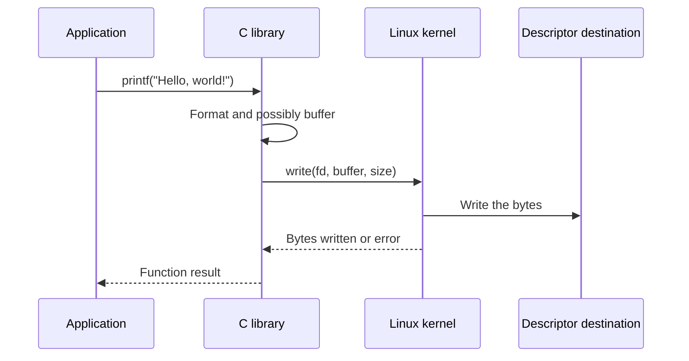

*An executable can be present in a container and still fail with “No such file or directory.” Understanding why means distinguishing libc, system calls, the dynamic loader, and the ABI.*

## The path from a function to the kernel

Consider this C program:

```c
#include <stdio.h>

int main(void) {
    printf("Hello, world!\n");
    return 0;
}
```

The call to `printf` does not jump directly from C code into the kernel. `printf` is part of the C standard library; its implementation formats the text and may temporarily hold it in a buffer. When the data needs to be sent, the implementation asks the operating system to write to a file descriptor, typically through `write`.

A **system call**, or syscall, is the low-level interface a process uses to request a kernel service. Reading and writing files, creating memory mappings, and starting processes are examples of operations that can involve syscalls. The program runs in *userspace*; a syscall triggers a controlled transition to *kernel space*, where the kernel validates and performs the authorized operation.



This path is conceptual. `printf` may perform several writes or no immediate syscall at all, for example, while output remains buffered. Conversely, functions such as `strlen` can operate entirely in userspace memory. **Not every libc function calls the kernel.**

Nor is the C function `write` itself the system call. Libc provides a function with that interface and handles details such as the architecture's syscall ABI and translating errors into `-1` and `errno`. The actual transition uses an architecture-specific instruction, such as `syscall` on x86-64 or `svc` on AArch64. Linux syscall numbers and argument-passing conventions are specific to the architecture and ABI.

## What does libc mean?

**libc** is the common name for an implementation of the C standard library, often accompanied by POSIX interfaces and system-specific extensions. The C language's standard library includes functions such as `printf`, `malloc`, `strlen`, and `memcpy`. POSIX adds interfaces used by Unix-like systems, such as `fork` and `pthread_create`; the available implementation depends on the platform and the applicable standard.

Libc does much more than wrap syscalls. Along with functions that perform kernel operations, it provides string routines, memory allocation, buffered input and output, conversions, locale support, process management, and other functionality. Some of this work is entirely in userspace; other operations combine library logic with kernel calls.

There are several implementations. **glibc** is the GNU implementation used by many Linux distributions, including Debian, Ubuntu, and Fedora. **musl** is an alternative widely used by Alpine Linux. **uClibc-ng** is aimed primarily at embedded Linux systems. They can share APIs without making their binaries automatically interchangeable.

## API and ABI are different contracts

An **API** describes the interface used to write source code: function names, types, arguments, and promised behavior. An **ABI** describes how already-compiled components communicate: calling conventions, structure layouts, type representations, symbol names and versions, executable format, linking, and binary interfaces with libraries.

Two C libraries can expose a compatible `printf` API and still fail to provide the same binary ABI. An executable may require not only a function named `printf`, but a versioned glibc symbol, a library with a particular name, or the target's specific dynamic loader. Implementation-specific extensions, such as glibc's `malloc_trim`, are also not part of a universal contract.

The linker resolves symbols while combining object files and libraries. For example, `nm main.o` might show `U printf`: `U` means that the symbol is used but not defined in that object file. In a dynamically linked executable, some references are left for resolution during program startup or when the function is first used, depending on the linking strategy.

## The dynamic loader and a misleading error

**ELF**, the *Executable and Linkable Format*, is the standard file format for Linux executables, shared libraries, and object files. Its headers describe how the file is organized and how it should be loaded; segments describe the parts that need to be mapped into memory. An ELF executable may also name an interpreter, the dynamic loader, in a segment marked `INTERP`.

At startup, the kernel reads that interpreter path and starts the requested loader. The loader finds the required shared libraries, maps them into memory, resolves relocations, and transfers control to the program. A statically linked executable generally does not need a dynamic loader for shared-library resolution.

You can inspect these requirements without running the program:

```bash
readelf -l ./app
readelf -d ./app
readelf --version-info ./app
```

`readelf -l` helps locate the requested interpreter; `readelf -d` shows dynamic dependencies such as `DT_NEEDED`; the last command displays symbol version information. The interpreter path varies by architecture and toolchain. For example, an x86-64 executable built for glibc may request `/lib64/ld-linux-x86-64.so.2`.

If that file is missing from the runtime environment, the kernel may return `ENOENT` while trying to start the executable. The shell then prints “No such file or directory,” even though the executable itself exists. Later failures can also occur if a dependent library or required symbol is missing.

This is why copying a glibc binary into an Alpine image based on musl can fail. The executable expects a loader and userspace ABI that the image may not provide. Similar POSIX APIs do not replace binary compatibility. The most predictable approach is to build for the target environment or use a runtime image that provides the expected dependencies.

## Can a program run without libc?

Yes. The Linux kernel does not depend on libc: libc is a userspace library, not a layer the kernel needs in order to work. A program can start at its ELF entry point and issue syscalls directly. Doing so, however, ties the program to an architecture, an ABI, and the kernel's conventions.

This small example is assembly for Linux x86-64. It writes 14 bytes to descriptor 1 and exits with status zero:

```asm
.global _start
.section .text
_start:
    mov $1, %rax
    mov $1, %rdi
    lea message(%rip), %rsi
    mov $14, %rdx
    syscall
    mov $60, %rax
    xor %rdi, %rdi
    syscall
.section .rodata
message:
    .ascii "Hello, World!\n"
```

Assemble and link the object directly:

```bash
as --64 -o hello.o hello.s
ld -o hello hello.o
./hello
```

On Linux x86-64, `rax` holds the syscall number; for `write`, `rdi`, `rsi`, and `rdx` hold the descriptor, buffer address, and length. Number 60 is `exit`. This is only an illustration: it does not check errors or partial writes, and it is not portable to other architectures. In real applications, wrappers and libraries avoid repeating this work and help handle platform differences.

## Where do Go's runtime and CGO fit?

Go includes a runtime that manages goroutines, scheduling, garbage collection, and other services. In many configurations, a Go program can interact with the kernel without depending on libc, which helps make some executables distributable without shared C libraries. That does not mean every Go binary is always static or never needs native dependencies: the build configuration and libraries in use matter.

For example, `go` starts a goroutine, and the runtime schedules it. The wait group keeps `main` from returning before that goroutine finishes:

```go
package main

import (
	"fmt"
	"sync"
)

func main() {
	var workers sync.WaitGroup
	workers.Add(1)
	go func() {
		defer workers.Done()
		fmt.Println("running in a goroutine")
	}()
	workers.Wait()
}
```

**CGO** lets Go packages call C code and link native libraries. When a Go file imports the pseudo-package `C`, the Go tool invokes a C toolchain, and that file is subject to the `cgo` build constraint. This small example uses a C type, `C.int`, from Go:

```go
package main

import "C"

func main() {
	value := C.int(42)
	println(value)
}
```

Build it with CGO enabled and a C toolchain available:

```bash
CGO_ENABLED=1 go build -o app .
```

With `CGO_ENABLED=0`, this file is excluded; the standalone example then has no Go source left to build. In a real package, an alternative Go implementation may be available, or compilation may fail if no alternative exists. Calling C functions also requires their declarations, usually provided by C headers.

Enabling CGO does not by itself mean the result will always use dynamic linking or glibc. The C compiler, linker options, native libraries, and target image determine the actual dependencies. A CGO binary built against glibc may require glibc at runtime; to run it on a musl system, build with a musl-compatible toolchain and libraries, or choose a runtime image that supplies the expected glibc. Static linking can remove some dynamic dependencies, but it does not automatically resolve architecture, kernel, external-data, or behavioral incompatibilities.

When investigating a binary, start by inspecting its format and interpreter with `readelf`. `ldd ./app` is convenient for viewing shared libraries in a trusted executable, but should not be used to inspect untrusted binaries because, depending on the implementation, it can involve executing the loader. `strace ./app` helps observe syscalls once the program starts and runs. For container builds, validate the binary against the userspace family and architecture of the final image.

## A mental model to keep

The language defines how we express the program; the runtime implements language-specific services; libc provides the C library and userspace interfaces; the ABI lets compiled components understand one another; the loader prepares ELF dependencies; and syscalls carry requests to the kernel. These boundaries are related, but distinct.

Understanding them turns vague startup errors into verifiable questions: what format and architecture is the binary? Which ELF interpreter does it request? Which libraries and symbol versions does it need? Was it built for the libc present in the image? Is the CGO path enabled? Those answers are usually more useful than knowing only which language the source was written in.

## Further reading

- [Linux man-pages: syscall(2)](https://man7.org/linux/man-pages/man2/syscall.2.html)
- [Linux man-pages: ld.so(8)](https://man7.org/linux/man-pages/man8/ld.so.8.html)
- [Linux man-pages: elf(5)](https://man7.org/linux/man-pages/man5/elf.5.html)
- [Go CGO documentation](https://pkg.go.dev/cmd/cgo)
- [GNU C Library](https://www.gnu.org/software/libc/)
- [musl libc](https://musl.libc.org/)
