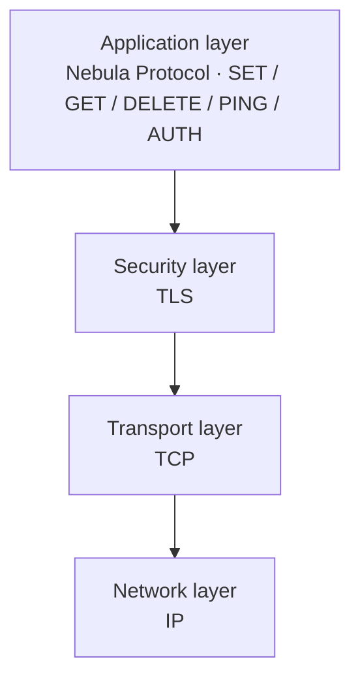
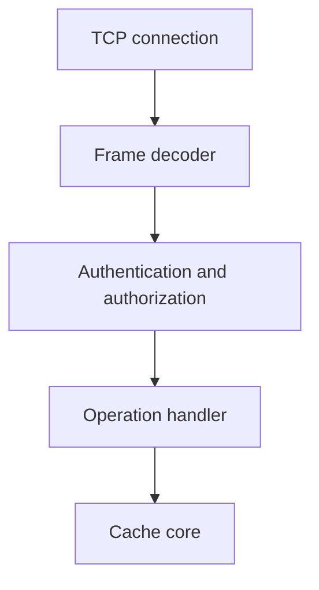
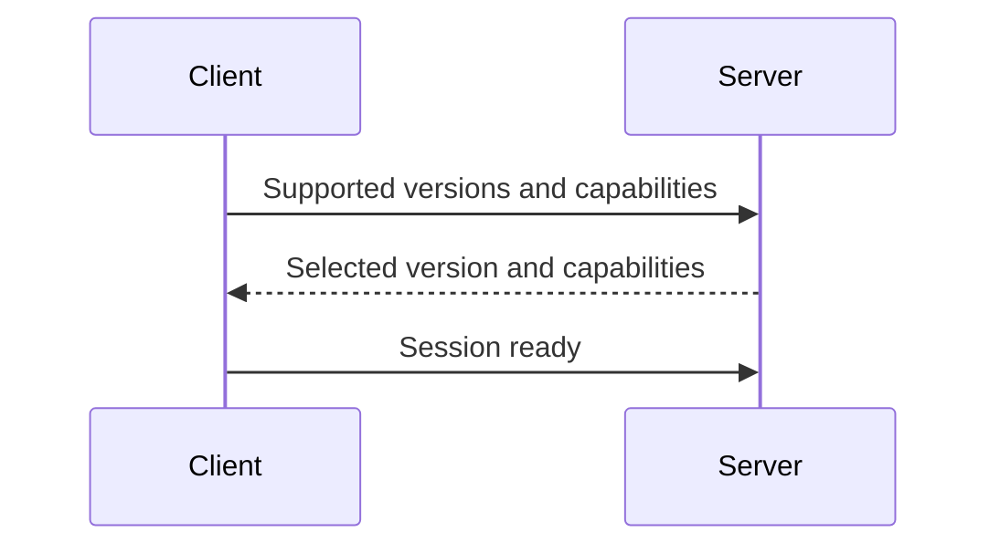
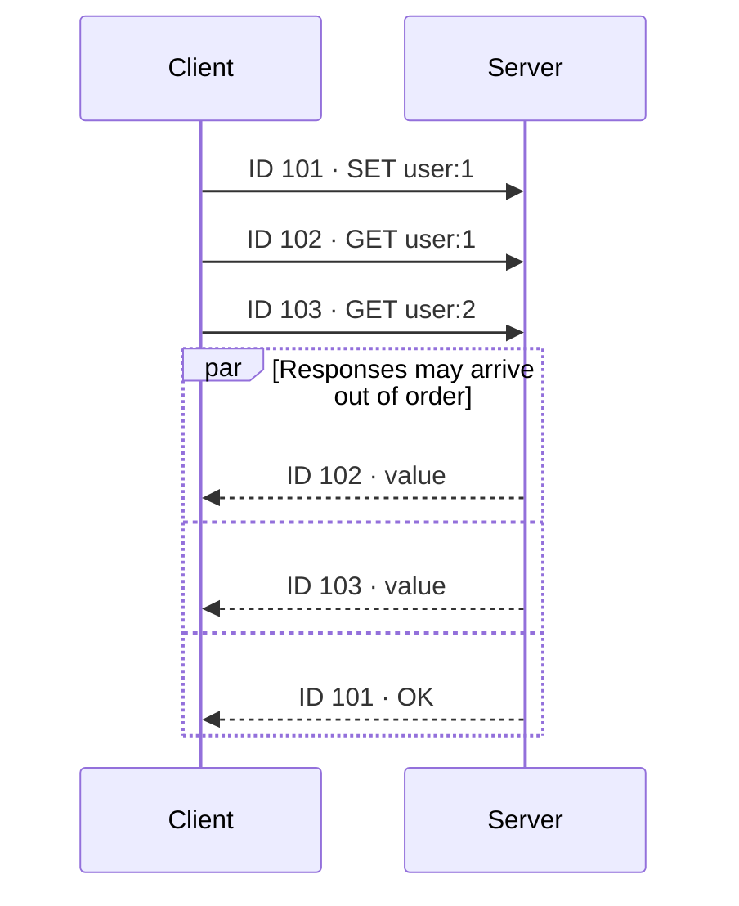
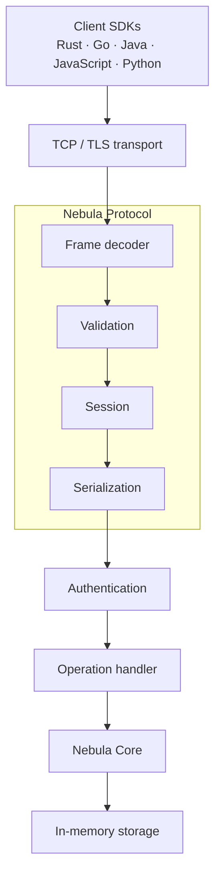

Imagine building an in-memory cache. The goal sounds simple: let applications store and retrieve values with as little latency as possible.

A client needs to look up a key:

```text
GET user:123
```

The server receives the operation, checks memory, and returns the value. We could expose this through HTTP, use gRPC, implement Redis's protocol, or adopt the Memcached protocol. Those are all reasonable options. So why build another protocol?

The question that led to **Nebula Protocol** was whether we wanted full control over how clients communicate with the NebulaCache server: how operations are represented on the wire, how data is encoded, where messages end, and how the interface evolves as the product gains features.

Nebula Protocol is a versioned binary application-layer protocol built on TCP. It is the communication interface between NebulaCache SDKs and the server. To understand why it exists, we first need to look at the alternatives and the problem the protocol must solve.

## Why not use an existing protocol?

Before designing a protocol, it is worth understanding what established options already provide.

### REST over HTTP

A first approach might expose cache operations through HTTP endpoints:

```http
PUT /cache/user:123
Content-Type: application/octet-stream

<value>
```

And to retrieve the value:

```http
GET /cache/user:123
```

HTTP is familiar, widely supported, and backed by a huge ecosystem. It was also my initial instinct, especially in a world where so many services are designed around REST.

HTTP brings its own message structure and resource-oriented model. For a cache workload made up of small, frequent operations, that structure may be more than the operation itself needs. This does not mean HTTP is inherently slow or unsuitable; HTTP/1.1 and HTTP/2 can perform very well. The question is whether we want HTTP semantics to be the primary interface to this cache.

### gRPC and Protocol Buffers

Another option is gRPC, with services and messages defined using Protocol Buffers:

```protobuf
syntax = "proto3";

service CacheService {
  rpc Get(GetRequest) returns (GetResponse);
  rpc Set(SetRequest) returns (SetResponse);
  rpc Delete(DeleteRequest) returns (DeleteResponse);
}

message GetRequest {
  bytes key = 1;
}

message GetResponse {
  bytes value = 1;
  bool found = 2;
}
```

gRPC offers explicit contracts, generated code, support for many languages, streaming, and mature communication mechanisms. It is an excellent choice for service-to-service communication.

Using it would also mean adopting its RPC model, HTTP/2 infrastructure, and associated framing and serialization decisions. That is not necessarily a bad trade; it is simply a broader abstraction than the one we set out to build for NebulaCache.

### RESP and the Memcached protocol

We could also use protocols made for caching. Redis uses RESP (Redis Serialization Protocol), and Memcached has its own text and binary protocols. Both solve many of the same communication problems.

There is a difference, though, between implementing a product compatible with an existing protocol and building a product around a protocol shaped for its own requirements. NebulaCache is an opportunity to explore the latter.

### The decision

This is not an argument that a custom protocol is better than REST, gRPC, RESP, or Memcached. Each option already makes design choices and provides useful abstractions.

With Nebula Protocol, we choose to control:

- The binary wire format and operation representation.
- Header structure and message framing.
- Versioning and payload limits.
- Response semantics and future communication features.

That control comes with responsibility. We own the correctness, security, compatibility, and maintenance work that an established protocol would otherwise provide.

## The layers: what TCP does and does not do

Nebula Protocol is a Layer 7 (application-layer) protocol that uses TCP as its transport. Each layer has a different responsibility:



TCP transports an ordered, reliable stream of bytes between endpoints. TLS can protect that communication with confidentiality, integrity, and server authentication when configured correctly. Nebula Protocol gives the bytes their meaning.

When a client sends `GET user:123`, TCP does not know what `GET` means. To TCP, it is all bytes. The application protocol defines a structure the server can decode and interpret.

## The first challenge: turning a byte stream into messages

TCP is a **byte stream, not a message-oriented protocol**.

Suppose a client writes 100 bytes to a socket:

```rust
socket.write_all(&buffer).await?;
```

The server is not guaranteed to receive those bytes in a single read. It might receive 30 bytes, then 40, then 30; it might receive all 100 together; or a read may return fewer bytes than the complete message. TCP does not preserve the boundaries of the application's write calls.

A protocol built on TCP therefore needs **message framing**: a way for the receiver to tell where a message ends and the next begins.

Common approaches include delimiters such as newlines, fixed-size messages, length prefixes, or a header that declares the size of the following payload. Nebula Protocol uses a fixed-size header with explicit payload lengths. This makes the frame boundary clear and supports arbitrary binary values.

## The first Nebula Protocol frame

The current protocol uses a four-byte identifier, `NEBU`, called the **magic bytes**. They let the reader identify a Nebula Protocol frame. The current protocol version is `1`.

### Request frame

A request has a fixed 22-byte header followed by the key and value bytes:

| Field | Size | Representation |
|---|---:|---|
| Magic | 4 bytes | ASCII `NEBU` |
| Version | 1 byte | `u8` |
| Opcode | 1 byte | `u8` |
| Key length | 4 bytes | `u32` |
| Value length | 4 bytes | `u32` |
| TTL | 8 bytes | `u64` |
| Key | Variable | Bytes |
| Value | Variable | Bytes |

All integers use Big Endian encoding. The header is always 22 bytes, regardless of key and value sizes. The server reads the header first, then knows how many bytes it must consume to complete the frame.

### Why Big Endian?

Systems need to agree on how numbers are represented as bytes. For example, the number `0x00000100` is represented as `00 00 01 00` in Big Endian and `00 01 00 00` in Little Endian. If the client and server disagree, they interpret different values.

Specifying Big Endian makes the wire format independent of the native integer representation used by a particular language or machine architecture.

### Why explicit lengths?

Suppose we want to store the value `Hello` under the key `test`. The header can declare a key length of four and a value length of five, followed by those nine bytes.

The server does not need to search for a delimiter. It reads the lengths, then consumes the specified number of bytes. Since the payload is length-delimited, it can contain zero bytes, newlines, or any other byte sequence. Values are not restricted to UTF-8 strings.

## Decoding a request in Rust

With a frame format in place, we can implement its decoder. Rust's Tokio library provides asynchronous I/O abstractions for working with TCP streams. A simplified decoder looks like this:

```rust
use std::io::{self, ErrorKind};
use tokio::io::{AsyncRead, AsyncReadExt};

const MAGIC: &[u8; 4] = b"NEBU";
const VERSION: u8 = 1;
const HEADER_LEN: usize = 22;
const MAX_KEY_LEN: usize = 1024;
const MAX_VALUE_LEN: usize = 8 * 1024 * 1024;

pub struct Request {
    pub opcode: u8,
    pub key: Vec<u8>,
    pub value: Vec<u8>,
    pub ttl_secs: u64,
}

pub async fn read_request<R>(reader: &mut R) -> io::Result<Request>
where
    R: AsyncRead + Unpin,
{
    let mut header = [0u8; HEADER_LEN];
    reader.read_exact(&mut header).await?;

    if &header[0..4] != MAGIC {
        return Err(io::Error::new(ErrorKind::InvalidData, "invalid magic"));
    }

    if header[4] != VERSION {
        return Err(io::Error::new(ErrorKind::InvalidData, "unsupported version"));
    }

    let opcode = header[5];
    let key_len = u32::from_be_bytes(header[6..10].try_into().unwrap()) as usize;
    let value_len = u32::from_be_bytes(header[10..14].try_into().unwrap()) as usize;
    let ttl_secs = u64::from_be_bytes(header[14..22].try_into().unwrap());

    if key_len > MAX_KEY_LEN || value_len > MAX_VALUE_LEN {
        return Err(io::Error::new(ErrorKind::InvalidData, "frame too large"));
    }

    let mut key = vec![0u8; key_len];
    let mut value = vec![0u8; value_len];
    reader.read_exact(&mut key).await?;
    reader.read_exact(&mut value).await?;

    Ok(Request {
        opcode,
        key,
        value,
        ttl_secs,
    })
}
```

This illustrates the framing principle rather than every detail of the current implementation. In production code, the protocol has dedicated types for opcodes, responses, errors, and frame limits, as well as validation for each operation's structure.

The important detail is `read_exact()`: the decoder does not assume that a single read will fill the header. It keeps reading until the requested buffer is complete or an error occurs. The same is true for the key and value after the header has been validated.

### Validate lengths before allocating

Imagine a client sends a header declaring `VALUE_LENGTH = 4294967295`. If the server trusts that number and allocates a buffer immediately, a malicious client could request an unreasonable amount of memory.

The current limits are a maximum 1 KiB key and an 8 MiB value. They can also be represented through `FrameLimits`, so the decoder and encoder can use configured bounds. Validating lengths before allocation is a fundamental protocol responsibility: a protocol must define how to handle invalid messages as well as valid ones.

## How the server interprets operations

After decoding a frame, the server interprets its opcode:

| Operation | Opcode | Purpose |
|---|---:|---|
| SET | 1 | Store a value |
| GET | 2 | Retrieve a value |
| DELETE | 3 | Remove a key |
| PING | 4 | Check availability |
| AUTH | 5 | Authenticate a connection |

An opcode of `1` represents a client's intent to perform a `SET`. The opcode is not the operation itself; it is a compact representation of that intent. The operation is executed at a different layer.

The high-level flow is:



This keeps communication concerns separate from the cache engine. The `CacheStore` does not need to know that a `GET` arrived as opcode `2` over TCP. It receives an interpreted operation, which makes it possible to evolve the protocol without unnecessarily changing the storage core.

## Response frames

After executing an operation, the server returns a response frame with a fixed 10-byte header:

| Field | Size |
|---|---:|
| Magic | 4 bytes |
| Version | 1 byte |
| Status | 1 byte |
| Value length | 4 bytes |
| Value | Variable |

The status indicates the operation result:

| Status | Value | Meaning |
|---|---:|---|
| OK | 0 | Operation completed |
| NOT_FOUND | 1 | Key does not exist |
| INVALID_ARGUMENT | 2 | Invalid arguments |
| INTERNAL_ERROR | 3 | Internal failure |
| UNAUTHORIZED | 4 | Not authenticated |
| FORBIDDEN | 5 | Insufficient permission |

For `GET user:123`, the response contains `OK` and the stored bytes if the key exists. If it does not, the response contains `NOT_FOUND` and a zero value length.

`NOT_FOUND` is not a framing error. It is a valid result of the operation. The decoder should be able to interpret a response regardless of whether the operation succeeded. Keeping protocol errors distinct from application results helps SDKs provide consistent behavior.

## One protocol, many implementation languages

Nebula Protocol is intended to let SDKs in different languages communicate with the same server. The project currently provides SDKs for Rust, Go, Java, JavaScript, and Python.

A Go client, for example, must write the same 22-byte request header that the Rust server expects:

```go
header := make([]byte, 22)

copy(header[0:4], []byte("NEBU"))

header[4] = 1
header[5] = 1

binary.BigEndian.PutUint32(header[6:10], uint32(len(key)))
binary.BigEndian.PutUint32(header[10:14], uint32(len(value)))
binary.BigEndian.PutUint64(header[14:22], ttl)
```

The programming language does not matter. The wire format does. Rust can use `Vec<u8>`, Go can use `[]byte`, and Java can use `byte[]`; on the network, they all exchange the same defined bytes.

That is why a protocol specification must not depend on the internal data structures of one implementation.

## Why Rust for the server?

Rust is the reference server's language because it offers low-level control and predictable resource use while catching many memory-safety errors at compile time. Tokio's async I/O helps it handle many connections without dedicating a thread to each one; SDKs in other languages still use the same wire format.

With the steady stream of security headlines—and what can feel like an `everything4shell` season—Rust's memory-safety guarantees are especially compelling. They are no silver bullet: dependencies still need updates, and Rust cannot prevent logic bugs or every vulnerability.

## Why build a custom protocol?

After implementing a first version, some architectural advantages become clearer.

### Control over the wire format

We do not need to adapt cache operations to another protocol's message structure. We choose the fields to transmit and how to represent them.

### An efficient representation, when measurement supports it

An opcode takes one byte, and lengths are represented as binary integers rather than decimal text. The format avoids structures that are not needed for the operation.

A binary protocol is **not automatically faster** than a text protocol. Performance depends on the implementation, message sizes, allocations, I/O, and usage patterns. The benefit is control over the format, which lets us optimize against real measurements.

### Technology independence

The server can be implemented in Rust while clients use other languages and runtimes. They only need to implement the same wire format.

### Controlled evolution and specialization

We can evolve the protocol around NebulaCache's needs, with new opcodes or operations such as `MGET`, `MSET`, `EXPIRE`, and `INCR`, provided we define and follow compatibility rules.

## The cost of controlling everything

A binary format is easy to sketch. Keeping it correct, secure, and compatible over time is much harder.

### Compatibility between versions

What happens when a client built for an older version connects to a newer server, or vice versa? We need a compatibility policy. The current version field is `1`, and the server rejects unknown versions. That is a start, but there is not yet a complete negotiation mechanism for versions or capabilities.

A future handshake could let both sides announce supported versions and capabilities, select a common version, and then begin the session.



### Framing errors

If the server receives an invalid header, how can it know where the next message starts? The current decoder does not try to recover alignment; it closes the connection on an invalid frame. Searching the stream for `NEBU` is not enough, because that byte sequence could also occur inside a binary payload. Closing the connection avoids treating arbitrary bytes as a new message.

### SDK implementation complexity

Every SDK needs correct encoding and decoding, endianness, framing, timeouts, error handling, TLS, authentication, and version compatibility. As features grow, so does the maintenance burden. Independent conformance tests are essential so clients can be checked against the same protocol behavior.

### Security

The protocol must not trust client-supplied lengths, opcodes, authentication state, or arguments. Each needs validation. There is also an important property of the current implementation: token authentication can work without TLS. On a connection without TLS, the token is transmitted without confidentiality. Authentication does not protect the transport; TLS should be used when communication crosses an untrusted network.

### No automatic performance guarantee

A custom protocol does not remove network latency, system calls, context switches, memory allocations, contention, backpressure, or transport limits. A compact protocol can still sit on top of an inefficient server. Performance needs to be measured, not assumed.

## What should Nebula Protocol grow into?

The current version solves the basic problem: clients and servers can exchange cache operations through defined binary frames. Workloads with more demanding communication patterns will raise further questions.

### Request IDs and response correlation

Request frames do not currently include a request identifier. The server processes each connection using a read, execute, and write cycle, so the current model is essentially sequential per connection.

A client that wants to send several operations without waiting for each response could include identifiers:



Each response would carry its request's identifier. The client could then correlate responses even if operations were processed concurrently and responses arrived out of order.

Two related ideas need to be distinguished:

- **Pipelining** means sending several operations without waiting for each individual response.
- **Multiplexing** means independent operations can make progress concurrently on one connection, with responses associated by their identifiers.

Adding a field to the header is not enough to support multiplexing. The server's execution model, task management, and ordering guarantees must also be defined.

### Batch operations

A batch request could ask for several keys at once, reducing round trips for workloads with many small operations. But we would need to specify whether a batch is simply a group of operations or provides any atomicity guarantee. A batch should not be confused with a transaction.

### Capability negotiation

Capability negotiation could let a client discover which features a server supports, such as batch operations, pipelining, compression, or authentication. An SDK could then adapt to what is available, which is useful when different server versions coexist in production.

### Flow control and backpressure

If a client sends work faster than the server can process it, unbounded queues, tasks, or buffers can threaten stability. We will need to define limits on pending operations, bounded queues, per-connection quotas, and explicit backpressure behavior.

The goal is not to let clients send as much as possible. It is to keep communication stable when incoming work exceeds the server's processing capacity.

## What if the system grows?

NebulaCache began as a single-node cache, but the protocol should not unnecessarily prevent future evolution. A multi-node deployment raises questions of node identity, cluster communication, routing, replication, and change propagation.

Those are not the same problem as framing messages on the current connection. Layer 7 messages might eventually support cluster operations, but distribution, replication, and consistency are architectural concerns of their own. We do not need to solve them in the first version; we do need to avoid choices that make future evolution unnecessarily difficult.

One of the original ambitions for NebulaCache was a highly available system with support for multiple nodes. We will get there eventually.

## The architecture worth preserving

One of the most important design goals is to keep the protocol, transport, and application separate. Nebula Protocol should remain a specification independent of the server implementation:



The server can continue to use HTTP separately for administration and metrics. There is no need to make the binary protocol solve every communication problem in the product; each interface should serve its own purpose.

## Conclusion: a protocol means owning the communication

Building a custom protocol is a decision to make with the costs in view. It is not enough to say that binary is faster or that we control every byte on the wire. Each field, operation, limit, and compatibility decision needs a reason.

NebulaCache started with a relatively simple format: a 22-byte request header, a 10-byte response header, numeric opcodes, explicit lengths, and binary payloads. This lets clients written in different languages communicate with the same server.

The interesting part is not only the current format, but how it can evolve around the system's real needs. Pipelining, request correlation, batch operations, capability negotiation, and flow control all offer directions to explore, and each brings new architectural decisions.

Building our own technology means understanding the problems that established abstractions solve and taking responsibility for the solutions we choose. **Nebula Protocol began as a way to talk to a cache. The challenge now is to make it a robust, efficient, and evolvable communication interface without losing the simplicity that motivated it.**

## Further reading

- [NebulaCache repository](https://github.com/dyotamo/nebula)
- [Nebula Protocol implementation](https://github.com/dyotamo/nebula/tree/master/crates/nebula-protocol)
