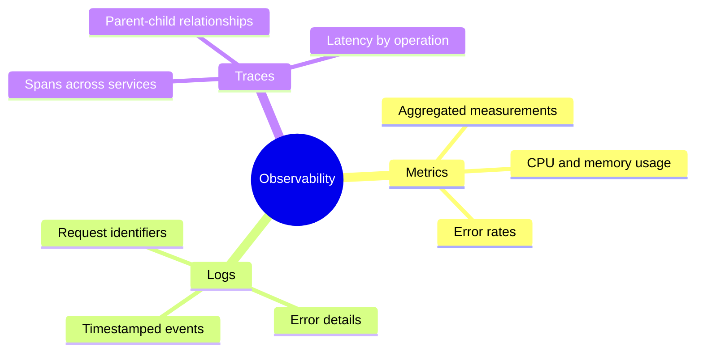
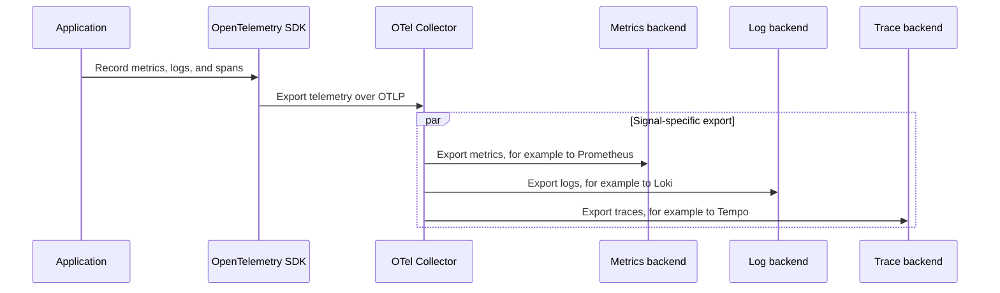

Consider a service whose latency rises after a deployment. A dashboard may show that the issue is widespread, but engineers need related metrics, logs, and traces to investigate which component is responsible and why.

**Observability** is the ability to infer a system's internal state from the signals it emits. In practice, instrumentation and telemetry backends provide evidence that engineers can use to ask questions about production behavior.

## Three telemetry signals

The three signals complement one another, but each records a different kind of evidence:

### Metrics
Metrics represent measurements aggregated over time, often with dimensions such as service, operation, or status. They are useful for detecting trends and alerting on conditions such as rising error rates or resource saturation.

### Logs
Logs record individual events with timestamps and contextual fields. Structured fields such as a request ID or trace ID make it easier to correlate an event with related work, while consistent levels and focused messages help control volume and cost.

### Traces
A distributed trace connects spans produced by services and operations involved in one request. Each span records a time interval and may include attributes, events, and a parent relationship, helping engineers locate latency and errors across service boundaries.

## Questions the signals can answer

Correlated telemetry can help an engineer investigate questions such as:

- Did latency or error rates change after a deployment?
- Which dependency accounts for most of a request's time?
- Are failures concentrated in one operation, region, or customer segment?

The answer depends on what the system records. Missing instrumentation, unsampled events, or inconsistent identifiers can leave important questions unresolved.

## Monitoring vs. Observability: What's the Difference?

It is common to use these terms interchangeably, but they represent different stages of maturity:

- **Monitoring:** Uses predefined dashboards and alerts to track known conditions, such as availability, latency, and error rates.
- **Observability:** Describes how well the available telemetry lets engineers investigate system behavior, including questions that were not anticipated when dashboards and alerts were written.

They are complementary: monitoring helps detect a change, while sufficiently rich and correlated telemetry can help explain it.

## Four golden signals for services

Google's SRE guidance highlights four useful service-level signals; they are a starting point, not a complete monitoring model for every system:

1. **Latency:** The time it takes to service a request.
2. **Traffic:** A measure of how much demand is being placed on your system (e.g., HTTP requests per second).
3. **Errors:** The rate of requests that fail (explicitly, implicitly, or by policy).
4. **Saturation:** How "full" your service is (e.g., CPU usage or memory consumption).

## Example tools by signal

These tools can collect, store, or visualize telemetry; the right combination depends on the system and operating requirements.

| Signal | Examples |
| :--- | :--- |
| **Metrics** | Prometheus, VictoriaMetrics, InfluxDB |
| **Logs** | ELK Stack (Elasticsearch, Logstash, Kibana), Loki, Splunk |
| **Traces** | Jaeger, Tempo, Honeycomb |
| **Visualization** | Grafana, Kibana |

## OpenTelemetry: Instrumentation and transport

**OpenTelemetry (OTel)** is an open-source set of APIs, SDKs, conventions, and protocols for generating and exporting telemetry. Its Collector can receive, process, and route telemetry to one or more backends; OTel does not store or query the data itself.

A vendor-neutral instrumentation and transport layer can make backend changes easier, but it does not eliminate backend-specific features, query languages, or migration costs.

## Operational trade-offs

Telemetry volume is an engineering constraint. Metrics with unbounded label values, such as user IDs or request IDs, create high cardinality and can overwhelm storage and queries. Prefer bounded dimensions and keep per-request identifiers in logs or traces.

Distributed traces depend on context propagation between services. The W3C Trace Context format standardizes identifiers commonly carried in the `traceparent` header, but every participating component still needs instrumentation or propagation support. Sampling reduces ingestion and storage costs; head-based sampling decides early, while tail-based sampling can use completed trace data but requires buffering and more collector resources.

Logs and traces also have retention, privacy, and access-control costs. Collectors need bounded queues, retry policies, and monitoring of their own health: retries can absorb short exporter failures, but sustained backpressure can fill queues and lead to dropped telemetry.

## Conclusion

Metrics help show when a system changes, logs preserve event details, and traces connect work across components. They are most useful when instrumentation, identifiers, sampling, storage, and operational limits are designed together.

## Further reading

- [Observability primer](https://opentelemetry.io/docs/concepts/observability-primer/)
- [Monitoring Distributed Systems](https://sre.google/sre-book/monitoring-distributed-systems/)
- [Prometheus data model](https://prometheus.io/docs/concepts/data_model/)
- [W3C Trace Context](https://www.w3.org/TR/trace-context/)
