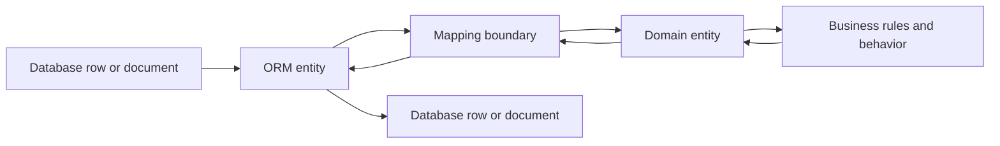
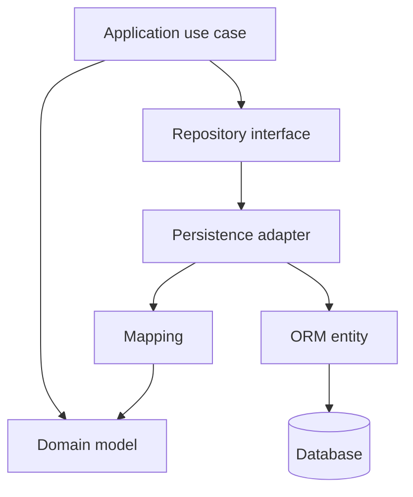

At the beginning, an ORM entity and a domain entity can look exactly alike. They may have the same fields, so it is tempting to use one class (or struct, or whatever the language calls it) for both.

That can work for a while. But the two concepts have different responsibilities, and the paths often diverge as the application grows.

## One class, two jobs

An **ORM entity** exists to represent data in a persistence system. It helps a tool such as JPA, GORM, Django’s ORM, Panache, or Rails Active Record map rows or documents to objects and back again. Its shape may reflect the database schema, the ORM’s requirements, and the way persistence is optimized.

A **domain entity** represents a concept the business cares about. It has identity and a lifecycle, and it protects the rules that make that concept valid. An order, for example, is not just a row with a `status` column: it has rules about when it can be confirmed, cancelled, or fulfilled.

The same `Order` class can represent both in a small application. The distinction is about responsibility, not naming. A class called `Order` is not automatically a domain model just because it has a meaningful name.



## The persistence model follows storage concerns

The ORM model is allowed to know about persistence. It may need:

- Table and column names, field lengths, indexes, and nullability.
- Foreign keys and relationship-loading behavior.
- Version columns for optimistic locking.
- Soft-delete fields, audit timestamps, or migration compatibility.
- Denormalized data or serialization details used by a particular store.

These details can change when the schema evolves, the ORM changes, or the application moves from one storage technology to another. Some are useful implementation decisions, but they are not automatically business concepts.

For instance, a `deleted_at` column may exist because a system implements soft deletion. The business concept might instead be “cancelled,” “archived,” or “no longer available”, each with different rules and meaning.

## The domain model follows business meaning

The domain model should express the concepts and decisions that make the application useful. It should not need to import JPA annotations, GORM tags, Django model classes, or database-specific types just to enforce a rule.

Here is a simplified example. The persistence representation contains fields needed by the database and ORM; the domain object exposes a valid business operation:

```java
@Entity
@Table(name = "orders")
public class OrderRow {
    @Id
    private UUID id;

    @Column(name = "customer_id", nullable = false)
    private UUID customerId;

    @Column(nullable = false)
    private String status;

    @Version
    private long version;

    @Column(name = "created_at", nullable = false)
    private Instant createdAt;

    @Column(name = "deleted_at")
    private Instant deletedAt;
}
```

```java
public final class Order {
    private final OrderId id;
    private final List<OrderLine> lines;
    private OrderStatus status;

    public void confirm() {
        if (lines.isEmpty()) {
            throw new IllegalStateException("An empty order cannot be confirmed");
        }
        if (status != OrderStatus.DRAFT) {
            throw new IllegalStateException("Only a draft order can be confirmed");
        }
        status = OrderStatus.CONFIRMED;
    }
}
```

The example is intentionally small: real domain types need suitable constructors and controlled access to their state. The important difference is that `OrderRow` describes how an order is stored, while `Order` makes an order’s business transition explicit. A database column containing the string `CONFIRMED` does not, by itself, enforce when that transition is allowed.

## Why the two shapes eventually diverge

A system can begin with a simple table and a few straightforward operations. Over time, business behavior and persistence requirements tend to pull the model in different directions:

| Change | Persistence model may need | Domain model may need |
| :--- | :--- | :--- |
| Add optimistic locking | A version column | A rule for handling a concurrent change |
| Add soft deletion | A nullable `deleted_at` field | A meaningful cancellation or archival operation |
| Optimize a read path | A denormalized column or projection | No change to the business concept |
| Change storage technology | New annotations, mapping, or document shape | The same business rules, if the domain is unchanged |
| Add a new order policy | Often no schema change | New behavior and invariant checks |

This is where a shared model starts to become awkward. Persistence-only fields leak into business code, or business rules get buried in lifecycle callbacks and setters. Database constraints can still be valuable, but they should reinforce application rules rather than become the only place those rules exist.

## Keep the dependency pointed in the right direction

A useful boundary is to let application code use the domain model and a repository abstraction, while an infrastructure adapter handles ORM and database details. The repository translates between domain objects and persistence representations.



The mapping is not free. It adds code, tests, and types to maintain. But it creates a clear place for translating between two models that change for different reasons. If the ORM, schema, or storage technology changes, the adapter can absorb much of that change without making the business rules speak the language of a database.

This does not mean every application needs a repository abstraction for every table or a separate type for every field. Boundaries should earn their keep.

## When sharing a model is reasonable

If an application is a small CRUD tool, its rules are trivial, its persistence model is unlikely to change independently, and the team benefits from keeping things simple, one class can be a sensible choice. Frameworks such as Active Record deliberately combine persistence and object behavior, and that can be productive in the right context.

The signal to separate the models is not “we are using an ORM.” It is that the reasons to change have started to differ:

- Business rules are growing or changing independently of the schema.
- Persistence details are spreading into use cases and domain behavior.
- More than one storage shape or persistence mechanism is needed.
- The same business model must support different interfaces or workflows.
- ORM lifecycle behavior makes important rules difficult to see or test.

For systems expected to grow, separating the models early can prevent those concerns from becoming entangled. For a tiny application, doing so too early can add ceremony without protecting anything. The useful question is whether the boundary makes change easier, not whether an architecture diagram looks more impressive.

## A related distinction: entity versus value object

“Domain entity” also has a specific meaning in domain-driven design. An entity has identity that persists through changes: two orders with the same items are still different orders if they have different identities. A value object is defined by its values and is typically immutable, for example, a `Money` amount with a currency.

Neither concept is the same as an ORM entity. An ORM can persist both entities and value objects, sometimes in the same table, separate tables, or embedded columns. The persistence mapping does not decide the domain semantics.

## Different responsibilities, different reasons to change

An ORM entity answers: **How is this data represented and retrieved by this persistence mechanism?**

A domain entity answers: **What does this business concept mean, and which operations keep it valid?**

Sometimes one class can answer both questions without causing trouble. As soon as its storage shape and business meaning begin changing for different reasons, give each responsibility a model of its own. That is not abstraction for abstraction’s sake; it is a way to let the database, ORM, and business rules evolve without dragging one another along.