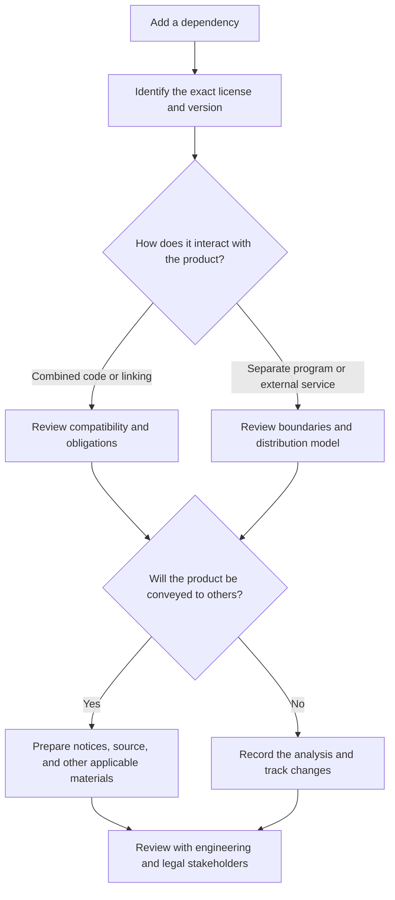
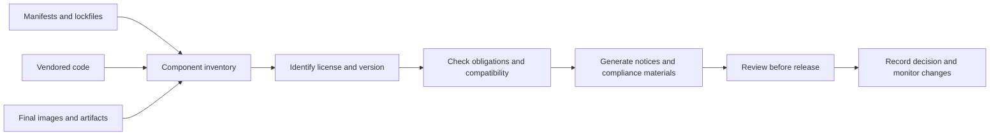

This time, the subject is **software licensing**.

I recently revisited software licenses and was alarmed by how little attention many teams give to this topic. I know, it is not the most exciting part of a sprint. But ignoring it can turn an apparently small technical choice into a product, business, or compliance problem.

In the free and open-source software world, it is common to start with two broad families: **permissive licenses** and **copyleft licenses**. That distinction helps frame the conversation, but it is no substitute for reading the specific license.

## Permissive and copyleft, in broad strokes

Permissive licenses such as **MIT** and **BSD** allow code to be used, modified, and redistributed, including in commercial and proprietary products, without requiring changes or the complete product to be released under the same license.

That does not mean “no obligations.” For example, MIT and BSD require certain copyright notices, conditions, and disclaimers to be preserved in redistributions. The Apache License 2.0 is also permissive and includes explicit patent-related terms.

**Copyleft licenses**, such as the **GPL**, aim to ensure that the freedoms granted to users remain available when a covered version is shared. In certain situations involving combination and distribution, this can require the combined work to be made available under the GPL, with corresponding source code and required notices.

That is why people say copyleft “infects” a product. I would avoid that word: it suggests an automatic, universal effect that does not exist. The analysis depends on the exact license and version, how components are combined, which exceptions apply, and how the software is delivered or made available.

## “Copyleft” does not mean publishing everything to everyone

This deserves emphasis because many summaries oversimplify it.

The GPL does **not generally require a company to publish changes it uses only internally to the whole world**. The obligation to provide corresponding source is tied to certain ways of conveying or distributing copies of covered software. For example, if you distribute a binary covered by the GPL, you must comply with the source-availability conditions that apply to that license version.

It also does not mean the software must be offered at zero cost. The GPL permits charging for a copy or its distribution. “Free” here refers to the freedoms granted to recipients, for example, to study, modify, and redistribute under the license terms, not a mandatory zero price.

There is also an important distinction for online services: the ordinary GPL does not by itself create the same source-availability obligation simply because someone uses a program over a network. The **AGPL** was designed to cover a specific situation involving modified versions made available for remote interaction; under its terms, users interacting with such a version must be offered access to its source. The exact license text matters.

So do not stop at asking, “Is it GPL?” Also ask: **Which version? GPL, LGPL, or AGPL? Are we modifying, combining, distributing, or merely running the component?**

## Strong copyleft, weak copyleft, and file-level copyleft

You may also hear the terms *strong copyleft* and *weak copyleft*. They are practical descriptions of the expected reach of obligations, not universal legal classifications that resolve every case.

- **Strong copyleft**, such as the GPL, tends to require covered combined works to preserve compatible sharing terms.
- **Weak copyleft**, such as the LGPL in certain library scenarios, allows more flexible combinations while retaining obligations for the covered library and its linking and distribution.
- **File-level copyleft**, such as the MPL, focuses some obligations on files derived from or modified under the license.
- **Network copyleft**, such as the AGPL, includes conditions related to modified versions made available for use over a network.

These terms are a map, not the territory. The specific license, exceptions, and architecture still matter.

## A dependency does not automatically decide the product’s license

A dependency’s license does **not automatically transform** the entire product into a copyleft work. First, you need to determine whether the component and product form a combined work covered by the license, or are independent programs distributed together. Linking, inter-process communication, plugin architecture, and the license terms can all matter. Putting two programs in the same installer or container does not, by itself, answer every question.

There is also no simple rule that “if it is a transitive dependency, its license applies to the whole product.” A transitive dependency still has a license that must be respected, but the specific obligation depends on what is copied, combined, and conveyed.

This matters especially for GPL components linked into an application. The Free Software Foundation explains that some forms of linking can create a combined work; it also distinguishes those cases from independent programs aggregated side by side. Even so, determining the boundary in a real product may require legal analysis, a `package.json` file or package name is not enough.

## MIT, BSD, and GPL make different trade-offs

| Family | Examples | What it generally permits | What to review |
| :--- | :--- | :--- | :--- |
| Permissive | MIT, BSD, Apache-2.0 | Use, modification, and redistribution without requiring the whole product to adopt the same license | Copyright notices, conditions, disclaimers, patents, and compatibility |
| File-level or weak copyleft | MPL, LGPL | More flexible combinations in some contexts while preserving obligations for covered parts | Boundaries between files or modules, linking, and distribution |
| Strong copyleft | GPL | Sharing freedoms for covered works when they are conveyed | Whether there is a combined work, license version, corresponding source, and notices |
| Network copyleft | AGPL | Additional protections for certain remote uses of modified versions | Whether users remotely interact with a modified version and what source must be offered |

These descriptions are only a starting point for discussion, not a legal interpretation that applies to every project.

## What a team should track

The direct license for each dependency is just the beginning. A useful inventory should cover:

- **Direct and transitive dependencies**, including exact versions and optional modules.
- **Copied or vendored code**, snippets, and generated files that incorporate third-party code.
- **Delivered artifacts**, such as binaries, mobile apps, container images, installers, and SDKs.
- **Non-code components**, such as fonts, icons, images, documentation, and models.
- **Missing or ambiguous metadata**, multiple licenses, exceptions, and license changes between versions.
- **The usage model**, including distribution to customers, delivery to partners, internal use only, or remote service.

A dependency list in the repository does not guarantee it matches what was actually included in the released artifact. Analyze the build output and preserve the relationship between versions, dependencies, and releases.

Tools can automate part of this work. Formats and identifiers such as **SPDX** help record licenses consistently; software-composition analysis tools can identify dependencies and generate an inventory or SBOM. But a scanner is not a substitute for review: metadata may be wrong, licenses may be customized, and the tool may not know how a component is combined or distributed.

## A practical process before adopting a dependency

A straightforward review can prevent late surprises:

1. Identify the exact component, version, and source.
2. Confirm the license in the repository and in the files distributed with the component; do not rely only on a third-party summary.
3. Read the license and any exceptions that apply to that version.
4. Record how the component will be used: embedded code, linking, separate process, build tool, or external service.
5. Determine whether and to whom the product will be distributed or made available remotely.
6. Compare the obligations with the product’s licenses and the organization’s commercial commitments.
7. Preserve notices and provide source or other materials when the license requires it.
8. Record the decision and revisit it when the dependency, version, or distribution model changes.

If there are questions about a copyleft component in a proprietary application or distributed product, involve legal counsel before a release becomes urgent. Replacing a dependency during development is usually simpler than redesigning a deeply coupled integration later.

## Copyleft can also be a strategic choice

I am not arguing that copyleft dependencies should be avoided. The Linux kernel uses the GPL, and the decision to preserve certain freedoms for people who receive and modify the kernel was central to the project’s evolution. There are many contexts where copyleft is valuable: it promotes reciprocity, helps improvements flow back to the community, and gives recipients rights that permissive licenses do not require downstream users to preserve.

A permissive license can also be the right choice: it makes adoption across diverse ecosystems easier and allows code to be incorporated into products under other licenses, as long as notices and other conditions are followed.

The question is not “Which license is good and which is bad?” It is: **What rights do we want to grant, what obligations are we willing to meet, and how will this software be used and distributed?**

## Licensing is part of product engineering

Licenses are not just a legal topic to deal with on the eve of a release. They are part of dependency, architecture, distribution, and product-strategy decisions.

A team that understands the licenses it uses can choose components deliberately, respect their creators, and avoid surprises when the product or business model changes. This is not about being afraid of open source; it is about knowing what we use and the conditions that come with it.

> This article is a general introduction, not legal advice. Obligations depend on the exact license and version, jurisdiction, and how components are combined and conveyed. Consult qualified counsel for product decisions with legal impact.

## Further reading

- [GNU: Frequently Asked Questions about GNU Licenses](https://www.gnu.org/licenses/gpl-faq.html)
- [Open Source Initiative: MIT License](https://opensource.org/licenses/MIT)
- [Open Source Initiative: BSD 3-Clause License](https://opensource.org/licenses/BSD-3-Clause)