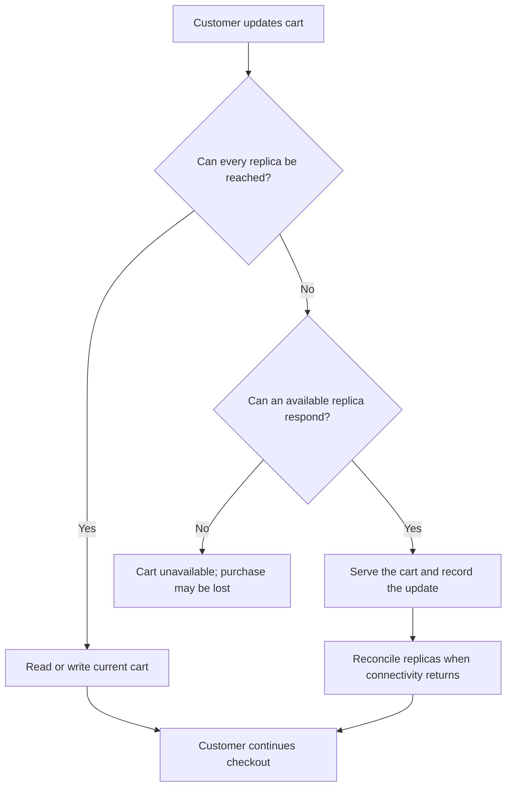
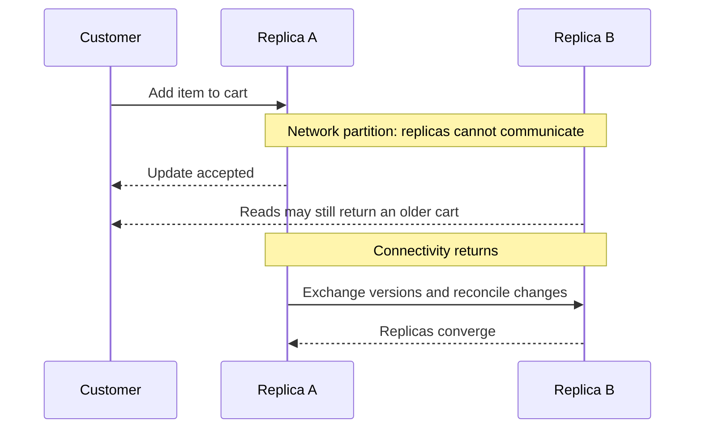
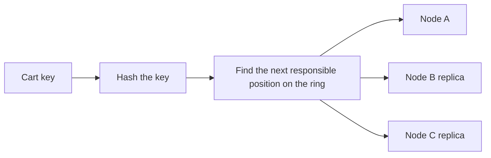

At some point in the 2000s, Amazon faced a problem that sounds small until you put it in business terms: **the shopping cart could not disappear**.

Not during a promotion. Not on Black Friday. Not even on an ordinary day when someone in finance was watching the numbers with their heart in their throat. A cart failure could mean a lost order, a frustrated customer, and revenue that would never come back.

The word *small* deserves those quotation marks. At Amazon's scale, even a brief interruption could affect a huge number of shopping sessions.

## Start with the business requirement

Amazon's engineers were building services that needed to keep working across many machines and data centers. Relational databases offered valuable guarantees, including transactions with ACID properties, but a single database configuration was not necessarily the right fit for every workload or every availability target.

The cart had a particular tolerance for mistakes. A customer might briefly see an old item, or even a duplicate, while the system reconciled updates. That was undesirable, but it was often less harmful than showing an empty cart, or no cart at all, because one component could not be reached.

Put another way, the business ranked two outcomes differently:

- A temporarily imperfect cart could still lead to a completed purchase.
- An unavailable cart could stop the purchase entirely.

That priority led to a practical design goal: keep accepting and serving cart operations through failures, then reconcile differences when the system recovered.

## Dynamo: built around the workload

Amazon described its Dynamo system in a 2007 research paper, *Dynamo: Amazon’s Highly Available Key-value Store*. It was designed as a highly available key-value storage system for services such as the shopping cart, where uninterrupted operation mattered more than always returning one globally agreed answer at that exact moment.

This was not a declaration that consistency did not matter. The design recognized that failures happen in distributed systems and gave applications mechanisms to continue operating while replicas temporarily disagreed. The system could preserve multiple versions of an item and let the application help resolve conflicts.

The guiding question was not, “What is the most elegant database?” It was closer to: **“What behavior lets this business keep serving customers when machines or network links fail?”**

## The CAP theorem, in the context of a real choice

Dynamo is often discussed alongside the CAP theorem. CAP says that when a network partition prevents parts of a distributed system from communicating, the system must choose between:

- **Consistency**: every successful read sees the latest agreed value.
- **Availability**: every request to a non-failing node receives a response.
- **Partition tolerance**: the system continues operating despite lost or delayed communication between nodes.

The phrase “choose any two” can be misleading. In a distributed system that must operate across a network, partitions are not something a design can simply opt out of. The meaningful trade-off during a partition is commonly between giving a response and guaranteeing that all responses reflect one latest value.

For the shopping cart, Amazon valued availability during a partition. The system could accept an update at an available node, even if another replica could not be contacted. That meant a customer could receive a response while replicas temporarily held different versions of the cart.

This is not a universal recommendation to sacrifice consistency. It is a reminder that a system's failure behavior should follow its domain. A payment ledger, inventory reservation, and shopping cart may have very different consequences when replicas disagree.

## The building blocks behind the decision

Dynamo combined several techniques to make that availability target practical. They are now familiar in distributed database discussions, but each addressed a specific operational need.

### Partitioning with consistent hashing

A distributed store needs to decide which machines are responsible for each key. Consistent hashing maps keys and nodes onto a ring, reducing how many keys need to move when machines are added or removed. Dynamo also used virtual nodes to distribute responsibility more evenly across physical machines.

Instead of one machine owning the only copy of a cart, multiple nodes could hold replicas. That improved the chance that an operation could continue if an individual node failed.

### Replication and quorum-like coordination

Dynamo replicated data across nodes and exposed parameters that let applications tune how many replicas participate in reads and writes. In simplified terms, requiring more replicas to acknowledge an operation can improve confidence in the value, while requiring fewer can help operations remain available when nodes are unreachable.

Those settings are not a magic switch between “safe” and “unsafe.” They express a workload-specific balance involving availability, latency, and the probability of seeing conflicting versions.

### Eventual consistency and conflict resolution

If two replicas accept changes during a partition, they can temporarily diverge. Dynamo's approach allowed multiple versions to exist and used mechanisms such as vector clocks to track causal relationships between versions. When versions could not be ordered automatically, application logic could help reconcile them.

For a cart, conflict resolution might merge independent additions rather than discard one. That does not mean every conflict is simple: removing an item while another replica updates its quantity requires a deliberate rule. The important point is that the behavior is made explicit instead of assuming that every network operation always succeeds.

### Recovery after failures

Dynamo also used techniques such as hinted handoff and anti-entropy to help replicas catch up after nodes or links recovered. These mechanisms are part of the bargain: accepting writes during a failure only works if the system has a way to repair replica differences afterward.

## The trade-off is a product decision

Here is the part that is easy to miss when architecture is discussed only in terms of algorithms: **the acceptable failure mode is a business decision**.

Ask what happens if this data is briefly stale, unavailable, or duplicated:

| Domain | Possible consequence of inconsistency | Possible consequence of unavailability |
| :--- | :--- | :--- |
| Shopping cart | A stale or duplicated item frustrates a customer | Customer may abandon checkout |
| Payment ledger | Incorrect balance or duplicated charge | Payment may need to wait or be retried |
| Inventory | Two customers may be promised the same item | A purchase may be delayed |
| Social feed | A recent post may appear late | Users cannot load the feed |

The table is only a starting point. For example, an inventory system can tolerate approximate counts on a product page but may need stricter coordination when reserving the final unit. The same product can therefore use different consistency choices at different steps.

A useful design conversation starts with questions like these:

1. Which user action must still work during a dependency failure?
2. What incorrect result can the user tolerate, and for how long?
3. Can the system resolve the conflict automatically, or does it need a person or business rule?
4. What is the cost of rejecting a request compared with accepting a potentially stale one?
5. How will the system detect and repair divergence?

## What Dynamo influenced, and what it did not mean

Dynamo became an important reference point for distributed storage. Amazon later introduced DynamoDB, but DynamoDB is a managed database product, not simply the original Dynamo paper exposed unchanged as a service.

Other systems drew on related ideas in different ways. Cassandra combined ideas associated with Dynamo's distributed architecture with data-modeling concepts associated with Google's Bigtable. ScyllaDB is a Cassandra-compatible database implementation. Bigtable itself was Google's separate system, described in its own paper; it should not be treated as a Dynamo descendant.

The broader impact was not a single database blueprint. It was a set of practical patterns, partitioning, replication, tunable coordination, and conflict handling, that teams could adapt to their own requirements.

## The lesson: architecture begins with priorities

It can look, in hindsight, as if every distributed-systems concept was neatly planned from the start. The story is more grounded: an important customer-facing feature could not be allowed to vanish whenever part of the infrastructure became unreachable.

Dynamo was shaped by that business constraint. Its availability-first behavior made sense for a cart where a temporary duplicate or stale view was preferable to a failed purchase. The same choice could be wrong for a different domain.

Technology helps solve technical problems. Understanding the business tells us **which problem is worth solving, which failure is acceptable, and what trade-off is actually useful**.

Sometimes all of that begins with a shopping cart that simply cannot fail.