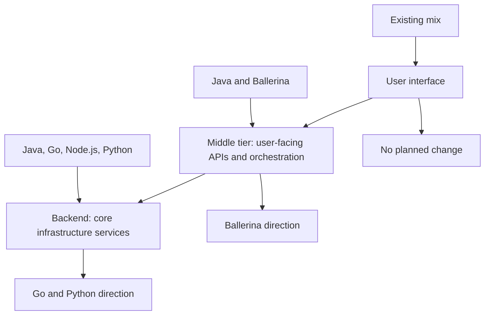
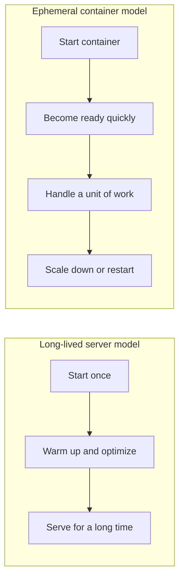
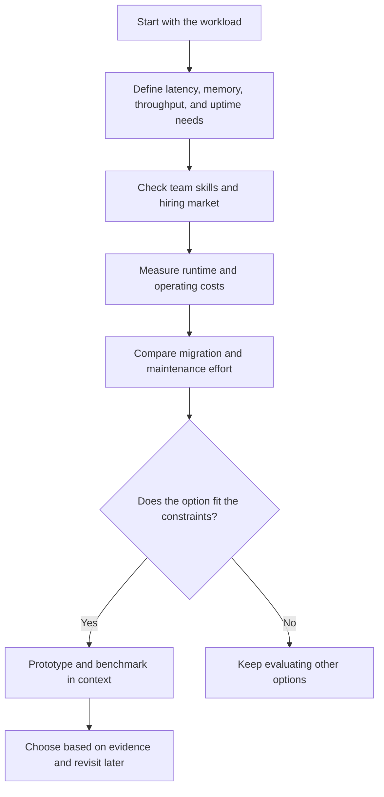

Your programming language is special…

Of course it is. Just like all the others.

When WSO2 announced **“Goodbye Java, Hello Go!”**, some reactions treated it less like an engineering decision and more like a personal breakup:

- “What do you mean, leave Java?”
- “What about more than twenty years of maturity?”
- “What about the ecosystem?”
- “And my Java 21 course?”

Breathe. Nobody killed Java. Nobody burned the design-pattern books. WSO2 looked at the problems it expects to solve over the next several years and chose a direction for its future backend infrastructure.

That is a meaningful decision. It is not a universal verdict on programming languages.

## What WSO2 actually announced

In its announcement on [26 January 2026](https://wso2.com/library/blogs/goodbye-java-hello-go/), WSO2 described a strategic direction for **new products and platforms**, not an immediate rewrite of everything it already sells. The company said it would continue to evolve, maintain, and support its existing Java products, with no end date in sight.

The announcement also described different choices for different layers of its software:

| Layer | WSO2’s current mix | Direction described in the announcement |
| :--- | :--- | :--- |
| Frontend | Web and mobile technologies | No change |
| Middle tier | Java and Ballerina | Ballerina |
| Backend infrastructure | Java, Go, Node.js, Python | Go and Python |

So the headline is deliberately punchy, but the actual strategy is more specific: **use different languages for different parts of the system, and move future backend infrastructure toward Go and Python**.

## The workload changed

For much of WSO2’s history, enterprise middleware was delivered as long-running servers. A process could stay up for months. That made it reasonable to invest in a runtime that might need time to start and warm up, but could optimize its performance while it ran.

Cloud-native deployments changed the shape of the problem. A service may now run inside a container that is created to handle work, scaled out during a traffic spike, rescheduled after a failure, or shut down when demand falls. In that world, startup latency and memory use are not abstract benchmark numbers: they affect how quickly capacity becomes available and how much infrastructure is needed to keep it available.

Java’s just-in-time compilation and mature runtime can be a strength for long-lived services: the process has time to warm up and optimize. For short-lived workloads, however, the time and resources spent getting to that point can matter more. A large application’s dependency graph, runtime configuration, and memory needs also shape its startup and operating costs.

This does **not** mean Java is inherently slow or unsuitable for containers. Modern Java has continued to improve, and options such as class-data sharing, ahead-of-time techniques, GraalVM native images, and careful runtime tuning may change the trade-offs. But each approach has constraints and operational costs of its own. The right question is not whether a language can be optimized; it is whether the whole solution is worth the complexity for this workload.

## Why Go can fit this particular job

WSO2’s announcement points to Go’s combination of fast startup, a relatively compact runtime footprint, garbage collection, concurrency primitives, and native compilation. It also cites the company’s prior experience: Go was already used in projects including OpenChoreo, the Ballerina compiler rewrite, Thunder, and command-line tools.

Those properties can be useful for infrastructure services that are frequently started, containerized, and scaled. They may help reduce the time to readiness and the compute resources needed to run a service. Go’s ecosystem is also well established in cloud infrastructure, with tools such as Kubernetes and Docker among its prominent examples.

But there is no free lunch hidden in the `go build` command:

- Go’s garbage collector and runtime still consume resources; a small binary does not mean zero memory cost.
- Concurrency primitives make concurrent programs easier to express, but do not automatically make a service correct or fast.
- A language change brings retraining, hiring, tooling, testing, and long-term maintenance costs.
- The best outcome depends on the application, its dependencies, its traffic, and how it is operated.

The choice makes sense when the benefits measured in the actual deployment outweigh the migration and lifecycle costs, not because a language has won a popularity contest.

## Why not Rust? Why not something else?

WSO2 also discussed Rust. Its explanation was contextual: Rust offers fine-grained control and strong guarantees that can be valuable close to the hardware or in software that runs for a long time without restarting. For the middleware infrastructure WSO2 builds, the company viewed Go as a better balance between control, productivity, memory management, concurrency, and native deployment.

That is WSO2’s engineering assessment, not a law of nature. Another company building a browser engine, an operating system component, or a latency-critical database may reasonably make a different choice. The requirements define the trade-off; the language does not define the requirements.

## A personal example: preferring Python was not enough

At one point, I personally preferred Python over every other language. I was even in roles where I could have strongly influenced its adoption for backend development, instead of Java or Go.

I did not do that. Not because I disliked Python, but because it was not viable for that particular context. The reasons were concrete: the available developers’ comfort with the language, operational cost, concurrency requirements, and performance expectations.

Those considerations do not make Python a bad language. They make a language choice consequential. A preference can help us explore an option, but it cannot pay the infrastructure bill, staff a team, or erase the properties of a workload.

## A better way to choose a language

Instead of asking **“Which language do we love?”**, ask questions that make the consequences visible:

1. What does this service do, and how long does each instance usually live?
2. How quickly must a new instance become ready?
3. What are the memory, CPU, latency, and throughput budgets?
4. What libraries and deployment tools does the service depend on?
5. Can the team hire, onboard, and support engineers for this stack?
6. What is the cost of changing languages now, and the cost of staying put?
7. How will we measure whether the choice worked?

Benchmarking matters, but so does the boundary of the benchmark. A microbenchmark can compare a function; it cannot tell you whether the team can operate a service, whether its dependencies dominate startup time, or whether a rewrite will delay a product customers need.

For an existing product, there is also a difference between **choosing a language for new development** and **rewriting a working system**. A new service can start with a clean set of constraints. A rewrite must preserve behavior, integrations, compatibility, support commitments, and years of accumulated operational knowledge. Those are different decisions with different risk profiles.

## Languages are tools, not identities

The lesson is not **“Go is better than Java.”** It is that a programming language is one part of an engineering system that includes the workload, runtime, libraries, team, deployment model, and business constraints.

Good engineering organizations do not ask which language is most lovable. They ask which option creates the least friction for the problem they have today, and what evidence would make them reconsider tomorrow.

And yes, a few years from now, someone may write: **“Goodbye Go, Hello Something Else.”** The cycle will continue, as it always has.

Relax. Your language is still great. It just is not eternal. Or special.