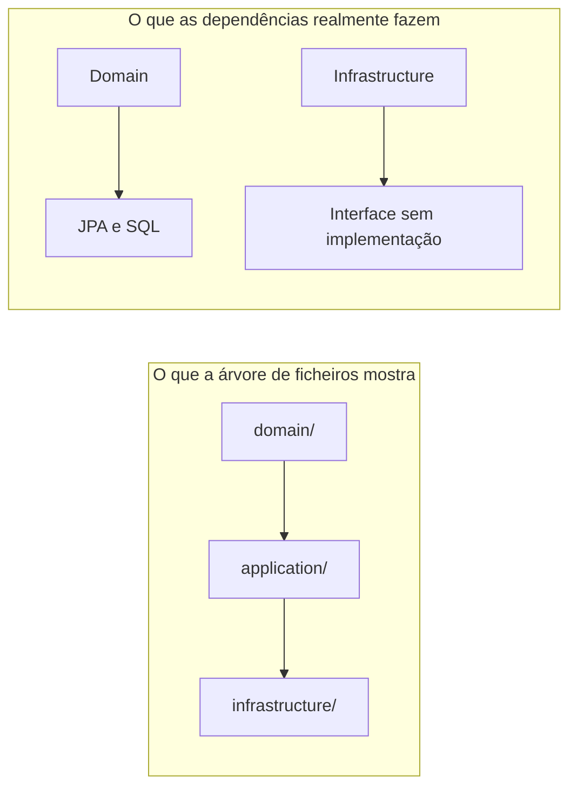
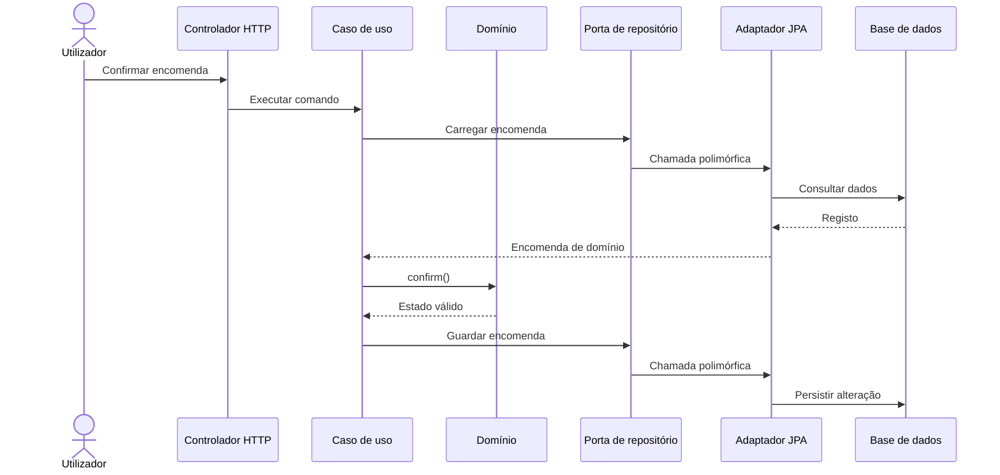
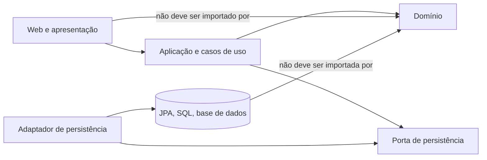
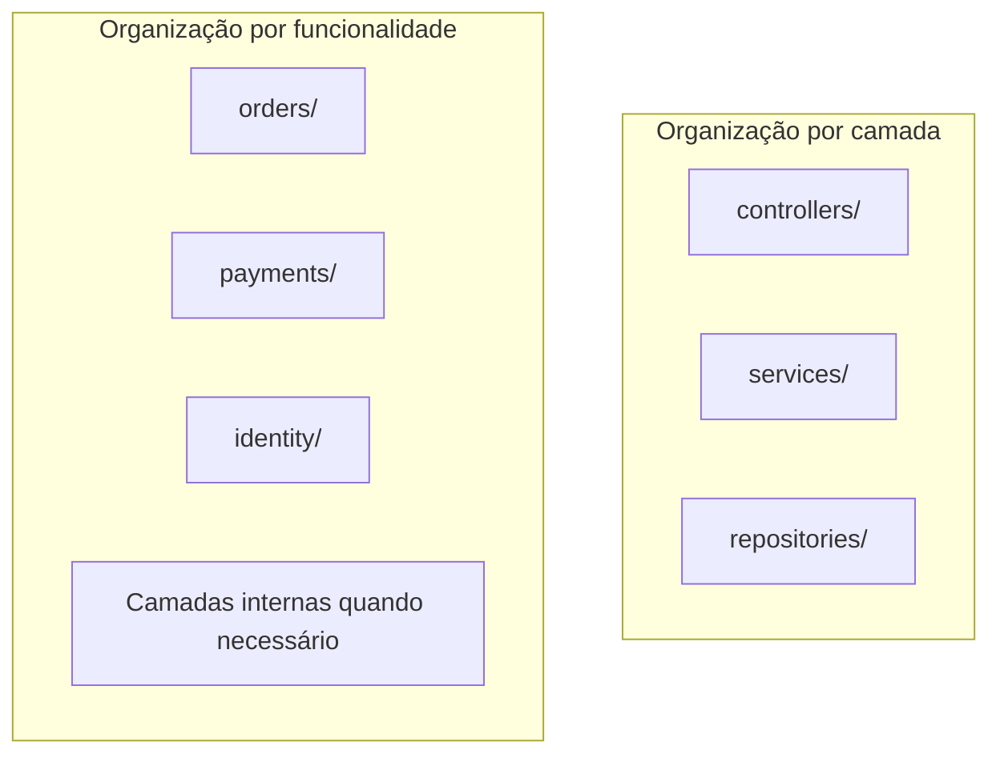

No universo do desenho e da arquitectura de software, tenho observado um erro recorrente: assumir que criar e nomear pastas, pacotes ou módulos equivale a implementar correctamente uma arquitectura.

Cria-se `domain`, `application`, `infrastructure`, `services` e `repositories`… e pronto, temos Clean Architecture. Certo?

Não necessariamente.

> **Não é o nome que define a camada ou o padrão. É a responsabilidade que o código implementa ,  e as dependências que respeita.**

Os nomes ajudam pessoas a navegar e a comunicar. Mas são uma promessa, não uma garantia. A arquitectura real está no que os componentes fazem, no que conhecem e nas mudanças que conseguem absorver sem arrastar o resto do sistema.

## Uma árvore de pastas não é um mapa de dependências

Uma estrutura de directórios mostra onde os ficheiros foram colocados. Não mostra, por si só:

- Quem chama quem durante a execução.
- Que módulos importam ou dependem de outros.
- Em que direcção as dependências de código apontam.
- Onde são aplicadas as regras de negócio.
- Que fronteiras são impostas pelo compilador ou pelo processo de build.

É possível ter um pacote chamado `domain` que importa classes JPA, conhece tabelas e executa SQL. E é possível ter um pacote chamado `infrastructure` que contém apenas uma interface, sem qualquer implementação técnica. Os nomes não corrigem essas responsabilidades.



A árvore é uma pista. A direcção das dependências e o comportamento do código é que contam.

## O que significa, na prática, uma arquitectura em camadas?

Uma arquitectura em camadas separa responsabilidades que mudam por razões diferentes. Uma divisão comum pode ter:

- **Apresentação**: recebe interacções externas ,  HTTP, interface gráfica, CLI ou mensagens ,  e traduz os dados de entrada e saída.
- **Aplicação**: coordena casos de uso, controla a sequência de operações e define a fronteira transaccional.
- **Domínio**: representa conceitos de negócio e protege as regras e invariantes do sistema.
- **Infraestrutura**: liga o sistema a tecnologias externas, como bases de dados, filas, serviços de terceiros, ficheiros e frameworks.

Isto não é uma taxonomia universal. Algumas arquitecturas juntam ou dividem camadas; outras usam nomes como *ports and adapters*, arquitectura hexagonal ou Clean Architecture. Os nomes e as convenções variam. O princípio relevante é que cada parte tenha uma responsabilidade compreensível e que o acoplamento entre elas seja deliberado.

### Fluxo de execução não é o mesmo que direcção das dependências

Esta distinção é subtil e importante.

Durante a execução de um caso de uso, o pedido pode percorrer o caminho abaixo: chega ao controlador, passa pelo serviço de aplicação, altera o domínio e acaba numa base de dados através de um adaptador.



Mas o fluxo de chamadas em execução não determina as dependências de compilação. Na direcção de dependências de uma arquitectura hexagonal ou Clean, o núcleo não deve precisar de conhecer a tecnologia exterior. O adaptador de persistência conhece a porta; a porta não precisa de conhecer JPA.



A chamada pode entrar no adaptador e voltar ao caso de uso, mas o código de negócio continua sem importar a implementação concreta. Essa é a diferença entre um diagrama bonito e uma fronteira de dependências real.

## “Service” é um nome; que serviço estamos a descrever?

Em Java, podemos chamar uma classe `UserService`, `OrderService` ou `PaymentService`. O compilador não verifica se ela é realmente um serviço de aplicação, um serviço de domínio, uma fachada para uma API externa ou apenas uma classe grande onde tudo acabou por parar.

O nome `service` é especialmente ambíguo:

- Um **serviço de aplicação** coordena um caso de uso: carrega os dados necessários, chama o domínio e solicita a persistência.
- Um **serviço de domínio** representa uma operação de negócio que não pertence naturalmente a uma única entidade ou objecto de valor.
- Um **adaptador de serviço externo** converte a interface da aplicação numa chamada a um fornecedor, API ou sistema externo.

Misturar estas funções numa classe com um nome genérico produz o conhecido serviço que valida regras, abre transacções, constrói consultas, envia emails, serializa respostas e ainda gere retries. Continua a chamar-se `OrderService`, mas o nome não reduz a responsabilidade nem o acoplamento.

## “Repository” também pode ser apenas um rótulo

Um repositório deveria oferecer ao código de aplicação ou de domínio uma forma de recuperar e guardar objectos de domínio sem expor os detalhes da persistência.

A interface, por exemplo, pode expressar a necessidade do caso de uso:

```java
public interface OrderRepository {
    Optional<Order> findById(OrderId id);
    void save(Order order);
}
```

A implementação concreta pode usar Spring Data, JPA, SQL manual ou outra tecnologia:

```java
@Repository
final class JpaOrderRepositoryAdapter implements OrderRepository {
    private final SpringDataOrderRepository database;
    private final OrderMapper mapper;

    @Override
    public Optional<Order> findById(OrderId id) {
        return database.findById(id).map(mapper::toDomain);
    }

    @Override
    public void save(Order order) {
        database.save(mapper.toRecord(order));
    }
}
```

O detalhe importante não é o nome da interface nem a existência de uma classe chamada `Repository`. É que o fluxo de negócio dependa de uma abstracção útil e não fique amarrado a `JpaRepository`, `EntityManager` ou a uma consulta SQL específica.

Onde colocar a interface? Depende do desenho. Em alguns sistemas faz sentido defini-la junto do domínio; noutros, junto do caso de uso que precisa dela. O que interessa é quem controla o contrato e para que lado apontam as dependências, não seguir uma regra de pastas por imitação.

## Um caso de uso pequeno, com responsabilidades visíveis

Consideremos a confirmação de uma encomenda. O controlador traduz o pedido HTTP, o caso de uso coordena a operação e o domínio decide se a transição é permitida.

```java
public final class ConfirmOrder {
    private final OrderRepository orders;

    public ConfirmOrder(OrderRepository orders) {
        this.orders = orders;
    }

    public void execute(OrderId id) {
        Order order = orders.findById(id)
            .orElseThrow(() -> new OrderNotFound(id));
        order.confirm();
        orders.save(order);
    }
}
```

A regra de que só uma encomenda em rascunho e com linhas pode ser confirmada pertence ao domínio:

```java
public final class Order {
    private final OrderId id;
    private final List<OrderLine> lines;
    private OrderStatus status;

    public void confirm() {
        if (lines.isEmpty()) {
            throw new EmptyOrderCannotBeConfirmed();
        }
        if (status != OrderStatus.DRAFT) {
            throw new OrderCannotBeConfirmedInCurrentStatus(status);
        }
        status = OrderStatus.CONFIRMED;
    }
}
```

O repositório sabe carregar e guardar. O caso de uso sabe coordenar. A encomenda sabe as suas regras. Um adaptador trata de transformar `Order` em registo JPA e vice-versa. Os nomes ajudam a ler a intenção porque cada peça cumpre o papel que anuncia.

Não é necessário que todos os sistemas tenham exactamente estas quatro classes. O exemplo é útil porque as razões para mudar ficam visíveis: mudar o endpoint não deve alterar a regra de confirmação; mudar a base de dados não deve obrigar o domínio a importar uma nova biblioteca.

## Camadas horizontais ou organização por funcionalidade?

Há duas formas comuns de organizar o código:

- **Por camada técnica**: todos os controladores juntos, todos os serviços juntos, todos os repositórios juntos.
- **Por funcionalidade ou contexto**: encomendas, pagamentos, identidade, notificações ,  cada área reúne o código que lhe pertence.

Ambas podem funcionar. A organização por camada é simples de compreender em aplicações pequenas, mas num sistema grande pode obrigar a percorrer muitas pastas para perceber uma funcionalidade. A organização por funcionalidade aproxima as peças que mudam em conjunto, mas pode criar duplicação ou fronteiras erradas se cada módulo inventar as suas próprias regras.

Também é possível combinar as duas: agrupar primeiro por funcionalidade e, dentro de cada módulo, separar apresentação, aplicação, domínio e infraestrutura quando isso trouxer valor.



A decisão deve facilitar a descoberta do código e limitar mudanças não relacionadas. Não existe uma pontuação arquitectural por quantidade de pastas.

## Os nomes não impõem fronteiras

Em Java, os nomes dos pacotes e classes ajudam a organizar e a comunicar, mas não são uma barreira de segurança nem uma regra automática de arquitectura. Colocar uma classe em `com.example.domain` não impede que importe uma classe do Hibernate. Escrever `interface` no nome de um tipo também não transforma essa interface numa abstracção bem desenhada.

Algumas ferramentas e escolhas de linguagem podem tornar as fronteiras mais difíceis de atravessar:

- **Modularização de build**: módulos separados com dependências explícitas podem impedir imports inválidos.
- **Visibilidade**: classes e construtores não precisam de ser públicos se só um módulo deve usá-los.
- **Testes de arquitectura**: ferramentas como ArchUnit podem verificar regras de dependência no CI.
- **Revisão do grafo de dependências**: builds e ferramentas de análise podem revelar ciclos e caminhos inesperados.

Uma convenção como “o domínio não importa infraestrutura” só é útil quando a equipa consegue detectar e corrigir violações. Se depende apenas da memória colectiva, mais cedo ou mais tarde alguém vai atravessá-la para resolver um problema urgente ,  e a excepção torna-se padrão.

## Como reconhecer uma camada que só existe no nome

Faça perguntas concretas ao código, em vez de confiar na árvore de ficheiros:

1. **Que responsabilidade esta classe cumpre?** Consegue descrevê-la sem repetir o seu nome?
2. **Que motivos a fariam mudar?** Uma alteração de API, uma regra de negócio e uma troca de base de dados exigem alterações na mesma classe?
3. **Que detalhes conhece?** O domínio importa tipos de HTTP, JPA, SQL ou de um fornecedor externo?
4. **Quem depende de quem?** A direcção das dependências respeita a fronteira pretendida?
5. **Onde vivem as regras?** Podem ser testadas sem iniciar uma base de dados, servidor Web ou container?
6. **A abstracção esconde detalhes ou apenas acrescenta indirecção?** Uma interface sem razão de mudança não cria modularidade por magia.
7. **Conseguimos impor a regra?** Há um limite de módulo, teste arquitectural ou verificação de build?

Estas perguntas ajudam a distinguir uma arquitectura aplicada de uma arquitectura que só existe nos slides.

## Não transforme arquitectura em cerimónia

Tudo isto não significa que cada aplicação precise de domínio rico, interfaces para todos os métodos e um adaptador para cada tabela.

Uma ferramenta CRUD pequena pode beneficiar de uma estrutura simples, mesmo que a classe JPA também seja usada pelo serviço da aplicação. Se as regras forem mínimas e as mudanças previsíveis, duplicar modelos pode acrescentar mais trabalho do que protecção.

O custo aparece quando responsabilidades diferentes começam a mudar por razões diferentes. É aí que uma separação deliberada reduz acoplamento e permite que o sistema evolua. A arquitectura deve responder a riscos reais de mudança, não satisfazer uma checklist de padrões.

## A arquitectura está no comportamento das fronteiras

Criar pacotes chamados `domain`, `application`, `infrastructure`, `services` e `repositories` pode ser um excelente começo para a organização. Mas não prova que as responsabilidades estejam separadas nem que as dependências estejam correctas.

A arquitectura emerge daquilo que cada componente faz, do que conhece e da direcção em que o sistema permite que as mudanças se propaguem. Os nomes podem explicar a intenção. A implementação é que tem de a cumprir ,  e os módulos, testes e processo de build devem ajudar a manter essa promessa.