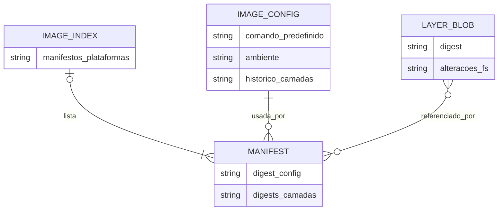
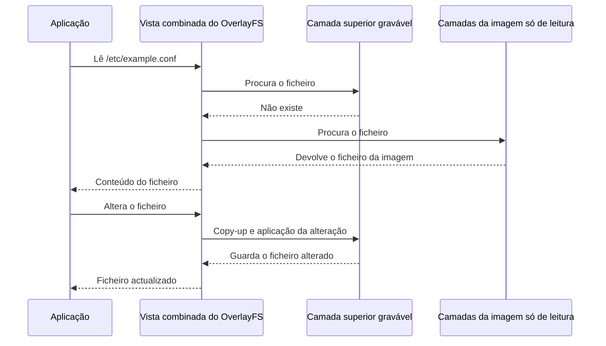

Um Dockerfile parece uma lista de comandos. Fazemos o build e obtemos uma imagem que pode ser descarregada, identificada com uma tag e iniciada. Mas de que é feita essa imagem e porque pode uma alteração numa linha tornar o build lento ou deixar um ficheiro inesperado na imagem final?

O formato publicado de uma imagem e a árvore de ficheiros vista pelo container são representações diferentes. Essa distinção ajuda a compreender as camadas, a cache e as alterações durante a execução.

## Uma imagem é composta por metadados e alterações imutáveis ao sistema de ficheiros

Uma **imagem de container** é um artefacto empacotado e versionado: metadados que descrevem como executar uma carga de trabalho e conteúdo do sistema de ficheiros, como executáveis, bibliotecas e configuração. Não inclui uma máquina em funcionamento nem o seu próprio kernel Linux. O runtime usa a imagem para preparar um sistema de ficheiros e iniciar um processo com as definições predefinidas da imagem, que podem ser substituídas no arranque.

Os termos descrevem etapas diferentes do processo:

- Um **Dockerfile** descreve os passos do build.
- Uma **imagem** empacota o conteúdo do sistema de ficheiros e os metadados resultantes.
- Um **container** é criado a partir da imagem com configuração de execução e, normalmente, a sua própria camada gravável.

Vários containers podem usar as mesmas camadas da imagem, mantendo separadas a configuração de execução e as alterações graváveis.

As imagens são geralmente descritas como uma pilha de camadas, mas não são simplesmente várias cópias completas de diretórios. Cada camada do sistema de ficheiros regista alterações — ficheiros adicionados ou modificados e, por vezes, marcadores para ficheiros removidos — em relação à camada anterior. O conteúdo da camada é imutável depois do build; uma alteração posterior acrescenta outra camada em vez de editar uma já existente.

## OCI: um formato comum para imagens

A **Open Container Initiative (OCI)** publica especificações que permitem a diferentes ferramentas criar, armazenar e executar imagens de container em formatos interoperáveis. OCI é um conjunto de normas, não um motor de containers.

Em termos gerais, uma imagem OCI tem:

- Um **manifesto de imagem**, que aponta para a configuração da imagem e para as suas camadas do sistema de ficheiros.
- Uma **configuração da imagem**, que regista metadados como o comando predefinido, o ambiente e o histórico ordenado de camadas.
- **Blobs de camadas**, que contêm alterações ao sistema de ficheiros.
- Opcionalmente, um **índice de imagem**, que aponta para diferentes manifestos, por exemplo, imagens construídas para diferentes arquitecturas de CPU.

Estes objetos são endereçados pelo conteúdo: os seus digests são derivados dos bytes que os compõem. Um registo pode reutilizar conteúdo idêntico, e o cliente pode confirmar que os dados descarregados correspondem ao digest esperado. Tags como `minha-app:latest` são nomes convenientes que podem mudar; um digest identifica conteúdo específico.



O armazenamento e a implementação do runtime podem variar, mas estes objetos OCI oferecem uma linguagem comum para distribuir imagens.

## Camadas durante o build e a execução

Num build de imagem tradicional, uma instrução do Dockerfile que altera o sistema de ficheiros — normalmente `RUN`, `COPY` ou `ADD` — costuma contribuir uma camada de sistema de ficheiros. Outras instruções podem alterar a configuração da imagem sem acrescentar conteúdo ao sistema de ficheiros. O **BuildKit** é o conjunto de ferramentas de build de imagens usado pelo Docker: executa os passos do Dockerfile e gere a cache de build. Tal como outros construtores, pode representar os passos intermédios e os dados em cache de forma diferente; por isso, é melhor pensar nos passos de build e nas alterações resultantes do que assumir que cada linha se transforma sempre numa camada final.

Quando um container arranca, as camadas da imagem ficam disponíveis como camadas inferiores só de leitura. Um driver de armazenamento ou *snapshotter* apresenta-as, juntamente com uma camada superior gravável, como uma única árvore do sistema de ficheiros. Em muitos sistemas Linux, o **OverlayFS** apresenta esta vista combinada. Imaginemos que uma aplicação lê um ficheiro que existe apenas numa camada da imagem e, em seguida, o altera:



A aplicação vê caminhos como `/etc` ou `/usr` na vista combinada; não precisa de saber qual camada forneceu cada ficheiro. O OverlayFS é comum, mas não universal: drivers de armazenamento, *snapshotters* e sistemas operativos podem usar mecanismos diferentes.

## Copy-on-write: o que acontece quando o container escreve?

As camadas da imagem não se alteram quando um container em execução modifica o seu sistema de ficheiros. Em vez disso, as escritas vão para a camada gravável do container. Esta é a ideia de **copy-on-write (CoW)**: partilhar os dados inferiores que não mudam e guardar as modificações à parte.

- Criar um ficheiro novo escreve-o na camada superior.
- Alterar um ficheiro que existe numa camada inferior pode desencadear **copy-up**: o OverlayFS copia o ficheiro para a camada superior e aplica aí a alteração.
- Remover um ficheiro de uma camada inferior é representado por um marcador (*whiteout*) na camada superior. A vista combinada oculta o ficheiro sem alterar a imagem.

Um *whiteout* é um pouco como uma nota de remoção acrescentada a uma cópia posterior de um documento: o original permanece intacto, mas quem consulta o conjunto combinado trata a entrada marcada como ausente. A comparação é limitada; um *whiteout* é um marcador de sistema de ficheiros com regras próprias, não uma eliminação física.

O copy-up pode tornar mais dispendiosa do que o esperado a escrita em ficheiros grandes de camadas inferiores. Mais importante: as alterações na camada gravável costumam estar ligadas ao ciclo de vida do container. Substituir o container não transforma essas alterações numa nova imagem, e removê-lo pode eliminá-las. Para dados que têm de sobreviver ao container, use um volume ou um *bind mount*.

## Cache de build: porque importa a ordem das instruções

A distribuição de imagens e os builds beneficiam da reutilização. Se um passo e as respetivas entradas corresponderem a um resultado em cache, o construtor pode reutilizá-lo em vez de repetir o trabalho. Quando um passo muda, os passos seguintes que dependem dele podem ter de ser executados novamente.

Por exemplo, copiar todo o código-fonte antes de instalar as dependências significa que uma alteração normal no código pode invalidar também o passo de instalação. Copiar primeiro os manifestos das dependências dá a esse passo a possibilidade de continuar em cache:

```dockerfile
WORKDIR /app
COPY package.json package-lock.json ./
RUN npm ci
COPY . .
RUN npm run build
```

É um padrão, não uma receita universal: adapte-o à linguagem e ao sistema de build e confirme que os ficheiros necessários a cada passo são copiados antes de o executar.

Alguns detalhes da cache são fáceis de ignorar:

- **Um resultado em cache não confirma que os dados estão atualizados.** Um `RUN apt-get update` em cache pode ser reutilizado se as entradas do build não mudaram; não significa necessariamente que o repositório foi consultado de novo. Defina uma estratégia de atualização intencional quando precisar de pacotes recentes.
- **Alterações invalidam trabalho dependente.** Reordenar passos pode colocar trabalho estável e dispendioso antes de ficheiros de código-fonte que mudam frequentemente.
- **O contexto do build é uma entrada.** Um contexto demasiado abrangente pode tornar as transferências mais lentas e fazer com que ficheiros irrelevantes afetem os builds. Use `.dockerignore` para excluir o que o build não precisa.
- **Mounts de cache não são camadas da imagem.** Os mounts de cache do BuildKit disponibilizam um diretório temporário a um passo do build, muitas vezes para guardar downloads de pacotes. O conteúdo pode ser reutilizado em builds posteriores, mesmo que o passo tenha de ser executado novamente, sem incluir a cache na imagem final.

## Um ficheiro apagado pode continuar na imagem

Adicionar um ficheiro numa camada e apagá-lo numa camada posterior normalmente não remove os seus bytes da camada anterior. A vista combinada oculta-o, mas a camada anterior continua a fazer parte da imagem. Isto pode desperdiçar espaço e é especialmente arriscado com credenciais ou ficheiros privados.

Não copie um segredo para a imagem para depois o apagar numa instrução seguinte. Mantenha os segredos fora do contexto de build e use um mecanismo de montagem de segredos do construtor quando o build precisar mesmo de uma credencial. Se alguns ficheiros só forem necessários para compilar a aplicação, os **builds multi-stage** permitem manter as ferramentas numa etapa de build e copiar apenas os resultados necessários para a etapa final.

## Em resumo

Uma imagem de container é um artefacto endereçado pelo conteúdo, com metadados e alterações reutilizáveis ao sistema de ficheiros. Em execução, essas alterações só de leitura são combinadas com uma camada gravável separada; o copy-on-write mantém as edições do container fora da imagem. Durante o build, a reutilização da cache depende das instruções e das suas entradas, pelo que a ordem dos passos e um contexto de build limpo fazem diferença.

Mantenha o contexto de build restrito, ordene os passos para reutilizar a cache estável e guarde os dados persistentes da aplicação fora da camada gravável do container.

## Para saber mais

- [Especificação OCI Image Format](https://github.com/opencontainers/image-spec)
- [Docker: Compreender as camadas de imagem](https://docs.docker.com/get-started/docker-concepts/building-images/understanding-image-layers/)
- [Docker: Otimizar a cache de build](https://docs.docker.com/build/cache/optimize/)
- [Kernel Linux: Documentação do OverlayFS](https://docs.kernel.org/filesystems/overlayfs.html)
- [Docker: Secrets durante o build](https://docs.docker.com/build/building/secrets/)
