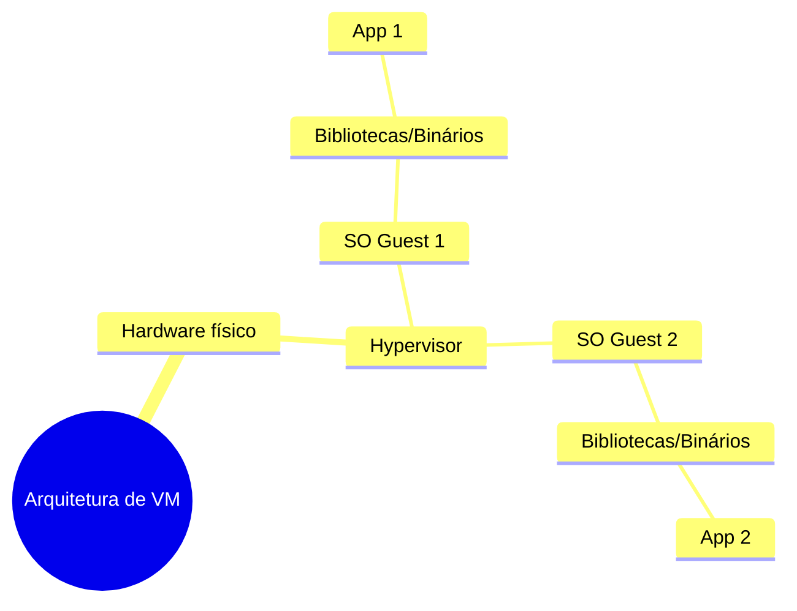
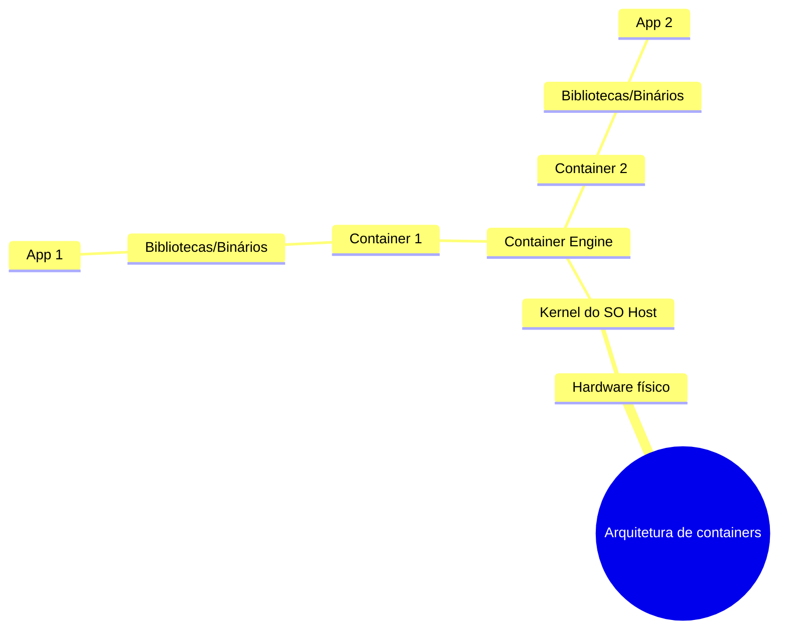

Containers e máquinas virtuais isolam cargas de trabalho, mas fazem-no em camadas diferentes. Compreender essa fronteira ajuda a avaliar as propriedades de segurança, os custos de recursos e os compromissos operacionais de cada opção.

## Máquinas virtuais (VMs): o modelo tradicional

Uma máquina virtual executa um sistema operativo convidado sobre hardware virtual fornecido por um **hypervisor**. Dependendo da arquitectura, o hypervisor corre directamente na máquina física ou sobre um sistema operativo anfitrião.

### Como funciona?
O hypervisor apresenta CPUs, memória, armazenamento e dispositivos virtuais a cada sistema convidado, e depois agenda e medeia o acesso aos recursos físicos. Estes recursos são partilhados pelo anfitrião e pelos convidados, em vez de ficarem exclusivamente reservados a uma VM.

**Uma analogia útil:** pensa numa VM como um apartamento num prédio. Cada apartamento tem divisões e serviços próprios, tal como um sistema convidado tem o seu kernel e dispositivos virtuais. A separação é mais forte do que o isolamento entre processos, mas continua dependente do hypervisor e da sua configuração.

## Containers: isolamento ao nível do sistema operativo

Os containers fornecem isolamento ao nível do sistema operativo, em vez de virtualizarem o hardware. Os containers Linux usam funcionalidades do kernel, como namespaces e cgroups, para isolar vistas dos processos e gerir recursos enquanto partilham um kernel Linux.

### O que muda na prática?
Os containers Linux partilham o kernel Linux do anfitrião, pelo que a imagem não precisa de incluir um kernel separado para cada aplicação. O Docker fornece ferramentas para containers, enquanto o Kubernetes orquestra cargas de trabalho containerizadas; nenhum dos dois é, por si só, um container.

Uma analogia aproximada é a de quartos separados num edifício partilhado: cada processo tem uma vista isolada de alguns recursos, mas todos dependem da infraestrutura comum, o kernel. Ao contrário dos quartos, estas fronteiras são implementadas por funcionalidades do kernel e não dão a cada container um kernel próprio.

## Que kernel está em execução?

Os detalhes do kernel dependem do tipo de container e do anfitrião. Os containers Linux partilham um kernel Linux; o Docker Desktop usa uma VM Linux leve para executar containers Linux em macOS e em configurações de Windows que não disponibilizam directamente um kernel Linux. Os containers Windows usam, por sua vez, um kernel Windows.

A imagem de um container Linux pode fornecer um userland Ubuntu ou Arch Linux, incluindo bibliotecas e gestor de pacotes, enquanto ambos os containers continuam a usar o kernel Linux do anfitrião. O nome da distribuição na imagem não determina o kernel que executa o container.

## Comparação rápida

Se precisas de um resumo rápido, aqui está uma comparação entre os dois:

| Característica | Máquinas Virtuais (VMs) | Containers |
| :--- | :--- | :--- |
| **SO** | O sistema convidado corre sobre hardware virtual | Os processos partilham o kernel do anfitrião |
| **Isolamento** | Kernel convidado e fronteira de hardware virtual separados | Mecanismos do kernel como namespaces e cgroups; a configuração importa |
| **Inicialização** | Inclui o arranque do sistema convidado | Inicia processos isolados; o tempo depende da carga e da configuração |
| **Imagem e armazenamento** | Inclui uma imagem do sistema convidado | Inclui o userland e as dependências da aplicação; o tamanho varia |
| **Custo de recursos** | Inclui os custos do hypervisor e do sistema convidado | Evita um kernel separado por container; o custo depende da carga e do runtime |

## Fronteiras de segurança e isolamento

Uma das principais diferenças entre VMs e containers é a **fronteira de segurança**.

- **VMs:** Dão a cada sistema convidado um kernel separado e uma fronteira de hardware virtual. Em muitas implementações, esta fronteira é mais forte do que o isolamento entre processos, mas continua dependente do hypervisor, da configuração e do modelo de ameaças.
- **Containers Linux:** Usam funcionalidades como **namespaces** para isolar vistas dos recursos do sistema e **cgroups** para contabilizar e limitar a sua utilização. Os containers partilham o kernel do anfitrião, pelo que uma vulnerabilidade do kernel ou uma configuração privilegiada pode afectar o anfitrião e outras cargas de trabalho.

## Limites da portabilidade

Uma imagem de container pode tornar mais consistentes os ficheiros da aplicação e as dependências do userland entre ambientes. Não elimina diferenças na arquitectura da CPU, no kernel anfitrião, na configuração do runtime, nos recursos disponíveis ou nos serviços externos, pelo que não garante um comportamento idêntico em todo o lado.

As imagens de VM também são portáteis, mas incluem um sistema operativo convidado e podem exigir mais armazenamento e capacidade de transferência. O impacto operacional depende do formato da imagem, da infraestrutura e do processo de implementação.

## Qual escolher?

A escolha depende da fronteira de isolamento e dos requisitos de sistema operativo da carga de trabalho.

### Use VMs quando:
- Precisas de um kernel convidado separado ou de uma fronteira de hardware virtual.
- Precisas de testar sistemas operativos ou versões específicas do kernel.
- Precisas de snapshots que incluam o sistema operativo convidado.

### Use containers quando:
- É aceitável que a carga partilhe o kernel do anfitrião.
- Queres empacotar uma aplicação e as suas dependências de espaço de utilizador de forma consistente.
- Queres executar vários processos isolados sem um kernel convidado separado para cada um.

## Conclusão

A escolha depende de a carga de trabalho precisar de um kernel convidado separado, da fronteira de isolamento adequada e da forma como o sistema será operado.

## Para saber mais

- [What is a container?](https://docs.docker.com/get-started/docker-concepts/the-basics/what-is-a-container/)
- [Linux Container Configuration](https://github.com/opencontainers/runtime-spec/blob/main/config-linux.md)
- [The Definitive KVM API Documentation](https://docs.kernel.org/virt/kvm/api.html)
