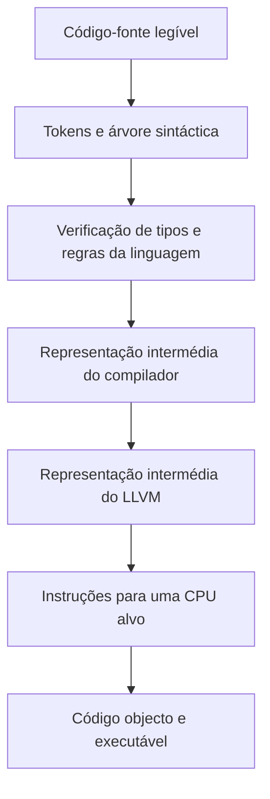
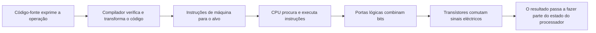

Quando escrevemos código de alto nível, o processador não lê as palavras-chave nem os operadores. A CPU trabalha com um vocabulário muito mais pequeno: instruções de máquina codificadas em bits. Entre o código-fonte e esses bits existem várias camadas de tradução; por baixo dos bits, há circuitos cujo comportamento eléctrico torna a computação possível.

Para percorrer essas camadas, consideremos esta pequena soma de inteiros:

```rust
fn main() {
    let a = 90;
    let b = 12;
    let c = a + b;
}
```

O resultado é `102`. Esta soma simples permite-nos acompanhar o percurso pela compilação, pelo sistema operativo, pelas instruções da CPU, pelas portas lógicas e pelos transístores.

## 1. O código de alto nível descreve uma intenção

O código diz o que queremos: criar dois valores inteiros, somá-los e associar o resultado a `c`. Não especifica onde os valores têm de ficar, que registo da CPU utilizar, nem como construir um circuito somador.

Neste exemplo em Rust, o compilador infere os literais inteiros como `i32`, porque não indicamos um tipo. É um tipo inteiro com sinal de 32 bits. Os valores são positivos, pelo que a sua representação em bits é igual quer os interpretemos como números binários positivos, quer como inteiros com sinal em complemento para dois.

Um nome como `a` é sobretudo útil para nós e para o compilador. Não garante que exista uma célula de memória permanente chamada `a` no programa final.

## 2. O compilador transforma o programa em representações inferiores

Um compilador processa normalmente o código-fonte através de várias representações. Para o nosso exemplo em Rust, `rustc` (normalmente invocado através do Cargo) segue um percurso que podemos resumir assim:



De forma simplificada:

1. **Análise sintáctica:** verifica se o texto respeita a gramática do Rust e constrói uma representação estruturada do código.
2. **Verificações semânticas:** determinam os tipos e aplicam as regras do Rust, incluindo ownership e borrowing quando são relevantes. Neste exemplo não há referências nem complicações de ownership.
3. **Representações intermédias:** exprimem o programa de formas que o compilador consegue analisar e transformar mais facilmente. O MIR do Rust é uma delas; o Rust utiliza habitualmente o LLVM como backend de geração de código.
4. **Optimização:** pode simplificar o programa, eliminar trabalho desnecessário e escolher representações eficientes para os valores.
5. **Geração de código:** emite instruções para um alvo específico, como x86-64 ou AArch64. O resultado depende do alvo, da versão do compilador, das opções de compilação e do restante programa.

Estas etapas são um modelo conceptual útil, não uma garantia de que todas as versões do compilador usem exactamente os mesmos passos internos.

### A optimização pode eliminar a soma

O nosso exemplo usa constantes. O compilador pode calcular `90 + 12` durante a compilação e substituir a expressão por `102`. Como `c` não é usado, pode até eliminar todo o cálculo. Num programa compilado real, a CPU talvez não execute soma nenhuma para este trecho.

A isto chama-se **constant folding**: se o compilador conseguir determinar o resultado antecipadamente, pode calculá-lo durante a compilação. A optimização é uma das razões pelas quais o código-fonte e as instruções executadas não correspondem um para um.

Para tornar mais fácil observar uma soma dependente de valores recebidos durante a execução, podemos escrever uma função com parâmetros:

```rust
fn add(a: i32, b: i32) -> i32 {
    a + b
}
```

O compilador tem de produzir um resultado para os valores fornecidos quando a função é executada, embora possa continuar a escolher instruções ou transformações diferentes conforme o alvo e o modo de compilação. Para inspeccionar localmente o assembly gerado, uma opção é:

```bash
cargo rustc --release -- --emit=asm
```

O resultado depende da plataforma e do compilador. O assembly é uma representação legível das instruções de máquina, não o formato nativo que a CPU recebe.

## 3. As instruções de máquina operam sobre bits

Uma instrução da CPU pode indicar ao processador que some o conteúdo de dois registos e coloque a resposta noutro registo. Numa CPU x86-64, o compilador pode utilizar uma instrução semelhante a `add eax, esi`; uma CPU AArch64 usa outras codificações e nomes de instruções. São exemplos, não uma previsão garantida para o nosso código exacto.

Podemos representar os números em binário:

```text
90  = 01011010
12  = 00001100
102 = 01100110
```

Para simplificar, mostramos apenas oito bits. Neste exemplo em Rust, os valores são `i32`, pelo que uma operação real usa, em geral, valores de 32 bits ou uma representação equivalente. Nestes números positivos, os bits adicionais à esquerda são zeros.

A soma binária segue a mesma ideia de somar coluna a coluna que usamos no sistema decimal, mas com base 2. Cada coluna contém 0 ou 1, e a soma de dois bits pode produzir um transporte para a coluna seguinte. Eis a representação em oito bits:

```text
  01011010
+ 00001100
----------
  01100110
```

A instrução do compilador não tem de significar «executa exactamente este desenho». Pede à CPU que faça uma soma de inteiros com os operandos e o destino especificados.

## 4. O sistema operativo carrega o programa

O compilador e o linker juntam o código de máquina e os restantes dados necessários num ficheiro executável. Num sistema Linux típico, esse ficheiro utiliza o formato ELF. Quando o executamos, o sistema operativo carrega os segmentos executáveis para o espaço de endereçamento virtual do processo, prepara o processo e transfere o controlo para o respectivo ponto de entrada. Programas ligados dinamicamente também podem envolver um linker dinâmico que carrega bibliotecas partilhadas.

Normalmente, o sistema operativo não traduz cada linha de código-fonte durante a execução do programa. A compilação já produziu o código de máquina. O sistema operativo prepara a execução e fornece serviços; depois, a CPU executa as instruções do programa.

## 5. A CPU procura, descodifica e executa

Em termos gerais, uma CPU repete um ciclo muitas vezes descrito como **procurar, descodificar e executar**:

1. **Procurar (fetch):** utiliza o endereço da instrução actual para obter os bytes da instrução, muitas vezes a partir de uma cache próxima.
2. **Descodificar (decode):** determina que instrução os bits representam e de que operandos necessita.
3. **Executar (execute):** realiza a operação, como uma soma de inteiros, e actualiza o estado do processador.

Os processadores modernos fazem muito mais internamente: usam pipelines, prevêem desvios, renomeiam registos e podem executar operações independentes em paralelo. Estas técnicas melhoram o desempenho, mas o resultado visível continua a respeitar o comportamento definido pelo programa.

Numa soma, os operandos podem estar em registos. Os registos são pequenas áreas de armazenamento muito rápidas dentro do núcleo da CPU. O hardware aritmético combina os bits dos operandos e disponibiliza o resultado às instruções seguintes. O compilador decide como atribuir os valores aos registos; uma variável do código-fonte não fica permanentemente associada a um registo físico.

## 6. As portas lógicas concretizam a soma

Dentro do processador, a soma é implementada por lógica digital. De forma simplificada, um somador é construído com circuitos que calculam um bit de soma e um bit de transporte para cada posição. O bit da soma depende dos bits de entrada e do eventual transporte da posição anterior. As unidades aritméticas reais das CPUs utilizam circuitos cuidadosamente concebidos para trabalhar rapidamente.

Os circuitos lógicos são montados a partir de **portas lógicas**, como AND, OR e NOT. Cada porta implementa uma regra simples sobre as entradas e a saída. Por exemplo, a saída de uma porta AND só é 1 quando ambas as entradas são 1. A combinação de portas permite construir circuitos para aritmética, comparações, selecção e muitas outras operações.

A implementação real é mais complexa do que uma sequência de portas de um exemplo escolar. Os chips modernos utilizam redes de transístores optimizadas, e o desenho dos circuitos equilibra velocidade, consumo de energia, área e calor.

## 7. Os transístores transformam a lógica em comportamento eléctrico

Um circuito digital usa transístores como interruptores eléctricos controláveis. Num transístor CMOS simplificado, uma tensão de entrada influencia a formação de um caminho condutor. Ao combinar transístores, os projectistas constroem portas cuja tensão de saída se aproxima de uma de duas gamas, interpretadas como o valor lógico 0 ou 1.

São **gamas de tensão**, não tensões perfeitamente fixas nem partículas com uma etiqueta «zero» ou «um». O circuito é concebido para que pequenas variações mantenham o sinal dentro de uma gama válida e fiável. Quando os sinais mudam, as capacitâncias do circuito carregam-se e descarregam-se; esta comutação consome energia e contribui para o calor.

O relógio da CPU fornece referências temporais para coordenar grande parte deste trabalho. Uma transição do relógio não significa que todos os transístores do chip mudem ao mesmo tempo: diferentes partes do chip estão activas em momentos diferentes, e alguma lógica é combinatória entre elementos sincronizados pelo relógio. Ainda assim, o relógio ajuda a coordenar quando o estado, como o conteúdo dos registos, é actualizado.

No nível mais baixo desta explicação, a soma não é uma operação mágica feita pelo software. É um padrão de alterações eléctricas em circuitos baseados em transístores, organizados para que o resultado respeite as regras da soma binária.

## 8. O que acontece a `c`?

Depois da soma, o resultado `102` fica disponível no estado do processador, muitas vezes num registo, para ser utilizado pela instrução seguinte. Se o código precisar dele na memória, o compilador pode gerar uma instrução para o guardar. Se o imprimirmos, há muito mais trabalho: formatar o número como caracteres, enviar a saída ao sistema operativo e, por fim, encaminhá-la para um terminal ou outro destino.

No nosso exemplo original, `c` nunca é lido e a soma não tem efeitos observáveis. O compilador pode eliminar a variável e o cálculo. Por isso, perguntar «onde fica guardado o `c`?» pode não ter uma resposta concreta no código de máquina final: a variável pode nem existir durante a execução.

## O percurso completo, numa só vista



Cada camada oferece uma abstracção útil. Uma linguagem de alto nível permite-nos exprimir uma intenção sem desenhar um circuito. O compilador traduz e optimiza essa intenção. As instruções de máquina descrevem operações para uma arquitectura de processador. Os circuitos da CPU executam-nas usando sinais eléctricos nos transístores.

Quando o código-fonte exprime uma operação como `a + b`, não estamos a dar uma ordem directa à electricidade. Usamos uma pilha de abstracções que, no fim, faz com que o comportamento eléctrico produza `102` de forma fiável — a menos que o compilador consiga provar esse resultado antecipadamente e eliminar o trabalho.