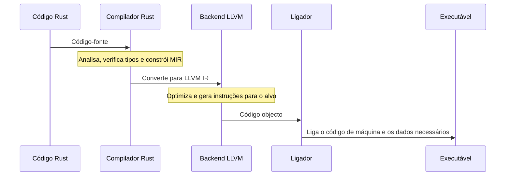
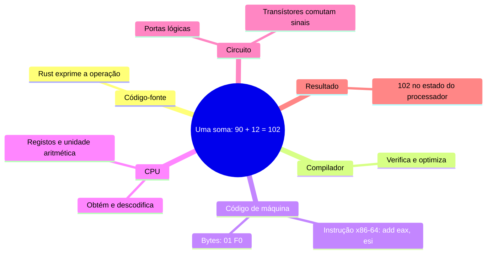

Quando escrevemos `a + b`, parece que o computador percebe simplesmente o que queremos e soma os números. De certa forma, sim, mas só depois de o código passar por várias camadas de tradução. O processador não lê as palavras-chave do Rust nem o sinal `+`. Obtém instruções de máquina codificadas em bits, e circuitos baseados em transístores transformam essas instruções em alterações eléctricas.

Vamos acompanhar uma pequena soma de princípio a fim. Será o nosso fio condutor, e vamos distinguir o que o código-fonte exprime daquilo que uma CPU específica poderá realmente fazer:

```rust
fn main() {
    let a = 90;
    let b = 12;
    let c = a + b;
}
```

O resultado é `102`. A conta é simples; o interessante é perceber quantas camadas tornam essa resposta possível. Vamos acompanhá-la desde o Rust, passando pelas instruções compiladas e pelo hardware da CPU, até às portas lógicas e aos transístores.

## 1. O código de alto nível descreve uma intenção

O código diz o que queremos: criar dois valores inteiros, somá-los e associar o resultado a `c`. Não especifica onde os valores têm de ficar, que registo da CPU utilizar, nem como construir um circuito somador.

Neste exemplo em Rust, o compilador infere os literais inteiros como `i32`, porque não indicamos um tipo. É um tipo inteiro com sinal de 32 bits. Os valores são positivos, pelo que a sua representação em bits é igual quer os interpretemos como números binários positivos, quer como inteiros com sinal em complemento para dois.

Um nome como `a` é sobretudo útil para nós e para o compilador. Não garante que exista uma célula de memória permanente chamada `a` no programa final.

## 2. O compilador transforma o programa em representações inferiores

Um compilador processa normalmente o código-fonte através de várias representações. Para o nosso exemplo em Rust, `rustc` (normalmente invocado através do Cargo) segue um percurso que podemos resumir assim:



De forma simplificada:

1. **Análise sintáctica:** verifica se o texto respeita a gramática do Rust e constrói uma representação estruturada do código.
2. **Verificações semânticas:** determinam os tipos e aplicam as regras do Rust, incluindo ownership e borrowing quando são relevantes. Neste exemplo não há referências nem complicações de ownership.
3. **Representações intermédias:** exprimem o programa de formas que o compilador consegue analisar e transformar mais facilmente. O MIR do Rust é uma delas; o Rust utiliza habitualmente o LLVM como backend de geração de código.
4. **Optimização:** pode simplificar o programa, eliminar trabalho desnecessário e escolher representações eficientes para os valores.
5. **Geração de código:** emite instruções para um alvo específico, como x86-64 ou AArch64. O resultado depende do alvo, da versão do compilador, das opções de compilação e do restante programa.

Estas etapas são um modelo conceptual útil, não uma garantia de que todas as versões do compilador usem exactamente os mesmos passos internos.

### A optimização pode eliminar a soma

O nosso exemplo usa constantes. O compilador pode calcular `90 + 12` durante a compilação e substituir a expressão por `102`. Como `c` não é usado, pode até eliminar todo o cálculo. Num programa compilado real, a CPU talvez não execute soma nenhuma para este trecho.

A isto chama-se **constant folding**: se o compilador conseguir determinar o resultado antecipadamente, pode calculá-lo durante a compilação. A optimização é uma das razões pelas quais o código-fonte e as instruções executadas não correspondem um para um.

Para tornar mais fácil observar uma soma dependente de valores recebidos durante a execução, podemos escrever uma função com parâmetros:

```rust
fn add(a: i32, b: i32) -> i32 {
    a + b
}
```

Esta função aproxima-nos um pouco mais de um caso real: os valores só são fornecidos quando a função é executada, por isso o compilador não pode calcular antecipadamente a resposta para todos os casos. Continua a poder escolher instruções diferentes conforme o processador e as opções de compilação.

Para inspeccionar o assembly gerado no teu projecto, podes pedir ao Rust que o emita:

```bash
cargo rustc --release -- --emit=asm
```

O resultado exacto depende do alvo, da versão do compilador e do código envolvente. O assembly é uma forma legível de escrever instruções de máquina; a CPU recebe os bytes das instruções, não estas palavras.

## 3. As instruções de máquina operam sobre bits

Uma instrução da CPU pode dizer, em termos simples: «soma o valor deste registo ao valor daquele e guarda aqui a resposta». Eis um exemplo x86-64, escrito na sintaxe Intel de assembly:

```asm
add eax, esi
```

Lê-se assim: soma `esi` a `eax` e guarda o resultado em `eax`. Estes nomes são registos da CPU, não variáveis Rust. Imagina que instruções anteriores colocaram `90` em `eax` e `12` em `esi`. Esta instrução altera `eax` para `102`. Estamos a omitir as instruções de preparação para nos concentrarmos na soma. Uma função Rust real pode usar outros registos ou outra instrução; este é um exemplo concreto, não uma promessa sobre o que qualquer compilador vai gerar.

### Como fica esta instrução em binário?

Em x86-64, a instrução acima tem esta codificação em código de máquina:

```text
Bytes em hexadecimal:  01 F0
Bits em binário:       00000001 11110000
```

O sistema hexadecimal é uma forma compacta de escrever bytes. A CPU obtém `01 F0`, não as letras `add eax, esi`. Eis o segundo byte dividido nos campos que o descodificador x86 lê:

```text
F0 = 11 110 000
     mod reg r/m
```

Nesse segundo byte, `mod = 11` significa que ambos os operandos são registos; `reg = 110` selecciona `esi` e `r/m = 000` selecciona `eax`. O primeiro byte, `01`, escolhe uma forma da instrução `ADD`. Em conjunto, estas regras de codificação dizem ao processador para somar `esi` a `eax`.

Outras arquitecturas de CPU codificam a soma de forma diferente, e o x86 também pode codificar operações equivalentes de mais do que uma maneira. O assembly é a forma legível por humanos; o código de máquina é o padrão de bits específico da arquitectura que o processador descodifica.

Agora vejamos os valores que estão a ser somados. Escritos com apenas oito bits, ficam assim:

```text
90  = 01011010
12  = 00001100
102 = 01100110
```

Os valores Rust são `i32`, ou seja, têm 32 bits; a versão de oito bits é apenas mais fácil de ler. Como estes números são positivos, os bits adicionais à esquerda são todos zeros. A soma binária funciona coluna a coluna, como a soma decimal, mas cada coluna usa a base 2:

```text
  01011010
+ 00001100
----------
  01100110
```

A CPU não segue este desenho como se fosse uma receita. A instrução indica ao hardware aritmético que operação deve realizar e que valores deve usar; o hardware combina os bits e produz o resultado.

## 4. O sistema operativo carrega o programa

O compilador e o linker juntam o código de máquina e os restantes dados necessários num ficheiro executável. Num sistema Linux típico, esse ficheiro utiliza o formato ELF. Quando o executamos, o sistema operativo carrega os segmentos executáveis para o espaço de endereçamento virtual do processo, prepara o processo e transfere o controlo para o respectivo ponto de entrada. Programas ligados dinamicamente também podem envolver um linker dinâmico que carrega bibliotecas partilhadas.

Normalmente, o sistema operativo não traduz cada linha de código-fonte durante a execução do programa. A compilação já produziu o código de máquina. O sistema operativo prepara a execução e fornece serviços; depois, a CPU executa as instruções do programa.

## 5. A CPU procura, descodifica e executa

Em termos gerais, uma CPU repete um ciclo muitas vezes descrito como **procurar, descodificar e executar**:

1. **Procurar (fetch):** utiliza o endereço da instrução actual para obter os bytes da instrução, muitas vezes a partir de uma cache próxima.
2. **Descodificar (decode):** determina que instrução os bits representam e de que operandos necessita.
3. **Executar (execute):** realiza a operação, como uma soma de inteiros, e actualiza o estado do processador.

O ciclo procurar-descodificar-executar é uma imagem útil, mas os processadores modernos fazem muito mais nos bastidores. Usam pipelines, prevêem desvios, renomeiam registos e podem executar operações independentes em paralelo. Alguns processadores x86 também descodificam uma instrução como a anterior em operações internas mais pequenas, muitas vezes chamadas micro-operações ou micro-ops. São detalhes de implementação: não são o mesmo que os bytes da instrução `01 F0` e podem variar entre modelos de processador.

Na nossa soma, os valores podem estar em registos: pequenas áreas de armazenamento muito rápidas dentro do núcleo da CPU. O hardware aritmético combina os bits e disponibiliza o resultado às instruções seguintes. É o compilador que escolhe os registos, por isso uma variável Rust não fica permanentemente associada a um registo físico.

## 6. As portas lógicas concretizam a soma

Dentro do processador, a soma é implementada por lógica digital. De forma simplificada, um somador é construído com circuitos que calculam um bit de soma e um bit de transporte para cada posição. O bit da soma depende dos bits de entrada e do eventual transporte da posição anterior. As unidades aritméticas reais das CPUs utilizam circuitos cuidadosamente concebidos para trabalhar rapidamente.

Os circuitos lógicos são montados a partir de **portas lógicas**, como AND, OR e NOT. Cada porta implementa uma regra simples sobre as entradas e a saída. Por exemplo, a saída de uma porta AND só é 1 quando ambas as entradas são 1. A combinação de portas permite construir circuitos para aritmética, comparações, selecção e muitas outras operações.

A implementação real é mais complexa do que uma sequência de portas de um exemplo escolar. Os chips modernos utilizam redes de transístores optimizadas, e o desenho dos circuitos equilibra velocidade, consumo de energia, área e calor.

## 7. Os transístores transformam a lógica em comportamento eléctrico

Um circuito digital usa transístores como interruptores eléctricos controláveis. Num transístor CMOS simplificado, uma tensão de entrada influencia a formação de um caminho condutor. Ao combinar transístores, os projectistas constroem portas cuja tensão de saída se aproxima de uma de duas gamas, interpretadas como o valor lógico 0 ou 1.

São **gamas de tensão**, não tensões perfeitamente fixas nem partículas minúsculas com uma etiqueta «zero» ou «um». O circuito é concebido para que pequenas variações mantenham o sinal dentro de uma gama válida e fiável. Quando os sinais mudam, as capacitâncias do circuito carregam-se e descarregam-se; esta comutação consome energia e contribui para o calor.

O relógio da CPU fornece referências temporais para coordenar grande parte deste trabalho. Uma transição do relógio não significa que todos os transístores do chip mudem ao mesmo tempo: diferentes partes do chip estão activas em momentos diferentes, e alguma lógica é combinatória entre elementos sincronizados pelo relógio. Ainda assim, o relógio ajuda a coordenar quando o estado, como o conteúdo dos registos, é actualizado.

No nível mais baixo desta explicação, a soma não é uma operação mágica feita pelo software. É um padrão de alterações eléctricas em circuitos baseados em transístores, organizados para que o resultado respeite as regras da soma binária.

## 8. O que acontece a `c`?

Depois da soma, o resultado `102` fica disponível no estado do processador, muitas vezes num registo, para ser utilizado pela instrução seguinte. Se o código precisar dele na memória, o compilador pode gerar uma instrução para o guardar. Se o imprimirmos, há muito mais trabalho: formatar o número como caracteres, enviar a saída ao sistema operativo e, por fim, encaminhá-la para um terminal ou outro destino.

No nosso exemplo original, `c` nunca é lido e a soma não tem efeitos observáveis. O compilador pode eliminar a variável e o cálculo. Por isso, perguntar «onde fica guardado o `c`?» pode não ter uma resposta concreta no código de máquina final: a variável pode nem existir durante a execução.

## As camadas envolvidas numa soma



Cada camada oferece uma abstracção útil. Uma linguagem de alto nível permite-nos exprimir uma intenção sem desenhar um circuito. O compilador traduz e optimiza essa intenção. As instruções de máquina descrevem operações para uma arquitectura de processador. Os circuitos da CPU executam-nas usando sinais eléctricos nos transístores.

Quando o teu código diz `a + b`, não está a dar uma ordem directa à electricidade. Descreve uma operação através de várias camadas de abstracção, que acabam por orientar alterações eléctricas que produzem `102`, a menos que o compilador consiga provar o resultado antecipadamente e elimine a soma.