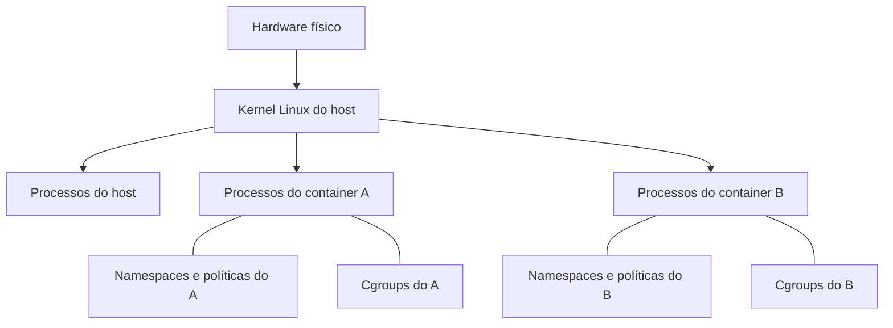
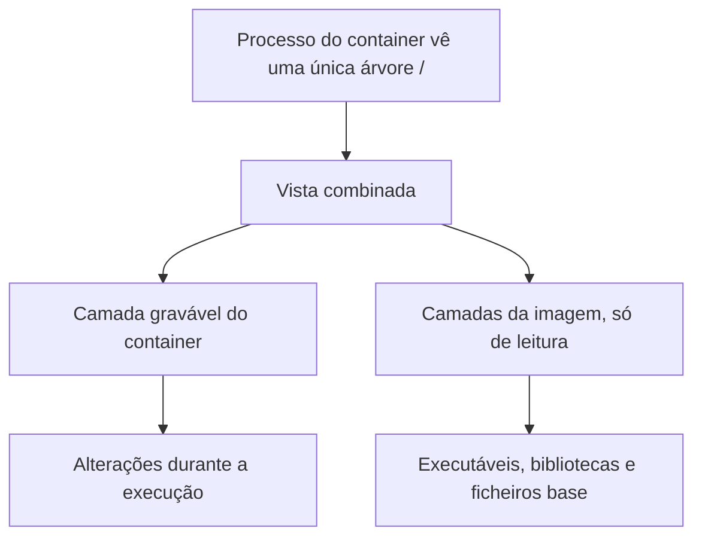
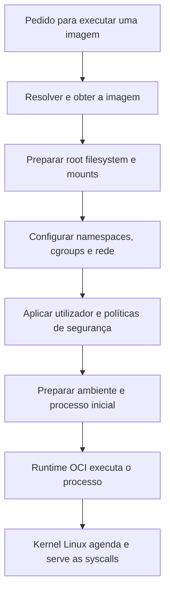

*No artigo [Containers não são máquinas virtuais](/pt/articles/containers-vs-vms/), comparámos containers com VMs. Agora vamos seguir o caminho desde um processo Linux até ao arranque de um container, para perceber o papel do kernel, do sistema de ficheiros e das ferramentas que coordenam tudo.*

## A ideia central: um container é um processo com contexto

Um container não é, por si só, uma máquina virtual, um sistema operativo completo ou uma caixa implementada pelo Docker. No Linux, é mais útil pensar nele como **um ou mais processos normais aos quais o kernel apresenta uma visão isolada do sistema e aplica políticas de recursos e segurança**.

Os processos continuam a ser agendados pelo mesmo kernel e a usar o mesmo hardware que os restantes processos do host. O que muda é o contexto em que são executados: que processos conseguem ver, que árvore de ficheiros encontram, que interfaces de rede têm disponíveis, que utilizadores aparentam ser e que recursos podem consumir.



O desenho é conceptual: namespaces e cgroups não são camadas pelas quais cada syscall passa. São mecanismos que o kernel consulta ao tratar operações dos processos.

Esta distinção também explica por que razão containers Linux partilham o kernel do host. Em macOS e Windows, ferramentas como Docker Desktop executam normalmente containers Linux dentro de uma máquina virtual Linux, porque o kernel do sistema anfitrião não é Linux.

## 1. O ponto de partida: processos Linux

Um **processo** é uma instância de um programa em execução. Quando executamos `sleep 300`, o kernel cria e agenda um processo para executar esse programa. O processo tem um identificador (PID), credenciais de utilizador e grupo, memória virtual, descritores de ficheiros e outros atributos mantidos ou controlados pelo kernel.

Podemos inspecionar processos com:

```bash
ps -ef
cat /proc/<PID>/status
```

`/proc` é um sistema de ficheiros virtual: o kernel apresenta informação sobre os processos e o sistema, não ficheiros convencionais guardados num disco.

Um processo pede serviços ao kernel através de **system calls**, ou syscalls  por exemplo, para abrir um ficheiro, criar outro processo ou enviar dados por uma socket. O programa que corre no container não tem um kernel próprio para satisfazer esses pedidos: continua a usar o kernel Linux partilhado.

## 2. Namespaces: limitar o que um processo consegue ver

Um **namespace** altera a visão que um processo tem de um recurso do sistema. Grupos de processos podem, assim, partilhar o kernel sem partilhar necessariamente a mesma visão de processos, rede ou pontos de montagem.

| Namespace | O que isola ou altera |
|---|---|
| PID | A vista dos identificadores e da hierarquia de processos |
| Network (NET) | Interfaces, endereços, rotas, sockets e outros recursos de rede |
| Mount (MNT) | A vista dos pontos de montagem |
| UTS | Hostname e nome de domínio NIS |
| IPC | Recursos de comunicação entre processos, como filas e semáforos |
| User (USER) | Mapeamento de identificadores de utilizador e grupo |
| Cgroup (CGROUP) | A vista da hierarquia de cgroups |
| Time (TIME) | Determinadas referências de relógio, através de offsets |

Um container típico combina vários namespaces, mas a configuração exata depende do runtime e do que foi pedido. A existência de namespaces não implica automaticamente que todos os recursos estejam completamente isolados ou que o container seja seguro contra qualquer ataque.

### PID: processos e o PID 1

Dentro de um PID namespace, um processo pode aparecer como PID 1 mesmo que tenha outro PID no namespace do host. O processo pode ser visto com identificadores diferentes em níveis diferentes da hierarquia de namespaces.

O PID 1 tem responsabilidades especiais: entre elas, receber processos órfãos e recolher o estado de processos terminados para evitar acumulação de *zombies*. Também pode ser necessário encaminhar sinais corretamente. Se a aplicação não desempenhar essas funções, um pequeno processo init pode fazê-lo.

### Network: uma pilha de rede própria

Um namespace de rede pode ter interfaces, endereços IP e tabelas de encaminhamento próprios. Assim, dois containers podem ter serviços à escuta na porta interna `8080` sem conflito entre si: estão em contextos de rede separados.

Para comunicar com o host ou com outros containers, a configuração pode ligar namespaces através de pares de interfaces virtuais (*veth*), bridges e rotas. A publicação de uma porta no host  por exemplo, encaminhar uma porta do host para um serviço do container  é uma configuração adicional feita pelo runtime ou por ferramentas de rede; não acontece apenas por existir um namespace.

### Mount: uma vista própria do sistema de ficheiros

O mount namespace dá ao processo uma tabela própria de pontos de montagem. Combinado com um *root filesystem* e operações de mudança da raiz, permite que `/` dentro do container aponte para uma árvore diferente da raiz do host.

Isto é uma visão isolada de mounts, não um disco físico independente. A árvore pode ser formada por camadas de imagem, mounts bind, volumes e outros mounts configurados para o container.

### User: identidades e privilégios

Um user namespace pode mapear os identificadores de utilizador e grupo vistos dentro do container para outros identificadores no host. Por exemplo, o UID 0 dentro do namespace pode corresponder a um UID sem privilégios no host.

Por isso, "root dentro do container" não significa necessariamente "root no host". O nível de proteção depende dos mapeamentos, das capabilities, da configuração do runtime e de eventuais vulnerabilidades do kernel. Nem todos os ambientes usam user namespaces da mesma forma.

## 3. Cgroups: contabilizar e controlar recursos

**Control groups (cgroups)** organizam processos numa hierarquia que permite ao kernel contabilizar e, conforme o controlador e a configuração, limitar ou distribuir recursos. Enquanto os namespaces se centram na visibilidade, os cgroups tratam sobretudo de **contabilidade e controlo de utilização**.

Os controladores podem gerir recursos como CPU, memória, I/O e o número de tarefas. O controlador de PIDs conta tarefas do kernel  incluindo threads  e não apenas o número de programas que uma pessoa vê numa listagem simplificada.

Por exemplo, o Docker permite configurar alguns limites ao criar um container:

```bash
docker run -d \
  --name minha-app \
  --cpus="1.5" \
  --memory="512m" \
  --pids-limit=100 \
  nginx
```

`--cpus="1.5"` configura uma quota equivalente a até 1,5 CPUs ao longo do tempo; não reserva CPUs físicas exclusivas. `--memory` define um limite de memória, e atingir esse limite pode levar o kernel a terminar processos por falta de memória. `--pids-limit` limita o número de tarefas contabilizadas pelo controlador de PIDs.

Em cgroups v2, a hierarquia unificada é normalmente exposta em `/sys/fs/cgroup/`. Entre os ficheiros de controlo mais comuns encontram-se `memory.current`, `memory.max`, `cpu.stat`, `pids.current` e `pids.max`. O caminho exato varia segundo o sistema e a hierarquia. Para saber a que cgroup pertence um processo:

```bash
cat /proc/<PID>/cgroup
```

Cgroups não são um mecanismo de isolamento da vista do sistema de ficheiros ou de processos, e os limites não substituem a monitorização. O kernel, a versão de cgroups e a configuração do runtime determinam o comportamento concreto.

## 4. Sistema de ficheiros: imagem, rootfs e camada gravável

Uma imagem de container fornece ficheiros de espaço de utilizador necessários para iniciar a aplicação: executáveis, bibliotecas, configuração e, por vezes, grande parte do userland de uma distribuição Linux. Pode incluir diretórios como `/bin`, `/etc`, `/usr` e `/lib`.

Isso não significa que a imagem contenha um kernel Linux próprio. O kernel e as syscalls continuam a ser fornecidos pelo host. Uma imagem pode parecer um sistema operativo completo do ponto de vista dos seus ficheiros, mas não arranca um kernel independente como uma VM.

### Camadas da imagem e armazenamento

Imagens no formato OCI são distribuídas como conteúdo com manifests e camadas. Camadas partilhadas podem ser reutilizadas por várias imagens. Durante a execução, o runtime e o respetivo componente de armazenamento preparam uma árvore de ficheiros para o processo. Em muitas configurações Linux, um filesystem por união como OverlayFS combina camadas só de leitura com uma camada gravável; outras implementações e *snapshotters* também são possíveis.



Com OverlayFS, uma alteração a um ficheiro que só existe numa camada inferior pode desencadear uma operação *copy-up*: o ficheiro é copiado para a camada gravável antes de ser modificado. O mecanismo concreto depende do driver ou snapshotter em uso.

A camada gravável costuma pertencer ao ciclo de vida do container. Se for removida, as alterações guardadas apenas nessa camada também podem desaparecer. Para dados que precisam de sobreviver à substituição ou remoção do container, utiliza-se armazenamento persistente, como volumes ou bind mounts.

**Imagem e container são coisas diferentes:** a imagem é um artefacto reutilizável; o container é uma instância em execução  ou preparada para execução  com configuração e estado próprios.

## 5. Rede: da interface virtual à porta publicada

O namespace de rede dá ao processo uma pilha de rede independente, mas é preciso configurar as ligações para que essa pilha comunique com outras redes. Uma configuração comum cria um par *veth*: uma ponta fica no namespace do container e a outra liga-se a uma bridge no host. O host pode encaminhar tráfego, e regras de firewall ou NAT podem permitir o acesso externo.


É uma arquitetura comum, não uma regra universal. Plugins de rede, modo host, políticas de cluster, IPvlan/Macvlan e outras configurações alteram o caminho. "A porta está aberta no container" também não quer dizer que esteja acessível a partir da Internet: é necessário verificar o endereço de escuta, os encaminhamentos, as regras de firewall e a rede envolvente.

## 6. Segurança: várias barreiras, nenhuma garantia isolada

Namespaces e cgroups são peças importantes, mas **não constituem, por si só, uma fronteira de segurança completa**. Os containers partilham o kernel, pelo que uma vulnerabilidade explorável no kernel pode afetar o host. A segurança depende também da configuração, dos privilégios concedidos, da superfície de ataque da aplicação e da manutenção do sistema.

- **Linux capabilities:** dividem privilégios tradicionalmente associados a root em capacidades mais específicas. Conceda apenas as necessárias; `CAP_SYS_ADMIN`, por exemplo, abrange um conjunto muito vasto de operações.
- **Seccomp:** filtros de syscalls podem bloquear chamadas que uma aplicação não precisa. Isto reduz a superfície disponível, mas não corrige vulnerabilidades na aplicação ou no kernel.
- **AppArmor e SELinux:** módulos de segurança Linux (LSM) aplicam políticas adicionais de controlo de acesso, como restrições a ficheiros e operações.
- **User namespaces e execução rootless:** podem reduzir os privilégios necessários no host, mas não eliminam todos os riscos nem garantem que todo o caminho de execução esteja sem privilégios.
- **Isolamento adicional:** em ambientes que exigem uma fronteira mais forte, podem usar-se VMs ou sandboxes que acrescentam outra camada entre a carga de trabalho e o kernel do host.

Uma configuração defensiva costuma evitar modo privilegiado sem necessidade, limitar capabilities, definir limites de recursos, manter o kernel atualizado e tratar imagens e segredos (secrets) com cuidado. Não existe uma configuração única adequada a todos os workloads.

## 7. Runtimes: quem prepara e inicia o container?

Criar os namespaces, associar cgroups, preparar mounts, aplicar políticas e executar o processo diretamente é possível, mas complexo. Um **runtime** coordena estes passos com base numa configuração.

A [Open Container Initiative (OCI)](https://opencontainers.org/) publica especificações para formatos de imagem e execução. Essas especificações ajudam componentes de diferentes fornecedores a interoperar; não são um daemon nem o kernel.

- **Runtimes de baixo nível**, como `runc` e `crun`, criam e iniciam containers conforme a configuração de execução OCI.
- **Runtimes de nível superior**, como `containerd` e CRI-O, gerem operações como imagens e ciclo de vida, e podem delegar a execução num runtime OCI.
- **Docker Engine** oferece uma experiência integrada de construção e gestão; numa arquitetura comum, o daemon comunica com `containerd`, que coordena a execução através de um runtime OCI.
- **Podman** oferece operações de gestão de containers e pode executar sem um daemon central persistente, incluindo em modo rootless, consoante a configuração.
- **Kubernetes** comunica com runtimes através da CRI (*Container Runtime Interface*). CRI é a interface do Kubernetes; OCI define formatos e execução. São papéis diferentes.

Os detalhes variam por versão e configuração. Nomes como Docker, `containerd` e `runc` referem-se a componentes com responsabilidades distintas, não a sinónimos de "container".

## 8. O que acontece quando iniciamos um container?

Consideremos `docker run nginx`. Em termos conceptuais, o caminho é semelhante a este  embora os componentes exatos variem entre ferramentas:



1. A ferramenta resolve a referência da imagem e obtém os conteúdos em falta, se necessário.
2. O armazenamento disponibiliza as camadas e prepara a árvore de ficheiros, juntamente com volumes ou bind mounts pedidos.
3. O runtime prepara a configuração do container: namespaces, cgroups, mounts e, quando aplicável, rede.
4. São configurados o utilizador, as capabilities, os filtros seccomp e as políticas LSM, de acordo com a configuração.
5. O runtime prepara variáveis de ambiente, diretório de trabalho e comando, e inicia o processo.
6. O kernel agenda esse processo como os restantes, mas aplica-lhe o contexto e as políticas configuradas.

Em termos práticos, um container é geralmente considerado em execução quando o seu processo principal está a correr. Se esse processo terminar, o container termina, mesmo que a árvore de ficheiros e outros dados persistentes continuem a existir.

## 9. Como observar containers num host Linux

Em Linux, estes comandos ajudam a ligar os conceitos à execução real. Alguns dependem de permissões, da versão do kernel ou da ferramenta instalada:

```bash
# Os processos visíveis no namespace atual
ps -ef

# Os namespaces associados a um processo
ls -l /proc/<PID>/ns/

# Cgroup associado ao processo
cat /proc/<PID>/cgroup

# Identificadores de processo vistos pelo processo
cat /proc/<PID>/status
```

O diretório `/proc/<PID>/ns/` contém referências aos namespaces do processo. A comparação entre essas referências pode ajudar a perceber que processos partilham o mesmo namespace. As ferramentas mostram o estado atual do host; em sistemas não Linux, a arquitetura subjacente pode incluir uma VM Linux e ser diferente.

## Conclusão: mecanismos do kernel, coordenados por ferramentas

Um container Linux não arranca um kernel novo. É um processo  ou grupo de processos  que usa o kernel do host com uma combinação de isolamento de visibilidade, controlo de recursos, sistema de ficheiros e políticas de segurança.

- **Namespaces** alteram a visão de determinados recursos.
- **Cgroups** contabilizam e controlam a utilização de recursos.
- **Imagens e mounts** fornecem a árvore de ficheiros da aplicação.
- **Capabilities, seccomp, LSM e user namespaces** podem reforçar a segurança.
- **Runtimes e ferramentas** coordenam a preparação e o ciclo de vida.

A imagem pode fornecer um userland de distribuição Linux, mas isso não equivale a uma VM com kernel próprio. E chamar a um container "isolado" não significa que seja invulnerável: os mecanismos e a configuração concreta importam.

Quando se percebe esta composição, os containers deixam de parecer caixas mágicas. São processos Linux com um contexto construído deliberadamente  e com limitações que também é importante compreender.

### Leituras adicionais

- [Linux namespaces  man7.org](https://man7.org/linux/man-pages/man7/namespaces.7.html)
- [Control Group v2  documentação do kernel Linux](https://docs.kernel.org/admin-guide/cgroup-v2.html)
- [OverlayFS  documentação do kernel Linux](https://docs.kernel.org/filesystems/overlayfs.html)
- [Linux capabilities  man7.org](https://man7.org/linux/man-pages/man7/capabilities.7.html)
- [Seccomp filter  documentação do kernel Linux](https://docs.kernel.org/userspace-api/seccomp_filter.html)
- [Especificação OCI Runtime](https://github.com/opencontainers/runtime-spec)
- [Especificação OCI Image](https://github.com/opencontainers/image-spec)
- [Runtimes de containers no Kubernetes](https://kubernetes.io/docs/setup/production-environment/container-runtimes/)

---

**Artigo anterior:** [Containers não são máquinas virtuais](https://dyotamo.is-a.dev/pt/articles/containers-vs-vms/)
