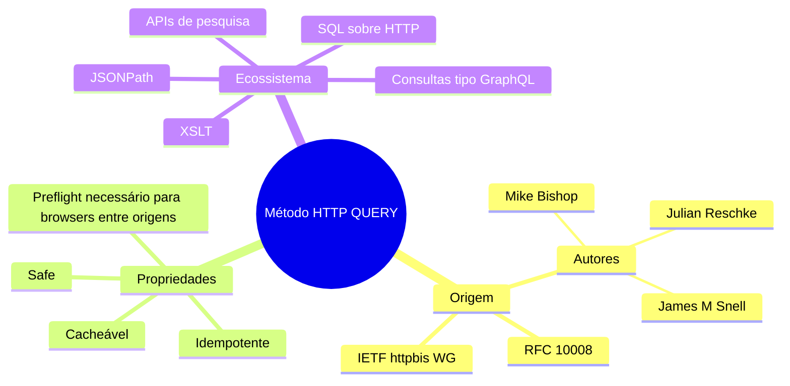
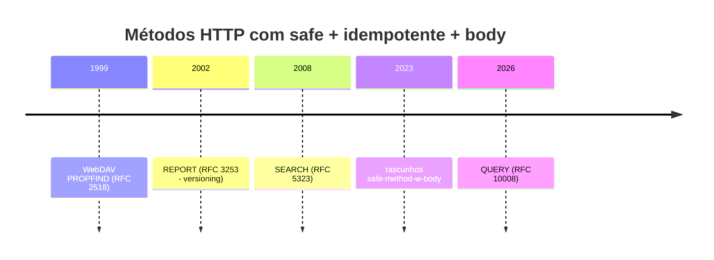
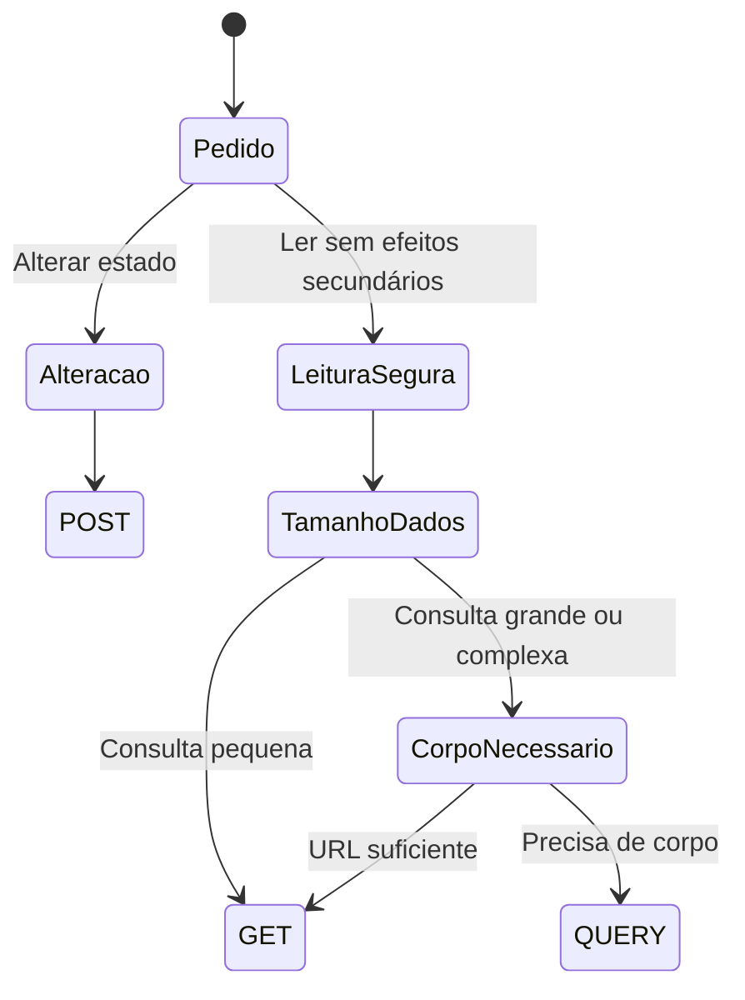
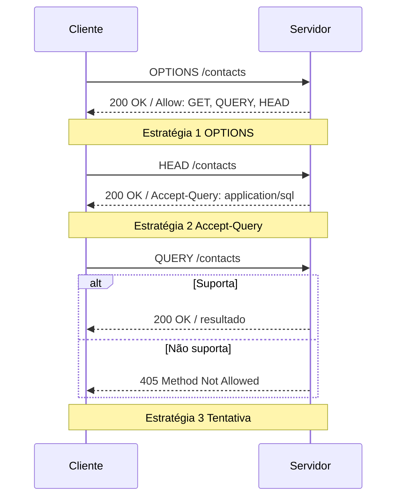
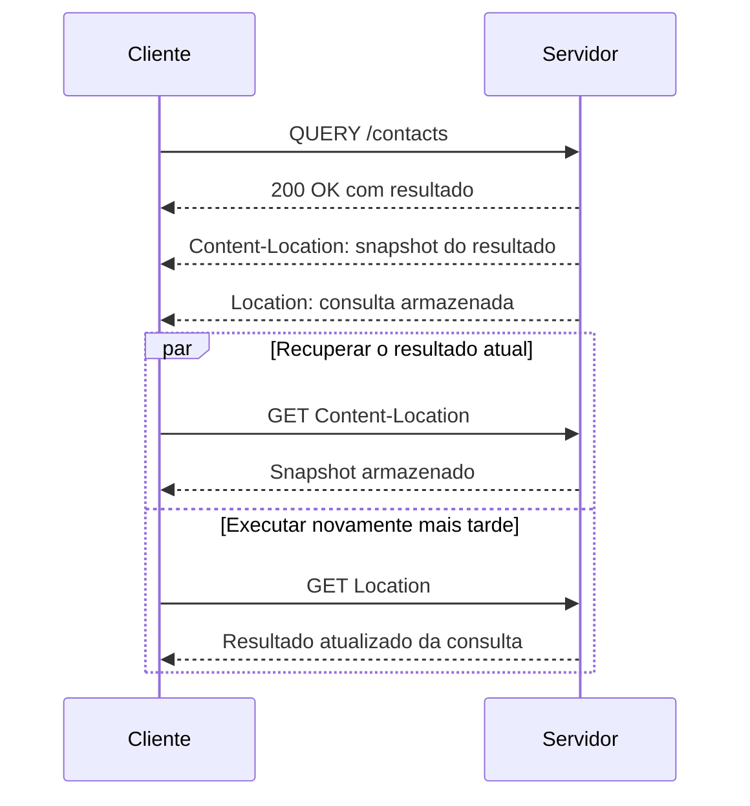
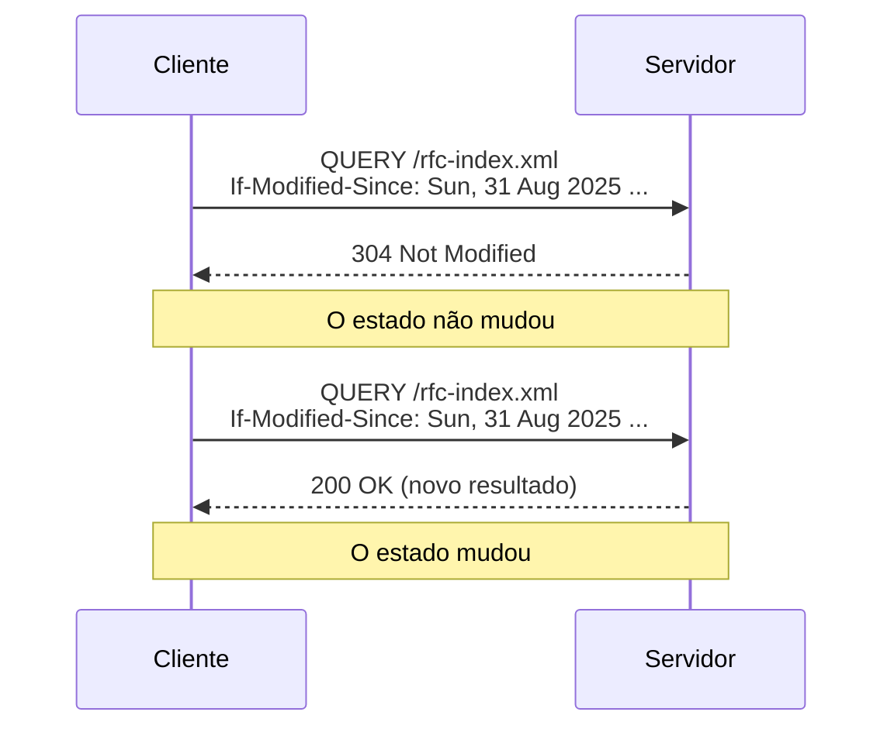
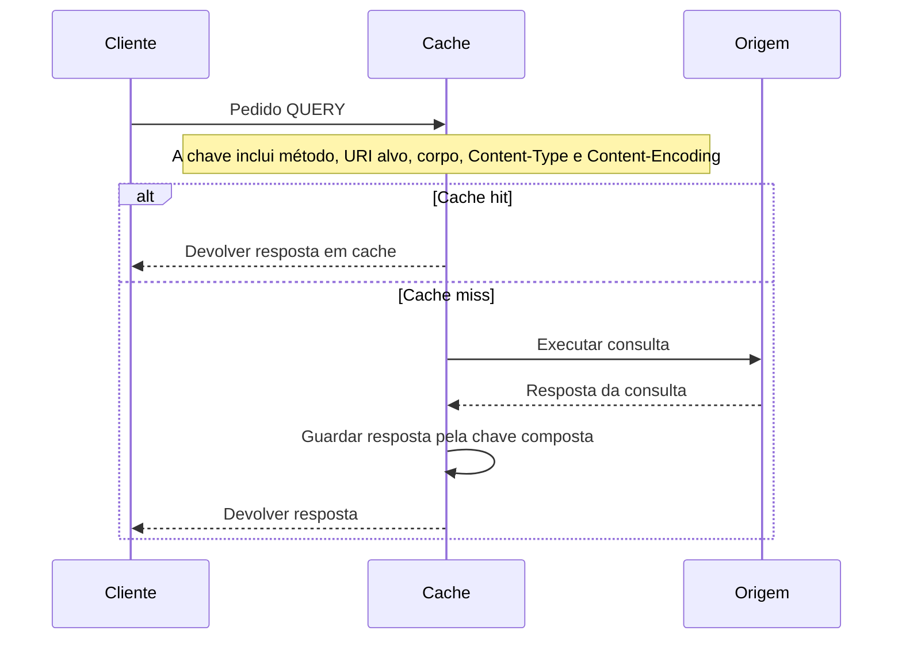
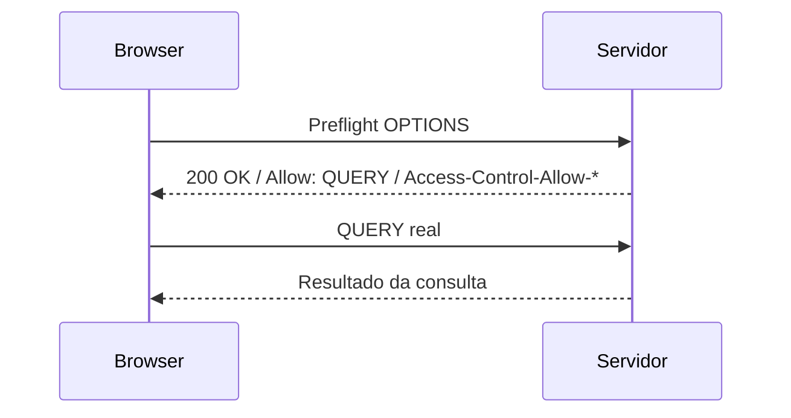

Os pedidos HTTP `GET` não definem semântica para um corpo, enquanto `POST` não indica, por omissão, que uma consulta é *safe* e *idempotente*. O RFC 10008, publicado pela IETF em **junho de 2026**, define o método **`QUERY`** para pedidos cujo conteúdo transporta os dados da consulta e cuja operação pretendida é *safe* e *idempotente*.

Este artigo explica a história e a semântica do método, compara-o com `GET` e `POST` e analisa considerações de cache, segurança e implementação.

## Porque definir outro método HTTP?

O HTTP/1.1, definido no **RFC 9110** (e historicamente no RFC 7231), tem limitações bem conhecidas quando se quer expressar uma consulta complexa:

- **`GET`** não pode transportar um corpo com semântica definida. Em teoria *pode*, mas nem proxies nem servidores são obrigados a fazer algo significativo com ele.
- **`POST`** pode transportar conteúdo, mas não é *safe* nem *idempotente* por omissão. O cliente não pode assumir que repetir um POST é isento de efeitos ao nível da aplicação; o armazenamento em cache só é possível de acordo com as regras HTTP aplicáveis e com metadados explícitos na resposta.

Uma solução comum consiste em colocar filtros simples na URI de um `GET` ou enviar dados de consulta mais complexos no corpo de um `POST`. A primeira opção pode esbarrar nos limites de tamanho da URI e em questões de registo; a segunda não comunica semântica de consulta *safe* e *idempotente* aos intermediários HTTP.



## História dos métodos HTTP com conteúdo no pedido

A necessidade de um "GET com corpo" não é nova. Muito antes do RFC 10008, já existia uma família de métodos com o perfil *safe e idempotente* nascidos do WebDAV:

- **`PROPFIND`** ([RFC 4918](https://www.rfc-editor.org/info/rfc4918))
- **`REPORT`** ([RFC 3253](https://www.rfc-editor.org/info/rfc3253))
- **`SEARCH`** ([RFC 5323](https://www.rfc-editor.org/info/rfc5323))

Estes métodos são *safe*, *idempotent* e podem transportar conteúdo no pedido, mas estão associados a casos de uso específicos do WebDAV. O RFC 10008 define um método `QUERY` de âmbito geral; entre os seus autores estão Julian Reschke, James M. Snell e Mike Bishop. Os primeiros rascunhos usavam o nome `SEARCH`, antes da adopção de **`QUERY`**:

> O nome "QUERY" capta bem a relação com o componente *query* da URI, ao mesmo tempo que afasta o novo método do universo WebDAV.



## RFC 10008 e o método QUERY

### O que faz, afinal, o QUERY?

> *"O método QUERY é usado para iniciar uma consulta do lado do servidor. Ao contrário do GET, que pede uma representação do recurso identificado pela URI alvo, o método QUERY é usado para pedir ao recurso alvo que execute uma operação de consulta dentro do âmbito desse recurso."*
>
> RFC 10008, Secção 2

`QUERY` não é simplesmente um `GET` com corpo: tem semântica própria, e o conteúdo do pedido descreve como o recurso alvo deve executar a consulta.

```http
QUERY /feed HTTP/1.1
Host: example.org
Content-Type: application/x-www-form-urlencoded
Accept: application/json

q=foo&limit=10&sort=-published
```

### Semântica do QUERY

Segundo o IANA Method Registry, o QUERY está registado como:

| Propriedade | Valor |
| :--- | :--- |
| **Nome do Método** | `QUERY` |
| **Safe** | sim |
| **Idempotente** | sim |
| **Especificação** | Secção 2 do RFC 10008 |
| **Cacheável** | sim |

Ser **safe** significa que o cliente não pede uma alteração de estado do recurso alvo; isso não impede efeitos incidentais, como o registo de logs. Ser **idempotente** significa que repetir o mesmo pedido tem o mesmo efeito pretendido que executá-lo uma vez, pelo que os clientes podem repeti-lo após uma falha sem pedir alterações adicionais ao nível da aplicação.

### Content type obrigatório

O RFC 10008 exige que os servidores rejeitem pedidos cujo tipo de conteúdo esteja em falta ou seja inconsistente com o conteúdo:

> *"Os servidores DEVEM rejeitar o pedido se o campo Content-Type estiver em falta ou for inconsistente com o conteúdo do pedido."*
>
> RFC 10008, Secção 2

Se o `Content-Type` faltar → **400 Bad Request**. Se for suportado mas inconsistente com o conteúdo → **400**. Se não for suportado pelo recurso → **415 Unsupported Media Type**. Se o conteúdo foi analisado mas a consulta é logicamente impossível → **422 Unprocessable Content**.

## GET vs QUERY vs POST: lado a lado

A tabela resume as diferenças entre os métodos segundo a semântica HTTP:

| | **GET** | **QUERY** | **POST** |
| :--- | :--- | :--- | :--- |
| **Safe** | sim | sim | não por omissão; a aplicação pode limitar os efeitos |
| **Idempotente** | sim | sim | não por omissão; a aplicação pode definir um comportamento repetível |
| **URI para a própria consulta** | sim (por definição) | opcional via `Location` | não |
| **URI para o resultado** | opcional via `Content-Location` | opcional via `Content-Location` | opcional |
| **Cacheável** | sujeito às regras HTTP de cache | sujeito às regras HTTP de cache e à chave específica de QUERY | sujeito às regras HTTP de cache; limitado à reutilização por GET/HEAD posteriores |
| **Conteúdo (body)** | *"sem semântica definida"* | **esperado** (semântica pelo recurso) | esperado |



## Descobrir o Suporte a QUERY

A especificação oferece **três** formas de descoberta, da menos à mais invasiva:

### 1. `OPTIONS`

```http
OPTIONS /contacts HTTP/1.1
Host: example.org
```

```http
HTTP/1.1 200 OK
Allow: GET, QUERY, OPTIONS, HEAD
```

### 2. Header de resposta `Accept-Query`

```http
HEAD /contacts HTTP/1.1
Host: example.org
```

```http
HTTP/1.1 200 OK
Content-Type: text/html
Accept-Query: "application/x-www-form-urlencoded", application/sql;charset="UTF-8"
```

### 3. Tentativa direta de QUERY

Basta enviar um `QUERY` e ver o que acontece. Se o servidor não suportar, a resposta será um **`405 Method Not Allowed`** com `Allow`.



## Exemplo: consultar uma lista de contactos

Reproduzindo o exemplo A.1 do RFC, ligeiramente anotado:

### Pedido

```http
QUERY /contacts HTTP/1.1
Host: example.org
Content-Type: application/x-www-form-urlencoded
Accept: application/json

select=surname,givenname,email&limit=10&match=%22email=*@example.*%22
```

### Resposta

```http
HTTP/1.1 200 OK
Content-Type: application/json

[
  { "surname": "Smith", "givenname": "John", "email": "smith@example.org" },
  { "surname": "Jones", "givenname": "Sally", "email": "sally.jones@example.com" },
  { "surname": "Dubois", "givenname": "Camille", "email": "camille.dubois@example.net" }
]
```

O servidor devolveu um resultado sem alterar o recurso alvo. `QUERY` é definido como *safe* e *idempotent*, mas uma resposta concreta só pode ser armazenada em cache quando as regras HTTP e os metadados da resposta o permitem.

## Content-Location e Location: dois papéis distintos

O servidor pode usar dois headers de resposta para permitir que os clientes obtenham um resultado da consulta mais tarde:

- **`Content-Location`**: URI que devolve o **resultado atual** da consulta (um snapshot).
- **`Location`**: URI que devolve um **resultado futuro** se a mesma consulta for executada novamente (estado atualizado).



Isto permite um padrão em que o primeiro pedido usa `QUERY` e o servidor devolve um `Location` estável; um `GET` posterior pode obter esse recurso segundo as regras normais de cache HTTP.

## Pedidos condicionais

Como o QUERY herda a semântica de **selected representation** do GET, os headers condicionais funcionam normalmente:

- `If-Modified-Since`
- `If-None-Match` (com ETag)
- `If-Match`
- `If-Unmodified-Since`

Se a representação seleccionada não mudou, o servidor pode responder com **`304 Not Modified`** e omitir o corpo da resposta.



## Redirecionamentos: 301, 302, 307, 308 e 303

A especificação remove explicitamente a exceção histórica de converter `POST → GET` após um 301/302. Para o QUERY:

- **`301` / `308`**: O recurso mudou-se permanentemente. Mantém o método.
- **`302` / `307`**: O recurso mudou-se temporariamente. Mantém o método.
- **`303` (See Other)**: O servidor sugere passar a um `GET` na URI indicada em `Location`.

```http
HTTP/1.1 303 See Other
Content-Type: text/plain
Location: /contacts/stored-queries/42

See stored query at "/contacts/stored-queries/42".
```

O cliente pode começar com `QUERY` e, depois, obter o resultado da consulta armazenada com `GET`.

## Caching: a chave com conteúdo do pedido

O RFC 10008 exige que a chave de cache de um pedido `QUERY` inclua o conteúdo e os metadados relacionados:

> *"A chave de cache para um pedido QUERY DEVE incorporar o conteúdo do pedido e os metadados relacionados."*
>
> RFC 10008, Secção 2.7

Na prática, isto significa que a cache **tem de ler o body inteiro** para calcular a chave. Uma simples tabela `"URI → resposta"` não chega. Para mitigar, as caches PODEM normalizar diferenças semanticamente insignificantes (encoding, espaços em branco, etc.). Com a diretiva **`no-transform`**, o cliente pode recusar essas normalizações.

Se o servidor devolver um `Location` estável, o cliente pode usar `GET` para as consultas seguintes; o armazenamento dessas respostas em cache continua dependente das directivas e validadores de cache.



> *"Note que o caching de respostas QUERY é inerentemente mais complexo do que o caching de respostas a GET."* — RFC 10008, Secção 2.7

## Pedidos de range

O RFC indica que os pedidos de range HTTP oferecem pouco valor para o QUERY, porque formatos como SQL, JSONPath e GraphQL já têm mecanismos de paginação. O uso de headers HTTP `Range` com QUERY é permitido.

## Considerações de segurança

- Os corpos dos pedidos podem ser registados pelas aplicações ou pela infraestrutura; usar um corpo não protege, por si só, os dados sensíveis da consulta.
- Se o servidor criar uma URI temporária para o recurso equivalente (`Location`), essa URI NÃO DEVE conter conteúdo sensível da consulta, que poderia acabar nos logs de acesso.
- **CORS**: `QUERY` não está nos métodos *safelisted* do CORS. Qualquer pedido cross-origin dispara um **preflight (`OPTIONS`)**.



## O que o QUERY muda no desenho de APIs

O `QUERY` dá ao HTTP um método para operações de leitura cujo conteúdo de entrada é transportado no pedido, com semântica *safe* e *idempotente*. Pode ser útil quando os critérios são demasiado complexos para uma URI ou quando uma API precisa de distinguir uma consulta de um `POST` que altera estado.

Esta semântica permite repetir pedidos e possibilita o armazenamento de respostas por caches compatíveis, mas nenhum dos comportamentos é automático: o servidor tem de respeitar o contrato do método e as caches têm de incluir o conteúdo do pedido nas chaves e seguir as directivas HTTP. O corpo do pedido também pode ser registado, pelo que os dados sensíveis precisam dos mesmos controlos de registo e protecção aplicados a outros conteúdos.

## Considerações de implementação e adopção

O RFC 10008 normaliza o método, mas as implementações e os intermediários podem adicionar suporte em momentos diferentes. Antes de usar `QUERY`, confirma que o framework de servidor, clientes, gateways, caches, ferramentas de descrição de APIs e políticas de segurança escolhidos reconhecem o método e preservam a sua semântica.

Os pedidos de browser entre origens exigem preflight CORS porque `QUERY` não é um método *safelisted*. Uma cache partilhada tem de compreender a chave que inclui o conteúdo do pedido; uma cache que use apenas o método e a URI alvo não é suficiente. A equipa também deve documentar os tipos de conteúdo aceites, os limites das consultas, a política de cache e o comportamento alternativo para clientes ou infraestruturas sem suporte.

## Conclusão

O RFC 10008 define um método para consultas *safe* e *idempotent* cujo conteúdo de entrada é transportado no pedido. Não substitui universalmente o `GET` nem o `POST`: cada método deve ser escolhido de acordo com a semântica da operação, e é necessário confirmar que os clientes, servidores e intermediários envolvidos suportam correctamente o `QUERY`.

## Para saber mais

- [RFC 10008: The HTTP QUERY Method](https://www.rfc-editor.org/info/rfc10008)
- [RFC 9110: HTTP Semantics](https://www.rfc-editor.org/rfc/rfc9110.html)
- [RFC 9111: HTTP Caching](https://www.rfc-editor.org/info/rfc9111)
- [Hypertext Transfer Protocol (HTTP) Method Registry](https://www.iana.org/assignments/http-methods/http-methods.xhtml)
