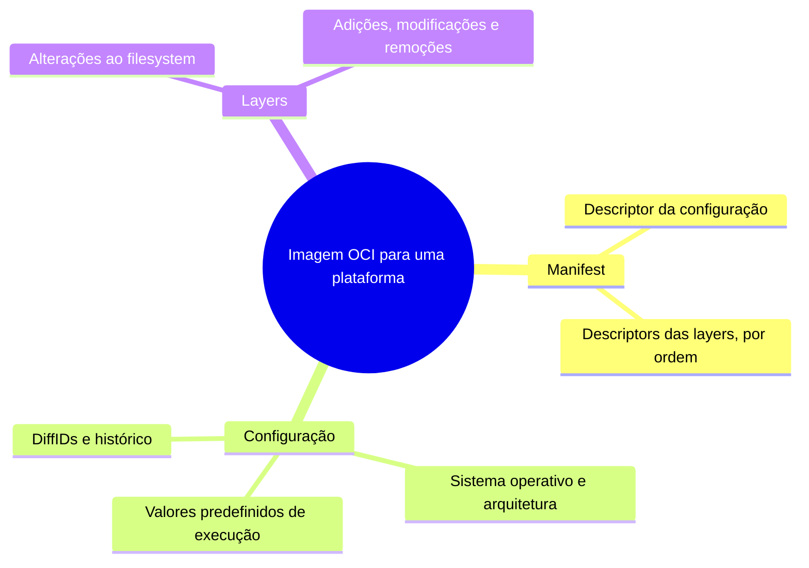

Quando fazemos `docker pull nginx:alpine` ou usamos `nginx:alpine` numa instrução `FROM`, trabalhamos com uma referência que parece apontar para um único ficheiro. Na realidade, uma imagem de container é um conjunto de conteúdos endereçados por digest e de metadados que descrevem como os combinar e executar.

OCI significa **Open Container Initiative**, uma iniciativa de normas abertas que mantém especificações para imagens, runtimes e distribuição de containers. Neste artigo, *imagem OCI* significa uma imagem organizada segundo a OCI Image Format Specification, que define como o manifest, a configuração e as layers de filesystem são representados e relacionados. OCI não é um engine como Docker nem uma implementação de filesystem; é um formato que diferentes ferramentas podem produzir e consumir.

Perceber essa estrutura ajuda a explicar por que imagens podem partilhar conteúdos, como uma alteração ao filesystem é representada e por que apagar um ficheiro numa layer posterior nem sempre reduz o tamanho da imagem.

## Uma imagem não é um container

Uma imagem reúne os ficheiros de espaço de utilizador de que uma aplicação precisa, por exemplo, executáveis, bibliotecas e configuração, e metadados com valores predefinidos para a execução. Não é, por si só, um processo em execução nem uma máquina virtual com kernel próprio.

Um container é uma instância criada a partir da imagem. O runtime prepara o filesystem e as definições do processo; em muitos ambientes Linux, também associa uma camada gravável específica dessa instância. A imagem original continua inalterada.

## Layers são alterações ao filesystem

Uma *layer* representa um conjunto de alterações em relação ao estado anterior do filesystem: ficheiros adicionados, modificados ou removidos. Não é necessariamente uma cópia completa de uma árvore de diretórios.

Por exemplo, uma imagem pode começar com ficheiros base, acrescentar o Nginx e, por fim, incluir uma página HTML:

```text
Layer base:
  bin/sh
  etc/os-release

Layer Nginx:
  usr/sbin/nginx
  etc/nginx/nginx.conf

Layer da aplicação:
  usr/share/nginx/html/index.html
```

Aplicadas da base para o topo, estas alterações produzem o filesystem visível da imagem. Se uma layer superior substituir um ficheiro, a versão superior é a que aparece no resultado. As layers inferiores continuam intactas.

As remoções também têm de ser representadas sem alterar uma layer imutável. No formato OCI, uma layer pode incluir um ficheiro especial chamado *whiteout*, que assinala um caminho de uma layer inferior como removido. Por exemplo, `.wh.old-config` indica que `old-config` não deve aparecer no filesystem final.

Isto tem uma consequência prática: se um build acrescentar um ficheiro numa layer e o remover numa layer posterior, a remoção não apaga os bytes do blob anterior. A imagem ainda inclui a layer que os contém. Para evitar esse desperdício, convém não deixar artefactos desnecessários em layers anteriores, ou usar uma estratégia de build que não os inclua na imagem final.

## Do Dockerfile à imagem

Um Dockerfile descreve instruções para construir uma imagem. Considere este exemplo:

```dockerfile
FROM nginx:alpine
COPY index.html /usr/share/nginx/html/index.html
```

`FROM` estabelece a imagem base. `COPY` adiciona o ficheiro ao filesystem e o resultado integra as layers da imagem construída. O Dockerfile é uma receita de build; não precisa de estar presente na imagem final para o container funcionar.

Nem todas as instruções produzem alterações ao filesystem. Instruções como `ENV`, `CMD` e `ENTRYPOINT` definem metadados de configuração. Instruções que alteram o filesystem podem gerar layers no resultado. Os detalhes também dependem do builder: por exemplo, etapas intermédias de um build multi-stage podem ser usadas para construir a imagem, mas não aparecer na imagem final.

Ao executar:

```bash
docker build -t dyotamo/minha-app:v1 .
```

O builder lê o Dockerfile e o contexto, resolve a imagem base, executa as instruções e produz os conteúdos e metadados do resultado. O contexto de build, os ficheiros disponibilizados ao builder, também pode afetar o resultado e a reutilização da cache.

### Cache de build não é o mesmo que uma layer da imagem

Os builders podem reutilizar resultados de etapas anteriores quando os respetivos inputs continuam válidos. A ordem das instruções influencia esta reutilização. Numa aplicação Go, por exemplo, copiar primeiro os ficheiros de dependências permite reutilizar a etapa de download quando só o código-fonte muda:

```dockerfile
FROM golang:alpine
WORKDIR /app
COPY go.mod go.sum ./
RUN go mod download
COPY . .
RUN go build -o server .
```

A cache é um mecanismo do builder; não deve ser confundida com a composição das layers da imagem. Alterar um input pode invalidar uma etapa e as etapas dependentes, mesmo que o resultado final de algumas delas pareça semelhante. A ordem acima reduz as vezes em que é necessário repetir o download, desde que os ficheiros de dependências não tenham mudado e a cache possa ser usada.

## Os componentes de uma imagem OCI

O formato OCI separa o manifesto, a configuração da imagem e os conteúdos das layers. O manifesto liga estes componentes através de *descriptors*, que indicam propriedades como o tipo de conteúdo, o tamanho e o digest.



### Manifest: referências aos conteúdos

Um manifest OCI é um documento JSON que descreve uma imagem para uma plataforma, como Linux/amd64. Contém um descriptor da configuração e uma lista ordenada de descriptors das layers. Os blobs não ficam incorporados no JSON: são identificados pelos seus digests e tamanhos.

Um exemplo simplificado:

```json
{
  "schemaVersion": 2,
  "mediaType": "application/vnd.oci.image.manifest.v1+json",
  "config": {
    "mediaType": "application/vnd.oci.image.config.v1+json",
    "digest": "sha256:abc123...",
    "size": 702
  },
  "layers": [
    {
      "mediaType": "application/vnd.oci.image.layer.v1.tar+gzip",
      "digest": "sha256:def456...",
      "size": 102400
    }
  ]
}
```

Os valores são ilustrativos. Um digest identifica o conteúdo através de um hash criptográfico; o descriptor permite verificar se o conteúdo recebido corresponde ao esperado. Para imagens com suporte a várias plataformas, um *image index* pode apontar para manifests separados, por exemplo para `linux/amd64` e `linux/arm64`.

### Configuração: propriedades e valores predefinidos

O blob de configuração descreve a plataforma e inclui valores predefinidos que o runtime pode usar ao criar um container, como variáveis de ambiente, diretório de trabalho, utilizador, `Entrypoint` e `Cmd`. Estes valores podem ser substituídos por opções fornecidas no momento da criação do container.

A configuração também regista os `diff_ids` das layers e, opcionalmente, o histórico das instruções de build. Um `diff_id` é o digest do arquivo tar da layer **descomprimido**. Não é necessariamente igual ao digest do descriptor no manifest, que identifica o blob distribuído, por exemplo, o conteúdo comprimido com gzip.

### Layers: blobs com alterações

As layers são blobs que transportam alterações ao filesystem num formato baseado em tar. OCI define media types para conteúdos tar sem compressão e para variantes comprimidas, como gzip ou zstd. Uma ferramenta pode escolher a representação suportada, pelo que nem todas as layers têm de ser um tar comprimido com gzip.

A ordem é importante: o manifest lista primeiro a layer base e depois as alterações seguintes. O resultado é calculado aplicando-as nessa ordem, incluindo o tratamento especial de whiteouts.

| Componente | Responsabilidade |
|---|---|
| Manifest | Referencia a configuração e as layers, pela ordem de aplicação |
| Configuração | Descreve a plataforma, os valores predefinidos de execução e os `diff_ids` |
| Layers | Transportam alterações ao filesystem |

## Uma tag não é um identificador imutável

Uma referência como `dyotamo/minha-app:v1` combina o nome da imagem com uma tag. A tag é uma referência legível e pode ser movida para apontar para outro conteúdo. Um digest, como `sha256:…`, identifica um conteúdo específico.

Esta diferença interessa quando se pretende reproduzir exatamente uma implementação: uma tag pode mudar ao longo do tempo, enquanto a referência por digest fixa o conteúdo identificado. Os digests também permitem que um registry e um cliente reconheçam blobs idênticos e evitem transferências repetidas.

## Distribuição e execução

Quando uma imagem é enviada para um registry, o manifest e os blobs são transferidos como conteúdos identificados por digest. O cliente pode reutilizar blobs que já tenha e validar os conteúdos recebidos. Para publicar e obter uma imagem, comandos comuns são:

```bash
docker push dyotamo/minha-app:v1
docker pull dyotamo/minha-app:v1
```

Ao executar um container, a imagem continua a ser a base só de leitura. Em Linux, um runtime pode usar OverlayFS para apresentar em conjunto as layers da imagem e uma camada gravável específica do container. Esta escolha de armazenamento é separada do formato OCI: OCI descreve o conteúdo da imagem, enquanto OverlayFS é uma implementação de filesystem Linux capaz de apresentar várias árvores de diretórios como uma única vista.

As alterações feitas apenas na camada gravável do container não alteram a imagem nem são automaticamente partilhadas com outros containers. Normalmente, essa camada também não é o local adequado para dados que têm de sobreviver à remoção do container; para isso, usam-se volumes ou outro armazenamento persistente.

## OverlayFS: como funciona um filesystem combinado

OverlayFS é um filesystem de união do Linux. Combina uma árvore de diretórios inferior, só de leitura, com uma árvore superior, gravável, e expõe o resultado através de um ponto de montagem. Um runtime pode usar diretórios inferiores para as layers da imagem já extraídas e guardar as alterações do container no diretório superior.

| Caminho OverlayFS | Função |
|---|---|
| `lowerdir` | Uma ou mais árvores de diretórios só de leitura, como layers de imagem extraídas |
| `upperdir` | Guarda alterações e ficheiros novos |
| `workdir` | Área de trabalho privada do OverlayFS; tem de estar no mesmo filesystem que `upperdir` |
| ponto de montagem combinado | Vista unificada do filesystem apresentada aos processos |

Ao procurar um caminho, OverlayFS usa a entrada superior quando existe; caso contrário, consulta a árvore inferior. Diretórios existentes em ambas as árvores são combinados. Assim, uma leitura de um ficheiro inferior inalterado pode aceder diretamente ao ficheiro original, sem o copiar primeiro para a árvore superior.

### Copy-on-write significa copiar para a camada superior ao modificar

Quando uma operação precisa de modificar um ficheiro da camada inferior, OverlayFS faz *copy-up*: cria na árvore superior os diretórios-pai necessários, copia para lá os metadados e os dados do ficheiro e aplica a escrita nessa cópia. O ficheiro inferior não muda. Ficheiros novos são criados diretamente na árvore superior.

Este copy-on-write ocorre ao nível do ficheiro; não significa necessariamente copiar apenas os blocos ou bytes alterados. A primeira modificação de um ficheiro inferior grande pode, por isso, ter um custo único de tempo de cópia e de espaço na camada superior; as escritas seguintes usam a cópia superior. OverlayFS tem uma opção de cópia apenas de metadados, mas a disponibilidade e a configuração dependem do kernel; não é necessária para o exemplo básico abaixo.

Remover um ficheiro inferior também não pode alterar a árvore inferior. OverlayFS regista um *whiteout* na árvore superior para ocultar o nome na vista combinada. O OverlayFS Linux pode representá-lo como um dispositivo de caracteres com número de dispositivo 0/0 ou como um ficheiro regular vazio com um atributo estendido de whiteout; a forma exata depende da configuração. Isto não é igual à entrada de um arquivo de layer OCI, como `.wh.old-config`: OCI especifica como codificar remoções numa layer distribuível, enquanto OverlayFS usa os seus próprios marcadores ao nível do filesystem. Em ambos os casos, o conteúdo inferior permanece intacto.

### Observar o copy-up num host Linux

É possível observar o mesmo comportamento sem Docker, montando OverlayFS diretamente. Isto requer um kernel Linux com suporte para OverlayFS e permissão para montar filesystems, normalmente através de `sudo`. O filesystem superior tem de suportar atributos estendidos e tipos de entrada de diretório válidos; filesystems locais ext4 e XFS são opções comuns. `upperdir` e `workdir` têm de ser diretórios vazios no mesmo filesystem. Estes comandos criam-nos lado a lado num diretório temporário. Executa-os no mesmo terminal, porque reutilizam `$demo`.

```bash
demo=$(mktemp -d)
mkdir -p "$demo"/{lower,upper,work,merged}
printf 'da layer inferior\n' > "$demo/lower/message.txt"
printf 'remover\n' > "$demo/lower/obsolete.txt"

sudo mount -t overlay overlay -o "lowerdir=$demo/lower,upperdir=$demo/upper,workdir=$demo/work" "$demo/merged"
findmnt -T "$demo/merged"
cat "$demo/merged/message.txt"

printf 'alterado através do mount combinado\n' | sudo tee "$demo/merged/message.txt" >/dev/null
printf 'criado na camada superior\n' | sudo tee "$demo/merged/new.txt" >/dev/null
sudo rm "$demo/merged/obsolete.txt"

cat "$demo/lower/message.txt"
cat "$demo/upper/message.txt"
ls "$demo/merged"
ls -la "$demo/upper"

sudo umount "$demo/merged"
sudo rm -r -- "$demo"
```

`findmnt` identifica o mount. O primeiro `cat` lê `message.txt` de `lower`; depois da escrita, a cópia inferior mantém-se inalterada e `upper/message.txt` contém o texto novo. O novo ficheiro aparece em `upper`, enquanto `ls "$demo/merged"` já não lista `obsolete.txt`. A última listagem de `upper` mostra o whiteout que o oculta. Os dois comandos finais desmontam OverlayFS e removem o diretório temporário. Se o mount falhar, confirma que OverlayFS está ativo e que o filesystem superior escolhido cumpre os requisitos. Docker e outros runtimes podem usar drivers de armazenamento ou *snapshotters* diferentes, por isso os seus caminhos internos e comportamentos não têm necessariamente de ser iguais aos deste mount direto.

## O que reter

Uma imagem OCI é um conjunto de conteúdos endereçados por digest e metadados. O manifest referencia a configuração e as layers; a configuração descreve a plataforma e os valores predefinidos de execução; as layers registam alterações ordenadas ao filesystem. É esta separação que permite partilhar blobs, selecionar imagens por plataforma e reconstruir de forma consistente o filesystem da aplicação.

Com esta estrutura em mente, também fica mais claro que uma tag não é uma garantia de identidade, que remover ficheiros em layers posteriores pode não reduzir o conteúdo transferido e que o estado gravável de um container não é o mesmo que a imagem de origem.

## Para saber mais

- [OCI Image Format Specification: Manifest](https://github.com/opencontainers/image-spec/blob/main/manifest.md)
- [OCI Image Format Specification: Image Configuration](https://github.com/opencontainers/image-spec/blob/main/config.md)
- [OCI Image Format Specification: Layers](https://github.com/opencontainers/image-spec/blob/main/layer.md)
- [Docker build cache](https://docs.docker.com/build/cache/)
- [Docker storage drivers](https://docs.docker.com/engine/storage/drivers/)
- [Documentação do kernel Linux: OverlayFS](https://docs.kernel.org/filesystems/overlayfs.html)
