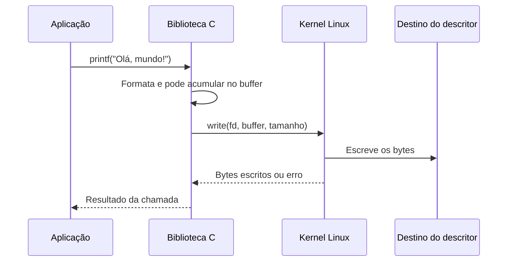

*Um executável pode estar presente num container e, ainda assim, falhar com «No such file or directory». Para perceber porquê, é preciso distinguir a libc, as system calls, o carregador dinâmico e a ABI.*

## O caminho entre uma função e o kernel

Considere este programa C:

```c
#include <stdio.h>

int main(void) {
    printf("Olá, mundo!\n");
    return 0;
}
```

A chamada a `printf` não salta diretamente do código C para o kernel. A função faz parte da biblioteca padrão de C; a sua implementação formata o texto e pode guardá-lo temporariamente num buffer. Quando os dados têm de ser enviados, a implementação pede ao sistema operativo que escreva num descritor de ficheiro, normalmente através de `write`.

Uma **system call**, ou syscall, é a interface de baixo nível através da qual um processo solicita um serviço ao kernel. Ler e escrever ficheiros, criar mapeamentos de memória e iniciar processos são exemplos de operações que podem envolver syscalls. O programa corre em *userspace*; a syscall provoca uma transição controlada para *kernel space*, onde o kernel valida o pedido e executa a operação autorizada.



O percurso é conceptual. `printf` pode fazer várias escritas ou nenhuma syscall imediata, por exemplo se a saída continuar em buffer. Por outro lado, funções como `strlen` podem operar inteiramente em memória de utilizador. **Nem todas as funções da libc chamam o kernel.**

A syscall também não é a função C `write` propriamente dita. A libc disponibiliza uma função com essa interface e trata dos detalhes da ABI de syscalls da arquitetura, da conversão de erros para `-1` e `errno`, entre outros. A transição real é feita por instruções específicas da arquitetura, como `syscall` em x86-64 ou `svc` em AArch64. Os números das syscalls e a convenção de passagem de argumentos são específicos da arquitetura e da ABI Linux.

## O que significa libc?

**libc** é o nome comum para uma implementação da biblioteca padrão de C, frequentemente acompanhada de interfaces POSIX e extensões próprias do sistema. A biblioteca padrão definida pela linguagem C inclui funções como `printf`, `malloc`, `strlen` e `memcpy`. POSIX acrescenta interfaces usadas em sistemas Unix-like, como `fork` e `pthread_create`; a implementação disponível depende da plataforma e do padrão adotado.

A libc contém muito mais do que wrappers de syscalls. Além de funções que fazem operações no kernel, oferece rotinas de strings, alocação de memória, entrada e saída com buffering, conversões, locale, gestão de processos e outras funcionalidades. Parte desse trabalho é inteiramente userspace; outra parte combina lógica de biblioteca e chamadas ao kernel.

Existem várias implementações. **glibc** é a implementação GNU usada por muitas distribuições Linux, incluindo Debian, Ubuntu e Fedora. **musl** é uma implementação alternativa muito usada no Alpine Linux. **uClibc-ng** é direcionada sobretudo a sistemas Linux embarcados. Todas podem oferecer APIs em comum, mas isso não torna automaticamente intercambiáveis os respetivos binários.

## API e ABI são contratos diferentes

Uma **API** descreve a interface com que o código-fonte é escrito: nomes de funções, tipos, argumentos e comportamento prometido. Uma **ABI** descreve como componentes já compilados comunicam: convenção de chamada, layout de estruturas, representação de tipos, nomes e versões de símbolos, formato do executável, linking e interfaces binárias com bibliotecas.

Duas libc podem expor `printf` com uma API compatível e, ainda assim, não fornecer a mesma ABI binária. Um executável pode depender não só de uma função chamada `printf`, mas também de um símbolo versionado da glibc, de uma biblioteca com determinado nome ou do carregador dinâmico próprio do alvo. Extensões específicas, como `malloc_trim` da glibc, também não fazem parte de um contrato universal.

O linker resolve símbolos quando combina ficheiros objeto e bibliotecas. Por exemplo, `nm main.o` pode mostrar `U printf`: `U` indica que o símbolo é usado mas não definido naquele ficheiro. Num executável com linking dinâmico, algumas referências ficam por resolver até à inicialização do programa ou ao primeiro uso da função, conforme a estratégia de linking.

## O carregador dinâmico e a mensagem enganadora

**ELF**, sigla de *Executable and Linkable Format*, é o formato de ficheiro padrão do Linux para executáveis, bibliotecas partilhadas e ficheiros objeto. Os cabeçalhos descrevem a organização do ficheiro e como deve ser carregado; os segmentos descrevem as partes que devem ser mapeadas na memória. Um executável ELF também pode indicar um interpretador, o carregador dinâmico, num segmento marcado `INTERP`.

No arranque, o kernel lê o caminho do interpretador e inicia o carregador especificado. Este encontra as bibliotecas partilhadas necessárias, mapeia-as na memória, resolve as relocações e transfere o controlo para o programa. Em geral, um executável ligado estaticamente não precisa de um carregador dinâmico para resolver bibliotecas partilhadas.

Pode inspecionar os requisitos sem executar o programa:

```bash
readelf -l ./app
readelf -d ./app
readelf --version-info ./app
```

`readelf -l` permite localizar o interpretador pedido; `readelf -d` mostra dependências dinâmicas como `DT_NEEDED`; a última opção apresenta informação de versões de símbolos. O caminho do interpretador varia consoante arquitetura e toolchain. Um executável compilado para glibc x86-64, por exemplo, pode pedir `/lib64/ld-linux-x86-64.so.2`.

Se esse ficheiro não existir no ambiente de execução, o kernel pode devolver `ENOENT` ao tentar iniciar o executável. A shell apresenta então «No such file or directory», embora o ficheiro executável exista. Também pode haver falhas posteriores se faltar uma biblioteca dependente ou um símbolo requerido.

É por isso que copiar um binário glibc para uma imagem Alpine baseada em musl pode falhar. O executável espera um carregador e uma ABI de userspace que a imagem pode não fornecer. A semelhança entre APIs POSIX não substitui a compatibilidade binária. A solução mais previsível é compilar para o ambiente de destino ou usar uma imagem de execução que disponibilize as dependências esperadas.

## É possível executar sem libc?

Sim. O kernel Linux não depende da libc: é uma biblioteca de userspace, não uma camada que o kernel precisa para funcionar. Um programa pode começar no ponto de entrada ELF e emitir syscalls diretamente. Isso, porém, compromete o programa com uma arquitetura, uma ABI e as convenções do kernel.

Este pequeno exemplo é Assembly para Linux x86-64. Escreve 14 bytes para o descritor 1 e termina com código zero:

```asm
.global _start
.section .text
_start:
    mov $1, %rax
    mov $1, %rdi
    lea message(%rip), %rsi
    mov $14, %rdx
    syscall
    mov $60, %rax
    xor %rdi, %rdi
    syscall
.section .rodata
message:
    .ascii "Hello, World!\n"
```

Pode montar e ligar o objeto diretamente:

```bash
as --64 -o hello.o hello.s
ld -o hello hello.o
./hello
```

No Linux x86-64, `rax` contém o número da syscall; para `write`, `rdi`, `rsi` e `rdx` contêm o descritor, o endereço do buffer e o comprimento. O número 60 corresponde a `exit`. O exemplo é apenas ilustrativo: não verifica erros nem escritas parciais e não é portável para outras arquiteturas. Em aplicações reais, wrappers e bibliotecas evitam repetir este trabalho e ajudam a lidar com diferenças de plataforma.

## Onde entra o runtime Go e o CGO?

Go inclui um runtime que gere, entre outras coisas, goroutines, escalonamento e garbage collection. Em muitas configurações, um programa Go pode interagir com o kernel sem depender da libc, o que contribui para que certos executáveis sejam distribuídos sem bibliotecas C partilhadas. Isso não significa que todos os binários Go sejam sempre estáticos ou que nunca precisem de dependências nativas: a configuração de build e as bibliotecas usadas importam.

Por exemplo, `go` inicia uma goroutine e o runtime faz o seu escalonamento. O `WaitGroup` impede que `main` termine antes de a goroutine terminar:

```go
package main

import (
	"fmt"
	"sync"
)

func main() {
	var workers sync.WaitGroup
	workers.Add(1)
	go func() {
		defer workers.Done()
		fmt.Println("a executar numa goroutine")
	}()
	workers.Wait()
}
```

**CGO** permite que pacotes Go chamem código C e liguem bibliotecas nativas. Quando um ficheiro Go importa o pseudo-pacote `C`, a ferramenta Go invoca uma toolchain C e esse ficheiro fica sujeito à build constraint `cgo`. Este pequeno exemplo usa um tipo C, `C.int`, a partir de Go:

```go
package main

import "C"

func main() {
	value := C.int(42)
	println(value)
}
```

Compile-o com CGO ativo e uma toolchain C disponível:

```bash
CGO_ENABLED=1 go build -o app .
```

Com `CGO_ENABLED=0`, este ficheiro é excluído; neste exemplo isolado, não resta código Go para compilar. Num pacote real, pode existir uma implementação alternativa em Go ou a compilação pode falhar se não houver alternativa. Para chamar funções C, também são necessárias declarações, normalmente fornecidas por headers C.

Ativar CGO não significa por si só que o resultado usará sempre linking dinâmico ou glibc. O compilador C, as opções de link, as bibliotecas nativas e a imagem de destino determinam as dependências efetivas. Um binário CGO compilado contra glibc pode exigir glibc em runtime; para executá-lo num sistema musl, é necessário compilar com uma toolchain e bibliotecas compatíveis com musl, ou escolher uma imagem de execução que forneça a glibc esperada. Linking estático pode remover algumas dependências dinâmicas, mas não resolve automaticamente incompatibilidades de arquitetura, kernel, dados externos ou comportamento.

Ao diagnosticar um binário, comece por inspecionar o formato e o carregador com `readelf`. `ldd ./app` é útil para ver bibliotecas dinâmicas num executável confiável, mas não deve ser usado para examinar binários não confiáveis, pois dependendo da implementação pode envolver a execução do carregador. `strace ./app` ajuda a observar syscalls quando o programa inicia e consegue correr. Para compilar e executar em containers, valide o binário na mesma família de userspace e arquitetura que a imagem final.

## Um modelo mental para guardar

A linguagem define como expressamos o programa; o runtime implementa serviços próprios dessa linguagem; a libc fornece a biblioteca C e interfaces de userspace; a ABI permite que os componentes compilados se entendam; o carregador prepara as dependências ELF; e as syscalls encaminham pedidos ao kernel. São fronteiras relacionadas, mas distintas.

Compreendê-las transforma erros vagos de arranque em perguntas verificáveis: qual é o formato e a arquitetura do binário? Que interpretador ELF pede? Que bibliotecas e versões de símbolos requer? Foi compilado para a libc presente na imagem? O caminho CGO está ativo? Essas respostas são geralmente mais úteis do que saber apenas em que linguagem o código foi escrito.

## Further reading

- [Linux man-pages: syscall(2)](https://man7.org/linux/man-pages/man2/syscall.2.html)
- [Linux man-pages: ld.so(8)](https://man7.org/linux/man-pages/man8/ld.so.8.html)
- [Linux man-pages: elf(5)](https://man7.org/linux/man-pages/man5/elf.5.html)
- [Documentação da ferramenta CGO](https://pkg.go.dev/cmd/cgo)
- [GNU C Library](https://www.gnu.org/software/libc/)
- [musl libc](https://musl.libc.org/)
