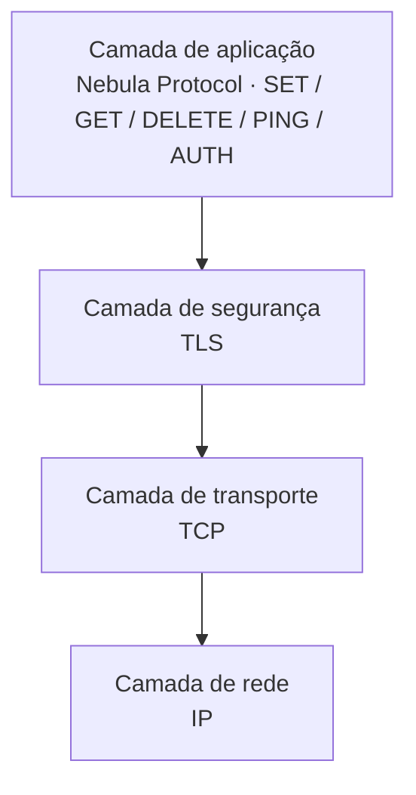
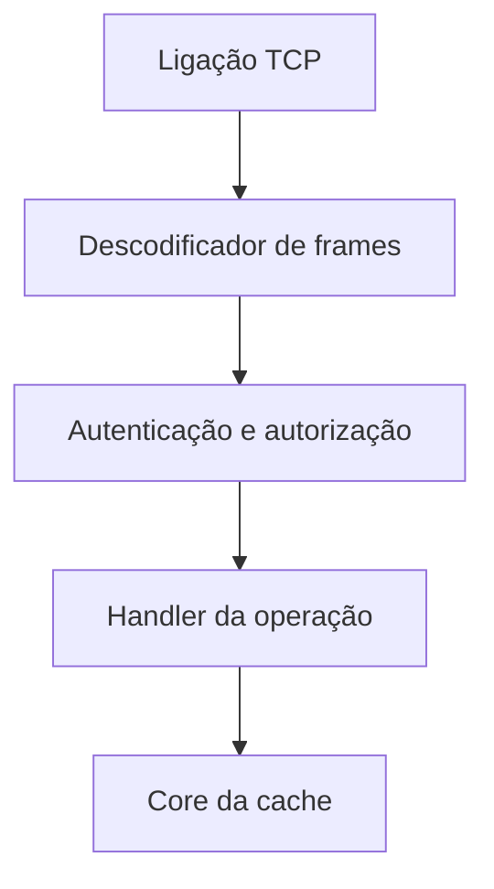
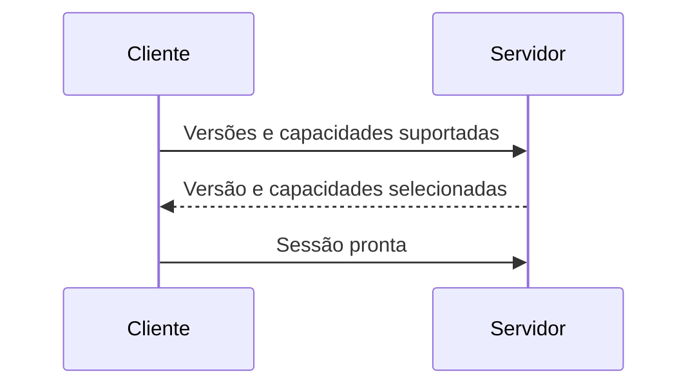
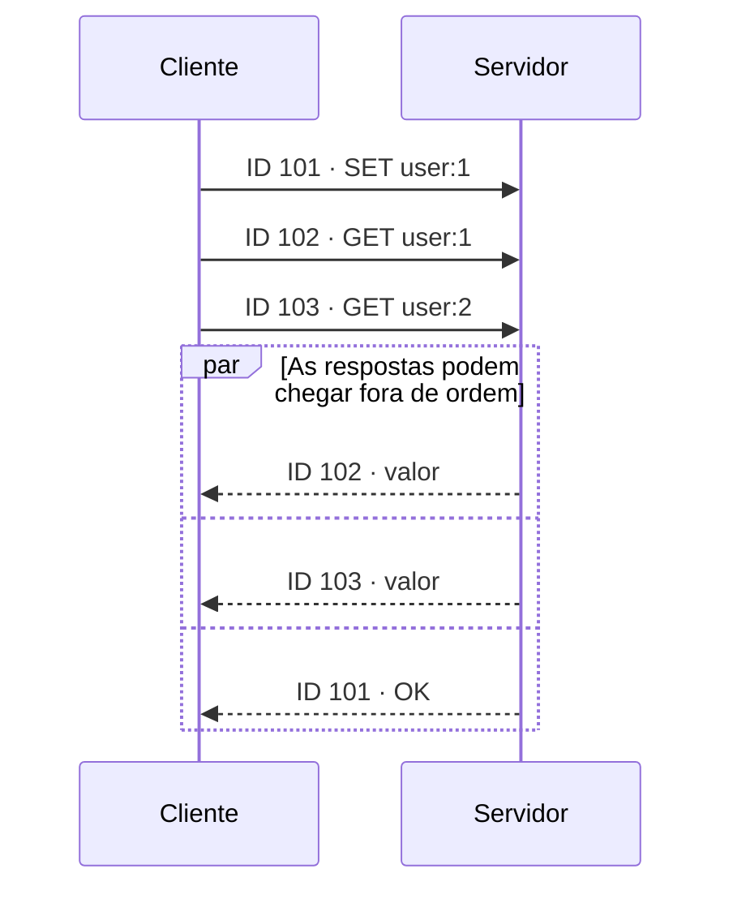
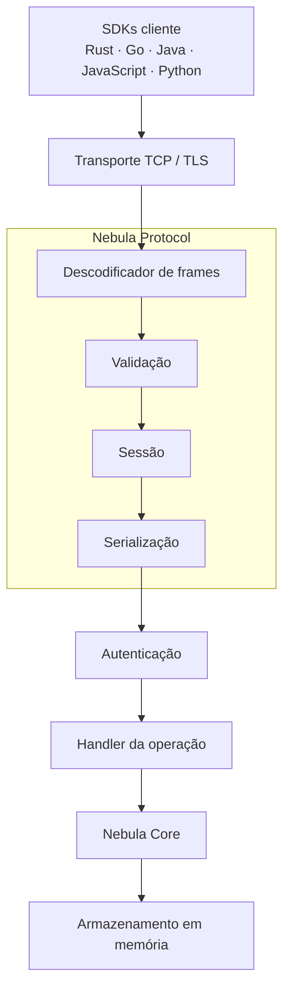

Imagina que estamos a construir um sistema de cache em memória. O objetivo parece simples: permitir que as aplicações armazenem e recuperem valores com a menor latência possível.

Uma aplicação precisa de consultar uma chave:

```text
GET user:123
```

O servidor recebe a operação, consulta a memória e devolve o valor. Podíamos disponibilizar esta funcionalidade através de HTTP, utilizar gRPC, implementar o protocolo do Redis ou adotar o protocolo do Memcached. Todas são opções razoáveis. Então, porque criar outro protocolo?

A questão que levou ao **Nebula Protocol** foi perceber se queríamos ter controlo total sobre a forma como os clientes comunicam com o servidor NebulaCache: como as operações são representadas na rede, como os dados são codificados, onde terminam as mensagens e como a interface evolui à medida que o produto ganha funcionalidades.

O Nebula Protocol é um protocolo binário, versionado e de camada de aplicação, construído sobre TCP. É a interface de comunicação entre os SDKs e o servidor NebulaCache. Para perceber porque existe, precisamos primeiro de analisar as alternativas e o problema que o protocolo tem de resolver.

## Porque não utilizar um protocolo existente?

Antes de desenhar um protocolo, vale a pena compreender o que as opções já estabelecidas oferecem.

### REST sobre HTTP

Uma primeira abordagem seria disponibilizar operações de cache através de endpoints HTTP:

```http
PUT /cache/user:123
Content-Type: application/octet-stream

<value>
```

E, para recuperar o valor:

```http
GET /cache/user:123
```

HTTP é conhecido, tem amplo suporte e está integrado num ecossistema enorme. Também foi o meu primeiro instinto, especialmente num mundo em que tantos serviços são concebidos em torno de REST.

HTTP traz consigo uma estrutura de mensagens própria e um modelo orientado a recursos. Num workload de cache composto por operações pequenas e frequentes, essa estrutura pode representar mais do que a própria operação necessita. Isto não significa que HTTP seja inerentemente lento ou inadequado; HTTP/1.1 e HTTP/2 podem ter um excelente desempenho. A questão é se queremos que a interface principal deste cache dependa da semântica de HTTP.

### gRPC e Protocol Buffers

Outra possibilidade seria utilizar gRPC, definindo serviços e mensagens com Protocol Buffers:

```protobuf
syntax = "proto3";

service CacheService {
  rpc Get(GetRequest) returns (GetResponse);
  rpc Set(SetRequest) returns (SetResponse);
  rpc Delete(DeleteRequest) returns (DeleteResponse);
}

message GetRequest {
  bytes key = 1;
}

message GetResponse {
  bytes value = 1;
  bool found = 2;
}
```

O gRPC oferece contratos explícitos, geração de código, suporte para várias linguagens, streaming e mecanismos de comunicação maduros. É uma excelente opção para comunicação entre serviços.

Utilizá-lo também significaria adotar o seu modelo RPC, a infraestrutura HTTP/2 e as decisões de framing e serialização associadas. Não seria necessariamente uma má escolha; simplesmente estaríamos a aceitar uma abstração mais abrangente do que aquela que pretendemos construir para o NebulaCache.

### RESP e o protocolo do Memcached

Também podíamos utilizar protocolos especializados em cache. O Redis utiliza RESP (Redis Serialization Protocol), enquanto o Memcached tem os seus próprios protocolos textuais e binários. Ambos resolvem muitos dos problemas de comunicação que estamos a tentar resolver.

Existe, contudo, uma diferença entre criar um produto compatível com um protocolo existente e desenvolver um produto em torno de um protocolo concebido para as suas próprias necessidades. O NebulaCache é uma oportunidade para explorar esta segunda opção.

### A decisão

Não se trata de provar que um protocolo próprio é melhor do que REST, gRPC, RESP ou Memcached. Cada opção incorpora decisões de design e disponibiliza abstrações úteis.

Com o Nebula Protocol, escolhemos controlar:

- O formato binário na rede e a representação das operações.
- A estrutura dos headers e o framing das mensagens.
- O versionamento e os limites dos payloads.
- A semântica das respostas e as futuras funcionalidades de comunicação.

Esse controlo também traz responsabilidades. Cabe-nos garantir a correção, a segurança, a compatibilidade e a manutenção que, de outra forma, seriam asseguradas por um protocolo estabelecido.

## As camadas: o que o TCP faz e não faz

O Nebula Protocol é um protocolo de camada 7 (camada de aplicação) que utiliza TCP como transporte. Cada camada tem uma responsabilidade diferente:



O TCP transporta um fluxo ordenado e fiável de bytes entre endpoints. O TLS pode proteger essa comunicação com confidencialidade, integridade e autenticação do servidor, quando configurado corretamente. O Nebula Protocol atribui significado aos bytes.

Quando um cliente envia `GET user:123`, o TCP não sabe o que significa `GET`. Para o TCP, tudo são bytes. É o protocolo de aplicação que define uma estrutura que o servidor pode descodificar e interpretar.

## O primeiro desafio: transformar um fluxo de bytes em mensagens

O TCP é um **fluxo de bytes, não um protocolo orientado a mensagens**.

Imagina que um cliente escreve 100 bytes num socket:

```rust
socket.write_all(&buffer).await?;
```

O servidor não tem a garantia de receber esses bytes numa única leitura. Pode receber 30 bytes, depois 40 e, por fim, 30; pode receber os 100 de uma vez; ou uma leitura pode devolver menos bytes do que a mensagem completa. O TCP não preserva os limites das operações de escrita da aplicação.

Por isso, um protocolo construído sobre TCP precisa de **message framing**: uma forma de o recetor perceber onde termina uma mensagem e começa a seguinte.

As abordagens comuns incluem delimitadores, como novas linhas, mensagens de tamanho fixo, prefixos de comprimento ou um header que declara o tamanho dos dados seguintes. O Nebula Protocol utiliza um header de tamanho fixo com comprimentos explícitos para os payloads. Assim, os limites do frame são claros e é possível transportar valores binários arbitrários.

## O primeiro frame do Nebula Protocol

O protocolo atual utiliza um identificador de quatro bytes, `NEBU`, conhecido como **magic bytes**. Permite ao leitor reconhecer um frame do Nebula Protocol. A versão atual do protocolo é `1`.

### Frame de pedido

Um pedido tem um header fixo de 22 bytes, seguido pelos bytes da chave e do valor:

| Campo | Tamanho | Representação |
|---|---:|---|
| Magic | 4 bytes | ASCII `NEBU` |
| Versão | 1 byte | `u8` |
| Opcode | 1 byte | `u8` |
| Comprimento da chave | 4 bytes | `u32` |
| Comprimento do valor | 4 bytes | `u32` |
| TTL | 8 bytes | `u64` |
| Chave | Variável | Bytes |
| Valor | Variável | Bytes |

Todos os inteiros utilizam codificação Big Endian. O header tem sempre 22 bytes, independentemente do tamanho da chave e do valor. O servidor lê primeiro o header e, em seguida, sabe quantos bytes tem de consumir para completar o frame.

### Porque utilizar Big Endian?

Os sistemas têm de concordar sobre a representação dos números em bytes. Por exemplo, o número `0x00000100` é representado por `00 00 01 00` em Big Endian e por `00 01 00 00` em Little Endian. Se o cliente e o servidor não estiverem de acordo, vão interpretar valores diferentes.

Definir Big Endian torna o formato na rede independente da representação nativa dos inteiros utilizada por cada linguagem ou arquitetura.

### Porque utilizar comprimentos explícitos?

Imagina que queremos guardar o valor `Hello` com a chave `test`. O header pode declarar um comprimento de chave igual a quatro e um comprimento de valor igual a cinco, seguidos desses nove bytes.

O servidor não precisa de procurar um delimitador. Lê os comprimentos e consome o número de bytes indicado. Como o payload é delimitado pelo comprimento, pode conter zeros, novas linhas ou qualquer outra sequência de bytes. Os valores não estão limitados a strings UTF-8.

## Descodificar um pedido em Rust

Com o formato do frame definido, podemos implementar o descodificador. A biblioteca Tokio, em Rust, oferece abstrações de I/O assíncrono para trabalhar com streams TCP. Uma versão simplificada do descodificador seria:

```rust
use std::io::{self, ErrorKind};
use tokio::io::{AsyncRead, AsyncReadExt};

const MAGIC: &[u8; 4] = b"NEBU";
const VERSION: u8 = 1;
const HEADER_LEN: usize = 22;
const MAX_KEY_LEN: usize = 1024;
const MAX_VALUE_LEN: usize = 8 * 1024 * 1024;

pub struct Request {
    pub opcode: u8,
    pub key: Vec<u8>,
    pub value: Vec<u8>,
    pub ttl_secs: u64,
}

pub async fn read_request<R>(reader: &mut R) -> io::Result<Request>
where
    R: AsyncRead + Unpin,
{
    let mut header = [0u8; HEADER_LEN];
    reader.read_exact(&mut header).await?;

    if &header[0..4] != MAGIC {
        return Err(io::Error::new(ErrorKind::InvalidData, "invalid magic"));
    }

    if header[4] != VERSION {
        return Err(io::Error::new(ErrorKind::InvalidData, "unsupported version"));
    }

    let opcode = header[5];
    let key_len = u32::from_be_bytes(header[6..10].try_into().unwrap()) as usize;
    let value_len = u32::from_be_bytes(header[10..14].try_into().unwrap()) as usize;
    let ttl_secs = u64::from_be_bytes(header[14..22].try_into().unwrap());

    if key_len > MAX_KEY_LEN || value_len > MAX_VALUE_LEN {
        return Err(io::Error::new(ErrorKind::InvalidData, "frame too large"));
    }

    let mut key = vec![0u8; key_len];
    let mut value = vec![0u8; value_len];
    reader.read_exact(&mut key).await?;
    reader.read_exact(&mut value).await?;

    Ok(Request {
        opcode,
        key,
        value,
        ttl_secs,
    })
}
```

Este exemplo ilustra o princípio do framing, não todos os detalhes da implementação atual. No código de produção, o protocolo tem tipos próprios para opcodes, respostas, erros e limites de frames, além de validação da estrutura específica de cada operação.

O detalhe mais importante é `read_exact()`: o descodificador não assume que uma única leitura vai preencher o header. Continua a ler até preencher o buffer solicitado ou até ocorrer um erro. O mesmo acontece com a chave e o valor, depois de o header ter sido validado.

### Validar os comprimentos antes de alocar

Imagina que um cliente envia um header a declarar `VALUE_LENGTH = 4294967295`. Se o servidor confiar nesse valor e alocar imediatamente um buffer desse tamanho, um cliente malicioso pode provocar um consumo excessivo de memória.

Os limites atuais são uma chave com um máximo de 1 KiB e um valor com um máximo de 8 MiB. Também podem ser representados através de `FrameLimits`, para que o descodificador e o codificador utilizem limites configuráveis. Validar os comprimentos antes de alocar é uma responsabilidade fundamental do protocolo: é preciso definir o tratamento de mensagens inválidas, não apenas das válidas.

## Como o servidor interpreta as operações

Depois de descodificar um frame, o servidor interpreta o opcode:

| Operação | Opcode | Finalidade |
|---|---:|---|
| SET | 1 | Armazenar um valor |
| GET | 2 | Recuperar um valor |
| DELETE | 3 | Remover uma chave |
| PING | 4 | Verificar disponibilidade |
| AUTH | 5 | Autenticar uma ligação |

Um opcode igual a `1` representa a intenção do cliente de executar um `SET`. O opcode não é a operação em si; é uma representação compacta dessa intenção. A execução ocorre noutra camada.

O fluxo de alto nível é:



Assim, as preocupações de comunicação ficam separadas do motor da cache. O `CacheStore` não precisa de saber que um `GET` chegou através do opcode `2` por TCP. Recebe uma operação já interpretada, o que permite evoluir o protocolo sem modificar desnecessariamente o core de armazenamento.

## Frames de resposta

Depois de executar a operação, o servidor devolve um frame de resposta com um header fixo de 10 bytes:

| Campo | Tamanho |
|---|---:|
| Magic | 4 bytes |
| Versão | 1 byte |
| Estado | 1 byte |
| Comprimento do valor | 4 bytes |
| Valor | Variável |

O estado indica o resultado da operação:

| Estado | Valor | Significado |
|---|---:|---|
| OK | 0 | Operação concluída |
| NOT_FOUND | 1 | A chave não existe |
| INVALID_ARGUMENT | 2 | Argumentos inválidos |
| INTERNAL_ERROR | 3 | Erro interno |
| UNAUTHORIZED | 4 | Não autenticado |
| FORBIDDEN | 5 | Permissões insuficientes |

Para `GET user:123`, a resposta contém `OK` e os bytes armazenados, se a chave existir. Se não existir, contém `NOT_FOUND` e um comprimento de valor igual a zero.

`NOT_FOUND` não é um erro de framing. É um resultado válido da operação. O descodificador deve conseguir interpretar uma resposta independentemente de a operação ter sido bem-sucedida. Distinguir erros de protocolo de resultados da aplicação ajuda os SDKs a fornecer um comportamento consistente.

## Um protocolo, várias linguagens de implementação

O Nebula Protocol foi concebido para permitir que SDKs em diferentes linguagens comuniquem com o mesmo servidor. Atualmente, o projeto disponibiliza SDKs para Rust, Go, Java, JavaScript e Python.

Por exemplo, um cliente em Go precisa de escrever o mesmo header de pedido de 22 bytes que o servidor em Rust espera:

```go
header := make([]byte, 22)

copy(header[0:4], []byte("NEBU"))

header[4] = 1
header[5] = 1

binary.BigEndian.PutUint32(header[6:10], uint32(len(key)))
binary.BigEndian.PutUint32(header[10:14], uint32(len(value)))
binary.BigEndian.PutUint64(header[14:22], ttl)
```

A linguagem de programação não importa; o formato na rede, sim. Rust pode utilizar `Vec<u8>`, Go pode utilizar `[]byte` e Java pode utilizar `byte[]`. Na rede, todos trocam os mesmos bytes definidos pelo protocolo.

É por isso que a especificação de um protocolo não deve depender das estruturas de dados internas de uma implementação específica.

## Porque Rust para o servidor?

Rust é a linguagem do servidor de referência porque oferece controlo de baixo nível e utilização previsível de recursos, detetando muitos erros de segurança de memória durante a compilação. O I/O assíncrono do Tokio ajuda a gerir muitas ligações sem dedicar uma thread a cada uma; os SDKs noutras linguagens continuam a utilizar o mesmo formato na rede.

Com o fluxo constante de notícias sobre vulnerabilidades — e a sensação de estarmos numa época de `everything4shell` — as garantias de segurança de memória do Rust são especialmente convincentes. Não são uma solução milagrosa: as dependências continuam a precisar de atualizações, e Rust não impede erros de lógica nem todas as vulnerabilidades.

## Porque construir um protocolo próprio?

Depois de implementar uma primeira versão, algumas vantagens arquiteturais tornam-se mais claras.

### Controlo sobre o formato na rede

Não precisamos de adaptar as operações da cache à estrutura de mensagens de outro protocolo. Escolhemos os campos a transmitir e a forma de os representar.

### Uma representação eficiente, quando as medições o confirmam

Um opcode ocupa um byte e os comprimentos são representados como inteiros binários, em vez de texto decimal. O formato evita estruturas que não são necessárias para a operação.

Um protocolo binário **não é automaticamente mais rápido** do que um protocolo textual. O desempenho depende da implementação, do tamanho das mensagens, das alocações, das operações de I/O e dos padrões de utilização. A vantagem é controlar o formato e poder otimizá-lo com base em medições reais.

### Independência tecnológica

O servidor pode ser implementado em Rust, enquanto os clientes utilizam outras linguagens e runtimes. Só precisam de implementar o mesmo formato na rede.

### Evolução controlada e especialização

Podemos evoluir o protocolo de acordo com as necessidades do NebulaCache, introduzindo novos opcodes ou operações como `MGET`, `MSET`, `EXPIRE` e `INCR`, desde que definamos e respeitemos as regras de compatibilidade.

## O custo de controlar tudo

É fácil esboçar um formato binário. É muito mais difícil mantê-lo correto, seguro e compatível ao longo do tempo.

### Compatibilidade entre versões

O que acontece quando um cliente desenvolvido para uma versão antiga se liga a um servidor mais recente, ou vice-versa? Precisamos de uma política de compatibilidade. A versão atual é identificada pelo valor `1`, e o servidor rejeita versões desconhecidas. É um começo, mas ainda não existe um mecanismo completo para negociar versões ou capacidades.

Um handshake futuro poderia permitir que ambos os lados anunciassem as versões e capacidades suportadas, selecionassem uma versão comum e só depois iniciassem a sessão.



### Erros de framing

Se o servidor receber um header inválido, como pode saber onde começa a próxima mensagem? O descodificador atual não tenta recuperar o alinhamento; fecha a ligação quando encontra um frame inválido. Procurar a sequência `NEBU` no stream não é suficiente, porque essa sequência também pode surgir dentro de um payload binário. Fechar a ligação evita interpretar bytes arbitrários como uma nova mensagem.

### Complexidade de implementação dos SDKs

Cada SDK precisa de implementar corretamente encoding e decoding, endianness, framing, timeouts, tratamento de erros, TLS, autenticação e compatibilidade entre versões. À medida que as funcionalidades aumentam, também cresce o custo de manutenção. Testes de conformidade independentes são essenciais para validar os clientes com base no mesmo comportamento do protocolo.

### Segurança

O protocolo não pode confiar nos comprimentos, opcodes, estados de autenticação ou argumentos enviados pelo cliente. É preciso validar cada um deles. Há também uma característica importante na implementação atual: a autenticação por token pode funcionar sem TLS. Numa ligação sem TLS, o token é transmitido sem confidencialidade. A autenticação não protege o transporte; deve utilizar-se TLS quando a comunicação atravessa uma rede não fiável.

### Não existe uma garantia automática de desempenho

Um protocolo próprio não elimina a latência de rede, as chamadas ao sistema, as mudanças de contexto, as alocações de memória, a contenção, o backpressure ou os limites do transporte. Um protocolo compacto pode estar na base de um servidor ineficiente. O desempenho tem de ser medido, não presumido.

## Como deve evoluir o Nebula Protocol?

A versão atual resolve o problema fundamental: permite que clientes e servidor troquem operações de cache através de frames binários definidos. Workloads com padrões de comunicação mais exigentes levantam outras questões.

### IDs de pedido e correlação de respostas

Atualmente, os frames de pedido não incluem um identificador de pedido. O servidor processa cada ligação através de um ciclo de leitura, execução e escrita, pelo que o modelo atual é essencialmente sequencial por ligação.

Um cliente que queira enviar várias operações sem esperar por cada resposta poderia incluir identificadores:



Cada resposta incluiria o identificador do pedido correspondente. Assim, o cliente poderia associar as respostas às operações, mesmo que estas fossem processadas concorrentemente e as respostas chegassem fora da ordem de envio.

É importante distinguir duas ideias relacionadas:

- **Pipelining:** enviar várias operações sem esperar individualmente pelas respetivas respostas.
- **Multiplexing:** permitir que operações independentes avancem concorrentemente na mesma ligação, associando as respostas através dos seus identificadores.

Adicionar um campo ao header não é suficiente para suportar multiplexing. Também é necessário definir o modelo de execução do servidor, a gestão das tarefas e as garantias de ordenação.

### Operações em lote

Um pedido em lote poderia consultar várias chaves de uma só vez, reduzindo o número de viagens de ida e volta em workloads com muitas operações pequenas. Mas teríamos de especificar se um lote é simplesmente um grupo de operações ou se oferece alguma garantia de atomicidade. Um lote não deve ser confundido com uma transação.

### Negociação de capacidades

A negociação de capacidades poderia permitir ao cliente descobrir que funcionalidades são suportadas pelo servidor, como operações em lote, pipelining, compressão ou autenticação. Um SDK poderia adaptar-se às funcionalidades disponíveis, o que é útil quando coexistem versões diferentes do servidor em produção.

### Controlo de fluxo e backpressure

Se um cliente enviar trabalho mais depressa do que o servidor consegue processá-lo, filas, tarefas ou buffers sem limites podem comprometer a estabilidade. Teremos de definir limites para operações pendentes, filas limitadas, quotas por ligação e um comportamento explícito de backpressure.

O objetivo não é permitir que os clientes enviem o máximo possível. É manter a comunicação estável quando a quantidade de pedidos recebidos excede a capacidade de processamento do servidor.

## E se o sistema crescer?

O NebulaCache começou como uma cache de nó único, mas o protocolo não deve impedir desnecessariamente uma evolução futura. Uma implementação com vários nós levanta questões de identificação de nós, comunicação de cluster, encaminhamento, replicação e propagação de alterações.

Estes desafios não são o mesmo que definir o framing das mensagens na ligação atual. A camada 7 poderá vir a suportar mensagens adicionais para operações de cluster, mas distribuição, replicação e consistência são problemas arquiteturais distintos. Não precisamos de os resolver na primeira versão; precisamos de evitar decisões que tornem a evolução futura desnecessariamente difícil.

Uma das ambições iniciais do NebulaCache era criar um sistema altamente disponível, com suporte para vários nós. Lá chegaremos.

## A arquitetura que queremos preservar

Um dos objetivos de design mais importantes é manter o protocolo, o transporte e a aplicação separados. O Nebula Protocol deve continuar a ser uma especificação independente da implementação do servidor:



O servidor pode continuar a utilizar HTTP separadamente para administração e métricas. Não há razão para obrigar o protocolo binário a resolver todos os problemas de comunicação do produto; cada interface deve servir o seu propósito.

## Conclusão: criar um protocolo é assumir o controlo da comunicação

Criar um protocolo próprio é uma decisão que deve ser tomada com consciência dos custos. Não basta dizer que um formato binário é mais rápido ou que controlamos todos os bytes enviados pela rede. Cada campo, operação, limite e decisão de compatibilidade precisa de uma justificação.

O NebulaCache começou com um formato relativamente simples: um header de pedido de 22 bytes, um header de resposta de 10 bytes, opcodes numéricos, comprimentos explícitos e payloads binários. Isto permite que clientes desenvolvidos em diferentes linguagens comuniquem com o mesmo servidor.

O mais interessante não é apenas o formato atual, mas a possibilidade de evoluir a comunicação de acordo com as necessidades reais do sistema. Pipelining, correlação de pedidos, operações em lote, negociação de capacidades e controlo de fluxo são algumas das direções que podemos explorar. Cada uma traz novos problemas e decisões arquiteturais.

Construir tecnologia própria significa compreender os problemas que as abstrações estabelecidas resolvem e assumir a responsabilidade pelas soluções que escolhemos implementar. **O Nebula Protocol começou por ser uma forma de comunicar com uma cache. O desafio agora é transformá-lo numa interface de comunicação robusta, eficiente e evolutiva, sem perder a simplicidade que motivou a sua criação.**

## Para saber mais

- [Repositório do NebulaCache](https://github.com/dyotamo/nebula)
- [Implementação do Nebula Protocol](https://github.com/dyotamo/nebula/tree/master/crates/nebula-protocol)
