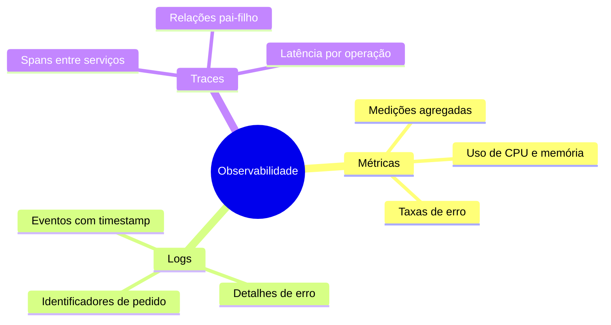
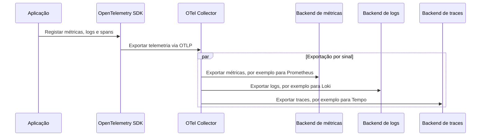

Considera um serviço cuja latência aumenta depois de uma implementação. Um painel pode mostrar que o problema é generalizado, mas a equipa precisa de métricas, logs e traces relacionados para investigar que componente é responsável e porquê.

**Observabilidade** é a capacidade de inferir o estado interno de um sistema a partir dos sinais que este emite. Na prática, a instrumentação e os backends de telemetria fornecem evidências que ajudam a equipa a formular perguntas sobre o comportamento em produção.

## Três sinais de telemetria

Os três sinais complementam-se, mas cada um regista um tipo diferente de evidência:

### Métricas
As métricas representam medições agregadas ao longo do tempo, muitas vezes com dimensões como serviço, operação ou estado. São úteis para detectar tendências e gerar alertas sobre condições como o aumento da taxa de erros ou a saturação de recursos.

### Logs
Os logs registam eventos individuais com carimbos temporais e campos contextuais. Campos estruturados, como um identificador de pedido ou de trace, facilitam a correlação entre eventos relacionados; níveis consistentes e mensagens focadas ajudam a controlar o volume e o custo.

### Traces
Um trace distribuído liga spans produzidos pelos serviços e operações envolvidos num pedido. Cada span regista um intervalo temporal e pode incluir atributos, eventos e uma relação com o span pai, ajudando a localizar latência e erros entre fronteiras de serviços.

## Perguntas a que os sinais podem responder

A telemetria correlacionada pode ajudar a investigar perguntas como:

- A latência ou a taxa de erros mudou depois de uma implementação?
- Que dependência representa a maior parte do tempo de um pedido?
- As falhas estão concentradas numa operação, região ou grupo de clientes?

A resposta depende do que o sistema regista. Falta de instrumentação, eventos não amostrados ou identificadores inconsistentes podem deixar perguntas importantes sem resposta.

## Monitorização vs. Observabilidade: Qual a Diferença?

É comum usar estes termos como sinónimos, mas eles representam níveis de maturidade diferentes:

- **Monitorização:** Usa painéis e alertas predefinidos para acompanhar condições conhecidas, como disponibilidade, latência e taxa de erros.
- **Observabilidade:** Descreve em que medida a telemetria disponível permite investigar o comportamento do sistema, incluindo perguntas que não foram antecipadas quando os painéis e alertas foram definidos.

São complementares: a monitorização ajuda a detectar uma alteração, enquanto uma telemetria suficientemente rica e correlacionada pode ajudar a explicá-la.

## Quatro sinais dourados para serviços

A documentação de SRE da Google destaca quatro sinais úteis ao nível do serviço; são um ponto de partida, não um modelo completo de monitorização para todos os sistemas:

1. **Latência:** O tempo que demora a processar um pedido.
2. **Tráfego:** Uma medida de quanta procura está a ser colocada no sistema (ex: pedidos HTTP por segundo).
3. **Erros:** A taxa de pedidos que falham (explícita, implicitamente ou por política).
4. **Saturação:** Quão perto o serviço está dos seus limites de recursos, como CPU ou memória.

## Exemplos de ferramentas por sinal

Estas ferramentas podem recolher, armazenar ou visualizar telemetria; a combinação adequada depende do sistema e dos requisitos operacionais.

| Sinal | Exemplos |
| :--- | :--- |
| **Métricas** | Prometheus, VictoriaMetrics, InfluxDB |
| **Logs** | ELK Stack (Elasticsearch, Logstash, Kibana), Loki, Splunk |
| **Traces** | Jaeger, Tempo, Honeycomb |
| **Visualização** | Grafana, Kibana |

## OpenTelemetry: Instrumentação e transporte

O **OpenTelemetry (OTel)** é um conjunto open-source de APIs, SDKs, convenções e protocolos para gerar e exportar telemetria. O Collector pode receber, processar e encaminhar telemetria para um ou mais backends; o OTel não armazena nem consulta os dados.

Uma camada neutra de instrumentação e transporte pode facilitar a mudança de backend, mas não elimina funcionalidades específicas, linguagens de consulta ou custos de migração associados a cada backend.

## Compromissos operacionais

O volume de telemetria é uma restrição de engenharia. Métricas com valores de etiquetas sem limite, como IDs de utilizador ou de pedido, criam cardinalidade elevada e podem sobrecarregar o armazenamento e as consultas. Prefira dimensões limitadas e mantenha identificadores por pedido em logs ou traces.

Os traces distribuídos dependem da propagação de contexto entre serviços. O formato W3C Trace Context normaliza identificadores habitualmente transportados no cabeçalho `traceparent`, mas cada componente participante continua a precisar de suporte de instrumentação ou propagação. A amostragem reduz os custos de ingestão e armazenamento: a amostragem *head-based* decide no início, enquanto a *tail-based* pode usar os dados do trace completo, mas exige buffering e mais recursos no Collector.

Logs e traces também implicam custos de retenção, privacidade e controlo de acesso. Os Collectors precisam de filas limitadas, políticas de repetição e monitorização da própria saúde: as repetições podem absorver falhas breves de exportação, mas uma pressão contínua pode encher as filas e levar à perda de telemetria.

## Conclusão

As métricas ajudam a detectar quando um sistema muda, os logs preservam detalhes dos eventos e os traces relacionam o trabalho entre componentes. São mais úteis quando a instrumentação, os identificadores, a amostragem, o armazenamento e os limites operacionais são planeados em conjunto.

## Para saber mais

- [Observability primer](https://opentelemetry.io/docs/concepts/observability-primer/)
- [Monitoring Distributed Systems](https://sre.google/sre-book/monitoring-distributed-systems/)
- [Prometheus data model](https://prometheus.io/docs/concepts/data_model/)
- [W3C Trace Context](https://www.w3.org/TR/trace-context/)
