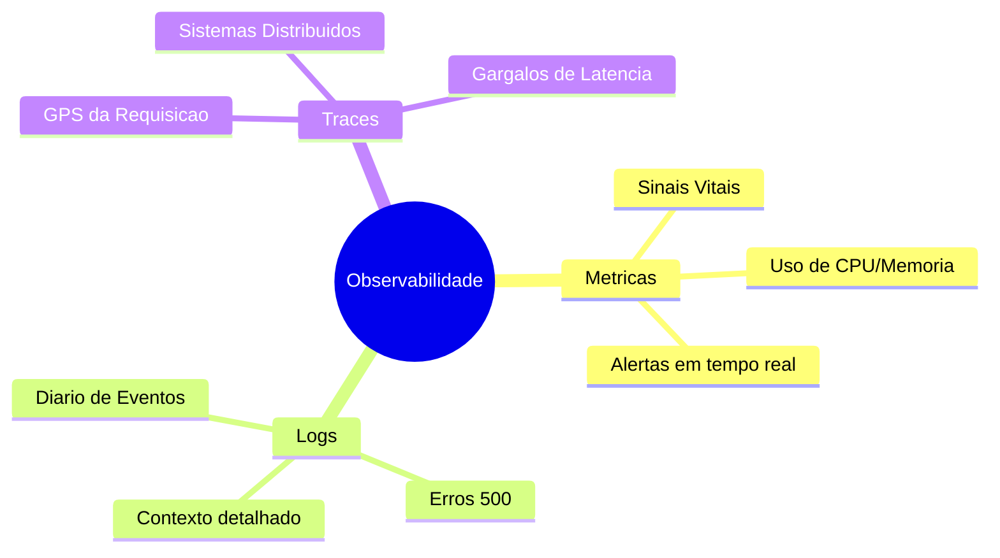
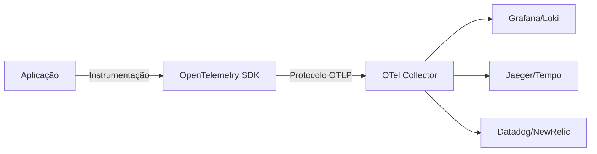

Imagine este cenário: o seu sistema de uma startup potencialmente milionária está a correr "aparentemente" bem. De repente, os utilizadores começam a reportar lentidão extrema. O pânico instala-se. Sem informações claras, a equipa tenta corrigir código "às cegas" e testa diretamente em produção. **Isto é a definição do caos.**

Bem-vindo ao mundo da **Observabilidade**. É como ter superpoderes tecnológicos: entender o que acontece dentro do sistema sem precisar de perguntar ao sénior ou, pior, ao estagiário.

## Os Três Pilares da Observabilidade

A observabilidade apoia-se num tripé fundamental:

### 1. Métricas: Os Sinais Vitais 📈
Pense nelas como a pulsação do sistema. Elas dizem se a saúde está boa (uso de CPU normal) ou se estamos na sala de reanimação (memória a explodir). Combinadas com alertas, são o seu alarme de incêndio.

### 2. Logs: O Diário do Sistema 📖
São os registos de eventos. Eles contam a história do que aconteceu: o que deu certo, o que falhou e onde o programador esqueceu de fechar aquela ligação à base de dados. Só não os confunda com fofocas inúteis; cada log deve ter um propósito.

### 3. Traces: O GPS da Requisição 📍
Em sistemas distribuídos, os traces são o seu "Batman com preparo". Eles mostram o caminho exato que uma funcionalidade percorreu, onde o "pneu furou" e quanto tempo cada etapa demorou.

## Por que você precisa disso?

Sistemas que parecem estáveis podem ser bombas-relógio. Com uma boa observabilidade, você consegue:
- **Antecipar problemas:** Resolver falhas antes que o cliente reclame no WhatsApp.
- **Identificar Gargalos:** Descobrir exatamente porque aquela página demora 10 segundos a carregar.
- **Insights de Negócio:** Extrair dados reais para tomadas de decisão estratégicas.

## Monitorização vs. Observabilidade: Qual a Diferença?

É comum usar estes termos como sinónimos, mas eles representam níveis de maturidade diferentes:

- **Monitorização:** Diz-te **que** algo está errado (ex: "O servidor está em baixo"). É reativa e baseada em padrões de falha conhecidos.
- **Observabilidade:** Diz-te **porquê** algo está errado (ex: "O servidor está lento porque uma query específica na base de dados está a bloquear as tabelas"). Permite-te fazer perguntas que não sabias que precisavas de fazer.

## Os 4 Sinais Dourados (Golden Signals)

O manual de SRE da Google define quatro métricas essenciais para monitorizar qualquer sistema:

1. **Latência:** O tempo que demora a processar um pedido.
2. **Tráfego:** Uma medida de quanta procura está a ser colocada no sistema (ex: pedidos HTTP por segundo).
3. **Erros:** A taxa de pedidos que falham (explícita, implicitamente ou por política).
4. **Saturação:** Quão "cheio" está o teu serviço (ex: uso de CPU ou consumo de memória).

## O Ecossistema Moderno

Para implementar estes pilares, várias ferramentas tornaram-se padrões da indústria:

| Pilar | Ferramentas Populares |
| :--- | :--- |
| **Métricas** | Prometheus, VictoriaMetrics, InfluxDB |
| **Logs** | ELK Stack (Elasticsearch, Logstash, Kibana), Loki, Splunk |
| **Traces** | Jaeger, Tempo, Honeycomb |
| **Visualização** | Grafana, Kibana |

## OpenTelemetry: O Tradutor Universal 🌐

Cuidado com o *vendor lock-in* (ficar preso a uma ferramenta específica). Para evitar isso, recomendo o **OpenTelemetry (OTel)**.

O OTel é um padrão *open-source* que oferece APIs e SDKs neutros para recolher e exportar dados. Ele não é o "backend" (onde vês os gráficos), mas sim o meio de transporte padronizado.

## Lições Aprendidas

No início, muitos acham que observabilidade é "perda de tempo". Mas quando o sistema cresce, com milhares de requisições por segundo, operar sem ela é como pilotar um avião sem painel de instrumentos.

Hoje, sei que a saúde do sistema não é apenas "não dar erro". Trata-se de ser eficiente, resiliente e otimizado. Com observabilidade, ganhas algo precioso: **noites de sono tranquilas.**

Qual ferramenta de observabilidade usas no teu projeto atual? 🚀
