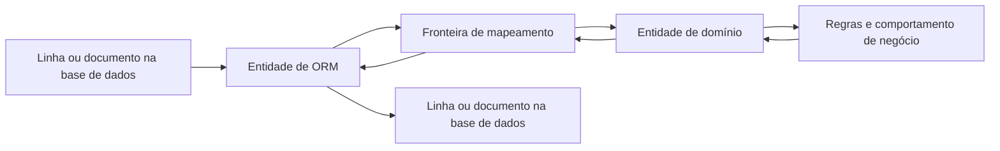
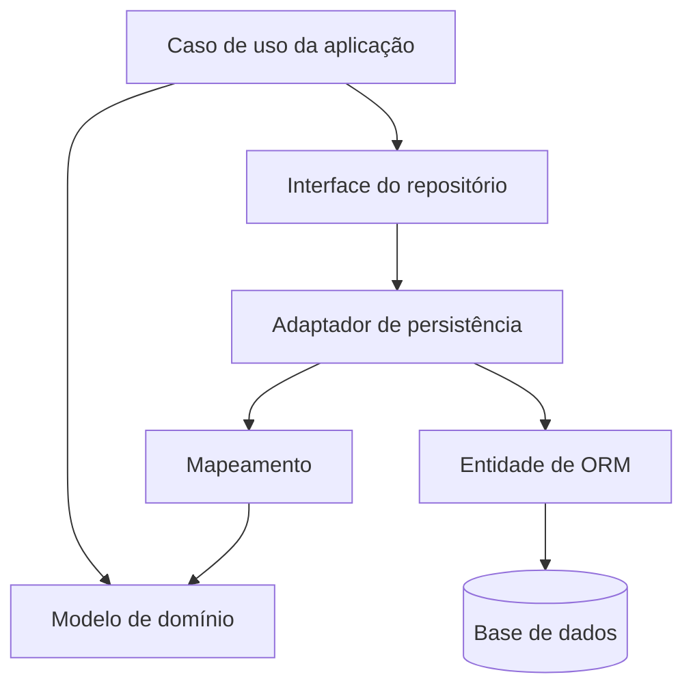

No início, uma entidade de ORM e uma entidade de domínio podem parecer exactamente iguais. Podem ter os mesmos atributos e, por isso, é tentador usar a mesma classe (ou struct, ou seja lá o que a linguagem utilizar) para ambas.

Isso pode funcionar durante algum tempo. Mas os dois conceitos têm responsabilidades diferentes e os caminhos tendem a divergir à medida que a aplicação cresce.

## Uma classe, duas funções

Uma **entidade de ORM** existe para representar dados num sistema de persistência. Ajuda uma ferramenta como JPA, GORM, o ORM do Django, Panache ou o Active Record do Rails a mapear linhas ou documentos para objectos e vice-versa. A sua forma pode reflectir o esquema da base de dados, os requisitos do ORM e a maneira como a persistência é optimizada.

Uma **entidade de domínio** representa um conceito importante para o negócio. Tem identidade e um ciclo de vida, e protege as regras que mantêm esse conceito válido. Uma encomenda, por exemplo, não é apenas uma linha com uma coluna `status`: tem regras sobre quando pode ser confirmada, cancelada ou expedida.

A mesma classe `Order` pode representar as duas coisas numa aplicação pequena. A diferença está na responsabilidade, não no nome. Uma classe chamada `Order` não se torna automaticamente um modelo de domínio só por ter um nome com significado.



## O modelo de persistência segue as preocupações do armazenamento

O modelo de ORM pode conhecer os detalhes de persistência. Pode precisar de:

- Nomes de tabelas e colunas, comprimentos de campos, índices e nulabilidade.
- Chaves estrangeiras e comportamento de carregamento das relações.
- Colunas de versão para controlo optimista de concorrência.
- Campos de eliminação lógica, datas de auditoria ou compatibilidade com migrações.
- Dados desnormalizados ou detalhes de serialização usados por um armazenamento específico.

Estes detalhes podem mudar quando o esquema evolui, quando se troca o ORM ou quando a aplicação muda de tecnologia de armazenamento. Alguns são decisões úteis de implementação, mas não são automaticamente conceitos de negócio.

Por exemplo, uma coluna `deleted_at` pode existir porque o sistema implementa eliminação lógica. O conceito de negócio pode ser antes “cancelada”, “arquivada” ou “já não disponível” ,  cada um com significado e regras diferentes.

## O modelo de domínio segue o significado do negócio

O modelo de domínio deve expressar os conceitos e decisões que tornam a aplicação útil. Não deve precisar de importar anotações JPA, tags GORM, classes de modelos do Django ou tipos específicos de uma base de dados apenas para impor uma regra.

Segue um exemplo simplificado. A representação de persistência contém campos necessários à base de dados e ao ORM; o objecto de domínio expõe uma operação de negócio válida:

```java
@Entity
@Table(name = "orders")
public class OrderRow {
    @Id
    private UUID id;

    @Column(name = "customer_id", nullable = false)
    private UUID customerId;

    @Column(nullable = false)
    private String status;

    @Version
    private long version;

    @Column(name = "created_at", nullable = false)
    private Instant createdAt;

    @Column(name = "deleted_at")
    private Instant deletedAt;
}
```

```java
public final class Order {
    private final OrderId id;
    private final List<OrderLine> lines;
    private OrderStatus status;

    public void confirm() {
        if (lines.isEmpty()) {
            throw new IllegalStateException("An empty order cannot be confirmed");
        }
        if (status != OrderStatus.DRAFT) {
            throw new IllegalStateException("Only a draft order can be confirmed");
        }
        status = OrderStatus.CONFIRMED;
    }
}
```

O exemplo é intencionalmente pequeno: os tipos de domínio reais precisam de construtores adequados e de acesso controlado ao seu estado. A diferença importante é que `OrderRow` descreve como uma encomenda é armazenada, enquanto `Order` torna explícita uma transição de negócio. Uma coluna da base de dados com o valor `CONFIRMED`, por si só, não impõe quando essa transição é permitida.

## Porque é que os dois modelos acabam por divergir

Um sistema pode começar com uma tabela simples e algumas operações directas. Com o tempo, o comportamento do negócio e os requisitos de persistência tendem a puxar o modelo em direcções diferentes:

| Alteração | O modelo de persistência pode precisar de | O modelo de domínio pode precisar de |
| :--- | :--- | :--- |
| Adicionar controlo optimista de concorrência | Uma coluna de versão | Uma regra para lidar com alterações concorrentes |
| Adicionar eliminação lógica | Um campo `deleted_at` opcional | Uma operação significativa de cancelamento ou arquivo |
| Optimizar uma consulta de leitura | Uma coluna desnormalizada ou projecção | Nenhuma alteração ao conceito de negócio |
| Mudar de tecnologia de armazenamento | Novas anotações, mapeamento ou formato de documento | As mesmas regras de negócio, se o domínio não mudou |
| Adicionar uma política de encomendas | Muitas vezes nenhuma alteração ao esquema | Novo comportamento e verificação de invariantes |

É aqui que um modelo partilhado começa a tornar-se incómodo. Campos exclusivos da persistência espalham-se pelo código de negócio, ou as regras ficam escondidas em callbacks do ciclo de vida e *setters*. As restrições da base de dados continuam a ser valiosas, mas devem reforçar as regras da aplicação, não ser o único lugar onde essas regras existem.

## Manter as dependências na direcção certa

Uma fronteira útil permite que o código da aplicação use o modelo de domínio e uma abstracção de repositório, enquanto um adaptador de infraestrutura trata dos detalhes do ORM e da base de dados. O repositório traduz entre os objectos de domínio e as representações de persistência.



O mapeamento não é gratuito. Acrescenta código, testes e tipos para manter. Mas cria um lugar claro para traduzir entre dois modelos que mudam por razões diferentes. Se o ORM, o esquema ou a tecnologia de armazenamento mudar, o adaptador pode absorver grande parte dessa alteração sem obrigar as regras de negócio a falar a linguagem da base de dados.

Isto não significa que todas as aplicações precisem de uma abstracção de repositório para cada tabela ou de um tipo separado para cada campo. As fronteiras devem justificar o custo.

## Quando partilhar um modelo é razoável

Se a aplicação for uma pequena ferramenta CRUD, as regras forem triviais, o modelo de persistência dificilmente mudar de forma independente e a equipa beneficiar da simplicidade, uma única classe pode ser uma escolha sensata. Frameworks como Active Record combinam deliberadamente persistência e comportamento dos objectos, e isso pode ser produtivo no contexto certo.

O sinal para separar os modelos não é “estamos a usar um ORM”. É que as razões para mudar começaram a ser diferentes:

- As regras de negócio estão a crescer ou a mudar independentemente do esquema.
- Os detalhes de persistência estão a espalhar-se pelos casos de uso e pelo comportamento de domínio.
- É necessário mais do que um formato ou mecanismo de persistência.
- O mesmo modelo de negócio tem de suportar interfaces ou fluxos de trabalho diferentes.
- O comportamento do ciclo de vida do ORM torna regras importantes difíceis de ver ou testar.

Em sistemas que se espera que cresçam, separar os modelos desde cedo pode evitar que essas preocupações se misturem. Numa aplicação minúscula, fazê-lo cedo demais pode acrescentar cerimónia sem proteger nada. A pergunta útil é se a fronteira facilita a evolução, não se o diagrama de arquitectura parece mais impressionante.

## Uma distinção relacionada: entidade e objecto de valor

“Entidade de domínio” também tem um significado específico em *domain-driven design*. Uma entidade tem uma identidade que persiste ao longo das mudanças: duas encomendas com os mesmos artigos continuam a ser encomendas diferentes se tiverem identidades diferentes. Um objecto de valor é definido pelos seus valores e é normalmente imutável ,  por exemplo, um valor monetário com uma moeda.

Nenhum destes conceitos é igual a uma entidade de ORM. Um ORM pode persistir entidades e objectos de valor, por vezes na mesma tabela, em tabelas separadas ou em colunas incorporadas. O mapeamento de persistência não determina a semântica do domínio.

## Responsabilidades diferentes, razões diferentes para mudar

Uma entidade de ORM responde à pergunta: **Como é que estes dados são representados e recuperados por este mecanismo de persistência?**

Uma entidade de domínio responde à pergunta: **O que significa este conceito de negócio e que operações o mantêm válido?**

Por vezes, uma classe consegue responder às duas perguntas sem causar problemas. Quando a forma de armazenamento e o significado de negócio começam a mudar por razões diferentes, atribua a cada responsabilidade o seu próprio modelo. Não é abstracção pela abstracção; é uma forma de deixar a base de dados, o ORM e as regras de negócio evoluírem sem arrastarem uns aos outros.