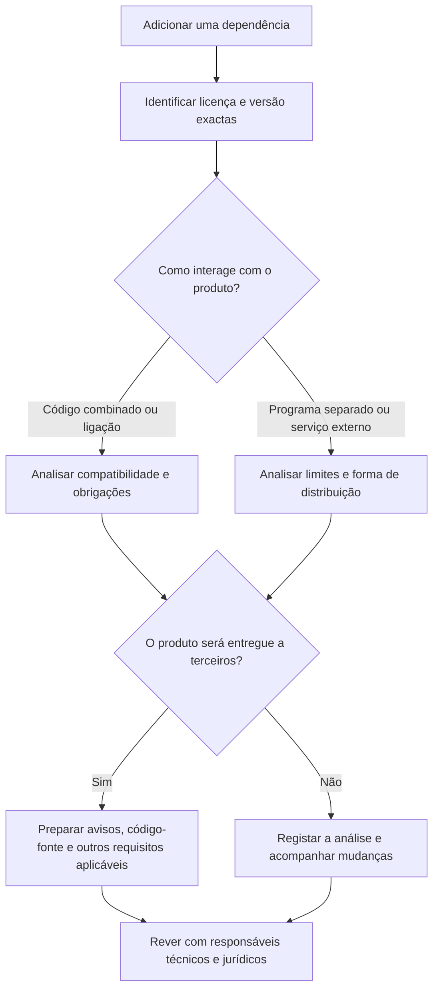
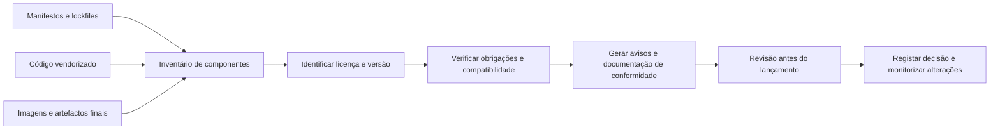

Desta vez, o assunto é **licenciamento de software**.

Recentemente, voltei a estudar licenças de software e fiquei alarmado com a pouca atenção que muitas equipas dedicam a este tema. Não é dos assuntos mais divertidos de uma sprint, eu sei. Mas ignorá-lo pode transformar uma escolha técnica aparentemente pequena num problema de produto, negócio ou conformidade.

No universo do software livre e de código aberto, é comum começar por duas grandes famílias: **licenças permissivas** e **licenças copyleft**. Essa divisão ajuda a orientar a conversa, mas não substitui a leitura da licença concreta.

## Permissivas e copyleft, em linhas gerais

Licenças permissivas como **MIT** e **BSD** permitem usar, modificar e redistribuir o código, inclusive em produtos comerciais e proprietários, sem exigir que as alterações ou o produto completo sejam publicados sob a mesma licença.

Isso não significa “sem obrigações”. Por exemplo, as licenças MIT e BSD exigem que certos avisos de direitos de autor, condições e isenções de responsabilidade sejam preservados nas redistribuições. A Apache License 2.0 também é permissiva e inclui termos explícitos relacionados com patentes.

As licenças **copyleft**, como a **GPL**, procuram garantir que as liberdades concedidas aos utilizadores continuam presentes quando uma versão abrangida pela licença é partilhada. Em certas situações de combinação e distribuição, isso pode exigir que o trabalho combinado seja disponibilizado sob a GPL, com o código-fonte correspondente e os avisos necessários.

É por isso que se ouve dizer que o copyleft “contamina” o produto. Eu evitaria essa palavra: sugere um efeito automático e universal que não existe. A análise depende da licença e da versão exactas, do modo como os componentes são combinados, das excepções aplicáveis e de como o software é entregue ou disponibilizado.

## “Copyleft” não significa publicar tudo para toda a gente

Este ponto merece destaque porque é onde muitos resumos simplificam demais.

A GPL **não exige, em geral, que uma empresa publique ao mundo inteiro alterações que usa apenas internamente**. A obrigação de disponibilizar o código-fonte correspondente está ligada a determinadas formas de transmitir ou distribuir cópias do software abrangido. Se distribuir um binário coberto pela GPL, por exemplo, terá de cumprir as condições de disponibilização do código-fonte aplicáveis à versão da licença.

Também não significa que o software tenha de ser oferecido a preço zero. A GPL permite cobrar pela cópia ou distribuição. “Livre” aqui está relacionado com as liberdades dadas aos destinatários ,  por exemplo, estudar, modificar e redistribuir sob os termos da licença ,  e não com a ausência obrigatória de preço.

Há ainda uma distinção importante para serviços online: a GPL normal não cria, por si só, a mesma obrigação de disponibilização de código apenas porque alguém usa um programa através de uma rede. A **AGPL** foi concebida para cobrir uma situação específica de versões modificadas disponibilizadas para interacção remota; nos termos da licença, os utilizadores que interagem com uma dessas versões devem ter acesso ao respectivo código-fonte. O texto exacto da licença importa.

Por isso, a pergunta não deve ser apenas “tem GPL?”. Pergunte também: **qual é a versão? É GPL, LGPL ou AGPL? Estamos a modificar, combinar, distribuir ou apenas a executar o componente?**

## Copyleft forte, fraco e licenças por ficheiro

Também se ouvem as expressões *copyleft forte* e *copyleft fraco*. São formas práticas de descrever o alcance esperado das obrigações, não uma classificação universal que resolve qualquer caso jurídico.

- **Copyleft forte**, como a GPL, tende a exigir que trabalhos combinados abrangidos pela licença mantenham condições de partilha compatíveis.
- **Copyleft fraco**, como a LGPL em certos cenários de bibliotecas, permite combinações mais flexíveis, mas mantém obrigações sobre a biblioteca e sobre a forma de ligação e distribuição.
- **Copyleft por ficheiro**, como a MPL, concentra algumas obrigações nos ficheiros derivados ou modificados sob a licença.
- **Copyleft de rede**, como a AGPL, inclui condições associadas a versões modificadas disponibilizadas para utilização através de uma rede.

Estes nomes são um mapa, não o território. A licença, as excepções e a arquitectura concreta continuam a ser determinantes.

## Uma dependência não decide automaticamente a licença do produto

A licença de uma dependência **não transforma automaticamente** todo o produto numa obra copyleft. Primeiro é preciso determinar se o componente e o produto formam um trabalho combinado abrangido pela licença ou se são programas independentes distribuídos em conjunto. A forma de ligação, a comunicação entre processos, a arquitectura de plugins e os termos da licença podem fazer diferença. Colocar dois programas no mesmo instalador ou container, por si só, não responde a todas essas perguntas.

Também não existe uma regra simples de que “se estiver numa dependência transitiva, aplica-se a licença ao produto inteiro”. Uma dependência transitiva continua a ter uma licença que precisa de ser respeitada, mas a obrigação concreta depende do que é copiado, combinado e entregue.

Isto é especialmente relevante para componentes GPL ligados a uma aplicação. A própria Free Software Foundation explica que certas formas de ligação podem criar um trabalho combinado; também distingue esses casos de programas independentes agregados lado a lado. Ainda assim, determinar a fronteira num produto real pode exigir análise jurídica ,  não basta olhar para o ficheiro `package.json` ou para o nome do pacote.

## Porque MIT, BSD e GPL fazem compromissos diferentes

| Família | Exemplos | O que normalmente permite | O que deve ser analisado |
| :--- | :--- | :--- | :--- |
| Permissiva | MIT, BSD, Apache-2.0 | Uso, modificação e redistribuição sem obrigar o produto inteiro a adoptar a mesma licença | Avisos de direitos de autor, condições, isenções, patentes e compatibilidade |
| Copyleft por ficheiro ou fraco | MPL, LGPL | Combinações mais flexíveis em certos contextos, preservando obrigações para partes abrangidas | Limites entre ficheiros ou módulos, ligação e distribuição |
| Copyleft forte | GPL | Partilha das liberdades de trabalhos abrangidos quando são redistribuídos | Se existe trabalho combinado, versão da licença, código correspondente e avisos |
| Copyleft de rede | AGPL | Protecções adicionais para certos usos remotos de versões modificadas | Se o utilizador interage remotamente com uma versão modificada e que código deve ser oferecido |

Estas descrições são apenas um resumo para orientar a conversa, não uma interpretação legal aplicável a todos os projectos.

## O que a equipa deve acompanhar

A licença directa de cada dependência é só o início. Um inventário útil deve cobrir:

- **Dependências directas e transitivas**, incluindo versões exactas e módulos opcionais.
- **Código copiado ou vendorizado**, snippets e ficheiros gerados que incorporem código de terceiros.
- **Artefactos entregues**, como binários, aplicações mobile, imagens de containers, instaladores e SDKs.
- **Componentes que não são código**, como fontes tipográficas, ícones, imagens, documentação e modelos.
- **Metadados ausentes ou ambíguos**, licenças múltiplas, excepções e alterações de licença entre versões.
- **O modo de utilização**, incluindo distribuição a clientes, entrega a parceiros, uso apenas interno ou serviço remoto.

Uma lista de dependências no repositório não garante que a lista corresponda ao que foi efectivamente incluído no artefacto lançado. É importante analisar o resultado do build e manter a relação entre versões, dependências e lançamentos.

Ferramentas podem automatizar parte deste trabalho. Formatos e identificadores como **SPDX** ajudam a registar licenças de forma consistente; ferramentas de análise de composição de software podem identificar dependências e gerar um inventário ou SBOM. Mas um scanner não substitui a revisão: metadados podem estar errados, licenças podem ser personalizadas e a ferramenta não sabe necessariamente como o componente é combinado ou distribuído.

## Um processo prático antes de adoptar uma dependência

Uma verificação simples pode evitar surpresas tardias:

1. Identifique o componente, a versão e a origem exactos.
2. Confirme a licença no repositório e nos ficheiros distribuídos com o componente; não confie apenas num resumo de terceiros.
3. Consulte a licença e as excepções aplicáveis àquela versão.
4. Registe como o componente será usado: código incorporado, ligação, processo separado, ferramenta de build ou serviço externo.
5. Determine se e a quem o produto será distribuído ou disponibilizado remotamente.
6. Compare as obrigações com as licenças do produto e com os compromissos comerciais da organização.
7. Preserve avisos e disponibilize código-fonte ou outros materiais quando a licença exigir.
8. Registe a decisão e volte a avaliá-la quando a dependência, a versão ou o modelo de distribuição mudar.

Se houver dúvidas sobre um componente copyleft numa aplicação proprietária ou num produto distribuído, envolva a equipa jurídica antes de o lançamento se tornar urgente. Trocar uma dependência durante o desenvolvimento costuma ser mais simples do que redesenhar uma integração depois de ela estar profundamente acoplada.

## O copyleft também pode ser uma escolha estratégica

Não estou a defender que se evitem dependências copyleft. O kernel Linux usa a GPL, e a decisão de manter certas liberdades para quem recebe e modifica o kernel foi central para a forma como esse projecto evoluiu. Há muitos contextos em que o copyleft é uma mais-valia: promove reciprocidade, permite que melhorias regressem à comunidade e dá aos destinatários direitos que uma licença permissiva não exige preservar.

Uma licença permissiva também pode ser a escolha certa: facilita a adopção em ecossistemas diversos e permite que código seja incorporado em produtos com outras licenças, desde que os avisos e demais condições sejam cumpridos.

A decisão não é “qual licença é boa e qual é má?”. É: **que direitos queremos conceder, que obrigações estamos dispostos a cumprir e como o software será usado e distribuído?**

## Licenciamento é parte da engenharia do produto

Licenças não são apenas um assunto jurídico para resolver na véspera do lançamento. São parte das decisões de dependências, arquitectura, distribuição e estratégia do produto.

Uma equipa que conhece as licenças que utiliza consegue escolher componentes conscientemente, respeitar quem os criou e evitar surpresas quando o produto muda de escala ou de modelo de negócio. Não se trata de ter medo do open source; trata-se de saber o que estamos a usar e quais são as condições.

> Este artigo é uma introdução geral, não aconselhamento jurídico. As obrigações dependem da licença e versão exactas, da jurisdição e de como os componentes são combinados e distribuídos. Para decisões de produto com impacto legal, consulte profissionais qualificados.

## Para continuar a leitura

- [GNU: Perguntas frequentes sobre as licenças GNU](https://www.gnu.org/licenses/gpl-faq.html)
- [Open Source Initiative: licença MIT](https://opensource.org/licenses/MIT)
- [Open Source Initiative: licença BSD de 3 cláusulas](https://opensource.org/licenses/BSD-3-Clause)