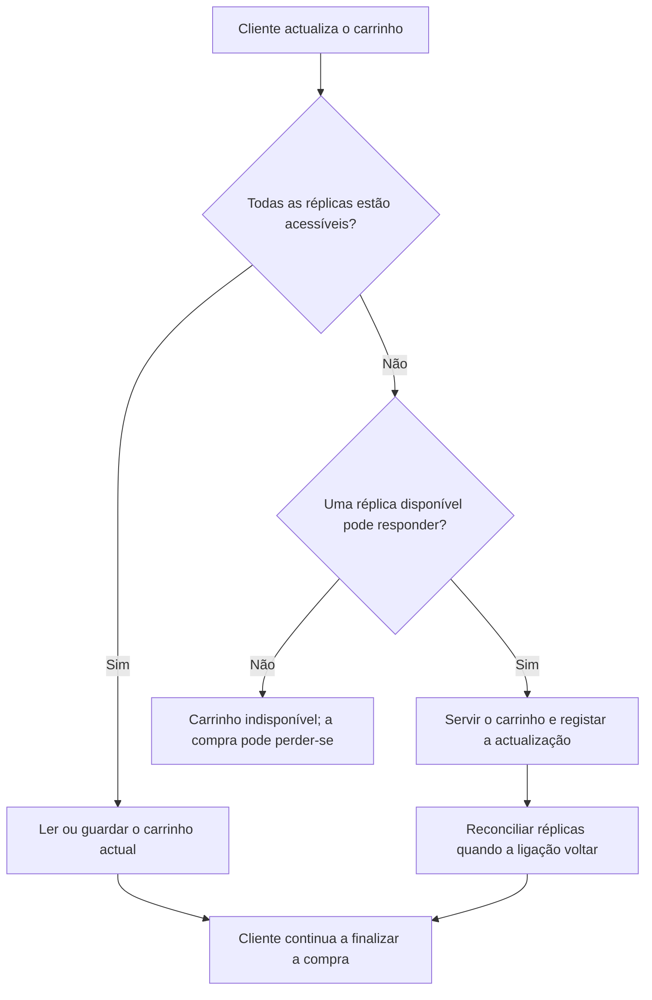
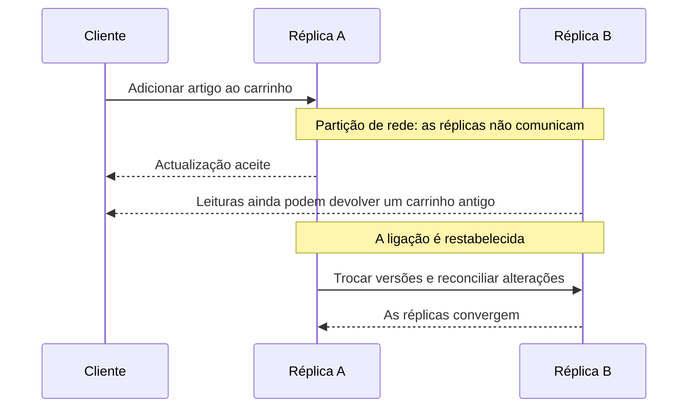
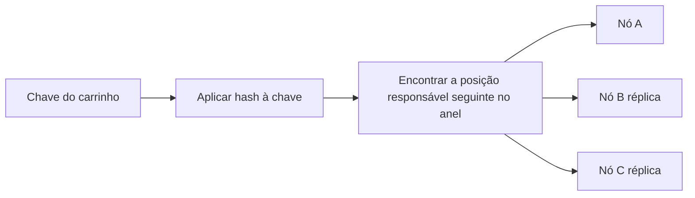

Em algum momento dos anos 2000, a Amazon deparou-se com um problema que parece pequeno até o colocarmos em termos de negócio: **o carrinho de compras não podia desaparecer**.

Nem durante uma promoção. Nem na Black Friday. Nem num dia normal, enquanto alguém da área financeira acompanhava os números com o coração nas mãos. Uma falha no carrinho podia significar uma venda perdida, um cliente frustrado e uma receita que não voltaria.

A palavra *pequeno* merece estas aspas. À escala da Amazon, mesmo uma breve interrupção podia afectar um número enorme de sessões de compra.

## Começar pelo requisito de negócio

Os engenheiros da Amazon estavam a construir serviços que precisavam de continuar a funcionar em muitas máquinas e centros de dados. As bases de dados relacionais ofereciam garantias importantes, incluindo transacções com propriedades ACID, mas uma única configuração de base de dados não era necessariamente a escolha certa para todas as cargas de trabalho ou todos os objectivos de disponibilidade.

O carrinho tinha uma tolerância particular a erros. Um cliente podia ver temporariamente um artigo antigo, ou até duplicado, enquanto o sistema reconciliava actualizações. Era indesejável, mas muitas vezes menos prejudicial do que mostrar um carrinho vazio ,  ou nenhum carrinho ,  porque um componente estava inacessível.

Dito de outra forma, o negócio atribuía pesos diferentes a dois resultados:

- Um carrinho temporariamente imperfeito ainda podia resultar numa compra concluída.
- Um carrinho indisponível podia impedir a compra por completo.

Essa prioridade levou a um objectivo prático de design: continuar a aceitar e servir operações do carrinho durante falhas e reconciliar as diferenças quando o sistema recuperasse.

## Dynamo: construído para a carga de trabalho

A Amazon descreveu o sistema Dynamo num artigo de investigação publicado em 2007, *Dynamo: Amazon’s Highly Available Key-value Store*. Foi concebido como um sistema de armazenamento chave-valor altamente disponível para serviços como o carrinho de compras, nos quais a operação ininterrupta era mais importante do que devolver sempre uma única resposta globalmente acordada naquele preciso instante.

Isto não foi uma declaração de que a consistência não importava. O design reconhecia que as falhas acontecem em sistemas distribuídos e dava às aplicações mecanismos para continuar a operar enquanto as réplicas podiam discordar temporariamente. O sistema podia preservar várias versões de um item e permitir que a aplicação ajudasse a resolver conflitos.

A pergunta orientadora não era: “Qual é a base de dados mais elegante?” Era algo mais próximo de: **“Que comportamento permite a este negócio continuar a servir os clientes quando máquinas ou ligações de rede falham?”**

## O Teorema CAP no contexto de uma escolha real

O Dynamo é frequentemente discutido em conjunto com o Teorema CAP. O CAP diz que, quando uma partição de rede impede partes de um sistema distribuído de comunicar, o sistema tem de escolher entre:

- **Consistência (Consistency)**: todas as leituras bem-sucedidas observam o último valor acordado.
- **Disponibilidade (Availability)**: todos os pedidos a um nó que não falhou recebem uma resposta.
- **Tolerância a partições (Partition Tolerance)**: o sistema continua a funcionar apesar da perda ou do atraso de comunicação entre nós.

A expressão “escolher quaisquer duas” pode induzir em erro. Num sistema distribuído que tem de funcionar através de uma rede, as partições não são algo de que o design possa simplesmente abdicar. Durante uma partição, a escolha relevante é, em geral, entre responder ao pedido e garantir que todas as respostas reflectem um único valor mais recente.

Para o carrinho, a Amazon valorizou a disponibilidade durante uma partição. O sistema podia aceitar uma actualização num nó disponível, mesmo que outra réplica não pudesse ser contactada. Assim, o cliente podia receber uma resposta enquanto as réplicas mantinham temporariamente versões diferentes do carrinho.

Isto não é uma recomendação universal para sacrificar a consistência. É um lembrete de que o comportamento de um sistema perante falhas deve acompanhar o seu domínio. Um livro de pagamentos, uma reserva de inventário e um carrinho de compras podem ter consequências muito diferentes quando as réplicas discordam.

## Os blocos de construção por trás da decisão

O Dynamo combinou várias técnicas para tornar prático esse objectivo de disponibilidade. Hoje são familiares nas conversas sobre bases de dados distribuídas, mas cada uma respondia a uma necessidade operacional específica.

### Particionamento com hashing consistente

Um armazenamento distribuído precisa de decidir que máquinas são responsáveis por cada chave. O hashing consistente mapeia chaves e nós num anel, reduzindo o número de chaves que precisam de ser movidas quando máquinas são adicionadas ou removidas. O Dynamo também usava nós virtuais para distribuir a responsabilidade de forma mais equilibrada pelas máquinas físicas.

Em vez de uma única máquina deter a única cópia de um carrinho, vários nós podiam guardar réplicas. Isso aumentava a probabilidade de uma operação continuar caso um nó falhasse.

### Replicação e coordenação semelhante a quorum

O Dynamo replicava dados entre nós e expunha parâmetros que permitiam às aplicações definir quantas réplicas participariam em leituras e escritas. De forma simplificada, exigir a confirmação de mais réplicas pode aumentar a confiança no valor; exigir menos pode ajudar as operações a manter-se disponíveis quando alguns nós estão inacessíveis.

Estas configurações não são um interruptor mágico entre “seguro” e “inseguro”. Expressam um equilíbrio específico para a carga de trabalho entre disponibilidade, latência e probabilidade de observar versões em conflito.

### Consistência eventual e resolução de conflitos

Se duas réplicas aceitarem alterações durante uma partição, podem divergir temporariamente. A abordagem do Dynamo permitia a existência de várias versões e usava mecanismos como relógios vectoriais (*vector clocks*) para acompanhar relações causais entre versões. Quando não era possível ordenar as versões automaticamente, a lógica da aplicação podia ajudar a reconciliá-las.

No caso de um carrinho, a resolução de conflitos podia combinar adições independentes em vez de descartar uma delas. Isso não significa que todos os conflitos sejam simples: remover um artigo enquanto outra réplica actualiza a sua quantidade exige uma regra deliberada. O ponto importante é tornar o comportamento explícito, em vez de assumir que todas as operações de rede têm sempre sucesso.

### Recuperação após falhas

O Dynamo também usava técnicas como *hinted handoff* e anti-entropia (*anti-entropy*) para ajudar as réplicas a sincronizarem-se depois da recuperação de nós ou ligações. Estes mecanismos fazem parte do acordo: aceitar escritas durante uma falha só funciona se o sistema tiver uma forma de reparar posteriormente as diferenças entre réplicas.

## O compromisso é uma decisão de produto

Aqui está a parte que é fácil não ver quando a arquitectura é discutida apenas em termos de algoritmos: **o modo de falha aceitável é uma decisão de negócio**.

Pergunte o que acontece se estes dados estiverem temporariamente desactualizados, indisponíveis ou duplicados:

| Domínio | Consequência possível da inconsistência | Consequência possível da indisponibilidade |
| :--- | :--- | :--- |
| Carrinho de compras | Um artigo antigo ou duplicado frustra o cliente | O cliente pode abandonar a compra |
| Livro de pagamentos | Saldo incorrecto ou cobrança duplicada | O pagamento pode ter de esperar ou ser repetido |
| Inventário | Dois clientes podem receber a promessa do mesmo artigo | A compra pode ser adiada |
| Feed social | Uma publicação recente pode aparecer com atraso | Os utilizadores não conseguem carregar o feed |

A tabela é apenas um ponto de partida. Por exemplo, um sistema de inventário pode tolerar contagens aproximadas na página de um produto, mas precisar de coordenação mais rigorosa ao reservar a última unidade. O mesmo produto pode, portanto, usar escolhas de consistência diferentes em etapas diferentes.

Uma conversa útil sobre o design começa com perguntas como estas:

1. Que acção do utilizador tem de continuar a funcionar durante uma falha de dependência?
2. Que resultado incorrecto o utilizador consegue tolerar e durante quanto tempo?
3. O sistema consegue resolver o conflito automaticamente ou precisa de uma pessoa ou regra de negócio?
4. Qual é o custo de rejeitar um pedido em comparação com aceitar um valor potencialmente desactualizado?
5. Como é que o sistema vai detectar e reparar divergências?

## O que o Dynamo influenciou ,  e o que isso não significa

O Dynamo tornou-se uma referência importante para o armazenamento distribuído. Mais tarde, a Amazon lançou o DynamoDB, mas o DynamoDB é um serviço de base de dados gerido, não simplesmente o artigo original do Dynamo exposto sem alterações como serviço.

Outros sistemas recorreram a ideias relacionadas de formas diferentes. O Cassandra combinou ideias associadas à arquitectura distribuída do Dynamo com conceitos de modelação de dados associados ao Bigtable da Google. O ScyllaDB é uma implementação compatível com Cassandra. O próprio Bigtable foi um sistema separado da Google, descrito no seu próprio artigo; não deve ser tratado como descendente do Dynamo.

O impacto mais amplo não foi um único modelo de base de dados. Foi um conjunto de padrões práticos ,  particionamento, replicação, coordenação configurável e tratamento de conflitos ,  que as equipas podiam adaptar aos seus próprios requisitos.

## A lição: a arquitectura começa pelas prioridades

Em retrospectiva, pode parecer que todos os conceitos de sistemas distribuídos foram planeados de forma meticulosa desde o início. A história é mais prática: uma funcionalidade importante e visível para o cliente não podia desaparecer sempre que parte da infraestrutura ficasse inacessível.

O Dynamo foi moldado por essa restrição de negócio. O seu comportamento que privilegiava a disponibilidade fazia sentido para um carrinho em que uma duplicação ou visualização desactualizada, ainda que temporária, era preferível a uma compra falhada. A mesma escolha podia ser errada noutro domínio.

A tecnologia ajuda a resolver problemas técnicos. Compreender o negócio diz-nos **qual é o problema que vale a pena resolver, que falha é aceitável e que compromisso é realmente útil**.

Por vezes, tudo começa com um carrinho de compras que simplesmente não pode falhar.