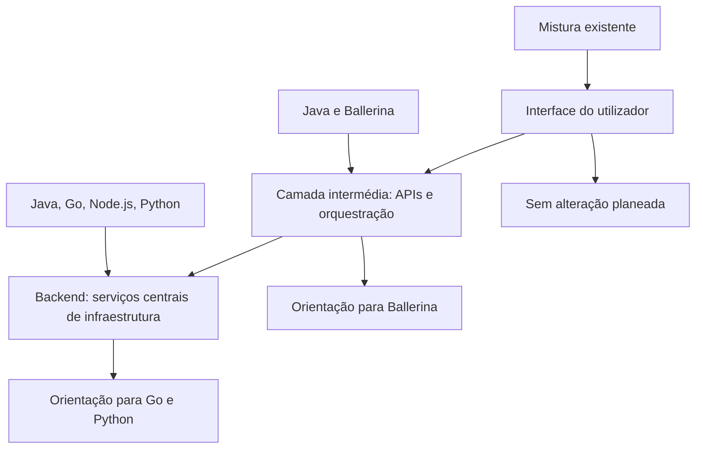
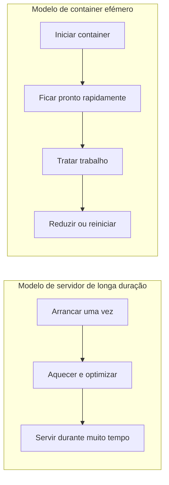
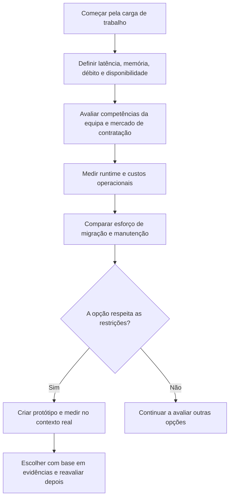

A sua linguagem de programação é especial…

Claro que é. Como todas as outras.

Quando a WSO2 anunciou **“Goodbye Java, Hello Go!”**, algumas reacções trataram o assunto menos como uma decisão de engenharia e mais como um desgosto amoroso:

- “Como assim, deixar Java?”
- “E os mais de vinte anos de maturidade?”
- “E o ecossistema?”
- “E o meu curso de Java 21?”

Calma. Ninguém matou Java. Ninguém queimou os livros de design patterns. A WSO2 olhou para os problemas que espera resolver nos próximos anos e escolheu uma direcção para a futura infraestrutura backend.

É uma decisão importante. Não é um veredicto universal sobre linguagens de programação.

## O que a WSO2 anunciou realmente

No anúncio de [26 de Janeiro de 2026](https://wso2.com/library/blogs/goodbye-java-hello-go/), a WSO2 descreveu uma orientação estratégica para **novos produtos e plataformas**, não uma reescrita imediata de tudo o que já vende. A empresa afirmou que continuaria a evoluir, manter e dar suporte aos seus produtos Java existentes, sem uma data prevista para terminar esse suporte.

O anúncio também descreveu escolhas diferentes para diferentes camadas do seu software:

| Camada | Mistura actual da WSO2 | Orientação descrita no anúncio |
| :--- | :--- | :--- |
| Frontend | Tecnologias Web e mobile | Sem alterações previstas |
| Camada intermédia | Java e Ballerina | Ballerina |
| Infraestrutura backend | Java, Go, Node.js, Python | Go e Python |

Portanto, o título é deliberadamente provocador, mas a estratégia real é mais específica: **usar linguagens diferentes em partes diferentes do sistema e orientar a futura infraestrutura backend para Go e Python**.

## A carga de trabalho mudou

Durante grande parte da história da WSO2, o middleware empresarial era disponibilizado como servidores de longa duração. Um processo podia permanecer activo durante meses. Fazia sentido investir num runtime que talvez precisasse de algum tempo para arrancar e aquecer, mas que podia optimizar o desempenho enquanto permanecia activo.

As implementações cloud-native mudaram o formato do problema. Um serviço pode agora correr num container criado para tratar trabalho, escalar durante um pico de tráfego, ser reagendado depois de uma falha ou ser desligado quando a procura diminui. Neste contexto, a latência de arranque e o consumo de memória não são números abstractos de benchmarks: afectam a rapidez com que a capacidade fica disponível e a quantidade de infraestrutura necessária para a manter disponível.

A compilação *just-in-time* e o runtime maduro de Java podem ser uma vantagem para serviços de longa duração: o processo tem tempo para aquecer e optimizar. Em cargas de trabalho de curta duração, porém, o tempo e os recursos gastos até esse ponto podem ser mais importantes. O grafo de dependências de uma aplicação grande, a configuração do runtime e as necessidades de memória também influenciam o arranque e os custos de operação.

Isto **não** significa que Java seja inerentemente lento ou inadequado para containers. O Java moderno continuou a evoluir, e opções como partilha de dados de classes, técnicas *ahead-of-time*, imagens nativas do GraalVM e afinação cuidadosa do runtime podem alterar os compromissos. Mas cada abordagem tem as suas próprias limitações e custos operacionais. A pergunta certa não é se uma linguagem pode ser optimizada; é se a solução completa justifica a complexidade para esta carga de trabalho.

## Porque Go pode encaixar neste trabalho específico

O anúncio da WSO2 destaca a combinação de arranque rápido, uma pegada de runtime relativamente compacta, recolha de lixo, primitivas de concorrência e compilação nativa de Go. Refere também a experiência anterior da empresa: Go já era usado em projectos como OpenChoreo, a reescrita do compilador Ballerina, Thunder e ferramentas de linha de comandos.

Estas propriedades podem ser úteis em serviços de infraestrutura iniciados frequentemente, executados em containers e escalados. Podem ajudar a reduzir o tempo até à prontidão e os recursos computacionais necessários para executar um serviço. O ecossistema de Go também está bem estabelecido na infraestrutura cloud, com ferramentas como Kubernetes e Docker entre os exemplos mais conhecidos.

Mas não há almoço grátis escondido no comando `go build`:

- O garbage collector e o runtime de Go também consomem recursos; um binário pequeno não significa custo de memória zero.
- As primitivas de concorrência facilitam a expressão de programas concorrentes, mas não tornam automaticamente um serviço correcto ou rápido.
- Mudar de linguagem implica custos de formação, contratação, ferramentas, testes e manutenção a longo prazo.
- O melhor resultado depende da aplicação, das dependências, do tráfego e da forma como o serviço é operado.

A escolha faz sentido quando os benefícios medidos na implementação real superam os custos de migração e de ciclo de vida ,  não porque uma linguagem venceu um concurso de popularidade.

## Porque não Rust? Porque não outra coisa?

A WSO2 também discutiu Rust. A explicação foi contextual: Rust oferece controlo detalhado e garantias fortes, que podem ser valiosos perto do hardware ou em software que funciona durante muito tempo sem reiniciar. Para o middleware de infraestrutura que a WSO2 desenvolve, a empresa considerou Go um equilíbrio melhor entre controlo, produtividade, gestão de memória, concorrência e implementação nativa.

Essa é a avaliação de engenharia da WSO2, não uma lei da natureza. Outra empresa que desenvolva um motor de browser, um componente de sistema operativo ou uma base de dados sensível à latência pode, com toda a razão, fazer uma escolha diferente. São os requisitos que definem o compromisso; não é a linguagem que define os requisitos.

## Um exemplo pessoal: preferir Python não chegava

Houve uma altura em que eu preferia Python a qualquer outra linguagem. Cheguei a estar em posições onde podia influenciar fortemente a sua adopção no backend, em vez de Java ou Go.

Não o fiz. Não por não gostar de Python, mas porque não era viável naquele contexto específico. As razões eram concretas: o à-vontade dos programadores disponíveis com a linguagem, o custo operacional, os requisitos de concorrência e as expectativas de desempenho.

Essas considerações não fazem de Python uma linguagem má. Mostram que escolher uma linguagem tem consequências. Uma preferência pode ajudar-nos a explorar uma opção, mas não paga a factura da infraestrutura, não forma uma equipa e não apaga as características da carga de trabalho.

## Uma forma melhor de escolher uma linguagem

Em vez de perguntar **“De que linguagem gostamos?”**, façamos perguntas que tornam as consequências visíveis:

1. O que faz este serviço e quanto tempo costuma viver cada instância?
2. Com que rapidez uma nova instância tem de ficar pronta?
3. Quais são os limites de memória, CPU, latência e débito?
4. De que bibliotecas e ferramentas de implementação o serviço depende?
5. A equipa consegue contratar, integrar e dar suporte a engenheiros para esta stack?
6. Qual é o custo de mudar de linguagem agora e qual é o custo de manter a actual?
7. Como vamos medir se a escolha funcionou?

Fazer benchmarks é importante, mas também importa definir os limites do benchmark. Um microbenchmark pode comparar uma função; não consegue dizer se a equipa sabe operar o serviço, se as dependências dominam o tempo de arranque ou se uma reescrita vai atrasar um produto de que os clientes precisam.

Num produto existente, também há uma diferença entre **escolher uma linguagem para novo desenvolvimento** e **reescrever um sistema funcional**. Um serviço novo pode começar com um conjunto de restrições limpo. Uma reescrita tem de preservar comportamento, integrações, compatibilidade, compromissos de suporte e anos de conhecimento operacional acumulado. São decisões diferentes, com perfis de risco diferentes.

## Linguagens são ferramentas, não identidades

A lição não é **“Go é melhor que Java”**. Uma linguagem de programação é uma parte de um sistema de engenharia que também inclui a carga de trabalho, o runtime, as bibliotecas, a equipa, o modelo de implementação e as restrições do negócio.

As boas organizações de engenharia não perguntam qual é a linguagem mais adorada. Perguntam qual opção cria menos atrito para o problema que têm hoje ,  e que evidências as fariam reconsiderar amanhã.

E sim, daqui a alguns anos alguém poderá escrever: **“Goodbye Go, Hello Outra Coisa.”** O ciclo continuará, como sempre.

Relaxe. A sua linguagem continua a ser óptima. Só não é eterna. Nem especial. Afinal, não dorme na mesma cama que uma linguagem de programação. Se dorme, talvez seja melhor repensar isso.