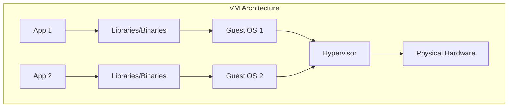
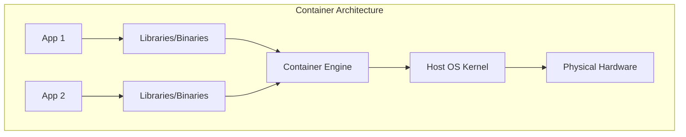

If you still think containers and virtual machines (VMs) are the same thing, sit down. In this article, we are going to demystify these concepts in a simple and direct way.

## Virtual Machines (VMs): The Traditional Model

Virtual machines, known as "guests", operate on a "host" (the physical operating system). They use a **hypervisor** (such as VMware or VirtualBox) to virtualize the **hardware**.

### How does it work?
The hypervisor creates an abstraction layer that manages access to the CPU, memory, and storage. It "fools" the VM, making it believe it has exclusive physical resources.

**The Building Analogy:**
Think of a VM as an apartment in a building:
- Each apartment has its own walls, kitchen, and bathroom.
- It is a completely isolated environment.
- You can have a neighbor running Windows 95 and another with Arch Linux; they don't even know of each other's existence.

## Containers: The Efficiency Revolution

Containers raise the level of abstraction. Instead of virtualizing the hardware, they virtualize the **Operating System Kernel**.

### What changes in practice?
Containers share the host's Kernel. You don't need to replicate a complete OS for each application. And pay attention: Docker or Kubernetes are not "containers" in themselves; Docker is an engine and Kubernetes is an orchestrator.

**The Co-living Analogy:**
Containers are like a modern co-living:
- Each has their private room for their things.
- Everyone shares the kitchen, water, power, and internet (that is, the **Kernel**).
- It is much lighter: no one needs to carry a whole house on their back to move.

## The "Secret" of Linux

Containers are a native **Linux** technology. If you use Docker on Windows or macOS, know that there is a small Linux VM running behind the scenes. Therefore, maximum efficiency is achieved in native Linux environments.

Since they share the same Kernel, you can have an Ubuntu container and an Arch Linux container running side by side. The difference lies only in the utilities and package managers (apt vs pacman), but the "soul" (the Kernel) is the same.

## Comparison at a Glance

If you need a quick summary, here is a comparison between the two:

| Feature | Virtual Machines (VMs) | Containers |
| :--- | :--- | :--- |
| **OS** | Full Guest OS (Windows, Linux, etc.) | Shares Host OS Kernel |
| **Isolation** | Hardware-level (Stronger) | OS-level (Process isolation) |
| **Startup** | Minutes (Full boot) | Seconds (Process start) |
| **Size** | Gigabytes (GB) | Megabytes (MB) |
| **Efficiency** | Lower (High overhead) | Higher (Minimal overhead) |

## Security and Isolation: The Great Debate

One of the main differences between VMs and containers is the **security boundary**.

- **VMs:** Provide a very strong isolation layer. A vulnerability in one VM is extremely unlikely to affect another VM or the host, as they are separated by hardware virtualization.
- **Containers:** Use Linux features like **Namespaces** (for visibility) and **Cgroups** (for resource limits). While very effective, they share the same Kernel. If a container compromises the Kernel, it could potentially affect the entire host.

## Portability and the "Works on My Machine" Syndrome

Containers solved the classic problem of environment inconsistency. Since a container includes all its dependencies (libraries, binaries, configuration), it will run exactly the same way on your laptop, a testing server, or a production cluster.

VMs are also portable, but their large size makes moving them between environments a slow and cumbersome process.

## Which to choose?

The short answer: **It depends**.

### Use VMs when:
- You need **total isolation** at the hardware level.
- You need to test different operating systems or specific Kernel versions.
- You want complete snapshots of the entire system state.

### Use Containers when:
- The priority is **agility and scalability**.
- You want identical environments between development and production.
- You need a high density of applications with low resource consumption.

## Conclusion

Sometimes it seems like we live in a simulation (hello, Matrix!), and deep down, both technologies try to simulate something. Whether simulating hardware (VMs) or the Kernel (containers), each has its place in the IT ecosystem.

What is your favorite choice for day-to-day use? 🚀
