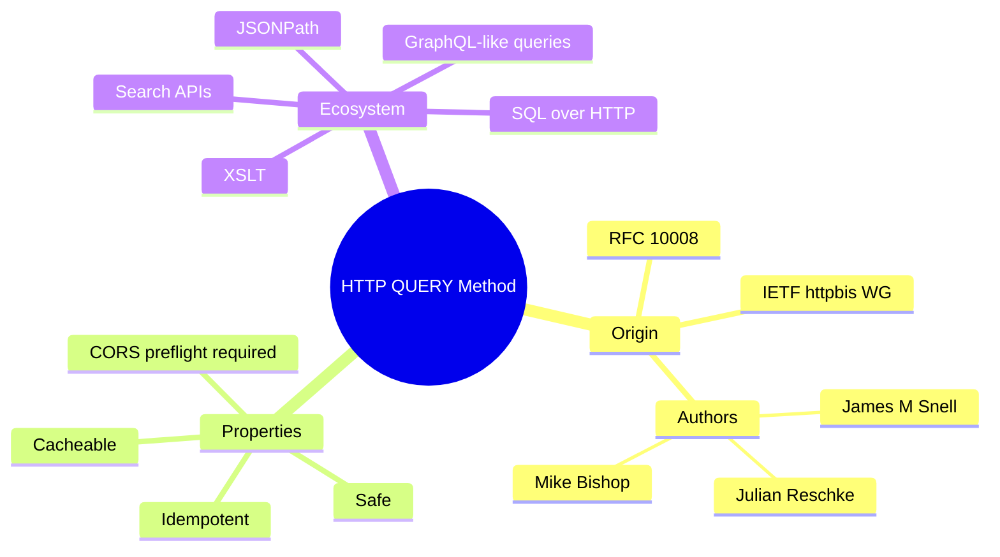
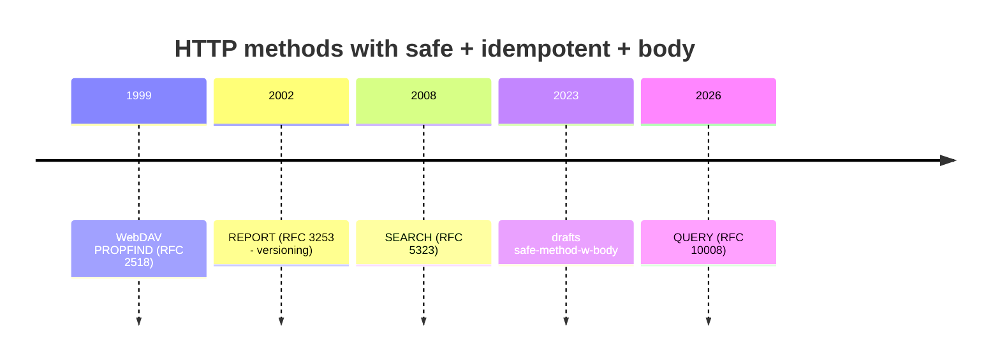
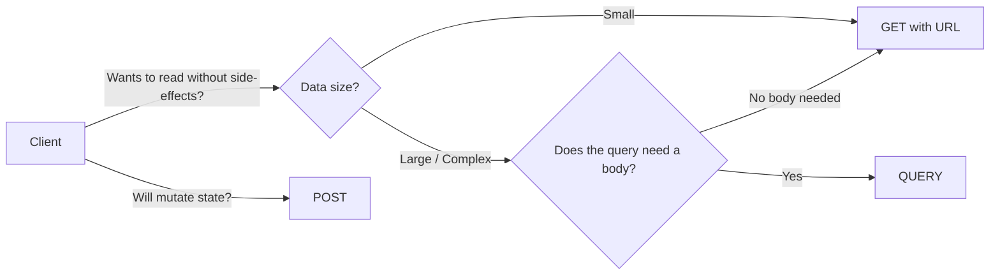
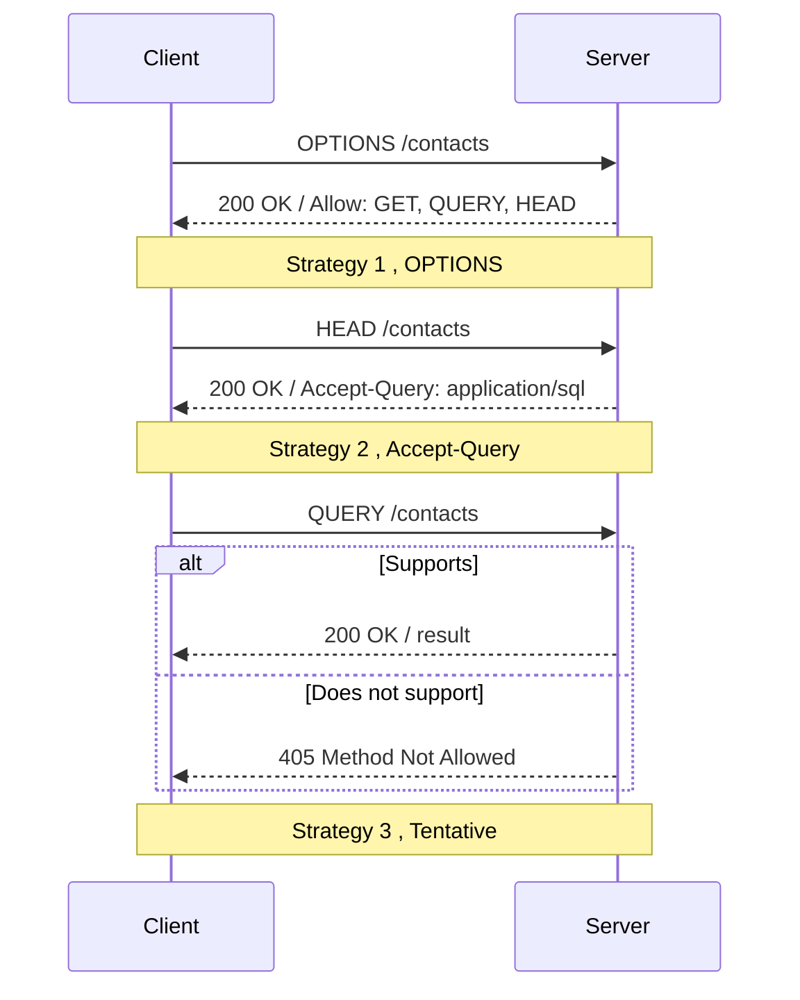
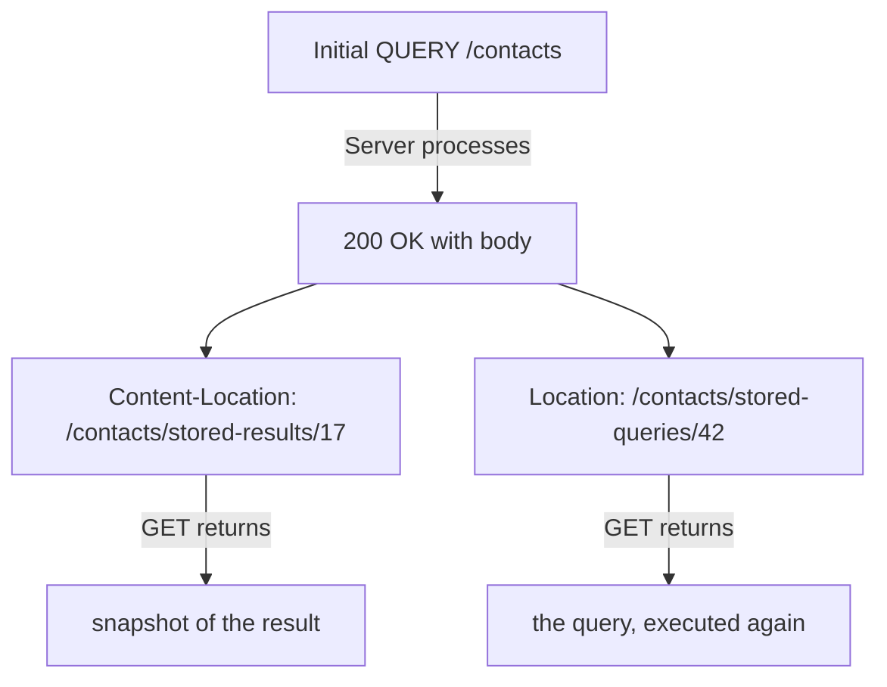
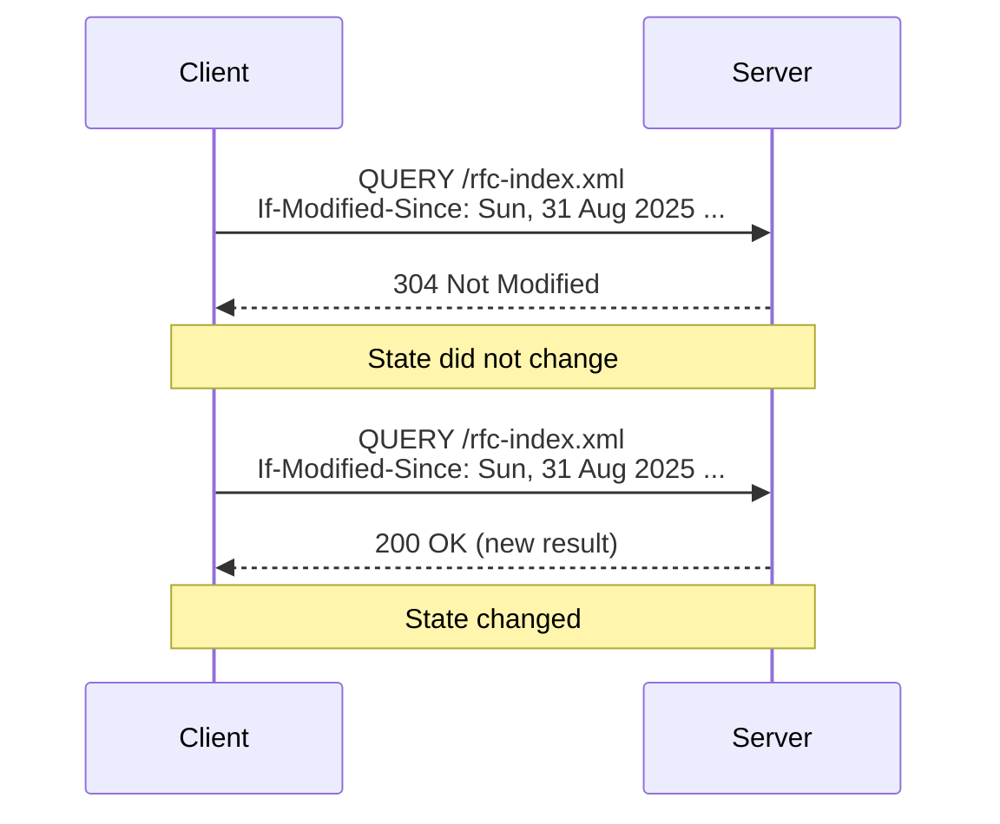
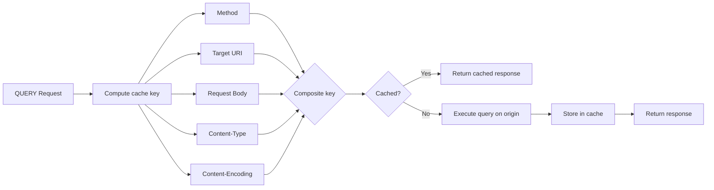
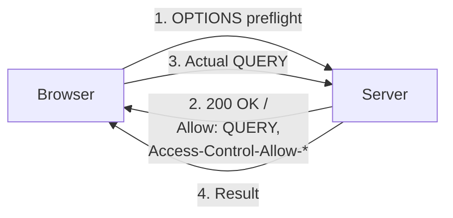
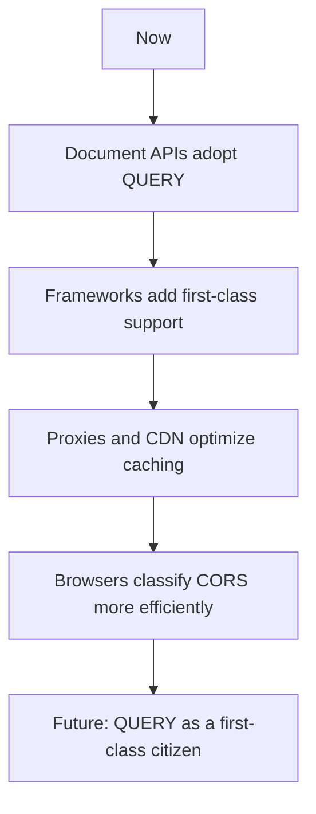

For decades, HTTP offered us a clear dichotomy: `GET` for *safe* and *idempotent* reads, `POST` for everything else (including queries that needed a request body). The problem? When a search filter or query grows too large, neither of them is the perfect fit.

In **June 2026** the IETF published **RFC 10008**, defining a brand new standard method: the **`QUERY`** method ,  a safe and idempotent request that, finally, **allows a body**.

In this article we'll walk through the **past, present and future** of this specification, with diagrams, examples, and a clear comparison between `GET`, `QUERY` and `POST`.

## HTTP in Context: The "Great Method Shortage"

HTTP/1.1, defined in **RFC 9110** (and historically in RFC 7231), has well-known limitations when you want to express a complex query:

- **`GET`** cannot carry a request body with defined semantics. In theory it *can*, but neither proxies nor servers are required to do anything meaningful with it.
- **`POST`** fits any content, but is **not safe** ,  intermediaries won't cache it, retries become dangerous, and browsers ship it behind CORS preflights.

For years, the workaround was *pretend GET is POST*: send your query in the URL of a `GET`, growing the URI until it explodes; or send it as the body of a `POST`, breaking the safety contract. QUERY is the answer to this long-standing itch.



## The Past: A Problem Long Discussed

The need for a "GET with body" is not new. Long before RFC 10008 was published, there was already a family of methods with the *safe and idempotent* profile born out of WebDAV:

- **`PROPFIND`** ([RFC 4918](https://www.rfc-editor.org/info/rfc4918))
- **`REPORT`** ([RFC 3253](https://www.rfc-editor.org/info/rfc3253))
- **`SEARCH`** ([RFC 5323](https://www.rfc-editor.org/info/rfc5323))

All three share the same profile as the future QUERY: *safe*, *idempotent*, and accepting a body. The problem? They all carry a historical "smell" of **WebDAV**, an ecosystem that never reached the mainstream. The team behind RFC 10008 ,  among them Julian Reschke (greenbytes), James M. Snell (Cloudflare) and Mike Bishop (Akamai) ,  tried to modernize this idea by renaming the concept from `SEARCH` (initially used in early drafts) to **`QUERY`**:

> The name "QUERY" captures the relation with the URI's query component well, while detaching the new method from the WebDAV universe.



## RFC 10008: The Present

### What exactly does QUERY do?

> *"The QUERY method is used to initiate a server-side query. Unlike GET, which requests a representation of the resource identified by the target URI, the QUERY method is used to ask the target resource to perform a query operation within the scope of that target resource."*
>
> ,  RFC 10008, Section 2

In a few words: **QUERY is a GET that accepts a body** ,  the body describes *how* the resource should be queried. The server then responds with the result.

```http
QUERY /feed HTTP/1.1
Host: example.org
Content-Type: application/x-www-form-urlencoded
Accept: application/json

q=foo&limit=10&sort=-published
```

### Fundamental Properties

According to the IANA Method Registry, QUERY is registered as:

| Property | Value |
| :--- | :--- |
| **Method Name** | `QUERY` |
| **Safe** | ✅ yes |
| **Idempotent** | ✅ yes |
| **Specification** | Section 2 of RFC 10008 |
| **Cacheable** | ✅ yes |

Being **safe** means the client *does not request or expect any state change* in the target resource. Being **idempotent** means the request can be **retried or repeated** at will ,  including after a connection failure ,  without partial side-effects.

### Mandatory Content-Type

A fundamental and sometimes forgotten rule:

> *"Servers MUST fail the request if the Content-Type request field is missing or is inconsistent with the request content."*
>
> ,  RFC 10008, Section 2

If the `Content-Type` is missing → **400 Bad Request**. If it is supported but inconsistent with the content → **400**. If it's not supported by the resource → **415 Unsupported Media Type**. If the content was parsed but the query is logically impossible → **422 Unprocessable Content**.

## GET vs QUERY vs POST: Side by Side

This is the central table of RFC 10008. Memorize it:

| | **GET** | **QUERY** | **POST** |
| :--- | :--- | :--- | :--- |
| **Safe** | yes | yes | potentially **no** |
| **Idempotent** | yes | yes | potentially **no** |
| **URI for query itself** | yes (by definition) | optional ,  via `Location` | no |
| **URI for the result** | optional ,  via `Content-Location` | optional ,  via `Content-Location` | optional |
| **Cacheable** | yes | yes | yes, but **only** for future GET/HEAD |
| **Content (body)** | *"no defined semantics"* | **expected** (semantics per resource) | expected |



## Discovering QUERY Support

The spec offers **three** forms of discovery, from least to most invasive:

### 1. `OPTIONS`

```http
OPTIONS /contacts HTTP/1.1
Host: example.org
```

```http
HTTP/1.1 200 OK
Allow: GET, QUERY, OPTIONS, HEAD
```

### 2. `Accept-Query` response header

```http
HEAD /contacts HTTP/1.1
Host: example.org
```

```http
HTTP/1.1 200 OK
Content-Type: text/html
Accept-Query: "application/x-www-form-urlencoded", application/sql;charset="UTF-8"
```

### 3. Tentative QUERY

Just send a `QUERY` and see what happens. If the server doesn't support it, the response will be a **`405 Method Not Allowed`** with `Allow`.



## Detailed Example: Query on a Contact List

Reproducing Example A.1 of the RFC, slightly annotated:

### Request

```http
QUERY /contacts HTTP/1.1
Host: example.org
Content-Type: application/x-www-form-urlencoded
Accept: application/json

select=surname,givenname,email&limit=10&match=%22email=*@example.*%22
```

### Response

```http
HTTP/1.1 200 OK
Content-Type: application/json

[
  { "surname": "Smith",   "givenname": "John",    "email": "smith@example.org" },
  { "surname": "Jones",   "givenname": "Sally",   "email": "sally.jones@example.com" },
  { "surname": "Dubois",  "givenname": "Camille", "email": "camille.dubois@example.net" }
]
```

Notice: the server **did not change state** ,  it only returned a result. Because the method is safe and idempotent, this response is **fully cacheable**.

## Content-Location and Location: Two Different Promises

The spec gives the server two complementary tools to "promote" a QUERY response to a future GET:

- **`Content-Location`**: A URI that returns the **current result** of the query (a snapshot).
- **`Location`**: A URI that returns a **future result** if the same query is executed again (refreshed state).



This allows a beautiful pattern: the first request is sent via `QUERY`, and from then on, the client (or the cache) can use `GET` ,  which is much cheaper to handle.

## Conditional Requests: Save Bandwidth

Because QUERY inherits the **selected representation** semantics of GET, conditional headers work normally:

- `If-Modified-Since`
- `If-None-Match` (with ETag)
- `If-Match`
- `If-Unmodified-Since`

If the data hasn't changed since the last request, the server can respond with **`304 Not Modified`**, sending no body. Bandwidth saved.



## Redirection: 301, 302, 307, 308 and 303

The spec explicitly removes the historical exception of converting `POST → GET` after a 301/302. For QUERY:

- **`301` / `308`**: The resource has moved permanently. Retain the method.
- **`302` / `307`**: The resource has moved temporarily. Retain the method.
- **`303` (See Other)**: The server suggests moving on to a `GET` on the URI in `Location`.

```http
HTTP/1.1 303 See Other
Content-Type: text/plain
Location: /contacts/stored-queries/42

See stored query at "/contacts/stored-queries/42".
```

This is the perfect path from a *"first-time QUERY"* to a *"subsequent GET"*.

## Caching: The Harder Part

Caching is the most delicate section of the RFC. The rule is uncompromising:

> *"The cache key for a QUERY request MUST incorporate the request content and related metadata."*
>
> ,  RFC 10008, Section 2.7

In practice, this means the cache **must read the entire body** to compute the key. A simple `"URI → response"` table is not enough. To alleviate this, caches MAY normalize semantically insignificant differences (encoding, whitespace, etc.). With the directive **`no-transform`**, the client can refuse these normalizations.

The good news: if the server returns a `Location`, the client can **migrate to GET** from the second request onward ,  and that *is* trivial to cache.



> ⚠️ *"Note that caching QUERY method responses is inherently more complex than caching responses to GET."* ,  RFC 10008, Section 2.7

## Range Requests: A Footnote

HTTP range requests make little sense for QUERY. Section 2.8 makes this clear: query formats (SQL, JSONPath, GraphQL) already have their own pagination mechanisms. Using HTTP `Range` headers with QUERY is legal but *"offers little value"*.

## Security Considerations

The spec is direct:

- Because the body is **less likely to be logged** than the URI, **QUERY can be a leak defense** for sensitive queries.
- If the server creates a temporary URI for the equivalent resource (`Location`), this URI MUST NOT contain the sensitive content of the query ,  otherwise the secret ends up in access logs all over again.
- **CORS**: `QUERY` is not in the CORS-safelisted methods. Every cross-origin request triggers a **preflight (`OPTIONS`)**.



## Advantages of QUERY ,  A Quick List

1. **Safety preserved**: an explicit safe + idempotent contract that GET never managed to give with a body.
2. **Automatic retries**: no risk of partial state changes ,  perfect for unstable networks (mobile, IoT).
3. **Cache friendly**: intermediaries can cache results, alleviating the origin server.
4. **Clear semantics for proxies and middlewares**: firewalls, API gateways and CDN finally have a method that "is not POST, but has a body".
5. **Decoupled body formats**: the URI does not need to encode JSON, SQL, JSONPath, XSLT, Form URIs, etc. ,  you send them in the body, the way they should be.
6. **Less noise in logs**: URIs tend to be logged everywhere. Sensitive filters go in the body.
7. **Optimization path to GET**: the server can return a stable `Location` and the client switches to GET on subsequent calls.

## Challenges and Adoption Barriers

Despite being a **Standards Track** document, QUERY still faces hurdles:

- **Server frameworks** (Express, Spring, FastAPI, etc.) do not natively recognize the method. Many will respond with **405 Method Not Allowed** out of the box.
- **CORS preflight** adds latency for browsers on the first request.
- **Caches** need to be reevaluated; those that only inspect the URI will behave incorrectly.
- **Documentation culture**: teams still default to `POST` for any operation with a body, by reflex.

## The Future: Where is QUERY headed?

It's still early days for RFC 10008, but the trajectory is exciting:

- **API design**: expect to see **"REST Search APIs"** standardized around QUERY, replacing the current *"POST /search"* pattern.
- **GraphQL over QUERY**: since GraphQL queries are already safe and idempotent, more efficient wire-format transports may emerge that use `QUERY` instead of `POST`.
- **Database-as-a-Service**: services exposing SQL/JSONPath directly via `QUERY`, taking advantage of the cache and conditional semantics.
- **CDNs and Edge Computing**: edge functions can become **safe and cacheable** natively, without going down the dark POST path.
- **OpenAPI 4 / JSON Schema**: expect updates to declare QUERY in API contracts.



## QUERY in One Sentence

> **QUERY is the method that finally gives us, 30 years after HTTP/1.0, a way to ask the server a complex question *without* lying that we are creating a resource.**

## Conclusion

RFC 10008 is small (around 60 pages) but solves a problem that has been *"swept under the rug"* of POST for decades. The elegance of the approach ,  preserving the **safe + idempotent** contract while finally accepting a body ,  is what makes this specification promising.

For me, the immediate practical change will be: **the next time** I need a search endpoint, I will not lazily stuff it into `POST /search`. I will think carefully:

- *Is it a simple filter?* → **`GET`** with URL query string.
- *Is it a complex query with body?* → **`QUERY`**.
- *Does it create a resource?* → **`POST`**.

That's the new mental map.

Have you already designed an API around QUERY, or are you going to wait for framework support? 🚀
