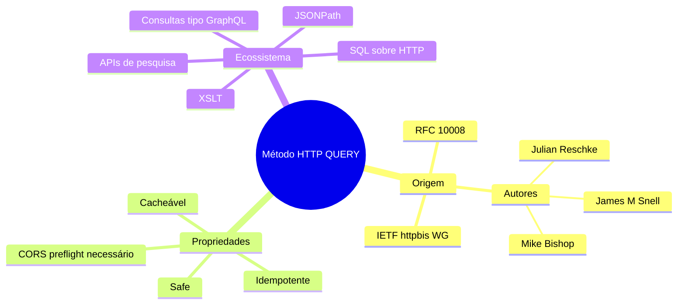
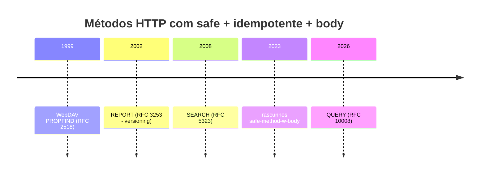
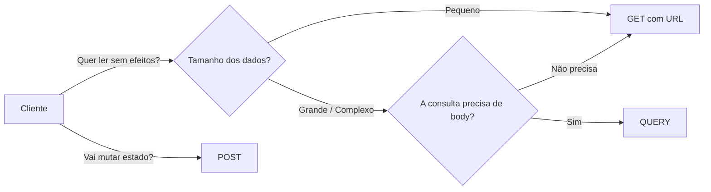
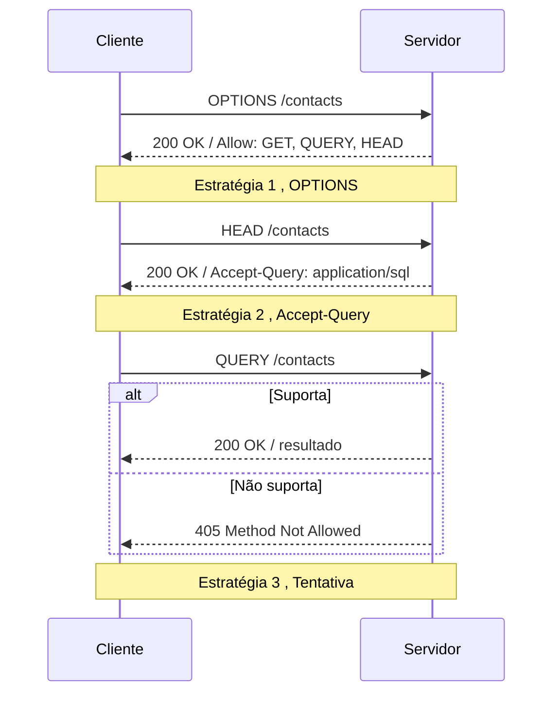
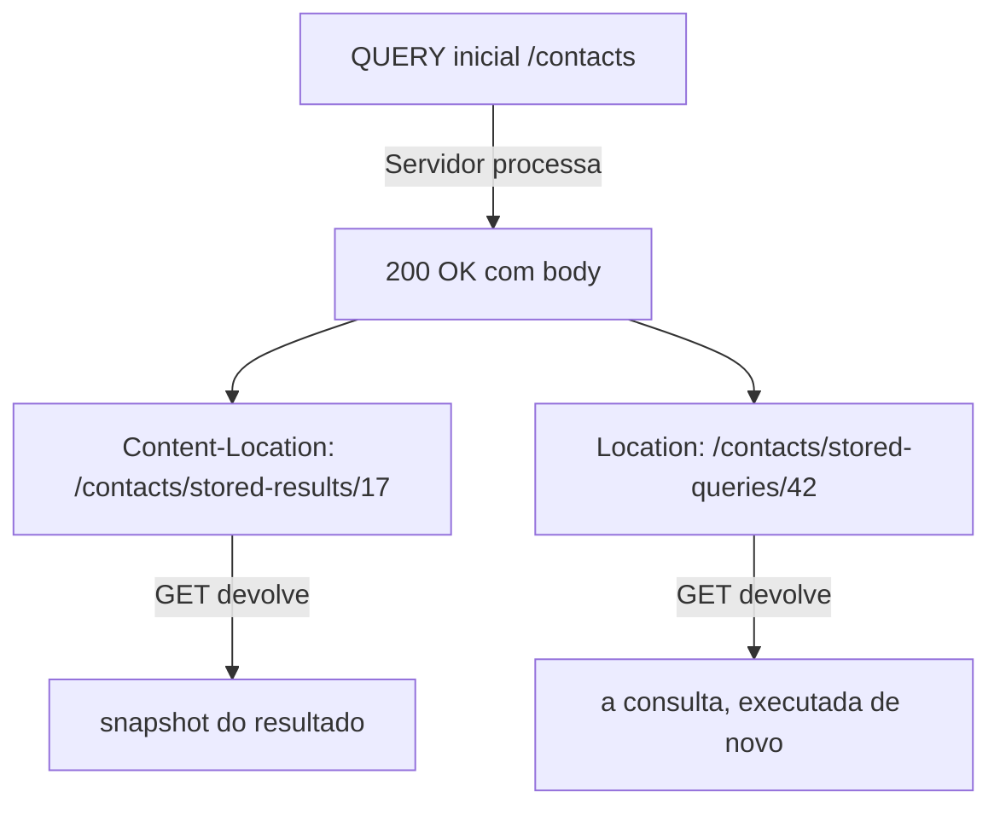
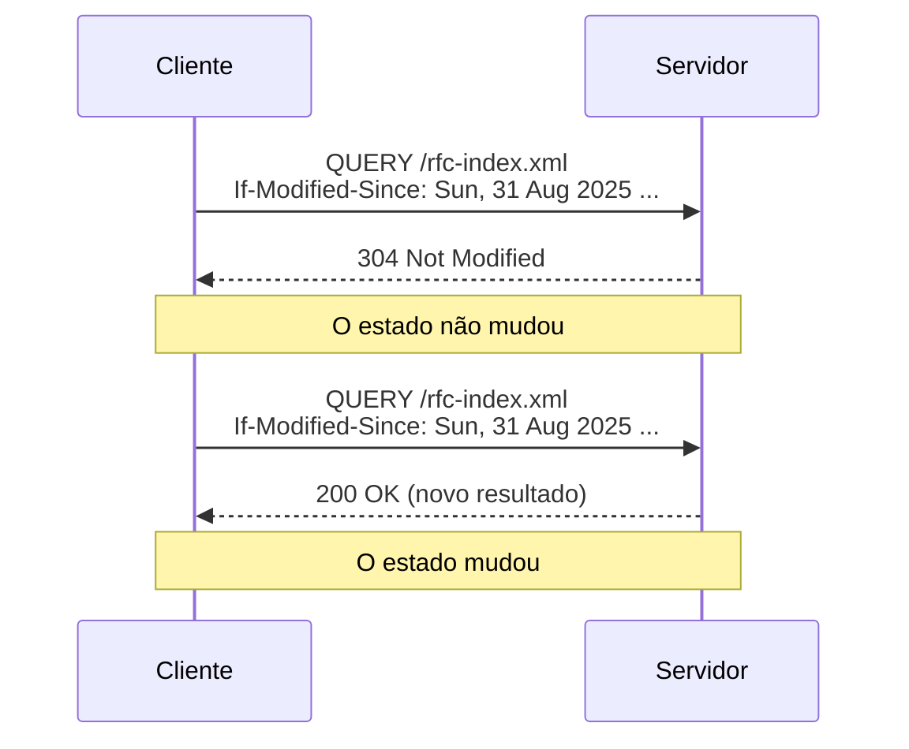
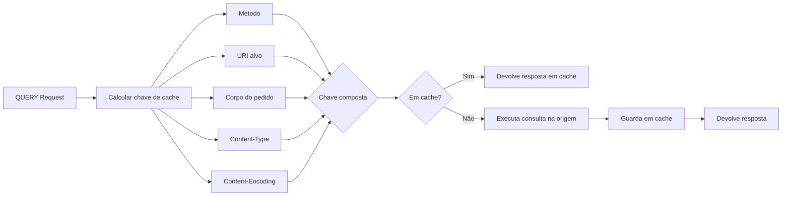
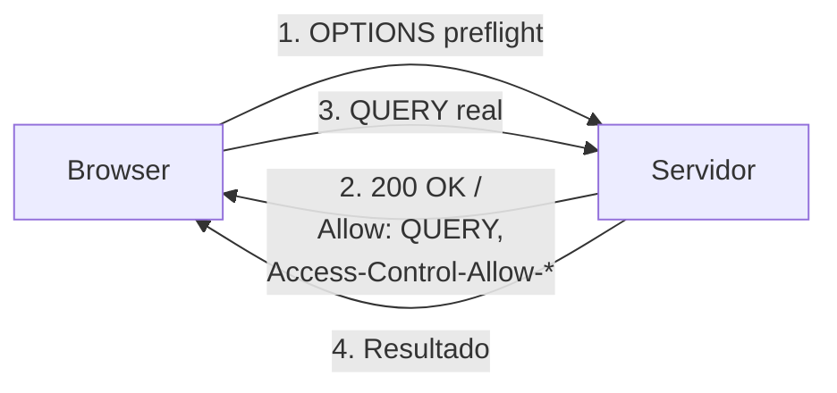
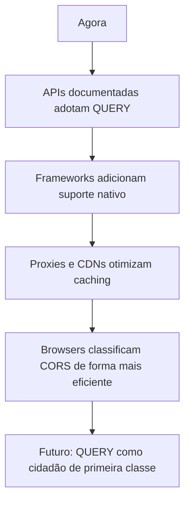

Durante décadas, o HTTP ofereceu-nos uma dicotomia clara: `GET` para leituras *safe* e *idempotentes*, `POST` para tudo o resto (incluindo pesquisas que precisassem de um corpo). O problema? Quando um filtro ou consulta cresce demasiado, nenhum dos dois é o ajuste perfeito.

Em **junho de 2026** a IETF publicou o **RFC 10008**, definindo um novo método padrão: o **`QUERY`** ,  um pedido *safe* e *idempotente* que, finalmente, **permite um corpo**.

Neste artigo vamos percorrer o **passado, presente e futuro** desta especificação, com diagramas, exemplos e uma comparação clara entre `GET`, `QUERY` e `POST`.

## HTTP em Contexto: A "Grande Falta de Métodos"

O HTTP/1.1, definido no **RFC 9110** (e historicamente no RFC 7231), tem limitações bem conhecidas quando se quer expressar uma consulta complexa:

- **`GET`** não pode transportar um corpo com semântica definida. Em teoria *pode*, mas nem proxies nem servidores são obrigados a fazer algo significativo com ele.
- **`POST`** serve para qualquer conteúdo, mas **não é *safe*** ,  intermediários não o vão armazenar em cache, retries tornam-se perigosos, e os navegadores obrigam-no a passar por preflights CORS.

Durante anos, o workaround foi *disfarçar o GET de POST*: enviar a consulta na URL de um `GET`, crescendo a URI até ela explodir; ou enviá-la como corpo de um `POST`, quebrando o contrato de segurança. O QUERY é a resposta para esta comichão antiga.



## O Passado: Um Problema Discutido Há Muito

A necessidade de um "GET com corpo" não é nova. Muito antes do RFC 10008, já existia uma família de métodos com o perfil *safe e idempotente* nascidos do WebDAV:

- **`PROPFIND`** ([RFC 4918](https://www.rfc-editor.org/info/rfc4918))
- **`REPORT`** ([RFC 3253](https://www.rfc-editor.org/info/rfc3253))
- **`SEARCH`** ([RFC 5323](https://www.rfc-editor.org/info/rfc5323))

Os três partilham o mesmo perfil do futuro QUERY: *safe*, *idempotente* e com capacidade de aceitar um corpo. O problema? Carregam todos um "cheiro" histórico de **WebDAV**, um ecossistema que nunca chegou ao mainstream. A equipa por trás do RFC 10008 ,  entre eles Julian Reschke (greenbytes), James M. Snell (Cloudflare) e Mike Bishop (Akamai) ,  tentou modernizar esta ideia renomeando o conceito de `SEARCH` (usado nos primeiros rascunhos) para **`QUERY`**:

> O nome "QUERY" capta bem a relação com o componente *query* da URI, ao mesmo tempo que afasta o novo método do universo WebDAV.



## RFC 10008: O Presente

### O que faz, afinal, o QUERY?

> *"O método QUERY é usado para iniciar uma consulta do lado do servidor. Ao contrário do GET, que pede uma representação do recurso identificado pela URI alvo, o método QUERY é usado para pedir ao recurso alvo que execute uma operação de consulta dentro do âmbito desse recurso."*
>
> ,  RFC 10008, Secção 2

Em poucas palavras: **QUERY é um GET que aceita um corpo** ,  o corpo descreve *como* o recurso deve ser consultado. O servidor responde então com o resultado.

```http
QUERY /feed HTTP/1.1
Host: example.org
Content-Type: application/x-www-form-urlencoded
Accept: application/json

q=foo&limit=10&sort=-published
```

### Propriedades Fundamentais

Segundo o IANA Method Registry, o QUERY está registado como:

| Propriedade | Valor |
| :--- | :--- |
| **Nome do Método** | `QUERY` |
| **Safe** | ✅ sim |
| **Idempotente** | ✅ sim |
| **Especificação** | Secção 2 do RFC 10008 |
| **Cacheável** | ✅ sim |

Ser **safe** significa que o cliente *não pede nem espera qualquer alteração de estado* no recurso alvo. Ser **idempotente** significa que o pedido pode ser **repetido ou retentado** à vontade ,  inclusive após uma falha de conexão ,  sem efeitos parciais.

### Content-Type Obrigatório

Uma regra fundamental e por vezes esquecida:

> *"Os servidores DEVEM rejeitar o pedido se o campo Content-Type estiver em falta ou for inconsistente com o conteúdo do pedido."*
>
> ,  RFC 10008, Secção 2

Se o `Content-Type` faltar → **400 Bad Request**. Se for suportado mas inconsistente com o conteúdo → **400**. Se não for suportado pelo recurso → **415 Unsupported Media Type**. Se o conteúdo foi analisado mas a consulta é logicamente impossível → **422 Unprocessable Content**.

## GET vs QUERY vs POST: Lado a Lado

Esta é a tabela central do RFC 10008. Memoriza-a:

| | **GET** | **QUERY** | **POST** |
| :--- | :--- | :--- | :--- |
| **Safe** | sim | sim | potencialmente **não** |
| **Idempotente** | sim | sim | potencialmente **não** |
| **URI para a própria consulta** | sim (por definição) | opcional ,  via `Location` | não |
| **URI para o resultado** | opcional ,  via `Content-Location` | opcional ,  via `Content-Location` | opcional |
| **Cacheável** | sim | sim | sim, mas **apenas** para GET/HEAD futuros |
| **Conteúdo (body)** | *"sem semântica definida"* | **esperado** (semântica pelo recurso) | esperado |



## Descobrir o Suporte a QUERY

A especificação oferece **três** formas de descoberta, da menos à mais invasiva:

### 1. `OPTIONS`

```http
OPTIONS /contacts HTTP/1.1
Host: example.org
```

```http
HTTP/1.1 200 OK
Allow: GET, QUERY, OPTIONS, HEAD
```

### 2. Header de resposta `Accept-Query`

```http
HEAD /contacts HTTP/1.1
Host: example.org
```

```http
HTTP/1.1 200 OK
Content-Type: text/html
Accept-Query: "application/x-www-form-urlencoded", application/sql;charset="UTF-8"
```

### 3. Tentativa direta de QUERY

Basta enviar um `QUERY` e ver o que acontece. Se o servidor não suportar, a resposta será um **`405 Method Not Allowed`** com `Allow`.



## Exemplo Detalhado: Consulta a uma Lista de Contactos

Reproduzindo o exemplo A.1 do RFC, ligeiramente anotado:

### Pedido

```http
QUERY /contacts HTTP/1.1
Host: example.org
Content-Type: application/x-www-form-urlencoded
Accept: application/json

select=surname,givenname,email&limit=10&match=%22email=*@example.*%22
```

### Resposta

```http
HTTP/1.1 200 OK
Content-Type: application/json

[
  { "surname": "Smith",   "givenname": "John",    "email": "smith@example.org" },
  { "surname": "Jones",   "givenname": "Sally",   "email": "sally.jones@example.com" },
  { "surname": "Dubois",  "givenname": "Camille", "email": "camille.dubois@example.net" }
]
```

Nota: o servidor **não alterou estado** ,  apenas devolveu um resultado. Como o método é *safe* e *idempotente*, esta resposta é **totalmente cacheável**.

## Content-Location e Location: Duas Promessas Diferentes

A especificação dá ao servidor duas ferramentas complementares para "promover" uma resposta QUERY a um GET futuro:

- **`Content-Location`**: URI que devolve o **resultado atual** da consulta (um snapshot).
- **`Location`**: URI que devolve um **resultado futuro** se a mesma consulta for executada novamente (estado atualizado).



Isto permite um padrão elegante: o primeiro pedido é um QUERY e, a partir daí, o cliente (ou a cache) pode usar GET ,  que é muito mais barato de processar.

## Pedidos Condicionais: Poupa Largura de Banda

Como o QUERY herda a semântica de **selected representation** do GET, os headers condicionais funcionam normalmente:

- `If-Modified-Since`
- `If-None-Match` (com ETag)
- `If-Match`
- `If-Unmodified-Since`

Se os dados não mudaram desde o último pedido, o servidor pode responder com **`304 Not Modified`**, sem enviar corpo. Largura de banda poupada.



## Redirecionamentos: 301, 302, 307, 308 e 303

A especificação remove explicitamente a exceção histórica de converter `POST → GET` após um 301/302. Para o QUERY:

- **`301` / `308`**: O recurso mudou-se permanentemente. Mantém o método.
- **`302` / `307`**: O recurso mudou-se temporariamente. Mantém o método.
- **`303` (See Other)**: O servidor sugere passar a um `GET` na URI indicada em `Location`.

```http
HTTP/1.1 303 See Other
Content-Type: text/plain
Location: /contacts/stored-queries/42

See stored query at "/contacts/stored-queries/42".
```

Este é o caminho perfeito de um *"primeiro QUERY"* para um *"GET subsequente"*.

## Caching: A Parte Mais Delicada

O caching é a secção mais sensível do RFC. A regra é clara:

> *"A chave de cache para um pedido QUERY DEVE incorporar o conteúdo do pedido e os metadados relacionados."*
>
> ,  RFC 10008, Secção 2.7

Na prática, isto significa que a cache **tem de ler o body inteiro** para calcular a chave. Uma simples tabela `"URI → resposta"` não chega. Para mitigar, as caches PODEM normalizar diferenças semanticamente insignificantes (encoding, espaços em branco, etc.). Com a diretiva **`no-transform`**, o cliente pode recusar essas normalizações.

A boa notícia: se o servidor devolver um `Location`, o cliente pode **migrar para GET** a partir do segundo pedido ,  e isso *é* trivial de fazer cache.



> ⚠️ *"Note que o caching de respostas QUERY é inerentemente mais complexo do que o caching de respostas a GET."* ,  RFC 10008, Secção 2.7

## Pedidos de Range: Um Apêndice

Os pedidos de range HTTP fazem pouco sentido para o QUERY. A Secção 2.8 torna isto claro: os formatos de consulta (SQL, JSONPath, GraphQL) já têm os seus próprios mecanismos de paginação. Usar headers HTTP `Range` com QUERY é legal mas *"oferece pouco valor"*.

## Considerações de Segurança

A especificação é direta:

- Como o body é **menos propenso a ser registado em log** do que a URI, o **QUERY pode ser uma defesa contra fugas** para consultas sensíveis.
- Se o servidor criar uma URI temporária para o recurso equivalente (`Location`), essa URI NÃO DEVE conter o conteúdo sensível da consulta ,  caso contrário, o segredo acaba em logs de acesso outra vez.
- **CORS**: `QUERY` não está nos métodos *safelisted* do CORS. Qualquer pedido cross-origin dispara um **preflight (`OPTIONS`)**.



## Vantagens do QUERY ,  Lista Rápida

1. **Segurança preservada**: contrato *safe + idempotente* explícito que o GET nunca conseguiu dar com body.
2. **Retries automáticos**: sem risco de alterações parciais de estado ,  perfeito para redes instáveis (mobile, IoT).
3. **Cache amigável**: intermediários podem fazer cache dos resultados, aliviando o servidor de origem.
4. **Semântica clara para proxies e middlewares**: firewalls, API gateways e CDNs finalmente têm um método que "não é POST, mas tem body".
5. **Formatos de body desacoplados**: a URI não tem de codificar JSON, SQL, JSONPath, XSLT, Form URIs, etc. ,  envias tudo no body, como deve ser.
6. **Menos ruído nos logs**: URIs tendem a ser logadas em todo o lado. Filtros sensíveis vão no body.
7. **Caminho de otimização para GET**: o servidor pode devolver um `Location` estável e o cliente muda para GET nos pedidos seguintes.

## Desafios e Barreiras à Adoção

Apesar de ser um documento **Standards Track**, o QUERY ainda enfrenta obstáculos:

- **Frameworks de servidor** (Express, Spring, FastAPI, etc.) não reconhecem nativamente o método. Muitos vão responder com **405 Method Not Allowed** por defeito.
- **CORS preflight** adiciona latência para os browsers no primeiro pedido.
- **Caches** precisam de ser reavaliadas; as que apenas olham para a URI vão comportar-se incorretamente.
- **Cultura de documentação**: as equipas ainda recorrem por reflexo ao `POST` para qualquer operação com body.

## O Futuro: Para onde caminha o QUERY?

Ainda é cedo para o RFC 10008, mas a trajetória é entusiasmante:

- **Design de APIs**: espera ver **"REST Search APIs"** padronizadas em torno do QUERY, substituindo o padrão atual de *"POST /search"*.
- **GraphQL sobre QUERY**: como as queries GraphQL já são naturalmente *safe* e *idempotentes*, podem surgir novos transportes wire-format mais eficientes que usem `QUERY` em vez de `POST`.
- **Database-as-a-Service**: serviços que exponham SQL/JSONPath diretamente via `QUERY`, tirando partido da cache e da semântica condicional.
- **CDN e Edge Computing**: funções de edge podem tornar-se **safe e cacheáveis** de forma nativa, sem passar pelo caminho sombrio do POST.
- **OpenAPI 4 / JSON Schema**: esperam-se atualizações para declarar o QUERY em contratos de API.



## QUERY Numa Frase

> **QUERY é o método que finalmente nos dá, 30 anos depois do HTTP/1.0, uma forma de fazer uma pergunta complexa ao servidor *sem* mentir que estamos a criar um recurso.**

## Conclusão

O RFC 10008 é pequeno (cerca de 60 páginas), mas resolve um problema que esteve *"varrido para debaixo do tapete"* do POST durante décadas. A elegância da abordagem ,  preservar o contrato **safe + idempotente** ao mesmo tempo que aceita finalmente um body ,  é o que torna esta especificação tão promissora.

Para mim, a mudança prática imediata será: **da próxima vez** que precisar de um endpoint de pesquisa, não vou preguiçosamente enfiá-lo num `POST /search`. Vou pensar com calma:

- *É um filtro simples?* → **`GET`** com query string na URL.
- *É uma consulta complexa com body?* → **`QUERY`**.
- *Cria um recurso?* → **`POST`**.

Este é o novo mapa mental.

Já desenhaste uma API em torno do QUERY, ou vais esperar pelo suporte dos frameworks? 🚀
