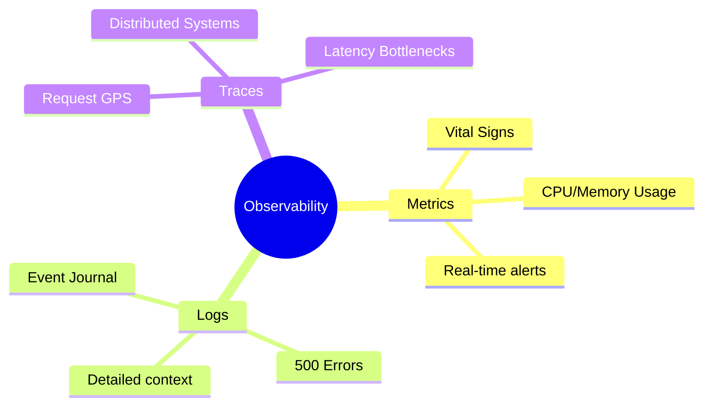
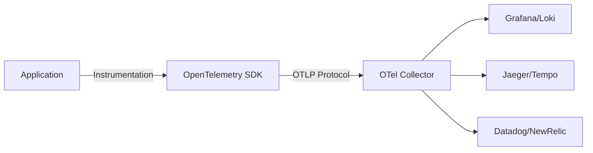

Imagine this scenario: your system for a potentially million-dollar startup is running "apparently" well. Suddenly, users start reporting extreme slowness. Panic sets in. Without clear information, the team tries to fix code "blindly" and tests directly in production. **This is the definition of chaos.**

Welcome to the world of **Observability**. It is like having technological superpowers: understanding what happens inside the system without needing to ask the senior or, worse, the intern.

## The Three Pillars of Observability

Observability relies on a fundamental tripod:

### 1. Metrics: The Vital Signs 📈
Think of them as the system's pulse. They tell if health is good (normal CPU usage) or if we are in the resuscitation room (exploding memory). Combined with alerts, they are your fire alarm.

### 2. Logs: The System Journal 📖
They are the records of events. They tell the story of what happened: what went right, what failed, and where the developer forgot to close that database connection. Just don't confuse them with useless gossip; every log should have a purpose.

### 3. Traces: The Request GPS 📍
In distributed systems, traces are your "prepared Batman". They show the exact path a feature traversed, where the "flat tire" occurred, and how long each step took.

## Why You Need This

Systems that seem stable can be time bombs. With good observability, you can:
- **Anticipate problems:** Resolve failures before the customer complains on WhatsApp.
- **Identify Bottlenecks:** Find out exactly why that page takes 10 seconds to load.
- **Business Insights:** Extract real data for strategic decision-making.

## Monitoring vs. Observability: What's the Difference?

It is common to use these terms interchangeably, but they represent different stages of maturity:

- **Monitoring:** Tells you **that** something is wrong (e.g., "The server is down"). It is reactive and based on known failure patterns.
- **Observability:** Tells you **why** something is wrong (e.g., "The server is down because a specific database query is locking the tables"). It allows you to ask questions you didn't know you needed to ask.

## The 4 Golden Signals

Google's SRE handbook defines four essential metrics to monitor any system:

1. **Latency:** The time it takes to service a request.
2. **Traffic:** A measure of how much demand is being placed on your system (e.g., HTTP requests per second).
3. **Errors:** The rate of requests that fail (explicitly, implicitly, or by policy).
4. **Saturation:** How "full" your service is (e.g., CPU usage or memory consumption).

## The Modern Ecosystem

To implement these pillars, several tools have become industry standards:

| Pillar | Popular Tools |
| :--- | :--- |
| **Metrics** | Prometheus, VictoriaMetrics, InfluxDB |
| **Logs** | ELK Stack (Elasticsearch, Logstash, Kibana), Loki, Splunk |
| **Traces** | Jaeger, Tempo, Honeycomb |
| **Visualization** | Grafana, Kibana |

## OpenTelemetry: The Universal Translator 🌐

Watch out for *vendor lock-in* (getting tied to a specific tool). To avoid this, I recommend **OpenTelemetry (OTel)**.

OTel is an *open-source* standard that offers neutral APIs and SDKs to collect and export data. It is not the "backend" (where you see the graphs), but rather the standardized means of transportation.

## Lessons Learned

At first, many think observability is a "waste of time". But when the system grows, with thousands of requests per second, operating without it is like flying a plane without an instrument panel.

Today, I know that system health is not just about "not having errors". It is about being efficient, resilient, and optimized. With observability, you gain something precious: **peaceful nights of sleep.**

Which observability tool do you use in your current project? 🚀
