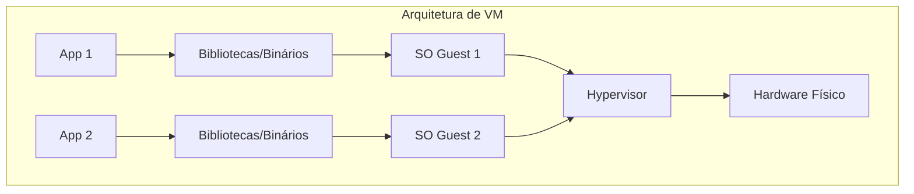
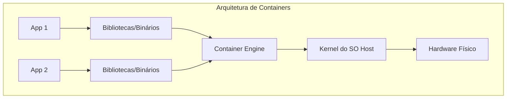

Se ainda achas que containers e máquinas virtuais (VMs) são a mesma coisa, senta-te aqui. Neste artigo, vamos desmistificar esses conceitos de forma simples e direta.

## Máquinas Virtuais (VMs): O Modelo Tradicional

As máquinas virtuais, conhecidas como "guests", operam sobre um "host" (o sistema operativo físico). Elas utilizam um **hypervisor** (como VMware ou VirtualBox) para virtualizar o **hardware**.

### Como funciona?
O hypervisor cria uma camada de abstração que gere o acesso ao CPU, memória e armazenamento. Ele "engana" a VM, fazendo-a acreditar que possui recursos físicos exclusivos.

**A Analogia do Prédio:**
Pensa numa VM como um apartamento num prédio:
- Cada apartamento tem as suas próprias paredes, cozinha e casa de banho.
- É um ambiente totalmente isolado.
- Podes ter um vizinho a correr Windows 95 e outro com Arch Linux; eles nem sabem da existência um do outro.

## Containers: A Revolução da Eficiência

Containers sobem o nível da abstração. Em vez de virtualizarem o hardware, eles virtualizam o **Kernel do Sistema Operativo**.

### O que muda na prática?
Os containers partilham o Kernel do host. Não precisas de replicar um SO completo para cada aplicação. E atenção: Docker ou Kubernetes não são "containers" em si; o Docker é um *engine* (motor) e o Kubernetes é um orquestrador.

**A Analogia do Co-living:**
Containers são como um co-living moderno:
- Cada um tem o seu quarto privado para as suas coisas.
- Todos partilham a cozinha, a água, a luz e a internet (ou seja, o **Kernel**).
- É muito mais leve: ninguém precisa de carregar uma casa inteira nas costas para se mudar.

## O "Segredo" do Linux

Containers são uma tecnologia nativa do **Linux**. Se usas Docker em Windows ou macOS, sabe que existe uma pequena VM Linux a correr nos bastidores. Por isso, a eficiência máxima é atingida em ambientes Linux nativos.

Como partilham o mesmo Kernel, podes ter um container Ubuntu e outro Arch Linux a correr lado a lado. A diferença está apenas nos utilitários e gestores de pacotes (apt vs pacman), mas a "alma" (o Kernel) é a mesma.

## Comparação Rápida

Se precisas de um resumo rápido, aqui está uma comparação entre os dois:

| Característica | Máquinas Virtuais (VMs) | Containers |
| :--- | :--- | :--- |
| **SO** | SO Guest completo (Windows, Linux, etc.) | Partilha o Kernel do SO Host |
| **Isolamento** | Nível de Hardware (Mais forte) | Nível de SO (Isolamento de processos) |
| **Inicialização** | Minutos (Boot completo) | Segundos (Início de processo) |
| **Tamanho** | Gigabytes (GB) | Megabytes (MB) |
| **Eficiência** | Menor (Alto overhead) | Maior (Overhead mínimo) |

## Segurança e Isolamento: O Grande Debate

Uma das principais diferenças entre VMs e containers é a **fronteira de segurança**.

- **VMs:** Oferecem uma camada de isolamento muito forte. Uma vulnerabilidade numa VM é extremamente improvável de afetar outra VM ou o host, pois estão separadas pela virtualização de hardware.
- **Containers:** Utilizam funcionalidades do Linux como **Namespaces** (para visibilidade) e **Cgroups** (para limites de recursos). Embora muito eficazes, partilham o mesmo Kernel. Se um container comprometer o Kernel, pode potencialmente afetar todo o host.

## Portabilidade e a Síndrome do "Funciona na Minha Máquina"

Os containers resolveram o problema clássico da inconsistência de ambientes. Como um container inclui todas as suas dependências (bibliotecas, binários, configuração), ele correrá exatamente da mesma forma no teu portátil, num servidor de testes ou num cluster de produção.

As VMs também são portáteis, mas o seu tamanho elevado torna o processo de movê-las entre ambientes lento e pesado.

## Qual escolher?

A resposta curta: **Depende**.

### Use VMs quando:
- Precisas de **isolamento total** ao nível do hardware.
- Precisas de testar diferentes sistemas operativos ou versões específicas de Kernel.
- Queres snapshots completos do estado de todo o sistema.

### Use Containers quando:
- A prioridade é **agilidade e escalabilidade**.
- Queres ambientes idênticos entre desenvolvimento e produção.
- Precisas de alta densidade de aplicações com baixo consumo de recursos.

## Conclusão

Às vezes parece que vivemos numa simulação (alô, Matrix!), e no fundo, ambas as tecnologias tentam simular algo. Seja simulando o hardware (VMs) ou o Kernel (Containers), cada uma tem o seu lugar no ecossistema de TI.

Qual é a tua escolha favorita para o dia a dia? 🚀
